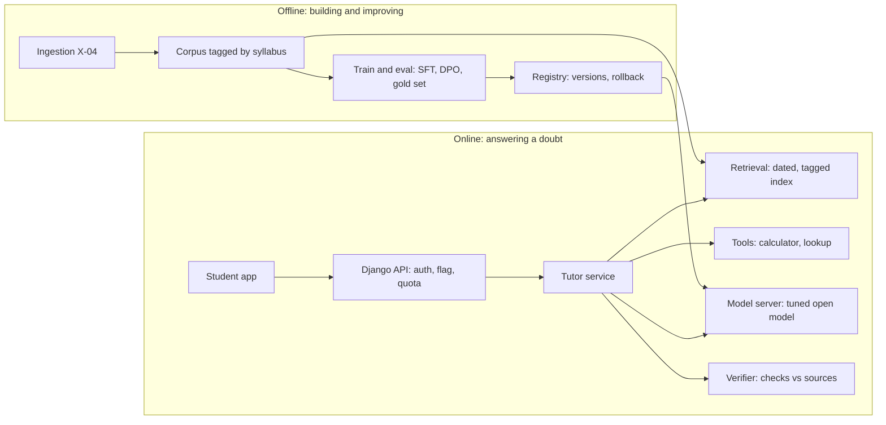
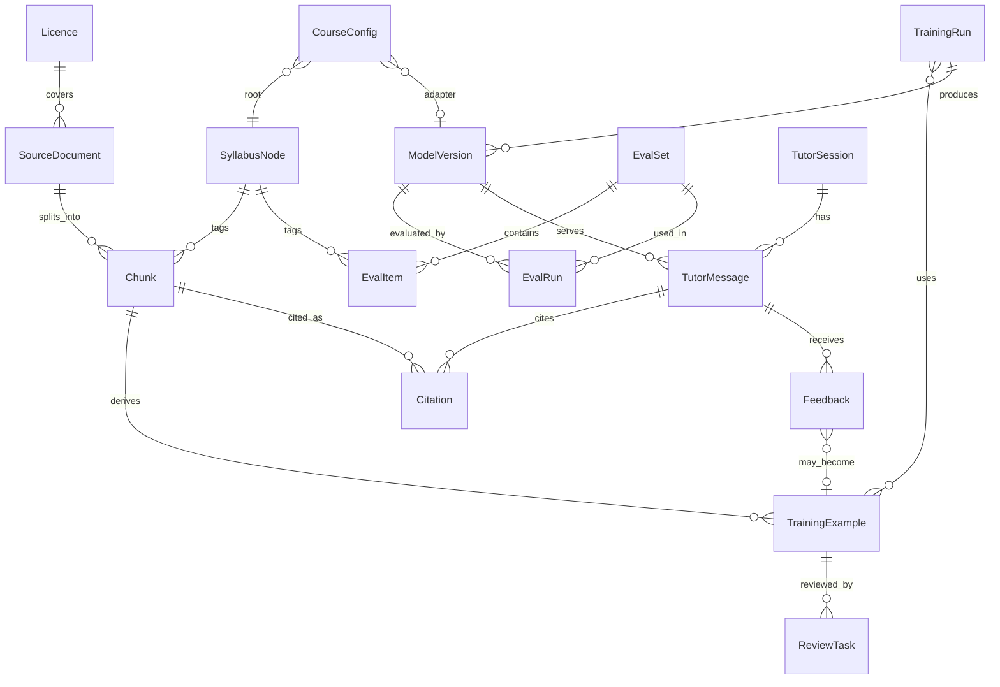

# ArthaAI Tutor Model: feasibility, PRD and ERD

Status: draft for review. Standalone planning document. It is not a feature in `product/FEATURE_MAP.md` and has no F-xx ID yet.
Date: 2026-10-15. Cost and time figures are planning estimates and must be re-quoted before budgeting. Licence and copyright points are not legal advice.

> **Relationship to F-17 (added 2026-10-15).** The product design for the tutor is F-17 and its children (`docs/F-17-ARCHITECTURE.md`). That design calls models only through the provider-neutral gateway in `integrations/llm` (ADR-12), which has an OpenAI-compatible adapter slot. A self-hosted fine-tuned model from this document plugs in there as one more model profile, chosen per function in the admin console, and is judged by the same evaluation gates as Gemini. Nothing in F-17 depends on this document being built.

## 1. The short answer

A commerce-specialised tutor on free open-source models is feasible. Pre-training an LLM from scratch is not the right start: it costs crores, needs trillions of tokens, and gives a weaker tutor than a fine-tuned open model. The best result per rupee is three layers: an open base model fine-tuned on curated CA/CS/CMA/Class 11-12 data, retrieval over the actual study material, and a verifier that checks each answer before the student sees it.

- "Your own model" realistically means your own fine-tuned weights (LoRA adapters or a full fine-tune) on an open base, hosted by you. You own the weights, data and behaviour.
- Base models already know accounting, tax and law basics. What they lack is Indian exam specifics (ICAI/ICSI/ICMAI formats, amendments, marking style, Ind AS, GST, Companies Act sections) and tutor behaviour. Fine-tuning and retrieval fix exactly that.
- Accuracy is mostly a data and retrieval problem. Rates, sections and amendments change every year; weights go stale, a retrieval index can be updated in an hour.
- Recommended path: Easy first (API model + retrieval, weeks), then Medium (open model, fine-tuned, self-hosted, 4 to 6 months). Keep Hard (continued pre-training) as an optional later bet only if Medium plateaus.

## 2. Feasibility check

Verdict: a fine-tuned, retrieval-grounded tutor is feasible for a small team and modest budget; pre-training from scratch is not.

| Question | Finding | Verdict |
| --- | --- | --- |
| Open-source models usable free? | Yes. Several families (Llama, Qwen, Gemma, Mistral, DeepSeek, plus Indic-focused releases such as Sarvam and AI4Bharat) ship open weights. Licences differ on commercial use, user caps and attribution; read each before choosing. | Feasible |
| Pre-train from scratch? | Needs trillions of tokens and thousands of GPU-days. English commerce text is a few billion tokens at most. A scratch model would be far weaker than any current open base. | Not recommended |
| Fine-tune an open model? | Yes. LoRA/QLoRA on a 7B to 32B model fits on 1 to 8 rented GPUs; a run takes hours to a few days. | Feasible |
| Enough data? | Public syllabi, past papers, RTPs, MTPs, institute study material, NCERT and board books exist, but most are copyrighted. You need licences or permission, or your own authored content. | Feasible with legal work |
| Tutor-grade quality? | Explanations: yes. Numericals (Ind AS, tax computation, cost sheets) need a calculator or code tool plus a verifier. Law sections and rates need retrieval of current text. | Feasible with RAG and tools |
| Hosting | Self-host a quantised 7B to 14B model on one 24 to 80 GB GPU with vLLM, or serverless GPU. Gemini stays as fallback. | Feasible |
| Team | Minimum: 1 ML engineer, 1 backend engineer, 2 to 3 subject experts (CA/CS/CMA qualified). | Needs hiring or contracting |

The real bottleneck is expert-verified data and an evaluation set, not GPUs. A model trained on unverified material will confidently teach wrong sections and amendments.

## 3. Easy, medium and hard ways

| | Easy | Medium (recommended) | Hard |
| --- | --- | --- | --- |
| Idea | Hosted LLM API (Gemini, already integrated) plus RAG, system prompts, tools | Open base model, LoRA/SFT on curated data, preference tuning, RAG, verifier, self-hosted | Continued pre-training on a large commerce corpus, then full SFT and RL |
| Time to first usable tutor | 3 to 6 weeks | 4 to 6 months | 12 to 18 months |
| Team | 1 to 2 engineers, 1 expert | 1 ML engineer, 1 backend, 2 to 3 experts | 3 to 5 ML engineers, 5+ experts, data team |
| Compute and API spend | Pay per token | About 2 to 10 lakh for experiments and training, then 30k to 2 lakh per month hosting | 50 lakh to several crore |
| You own | Prompts, index, evals | Weights, adapters, data, evals, serving | Everything including the base |
| Quality ceiling | High with good retrieval; limited style control | High on exam format and Indian context; numerics need tools | Marginally higher domain recall; diminishing returns |
| Main risks | Vendor cost and policy, no weights | Data quality, licence compliance, ops | Cost, data volume, time, talent |

Work-arounds that give most of the benefit cheaply:

- Distil from a strong model, then verify: draft explanations and questions from licensed material, have experts approve, fine-tune the small model on the approved set.
- Route by difficulty: the small tuned model answers routine questions; hard or low-confidence ones escalate to a larger model.
- One LoRA adapter per level on a shared base. A new course adds an adapter, not a retrain.
- Build the retrieval index before training. Many "model problems" are missing-context problems.

## 4. Recommended architecture

The Django API stays the only caller of the model and enforces auth, the feature flag and quota. The tutor service retrieves dated, syllabus-tagged sources, asks the tuned model (with calculation and lookup tools) to draft, and the verifier checks the draft against the sources before the student sees it. Student reports and expert corrections flow back into the corpus and training data.

## 5. Data strategy and legal position

Data quality decides the outcome, and most of the best commerce material is copyrighted, so the corpus must come from sources you have a right to train on. Have a lawyer who knows Indian copyright and DPDP law review this before any training run.

| Source | Examples | Training use | Notes |
| --- | --- | --- | --- |
| Authored by you | Own notes, explanations, question banks, expert solutions | Yes, you own it | Highest value. Pay experts under work-for-hire terms that assign rights. |
| Licensed | Publisher books, coaching content, question banks | Only with a written licence allowing AI training | Ask explicitly for "model training and derivative outputs". |
| Official institute material | ICAI, ICSI, ICMAI study material, RTPs, MTPs, past papers, amendments, standards | Check each institute's terms; retrieval with citation is lower risk than training | Seek written permission or a partnership. Publicly downloadable does not mean free to train on. |
| Statutes and rules | Companies Act, Income-tax Act, GST laws, Ind AS text, notifications | Generally usable; verify each source's terms | Version and date every document. |
| NCERT and state boards | Class 11-12 Accountancy, Business Studies, Economics | Check licence; free to read is not necessarily free to retrain on | Retrieval with attribution first. |
| Open datasets | Openly licensed text, Indic corpora | Per licence | Useful for language and reasoning, small for commerce. |
| Synthetic | Model-generated explanations, questions, solutions from licensed or own material | Yes, if the source is clean and experts verify | Never train on unverified synthetic output. |
| Student data | Chats, answers, mistakes | Only with consent, anonymised, DPDP compliant | Biggest long-term moat; needs consent flows. |

Data pipeline:

1. Ingest files with source, licence, date and exam level recorded (feeds the ERD below and the planned X-04 Ingestion Service).
2. Extract text, tables, formulae and layout. Scanned PDFs need OCR; accounting tables and journal entries need structure-aware parsing.
3. Clean and de-duplicate; strip headers and footers; normalise section numbers and units.
4. Tag by course, level, paper, chapter, topic, difficulty, effective date and amendment year, using the F-02 syllabus structure.
5. Split into retrieval chunks and training examples; keep a locked evaluation set the model never trains on.
6. Review a sampled share with subject experts; track error rate per source.

Medium-path targets: 20 to 60 thousand expert-verified instruction examples, a retrieval index of the full syllabus, and a gold evaluation set of 1,500 to 3,000 questions across levels.

## 6. Training pipeline

Each stage has an exit test on the evaluation set; do not move on until the stage beats the previous one.

1. Choose the base model. Shortlist 2 to 3 open models (7B to 32B) with commercial-friendly licences; run the evaluation set zero-shot; pick on measured accuracy, Indian-language ability, context length and serving cost.
2. Continued pre-training (optional, Hard path). A few hundred million to billions of clean commerce tokens. Skip in Medium unless evaluation shows vocabulary gaps.
3. Supervised fine-tuning (SFT) on instruction-response pairs: explain a concept, solve a numerical with steps, answer in institute style, correct a mistake, ask a Socratic follow-up. Start with LoRA or QLoRA.
4. Preference tuning with expert-ranked good/bad pairs (DPO or similar). This is the practical "reinforcement" step, cheaper and more stable than full RLHF.
5. Reinforcement with verifiable rewards (later) for numericals: reward answers matching a checked result.
6. Tool use: teach the model to call a calculator, code sandbox, section lookup and syllabus lookup instead of guessing.
7. Distil and quantise (4-bit or 8-bit) and re-run evaluation to confirm no quality loss.
8. Register and ship: version model, adapters, data snapshot and eval scores together; deploy behind a flag with canary traffic; keep the previous version for rollback.

Typical tooling: Hugging Face Transformers, PEFT, TRL, Axolotl or Unsloth, DeepSpeed or FSDP; Weights & Biases or MLflow; DVC or object-storage snapshots; Label Studio or Argilla for expert review; vLLM or SGLang with an OpenAI-compatible API so Django calls it like it calls Gemini today; a custom evaluation harness plus LLM-as-judge calibrated against expert grades.

## 7. Hosting, serving and cost

| Option | Setup | Indicative monthly cost | Good for |
| --- | --- | --- | --- |
| Hosted API only (Easy) | Gemini via the Django API (already in place) | Scales with tokens | Validation, first 1,000 users |
| Serverless GPU | Container with vLLM, pay per second | 20k to 1 lakh at modest traffic | Spiky traffic, early Medium |
| Dedicated cloud GPU (AWS, GCP, Azure, E2E Networks, Yotta) | 1x 24 to 80 GB GPU running vLLM, autoscaled | 60k to 3 lakh per GPU | Steady traffic, India data residency |
| Own hardware | Buy GPUs, colocate | Large upfront, lowest unit cost at scale | Only after sustained high volume |

LoRA runs on a 7B to 14B model often cost a few hundred to a few thousand rupees each on rented GPUs; a full experiment cycle usually lands at 2 to 10 lakh.

Serving decisions:

- Django stays the only caller of the model, matching the rule that AI keys and endpoints exist only on the API. The model server sits on a private network with an internal token.
- Vercel serverless cannot host GPUs, so the model server is a separate service. The Render worker in `render.yaml` is the closest precedent.
- Latency target: first token under 1.5 s, full answer under 15 s; stream tokens to the web app.
- Cache retrieval results and frequent answers per syllabus node.
- Log every request with model version, retrieved sources, latency, tokens and feedback (Sentry and PostHog stay as they are).

## 8. PRD: ArthaAI Tutor Model

### Problem

Commerce students in India (CA, CS, CMA, Class 11-12) get generic AI answers that ignore their syllabus, the latest amendments, the institute's answer format and exam marking. Wrong or outdated answers cost marks and trust.

### Users

| User | Need |
| --- | --- |
| Student | Syllabus-aware explanations, worked numericals, doubt solving, exam-style answers, revision help |
| Expert reviewer | Fast tools to verify, correct and rank model outputs |
| Admin / content editor | Ingest sources, tag them, publish updates, add courses |
| ML engineer | Reproducible training, evaluation, model registry, rollback |

### Goals and non-goals

- Goals: answers grounded in sources with citations; numericals solved correctly with visible steps; institute answer style; current with amendments; new courses without retraining everything; cost per answer under a set budget.
- Non-goals (v1): voice tutor, live video, handwritten-answer grading, pre-training a base model, languages beyond English and Hindi.

### Functional requirements

| ID | Requirement | Priority |
| --- | --- | --- |
| AI-01 | Ask a doubt in the context of a course, paper, chapter or topic from the syllabus structure | Must |
| AI-02 | Answers grounded in retrieved sources, with citations (document, chapter, section, effective date) | Must |
| AI-03 | Numerical solving with step-by-step working computed by a calculator or code tool, never from model memory | Must |
| AI-04 | Exam-style answer mode (marks-based structure, sections and case-law references where the course expects them) | Must |
| AI-05 | Refuse or flag low-confidence, out-of-syllabus or unsafe requests and say what could not be verified | Must |
| AI-06 | Thumbs up/down plus "report wrong answer" with correction text on every answer | Must |
| AI-07 | Hint-first Socratic mode before the full solution | Should |
| AI-08 | Generate practice questions and flashcard suggestions for Recall (F-15) from a chapter | Should |
| AI-09 | Explain a mistake from a student's attempt (links to F-06 when built) | Should |
| AI-10 | Course and level selection changes retrieval scope and adapter automatically | Must |
| AI-11 | Per-user daily quota, consent and a fail-closed feature flag (like `notes_ai` and `recall_ai`) | Must |
| AI-12 | Hindi and Hinglish input and output | Could |
| AI-13 | Admin tools: source ingestion, tagging, amendment publishing, expert review queue | Must |
| AI-14 | Model registry, evaluation dashboard, canary rollout and one-click rollback | Must |

### Non-functional requirements

- Accuracy: at least 90% on the gold factual set and 85% on numericals per level before general release (thresholds to be agreed with experts).
- Latency: first token under 1.5 s, p95 full answer under 15 s.
- Privacy: DPDP Act consent for any training use of student data; no student data to third parties without consent; India data residency where possible.
- Safety: no fabricated section numbers or case citations; show "source not found" instead.
- Platform fit: API module `apps/api/modules/tutor` and `integrations/llm`; web module `apps/web/src/modules/tutor`; barrels, four themes and WCAG 2.2 AA per existing rules.

### Success metrics

| Metric | Target (to confirm) |
| --- | --- |
| Expert-rated answer correctness (weekly sample) | 92% or higher |
| Citation present and valid | 98% or higher |
| Helpful rate (thumbs up) | 80% or higher |
| Cost per answer | Set after Easy-phase baseline |
| Day-7 return rate of tutor users | Set from baseline |

### Release plan

Internal alpha with experts, closed beta cohort behind the flag, then general release one course level at a time, starting with the level that has the best data.

## 9. ERD

| Entity | Key fields | Relationships |
| --- | --- | --- |
| Licence | holder, terms, allows_training, allows_retrieval, expires_on, evidence_file | 1 to many SourceDocument |
| SourceDocument | title, kind (book, paper, statute, notes), version, effective_from, superseded_by, checksum, status | belongs to Licence; 1 to many Chunk; tagged to SyllabusNode |
| Chunk | text, tables_json, embedding, tokens, effective_from, language | belongs to SourceDocument; tagged to SyllabusNode; cited by Citation |
| SyllabusNode (F-02, existing) | course, level, paper, chapter, topic | referenced, not copied |
| CourseConfig | course, answer_style, citation_rules, tools_allowed, adapter_id, thresholds | 1 per course; links SyllabusNode root and adapter |
| TrainingExample | kind (explain, solve, exam_answer, hint), prompt, response, origin (expert, synthetic, feedback), split, status | derived from Chunk; reviewed by ReviewTask; used by TrainingRun |
| ReviewTask | reviewer, verdict, correction, time_spent | many per TrainingExample |
| TrainingRun | base_model, method (sft, dpo), data_snapshot_id, hyperparams, cost, started_at | uses TrainingExamples; produces ModelVersion |
| ModelVersion | name, adapter_uri, quantisation, course_scope, status (candidate, canary, live, retired) | from TrainingRun; evaluated by EvalRun; serves TutorMessage |
| EvalSet | course, level, version, locked | 1 to many EvalItem (question, reference answer, topic, effective_date) |
| EvalRun | model_version_id, eval_set_id, score_by_layer, passed, ran_at | gates promotion of ModelVersion |
| TutorSession | user_id, course, mode (explain, hint, exam), started_at | 1 to many TutorMessage |
| TutorMessage | role, content, model_version_id, latency_ms, tokens, confidence, verifier_flags | belongs to TutorSession; has Citations and Feedback |
| Citation | message_id, chunk_id, quote, position | joins TutorMessage and Chunk |
| Feedback | message_id, rating, report_type, correction_text, consent_to_train | may produce a TrainingExample after expert review |

Storage notes: chunks and embeddings fit in Supabase Postgres with pgvector, so Django stays the only writer. Training snapshots and adapter files live in object storage; the database holds URIs and checksums. Student-linked rows (`TutorSession`, `TutorMessage`, `Feedback`) are covered by the account export and delete-all flows, and only rows with `consent_to_train` can enter a snapshot.

## 10. Scaling to new courses and subjects

A new course should cost data work and an evaluation set, not a new model: knowledge lives in data, behaviour lives in weights.

- Knowledge lives in retrieval. Every course, level, paper and chapter is a tagged node in the syllabus tree. Adding a course means ingesting and tagging its sources; the tutor can answer from them the same day.
- Behaviour lives in weights. A shared base plus a general commerce-tutor adapter teaches how to explain, show steps and cite. Add a small per-level adapter (for example CA Final, CS Professional, Class 12 Accountancy) only when evaluation shows the shared adapter is below target.
- Config, not code. A `CourseConfig` record holds answer style, citation rules, exam pattern, allowed tools and the evaluation set.
- Syllabus and amendment changes. Documents carry effective dates and supersede links; retrieval filters by the student's exam attempt date so an old paper does not quote a repealed section.
- Subjects beyond commerce (economics, law, banking, actuarial) reuse the pipeline; only sources, tags, experts and evaluation set change.
- Retrain triggers: a course's evaluation score falls below its threshold, 5,000 or more new verified examples accumulate, or a better base model passes the evaluation set. Each retrain is a registered, comparable run.

## 11. Evaluation, safety and accuracy

No model version ships unless it beats the current one on a locked evaluation set that experts built and the model never saw in training.

| Layer | What is tested | How |
| --- | --- | --- |
| Factual recall | Definitions, sections, rates, standards, case law | Gold Q&A per level, exact or expert-graded |
| Numericals | Journal entries, cost sheets, tax and GST computation, ratios, consolidation | Auto-checked against solved answers; tool-computed results |
| Exam style | Structure, marks allocation, terminology | Expert rubric, sampled weekly |
| Currency | Answers match the latest amendment for the attempt | Time-tagged questions with known amendment dates |
| Grounding | Every claim traceable to a retrieved source | Automatic citation check plus spot audits |
| Safety | Refusals, out-of-syllabus, prompt injection from uploaded notes | Red-team set |
| Regression | New model not worse on any course | Per-course score gates in CI |

Controls that reduce wrong answers: retrieve first and say "source not found" when nothing relevant exists; run arithmetic and tax computation in a sandbox; a verifier pass flags unsupported sentences, section numbers or figures; low-confidence answers escalate to a stronger model or are marked "verify with your study material"; student reports and expert review feed a correction queue whose confirmed fixes become training pairs and retrieval patches; the tutor is a study aid, not professional tax or legal advice.

## 12. Roadmap and decision gates

Phases are planning estimates. A phase that misses its gate repeats. Easy-tutor logs and expert corrections become the first training data for the tune-and-host phase. Hard path (continued pre-training) is considered only if the tuned model plateaus after the last gate.

## 13. Inputs needed from the owner

Decisions
- [ ] Target path: Easy then Medium (recommended), Medium directly, or Hard
- [ ] Launch levels and order
- [ ] Languages: English only, or Hindi and Hinglish from v1
- [ ] Success thresholds: accuracy and cost per answer
- [ ] Monthly budget ceiling for GPUs and APIs, and a one-off training budget

Data and rights
- [ ] Sources owned or licensable (books, notes, question banks, past papers) with counts and formats
- [ ] Written permissions or licences, and whether they allow AI training or only retrieval
- [ ] Whether experts will be paid to author content, and hours per month
- [ ] Student-data policy: consent text, retention, whether chats may be used for training

People
- [ ] ML engineer (own, hire or contract)
- [ ] Subject experts per course to review, rank answers and write the gold set
- [ ] Legal reviewer for copyright and DPDP

Technical
- [ ] Preferred hosting: serverless GPU, an Indian cloud, or own cloud account
- [ ] Expected users at launch and in 12 months, and peak concurrent sessions
- [ ] Whether Gemini remains the fallback model
- [ ] Access to X-04 ingestion plans and the syllabus database for tagging

## 14. Risks and mitigations

| Risk | Impact | Mitigation |
| --- | --- | --- |
| Copyright claims over training data | Takedown, lawsuit, model withdrawal | Licence-first corpus, source register per document, retrieval with attribution where training is not permitted, legal review |
| Hallucinated sections, rates or amendments | Students lose marks and trust | Dated retrieval, verifier pass, "source not found" behaviour, expert audits |
| Wrong numericals | Same | Tool-computed results, verifiable-reward training, numerical gold set |
| Poor data quality | Weak model whatever the GPU | Expert review sampling, per-source error rates, drop bad sources |
| Cost overruns | Burn without revenue | Easy-phase baseline, small/large routing, caching, quotas |
| Base model licence change or obsolescence | Rework | Portable data and evals; re-run fine-tune on a new base |
| Key-person and expert availability | Delays | Contract experts early, document and automate the pipeline |
| Student data misuse | DPDP penalties | Consent, anonymisation, retention limits, opt-out |
| Operational load of self-hosting | Downtime | Start serverless, Gemini fallback, canary and rollback |
| Scope creep to every course at once | Nothing ships well | One level at a time with evaluation gates |
