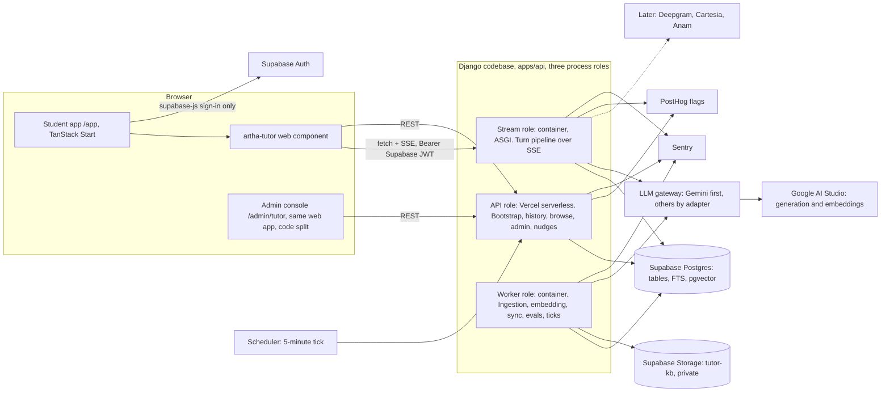
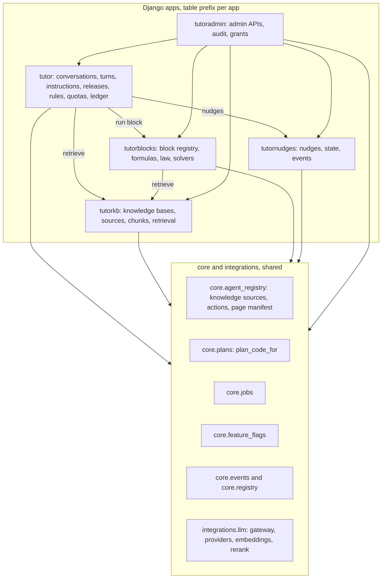
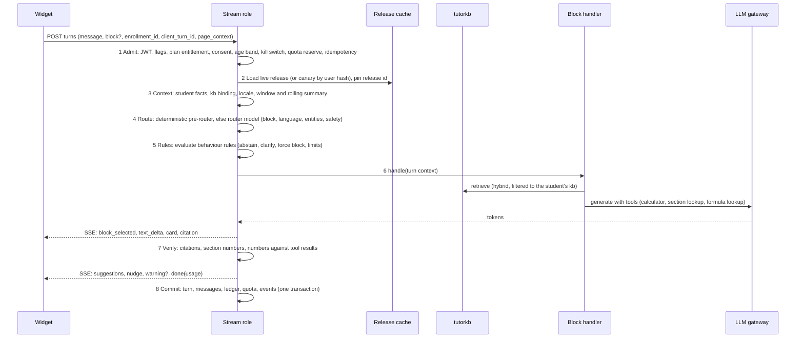
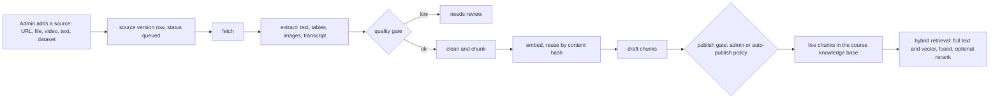
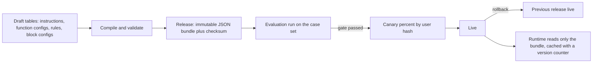

# F-17 AI Tutor: platform architecture

Status: draft for review, written 2026-10-15. Owner: founder. This is the technical spine of the AI Tutor family. The product documents hang off it and must not contradict it; if they do, this file wins until the PRD is changed on purpose.

| Document | What it owns |
| --- | --- |
| `docs/product/prd/F-17-ai-tutor-and-context-agent.md` and its ERD | Umbrella: vision, plans, wave map, and the later releases that stay there (navigation, actions, memory, voice, avatar) |
| `docs/product/prd/F-17.1-agent-platform.md` and ERD | Chat runtime, turn pipeline, instructions, releases, model profiles, behaviour rules, safety, quotas, evaluation |
| `docs/product/prd/F-17.2-knowledge-bases-and-ingestion.md` and ERD | The four global knowledge bases, sources, ingestion, retrieval, citations, rights |
| `docs/product/prd/F-17.3-study-blocks.md` and ERD | Ask AI, Formula, Law Sections, Numerical Questions, and the Block SDK |
| `docs/product/prd/F-17.4-admin-console.md` and ERD | Admin APIs, the admin dashboard, roles, audit, releases from the admin's side |
| `docs/product/prd/F-17.5-widget-nudges-localisation.md` and ERD | The `<artha-tutor>` web component, nudges beside the chat, English, Hindi and Hinglish |
| `docs/F-17-BUILD-WAVES.md` | Build order, exit checks and, for every wave, exactly what you do (accounts, commands, settings) |

## 1. What we are building

One chat agent, used by every student on the Pro or Pro Max plan, **global rather than tenant scoped**. It answers from four centralised knowledge bases (Class 11 and 12, CS, CMA, CA). A student only ever reaches the knowledge base of the course she chose. The agent is a tutor with four specialised blocks (Ask AI, Formula, Law Sections, Numerical Questions) that each have their own backend logic, plus an extensible block framework. You, as admin, control everything behind it from an admin dashboard: knowledge, instructions, tone, models, budgets, behaviour rules, nudges and localisation. The chat itself is an independent application packaged as a web component that lives inside the student app.

## 2. Principles

1. **Global, not multi-tenant.** No schema per tenant. One corpus per course, one set of rules, per-student scoping only for private data (conversations, memory, notes read through ports).
2. **The knowledge base decides what the tutor may say.** Retrieval first, abstention when nothing is found, citations on every sourced claim. Numbers come from a calculator, section numbers from a statute table, formulas from a curated store. The language model explains; it does not remember facts or do arithmetic.
3. **Specialised blocks, one runtime.** Every block is a plug-in with its own pipeline, schema, limits and evaluation pack. Adding a block never touches the runtime.
4. **Config is data, and data is released.** Instructions, model choices, behaviour rules and block settings are edited as drafts and shipped as immutable releases with validation, canary and one-click rollback. Every turn records the release it ran on.
5. **Independent but inside.** The widget talks to the API only. The backend apps import only `core` and `integrations`. Both can be lifted out into their own deployments without rewriting.
6. **Fail closed on cost and safety, fail open on reading.** Quotas, budgets, consent and kill switches fail closed. Browsing formulas and sections (no AI) keeps working when AI is off.
7. **Stateless instances, state in Postgres.** Streaming instances hold a connection but no state. Anything that must survive a restart is a row.
8. **Measure before scaling.** Capacity numbers below are assumptions with a measurement wave (W11); no infrastructure is bought before the numbers exist.
9. **The student's text never leaves the database except to the model call.** No question, answer or note text in logs, Sentry or PostHog (same hard rule as the rest of F-17).
10. **Existing rules apply.** `CLAUDE.md` rules 1 to 9: modular, layered, DRY, design system only, URL driven, secrets on the API only, validation at the edges, four themes and WCAG 2.2 AA, tests before done.

## 3. System context

Roles of the three process types (one codebase, one image family, chosen by `APP_ROLE`):

| Role | Host | Why there | Serves |
| --- | --- | --- | --- |
| `api` | Vercel serverless (existing, 30 s limit) | Short request and response, scales to zero, already deployed | `/api/v1/tutor/*` except the turn stream; `/api/v1/tutor-admin/*`; browse endpoints for formulas and sections; nudges; bootstrap |
| `stream` | Container with an ASGI server, region near Supabase | Vercel cannot hold a long stream or a WebSocket (`apps/api/vercel.json` has a 30 s function limit); one container serves many streams | `POST /api/v1/tutor/conversations/{id}/turns/` (SSE), later voice token minting and the voice pipeline control |
| `worker` | The existing always-on worker (Fly `sin` today, Render as the alternative; `docs/F-03-WORKER.md`) | Heavy and retryable work | Ingestion stages, embedding, sync, retrieval evaluation, release evaluation runs, ticks |

The Notes worker image already carries Tesseract with English and Hindi, `pypdfium2`, `pikepdf` and Devanagari-capable fonts, so ingestion reuses it. **PyMuPDF is excluded** in the repo (AGPL, see `worker/requirements-worker.txt`), so PDF text extraction uses `pypdfium2`, with Tesseract and a Gemini vision fallback for scans. The queue is the existing `core_job` table (`core/jobs.py`, `FOR UPDATE SKIP LOCKED`, visibility timeout, heartbeats), not a new broker.

## 4. Module map and import rules

Rules, each enforced by an import-boundary test:

1. The five tutor apps import only `core`, `integrations` and each other as drawn. They never import `profiles`, `coverage`, `notes`, `recall`, `tracking` or `syllabus` models. Student facts arrive through **ports** registered in `core/agent_registry.py` (same shape as `core.recall_port` and `core.plans`).
2. `tutorkb` imports nothing from the other tutor apps. It is the most reusable piece.
3. `tutorblocks` registers blocks in `AppConfig.ready`; `tutor` discovers them through the registry and never names a block.
4. `tutoradmin` is thin: serializers and permissions over the services of the other apps. No business rules of its own except audit and grants.
5. Inside each app: views, then services (writes), then selectors (reads), then models; business rules live in `domain/` as pure functions (`django-backend-layers`).
6. Web: `packages/tutor-widget` (no import from `apps/web`), `apps/web/src/modules/tutor` (host container, barrel), `apps/web/src/modules/tutor-admin` (barrel). Other modules reach the tutor only through the `tutor` barrel (`askAbout`, `TutorLauncher`).

The ports the tutor needs from the rest of the product, all optional (null provider by default):

| Port | Provides | Implemented by |
| --- | --- | --- |
| `student_context(user_id, enrollment_id)` | course code, level, scheme, exam date, locale preference, age band | `profiles` and `coverage` adapters |
| `kb_route(course_code)` | which knowledge base a course reads | `tutorkb` (its own table, section 9 of F-17.2) |
| `private_sources` | the student's notes, flashcards, progress as extra context | `notes`, `recall`, `coverage`, `tracking` (R2 of the context agent) |
| `recall_cards` | create flashcard drafts (formula and definition kinds) | `core.recall_port`, already used by Notes |
| `page_manifest` and `agent_actions` | navigation and confirmed actions | every module (context-agent releases) |

## 5. One turn, end to end

Latency budget (targets, measured from W3 onward):

| Stage | Budget | Notes |
| --- | --- | --- |
| Admit and context | 60 ms | Cached plan and release, one indexed read for quota |
| Route | 0 to 350 ms | The pre-router (patterns for section numbers, standards, "formula for", currency arithmetic) skips the model for most turns of three of the four blocks |
| Query rewrite | 0 to 400 ms | Runs in parallel with the query embedding; times out to the raw query |
| Embed query | 150 ms | One short call; cached for repeats |
| Hybrid retrieval | 120 to 300 ms | One SQL statement per index, run concurrently, fused in Python |
| Rerank (optional) | 0 to 400 ms | Off in the first waves; switched on per block when evaluation says it pays |
| First token | 800 ms | Streaming from the generation model |
| **Time to first token, p95** | **under 2.5 s** | Same target as the existing F-17 PRD |

## 6. Knowledge plane

Four knowledge bases are rows in `tutorkb_knowledgebase`: `school` (Class 11 and 12), `cs`, `cma`, `ca`. The table that holds chunks and the table that holds vectors are **list partitioned by knowledge base**, so every query for a student prunes to one partition and cannot read another course's content even by a bug in a filter. Details, indexes and capacity are in F-17.2.

## 7. Config plane

The runtime never reads draft tables. A turn carries its release id from admission to commit, so an admin publishing in the middle of a turn changes nothing for that turn, and any answer can be reproduced from its release, knowledge base index set and inputs.

## 8. Blocks as plug-ins

A block is a code-registered `BlockSpec` plus a database `tutorblocks_blockconfig` row:

| Part | Where | Example (Law Sections) |
| --- | --- | --- |
| Key, name, description, icon, starter prompts (i18n keys) | `BlockSpec` | `law`, "Law Sections" |
| Input schema and output **card** schema (JSON Schema) | `BlockSpec` | input: free text or `{act, section}`; card: `section_card` |
| Handler (a class with `handle(ctx) -> events`) | `modules/tutorblocks/blocks/law/` | Parse reference, look up, explain, verify |
| Tools the handler may expose to the model | `BlockSpec` | `lookup_section`, `search_sections` |
| Knowledge filters and source kinds | `BlockSpec` defaults, overridden by config | `kinds = [statute, case_note]` |
| Limits, weights, plans, enablement per knowledge base | `blockconfig` (released) | Pro 30 a day |
| Instructions (block layer) | instructions (released) | "Quote the section exactly, then explain" |
| Evaluation pack | `modules/tutorblocks/blocks/law/evals/` | 80 cases |

Adding a block means a spec, a handler, a seed and an eval pack, then a release. The widget renders cards by `card.type` from a registry of card components, so a new block can ship a new card without changing the chat shell.

## 9. Access model

Every student request passes five independent checks, in this order, each failing closed:

| # | Check | Source | Failure |
| --- | --- | --- |  --- |
| 1 | Signed in | Supabase JWT | 401 |
| 2 | Rollout flag on | PostHog `ai_tutor` (strict) | 403 `feature_disabled` |
| 3 | Plan entitles the tutor | `core.plans.plan_code_for` then `tutor_quotaplan.tutor_access` (`pro`, `pro_max`, `staff`) | 403 `plan_required` with the upgrade card payload |
| 4 | Consent at the current version, age band allowed | `tutor_consent`, profile band | 403 `consent_required` or `age_restricted` |
| 5 | Quota, budget and kill switches | `tutor_quotausage`, budgets, `tutor_killswitch` | 429 `quota_exceeded` or 503 `ai_unavailable` |

The knowledge base is **derived on the server** from the student's active enrolment (`enrollment_id` is validated against her own enrolments; a course code from the client is never trusted). A student with two active enrolments gets a course switcher; each conversation is bound to one knowledge base for its life.

Note on plans: `docs/BILLING-PLAN.md` defines **Free and Pro** only (plus an exam pass). **Pro Max does not exist yet.** The tutor reads plan codes through one function and one table, so adding `pro_max` is a billing change plus one `tutor_quotaplan` row; see Q-AP-1.

## 10. Data and storage

| Store | Content | Rule |
| --- | --- | --- |
| Postgres tables | All tutor entities, FTS (`tsvector`, GIN), vectors (`halfvec` 768, HNSW, per partition) | RLS on with no policies; Django is the only writer |
| Supabase Storage bucket `tutor-kb` (private) | Original files, extracted text snapshots, page images, thumbnails | Signed URLs only, generated names, content type and size validated, virus scan through `media` before extraction |
| Nothing for audio or video of students | Voice and avatar store no audio (existing F-17 rule) | |
| PostHog | Event counts with allow-listed properties | No text, no ids |

pgvector facts relied on (verified 2026-10-15, appendix): an HNSW index supports up to 2,000 dimensions for `vector` and 4,000 for `halfvec`; HNSW filters **after** the index scan, so selective filters need `hnsw.iterative_scan` (pgvector 0.8.0 and later) or partitioning. We use both: partition by knowledge base, iterative scan on for level and paper filters.

## 11. Scalability

### 11.1 Assumptions (change them in W11, not before)

| Item | Assumption | Basis |
| --- | --- | --- |
| Paying students | 1,000 (beta to launch), 10,000, 50,000 | Scenarios, not forecasts |
| Daily active share | 20% | Typical for study tools; measure |
| Turns per active student per day | 6 | Includes formula and section lookups |
| Peak hour share of daily turns | 15% | Evening study peak |
| Mean turn duration | 8 s | First token 2 s plus streaming |
| Chunks per course | CA 150k, CS 100k, CMA 100k, school 60k | 36 CA paper PDFs and their RTPs, MTPs, PYQs; estimate |

### 11.2 Result

| Scenario | Turns per day | Peak turns per second | Concurrent streams at peak | Stream instances | LLM calls per minute at peak |
| --- | --- | --- | --- | --- | --- |
| 1,000 students | 1,200 | 0.05 | 1 | 1 | 5 |
| 10,000 students | 12,000 | 0.5 | 4 | 1 (plus a warm standby) | 50 |
| 50,000 students | 60,000 | 2.5 | 20 | 2 to 3 | 250 |

The load is small because a chat turn is short and the model does the slow part. The things that actually limit us are, in order: **(1) cost per turn, (2) provider rate limits and outages, (3) vector index memory, (4) ingestion throughput, (5) connection counts to the pooler.**

### 11.3 Bottlenecks and what we do

| Bottleneck | Mitigation |
| --- | --- |
| Model cost | Per-student and global rupee budgets, per-block weights, lite model for routing and rewrite, deterministic shortcuts, optional shared answer cache for context-free questions (W11), reasoning model only where evaluation proves it pays |
| Provider limits and outages | Gateway with ordered fallbacks per function (Gemini first, an OpenAI-compatible or Anthropic adapter second), failover only before the first token, circuit breaker, kill switch per feature |
| Vector memory | Halfvec, 768 dimensions, partition per knowledge base, measure resident index size, size the compute to hold the hot indexes (Supabase compute add-on, ladder in 11.4) |
| Filtered recall | Partition pruning plus iterative scan; evaluate recall at 10 against exact search in W2 and W11 |
| Ingestion throughput | Stage per job, per-type concurrency caps (`WORKER_TYPE_LIMITS`), batch embedding, reuse by content hash, only changed chunks re-embedded |
| Pooler connections | A stream holds a database connection only to write the start and end rows (existing F-17 rule), not during the model stream |
| Hot rows | `tutor_quotausage` row lock is per student, not global; the global budget is a cached sum |
| Admin load | Admin traffic is tiny and rides the `api` role |

### 11.4 Scale-up ladder (do each only when its trigger is met)

| Trigger | Step |
| --- | --- |
| p95 time to first token above 2.5 s for three days | Add a stream instance; check rerank and rewrite timeouts |
| HNSW index larger than 50% of database RAM | Supabase compute add-on one size up; consider `m`, `ef_construction` or int8 quantisation after measuring recall |
| More than 20 concurrent streams sustained | Second stream region or instance; consider a Redis for rate limits and the answer cache (not needed before) |
| Ingestion queue older than 6 hours | Second worker instance |
| LLM spend per active student above 40% of net plan price for a week | Lower ceilings, move a function to the lite bucket, raise the price (owner decision) |
| Any course above 1 million chunks | Revisit partition count (partition by course and level) and the retrieval plan; evaluate a dedicated vector store only then |

### 11.5 Storage and cost, rough

400k chunks at 768 half-precision dimensions is about 0.6 GB of raw vectors and roughly 1.2 GB with the HNSW graph; text and the full-text index add about 1.5 GB. Embedding the full corpus once is about 160 million tokens; at the verified price of $0.15 per million input tokens for `gemini-embedding-001` that is about $24 (about ₹2,100 at ₹88 to the dollar). Re-embedding is therefore cheap and is a supported operation (index sets, F-17.2).

## 12. Reliability and degradation

| Failure | Behaviour |
| --- | --- |
| Primary model fails before the first token | Fallback model for that function; one retry; error event with a retry button if all fail |
| Model fails mid-stream | Partial text kept and marked `truncated`; student sees "answer stopped" and a regenerate button; no automatic provider switch |
| Router or rewrite model slow | Time out and continue with the pre-router result and the raw query |
| Embedding call fails | Full-text only for that turn, `retrieval_mode = fts_only` recorded and shown to staff |
| Postgres slow | Turn fails fast with `ai_unavailable`; browse endpoints keep their own timeouts |
| Worker down | Ingestion pauses; the queue keeps its rows; alert when the oldest queued job passes 6 hours |
| pgvector extension missing or index invalid | Retrieval falls back to full text only; admin sees a red banner |
| Release cache stale | Version counter in Postgres checked every 10 s; rollback takes effect within 15 s |
| PostHog down | Flag lookup fails closed for the tutor (strict); browse endpoints, export and erase stay open |
| Budget exhausted | New turns answer `ai_unavailable` politely; browse endpoints and nudges keep working |

## 13. Observability

| Signal | Where | Notes |
| --- | --- | --- |
| Turn stage timings, tokens, rupees, grounded flag, block, release id, kb | `tutor_turn`, `tutor_llmcall` | Numbers and codes only |
| Retrieval trace per turn (counts, scores, fusion ranks, no text) | `tutor_turn.retrieval_trace` | Powers the admin retrieval view |
| Ingestion status, throughput, failures | `tutorkb_ingestrun` | Admin dashboard and alerts |
| Errors | Sentry with the same scrub as recall | No text, no ids |
| Product events | PostHog allow-list | Names in each PRD |
| Alerts (start with email or Slack webhook) | Provider fallback rate above 10% for 10 minutes; daily budget at 80%; oldest queued job above 6 hours; abstention rate jump of 2 times; grounded rate under 85% for an hour | Wired in W11, thresholds in F-17.1 |

## 14. Security and privacy summary

Secrets only on the API roles. RLS deny-all on every table. Every student query filtered by `user_id`; every knowledge query pruned to one partition. Prompt-injection defence: retrieved and fetched text is delimited data, tools are a closed list per turn, arguments validated, ingested web content scanned and flagged. No text in logs, Sentry or PostHog. DPDP: versioned consent, minors restricted, export and erase registered with `core.registry`, vendor processor list published. Admin: scoped roles, every change audited with before and after, no staff scope reads conversation text by default. Full lists are in F-17.1 (runtime) and F-17.4 (admin).

## 15. Architecture decisions

| # | Decision | Options considered | Why this one | Reverse it when |
| --- | --- | --- | --- | --- |
| ADR-1 | Same Django codebase, new apps, three process roles | A separate service `apps/tutor-api`; microservices per block | One auth, flag, quota, admin and test stack; the import rules keep extraction cheap; chosen by you on 2026-10-15 | The tutor needs a different language runtime or team boundary |
| ADR-2 | Plain pipeline of steps in one process, not actors and not a general agent framework | Actor model (as in `django-backend`), LangGraph, a hosted agent platform | A turn is a short fixed sequence with bounded tool loops; actors add threads and failure modes; a graph library adds a dependency for a graph we can write as eight functions. Tool-calling loop is written once in the gateway | Turns become long-running, multi-agent or human-in-the-loop |
| ADR-3 | Postgres with `pgvector` and full text | Pinecone, Qdrant, Weaviate, Elasticsearch | Django is the only writer, one backup, one RLS story, transactional publish; scale is a few hundred thousand chunks | A course passes about 1 million chunks or recall at the target latency cannot be met |
| ADR-4 | Partition chunks and vectors by knowledge base | One table with a filter; one table per course created by hand | Hard isolation, partition pruning, per-partition HNSW, easy to drop or rebuild one course | Never expected |
| ADR-5 | `halfvec(768)` from `gemini-embedding-001` truncated by MRL | 3072 full; 1536; another embedding vendor | Fits HNSW limits with room, half the memory of 768 full precision, multilingual (over 100 languages, verified); adapter allows other models | Evaluation shows 1536 recall gain is worth the memory |
| ADR-6 | Hybrid retrieval: full text plus vector, reciprocal rank fusion, optional rerank | Vector only (what `django-backend` does) | Exact terms matter in law and standards (section numbers, "AS 2"); fusion gives both | Evaluation shows no gain on a block |
| ADR-7 | Immutable config releases with canary and rollback | Live edits to prompts (string versions in `django-backend`) | Reproducible answers, safe tuning, instant rollback | Never |
| ADR-8 | Deterministic stores for formulas, sections and arithmetic | Let the model recall them | Wrong section numbers and wrong arithmetic are the failures students cannot detect | Never |
| ADR-9 | Widget as a React-rendered custom element with a shadow root, in `packages/tutor-widget` | Lit; an iframe; plain in-app components | Reuses the design system and its components, true encapsulation and an event contract, lazy loaded, can later be embedded elsewhere; iframe would break theming and focus | The widget must embed on third-party sites (then iframe plus token exchange) |
| ADR-10 | Admin console inside the student web app under `/admin/tutor`, code split and role guarded, Django admin kept as a fallback | A separate `apps/admin` project now | One design system and auth, no extra deploy, faster; split later when more admin tools exist | A second admin product appears or admin bundle size matters |
| ADR-11 | Queue stays `core_job` | Temporal (as `django-backend`), Celery, QStash for everything | Already built and running for Notes; stages are idempotent and small; no new infrastructure | Pipelines need long-lived workflows with timers and signals |
| ADR-12 | Provider-neutral LLM gateway in `integrations/llm`, Gemini as the first adapter | Call `integrations/gemini.py` directly | Fallbacks, ledger, budgets, structured output, and a path to a self-hosted open model from `docs/AI-TUTOR-MODEL.md` (OpenAI-compatible adapter) | Never |
| ADR-13 | PDF extraction without PyMuPDF | PyMuPDF | The repo excludes it (AGPL); `pypdfium2`, Tesseract and Gemini vision cover the need | Licence changes |

## 16. What we take from `django-backend`, and what we change

| Pattern in `django-backend` | Here |
| --- | --- |
| Per-use-case function key (`AgentFunction`) selecting prompts, model and retrieval config | Kept as `function_key` in `tutor_functionconfig` (`route.intent`, `query.rewrite`, `answer.ask`, `answer.law`, `verify.ground`, `summarise.rolling` and so on) |
| Layered prompt: trait, context (XML tagged), directive; `{var}` placeholders, conditional inclusion, platform base rows with overrides | Kept: instruction layers `platform`, `persona`, `tone`, `policy`, `block`, `course`, `locale`, `mode`, composed in a fixed order with the same placeholder rules, but **immutable versions and releases** replace string versions |
| Planner as an admin-defined JSON schema becoming a structured model call, then a priority-ordered rules engine (states and actions) | Kept as **behaviour rules** with a safe JSON condition language (no code evaluation) and a simulator in the admin |
| `LLMGatewayService` with workload buckets (reasoning, fast, lite), catalogue with prices and fallbacks, append-only ledger per attempt, response cache validated against the schema | Kept; **added** per-user and session ids on the ledger and a real budget check (their `BUDGET_EXHAUSTED` status is not enforced) |
| Source then unit then chunk then embedding, status enums, versioned embeddings soft-deleted on replace, per-source chunk settings in JSON, daily sync fan-out only for due sources | Kept; **added** content-hash reuse, a publish gate, a quality gate, rights classes and effective dates |
| Dense-only retrieval, multi-query reciprocal rank fusion, metadata filter language, partial HNSW indexes | Kept multi-query fusion and partial indexes; **added** full-text leg, partitions, iterative scan, optional rerank, retrieval evaluation |
| Empty-retrieval state that stops invented answers | Kept as a built-in rule and a verifier |
| Tool registry with schemas, scopes, redaction (`breakout_mcp`) | Basis for the block tool registry |
| Deterministic shortcut turns before the graph | Kept as the pre-router |
| Structural eval cases with a data-driven grader | Kept for tool use; **added** retrieval and answer-quality evaluation (they have none) |
| Throttled cumulative `STREAM` messages, persist only when complete | Replaced by delta events with sequence numbers and a final `done`; partial text persisted as `truncated` |
| Per-agent, per-tenant everything; sales concepts (prospects, buyer intent, forms, meetings); schema-per-tenant; Firecrawl-only crawl; Temporal | **Not carried over** (global product, study concepts, `core_job`, crawler behind an interface) |
| Gaps there: no visitor rate limits or quotas, 3-exchange memory with no summary, citations hidden from end users, prompt versions as strings, no calculator, no citation formatter, `IsAuthenticated` only on admin endpoints | Designed in from the start here |

## 17. Extracting the tutor into its own service later

Because the five apps depend only on `core` and `integrations`, tables are prefixed and reference users by value, the API lives under one prefix, and the widget talks only to that API, extraction is: copy the five apps and the two `core` helpers into a new project, point the new project at the same database (or a replicated schema), put it behind the same JWT verification, change the widget `api-base`. No student-facing change.

## Appendix: facts verified on 2026-10-15

| Fact | Source |
| --- | --- |
| `gemini-embedding-001`: default 3072 dimensions, scalable down with Matryoshka representation learning (3072, 1536 and 768 recommended), over 100 languages, $0.15 per million input tokens, 2,048 token input | [Google Developers Blog: Gemini Embedding generally available](https://developers.googleblog.com/gemini-embedding-available-gemini-api/) |
| pgvector HNSW maximum 2,000 dimensions for `vector`, 4,000 for `halfvec`; filters apply after the index scan; `hnsw.iterative_scan` (0.8.0 and later) with `relaxed_order` and `strict_order`; `hnsw.max_scan_tuples` default 20,000; start with `m = 16`, `ef_construction = 64` | [dbi-services: pgvector guide part 2, indexes](https://www.dbi-services.com/blog/pgvector-a-guide-for-dba-part-2-indexes-update-march-2026/) |
| Income-tax Act, 2025: assent 21 August 2025, effective 1 April 2026, tax year 2026-27; ICAI says it applies to Intermediate Paper 3A and Final Paper 4 from the May 2027 CA examination onwards (and Paper 5 module exams from 1 May 2027); the announcement does not state which law governs exams before May 2027 | [ICAI exam update on the new Income-tax Act (Taxscan copy)](https://documents.taxscan.in/judgments/2025/1439534-2110882-icaiexamupdatenewincome-taxactwatermark.pdf) |

Not verified, to confirm before commitment: Gemini generation model names and current prices for the models chosen in W1 (the repo's `GEMINI_PRICE_*` defaults of ₹132 and ₹792 per million tokens are used for estimates); Supabase compute sizes and disk pricing on your plan; Fly or Render stream region latency to Mumbai (spike S-A); embedding rate limits on your Google project.
