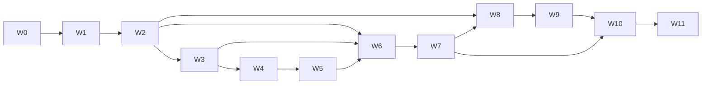

# F-17 AI Tutor: build waves and owner checklist

Read this first when you sit down to build. It says what each wave delivers, how to know it is done, and, in the **You do** boxes, exactly what only you can do (accounts, secrets, flags, decisions, content). Everything else is engineering work that Claude Code or a developer does from the PRDs and ERDs.

| Field | Value |
| --- | --- |
| Umbrella | `docs/product/prd/F-17-ai-tutor-and-context-agent.md` and `docs/product/erd/F-17-ai-tutor-and-context-agent.md` |
| Architecture | `docs/F-17-ARCHITECTURE.md` |
| Child PRDs and ERDs | `F-17.1` Agent platform, `F-17.2` Knowledge bases, `F-17.3` Study blocks, `F-17.4` Admin console, `F-17.5` Widget, nudges, localisation (all in `docs/product/prd/` and `docs/product/erd/`) |
| Format reference | `docs/F-13-BUILD-WAVES.md` |
| Last updated | 2026-10-15 |

Environment variable names and scheduler paths below are **proposals** that W1 adds to `docs/SETUP.md` section 10; they follow the pattern of the Notes, Recall and Today features already in the repo. Anything marked `[VERIFY]` is a price, size, region or name that must be checked on the provider's page on the day, because it was not verified when this was written.

## 0. How the waves fit together

| Wave | Name | Delivers | PRD slices |
| --- | --- | --- | --- |
| W0 | Pre-flight | Decisions, accounts, content plan. No product code | all open questions |
| W1 | Foundations | LLM gateway, core tables, ledger, consent, quotas, kill switches, flags, admin shell with access and audit | F-17.1 P1, F-17.4 A1 |
| W2 | Knowledge core | `tutorkb` schema, pipeline, text, FAQ, dataset and PDF text extraction, chunking, hybrid retrieval, licences, gold sets, playground, first corpus | F-17.2 K1, F-17.4 A2 |
| W3 | Runtime | Conversations, admission, router, instructions, rules, grounding, verifier, language engine, stream service, evaluation harness | F-17.1 P2 |
| W4 | Widget and Ask AI | `<artha-tutor>` shell, chat, history, consent, settings, full page, plan gate, Ask AI block, staff beta | F-17.5 U1, F-17.3 B1 |
| W5 | Control and language | Releases, canary, rollback, gates, behaviour and model screens, Hindi and Hinglish interface, language switch | F-17.1 P3, F-17.4 A3, F-17.5 U3 (language) |
| W6 | Law Sections | Statute store, importer, parser, regimes, verifier, cards, citations drawer, block chips | F-17.3 B2, F-17.5 U2, F-17.4 A4 (law) |
| W7 | Formula and Numerical | Formula store and calculator, safe calculator, templates, solution card, hint ladder | F-17.3 B3 and B4, F-17.4 A4 (rest) |
| W8 | Rich content and nudges | OCR, vision tables and formulas, office files, images, scanners, remaining corpora; nudge engine and rail | F-17.2 K2, F-17.5 U3 (nudges), F-17.4 A5 (nudge editor) |
| W9 | Video, sync, freshness | Audio and video, YouTube, change detection, amendments, regime rules, gap queue, rerank | F-17.2 K3 and K4 |
| W10 | Practice and images | Numerical practice and photo input, law case notes, hand-offs, voice, formula sheet, `askAbout` everywhere | F-17.3 B5, F-17.5 U4 |
| W11 | Scale and launch | Load test, capacity numbers, alerts, shared answer cache, re-embedding drill, counsel review, general availability | F-17.1 P4, F-17.4 A5 (rest) |

Waves are in dependency order but W2 and W3 can overlap, W8 and W9 can overlap with W6 and W7 once two people work, and content work (your corpus files, licences, gold sets, law and formula seeding) runs alongside every wave from W2.



### 0.1 Rules that apply to every wave

1. **Before any git or code work** check for a stale lock: `ls .git/index.lock` (if it exists and no git process runs, remove it). Never use `--no-verify`.
2. **Before calling a wave done** run, from the repo root: `pnpm check`. From `apps/api`: `ruff check . && ruff format --check .`, `python manage.py makemigrations --check --dry-run`, and `pytest`. The wave's own exit checks come on top.
3. **Commits** use Conventional Commits (`feat(tutor): ...`, `feat(tutorkb): ...`). One PR per slice listed in the PRDs.
4. **Migrations** run against the **direct** connection: `export DIRECT_DATABASE_URL='postgresql://postgres.<ref>:<password>@aws-0-ap-south-1.pooler.supabase.com:5432/postgres'`, then `cd apps/api && python manage.py migrate`. Run on a **staging** project first if you have one, otherwise on production in a quiet hour after a database backup (Supabase dashboard, Database, Backups).
5. **Flags** are created at 0% before the first merge that references them. They fail closed on the API and the web.
6. **Secrets** only in the API, stream and worker environments, never in `VITE_*`.
7. **Nothing reaches students** until you have turned a flag on for a cohort. Each wave ends dark.

### 0.2 Cheat sheet of values you will create (names proposed)

| Name | Where | Purpose |
| --- | --- | --- |
| `GEMINI_API_KEY`, `GEMINI_DATA_TIER=paid` | api, stream, worker | Already exist; the tier must be `paid` for the tutor (billing linked in Google Cloud) |
| `GEMINI_EMBEDDING_MODEL=gemini-embedding-001`, `TUTOR_EMBED_DIMS=768` | api, stream, worker | Embedding model and stored dimension |
| `TUTOR_CONSENT_APPROVED=<version>` | api, stream | The consent notice version you approved; empty keeps the tutor off |
| `TUTOR_HARD_DAILY_BUDGET_PAISE` | api, stream, worker | Last-resort rupee ceiling for all tutor model spend per India day (the database budgets in the admin console sit below it); `0` blocks everything |
| `TUTOR_TICK_SECRET` | api | Guards `/api/v1/tutor/internal/tick/`; header `X-Tutor-Tick-Secret` or `Authorization: Bearer`; may equal `NOTES_TICK_SECRET` |
| `APP_ROLE` | api (`api`), stream (`stream`), worker (`worker`) | Selects what a process does and which routes it serves |
| `TUTOR_STREAM_BASE_URL` | api (for links) | Public base URL of the stream service |
| `VITE_TUTOR_API_BASE`, `VITE_TUTOR_STREAM_BASE` | web | Where the widget sends requests (public values) |
| `CORS_ALLOWED_ORIGINS` | api, stream | Must include the web origin; stream also needs it |
| `WORKER_TYPE_LIMITS` | worker | Add `tkb.fetch=2,tkb.extract=1,tkb.clean=2,tkb.embed=2,tkb.scan=1,tkb.publish=2,tkb.build_index=1,tkb.eval_sample=1,tutor.eval=1,tblocks.embed_formula=1` (tune in W2) |
| PostHog flags | PostHog | `ai_tutor`, `ai_tutor_block_ask`, `ai_tutor_block_formula`, `ai_tutor_block_law`, `ai_tutor_block_numerical`, `ai_tutor_nudges`, optional `ai_tutor_admin` |
| Storage bucket `tutor-kb` | Supabase | Private; source files, licence evidence, extracted assets, evaluation outputs |

### 0.3 Decisions you owe, and when

| Id | Decision | Default if you say nothing | Needed by |
| --- | --- | --- | --- |
| Q-AP-1 | Pro Max plan: does it exist, price, benefits (`BILLING-PLAN.md` has Free and Pro only) | Build with plan code `pro_max` supported but unassigned; nobody gets it | W5 |
| Q-KB-1 | Add a `school` course (Class 11 and 12) to F-02 and onboarding in F-16 | Yes, a W0 task; the other three knowledge bases do not wait | before W8 (school corpus) |
| Q-KB-3 | Corpus order | CA Intermediate Taxation and Accounting, then CMA, CS, school | W2 |
| Q-KB-7 | Who writes 150 gold queries per knowledge base | You plus one subject expert per course, 30 a week | starts W2, done before each KB opens |
| Q-AP-9 | Consent notice wording and counsel review | Draft in W1, counsel before general launch | W1 draft, W11 sign-off |
| Q-SB-1, Q-SB-2 | Acts per knowledge base; exam terms that straddle the 1961 and 2025 Income-tax Acts | Proposal in FR-SB-41 | W6 |
| Q-KB-10 | Regime mapping rows before May 2027 | You enter them after checking ICAI material; they stay `[VERIFY]` until you confirm | W6 |
| Q-SB-4, Q-SB-5 | Formula seed source and rounding conventions | Your own study material first; ICAI style rounding in templates | W7 |
| Q-WG-2 | Devanagari font strategy | Self-host Noto Sans Devanagari subsets | W5 |
| Q-WG-3 | Design for the dock and the nudge rail | Claude builds from design-system components; you review a screenshot | W4 |
| Q-AD-1 | Second admin or editor account | Later | W5 |
| (image) | The brief's attached image never arrived | Re-attach it; the docs are structured so its ideas can be merged | before W4 |

---

## W0. Pre-flight (no product code)

**Goal.** Accounts, decisions and content are ready so W1 does not stall.

**You do**

- [ ] **Re-attach the image** from your original brief (or describe it). It may change block names, the nudge layout or the widget layout.
- [ ] **Google Cloud billing.** In Google Cloud Console open the project your `GEMINI_API_KEY` belongs to and link a billing account. A Gemini or Google AI Pro consumer subscription does not count. Then set `GEMINI_DATA_TIER=paid` later in W1.
- [ ] **Quota check.** In Google AI Studio, Usage and billing, note the requests-per-minute and tokens-per-minute of the models you will use and the embedding model; if low, apply for a higher tier now (it can take days) `[VERIFY]`.
- [ ] **Supabase.** Confirm the project is on the Pro plan and note the compute size (Project Settings, Compute and Disk) and the disk size. Tell Claude the numbers; the capacity plan in section 4.4 of the Knowledge Base ERD assumes about 3 GB of tutor data `[VERIFY]` pricing for larger compute.
- [ ] **Fly.io.** Create or confirm your Fly account (the worker already uses it). Install `flyctl` if needed: `brew install flyctl`, then `fly auth login`.
- [ ] **PostHog.** Confirm you can create flags in the production project.
- [ ] **Decide** Q-AP-1 (Pro Max), Q-KB-1 (school course) and Q-KB-3 (corpus order) from the table in 0.3.
- [ ] **Gather content for W2:** the first corpus files (CA Intermediate Taxation and Accounting PDFs or text) and, for each, who owns the rights and on what terms. Put the licence evidence (email, agreement, public-domain note) in one folder.
- [ ] **Name the people:** one subject expert per course for gold sets and law and formula review (Q-KB-7).
- [ ] **F-02 `school` course:** open a task for it (levels `class-11`, `class-12`, boards) and for the onboarding choice in F-16. Not needed for W1 to W7.

**Exit.** A short note back to Claude with: billing linked yes or no, compute size, the decisions above, and where the corpus files are.

---

## W1. Foundations

**Goal.** The platform skeleton exists, does nothing visible, and is safe: every model call goes through one gateway that counts money; the tutor can be switched off from the database; the admin console shell works with access control and audit.

**Builds**

- `integrations/llm` gateway: provider-neutral interface, Gemini adapter wrapping `integrations/gemini.py`, buckets, fallback, timeouts, structured output with schema validation, fake provider for tests (F-17.1 slices 1 to 3).
- `tutor` migrations 0001 and 0002: settings, consent, quota plans (with the new columns), quota usage, kill switches, budgets, config versions, model profiles, function configs, LLM call ledger, cost lines (F-17.1 ERD section 7).
- `core/plans.py` extension for plan codes `free`, `pro`, `pro_max`, `staff` and `tutor_access` lookup; `core/agent_registry.py`; flags `ai_tutor` and block flags wired with `strict=True`.
- `tutoradmin` migrations 0001 to 0003 (grants, audit log, alerts skeleton, overrides, rollups) and API access layer; web shell at `/admin/tutor` (overview with kill switches and budgets, access and audit screens); Django admin registrations for every tutor table (F-17.4 A1).
- `docs/SETUP.md` section 10 updated with the new variables; `README` pointer.

**Exit checks**

- Tests: gateway unit tests with the fake provider (timeouts, fallback, repair retry, ledger rows, budget refusal); migrations apply on SQLite and on PostgreSQL (`pg` marked tests); append-only trigger test for the audit log; scope tests for every admin route.
- With `ai_tutor` off, `GET /api/v1/tutor/bootstrap/` returns 403 `feature_disabled`.
- Turning a kill switch off in the console blocks a test call within 15 seconds.
- Import-linter rules pass (`tutor` imports only `core` and `integrations`).

**You do**

- [ ] **Flags.** PostHog, Feature flags, **New feature flag**, key `ai_tutor`, release condition **0% of users**. Repeat for `ai_tutor_block_ask`, `ai_tutor_block_formula`, `ai_tutor_block_law`, `ai_tutor_block_numerical`, `ai_tutor_nudges`, and optionally `ai_tutor_admin`. Do **not** release any yet.
- [ ] **Environment (API project on Vercel).** Settings, Environment Variables: set `GEMINI_DATA_TIER=paid` (only after billing is linked), `TUTOR_HARD_DAILY_BUDGET_PAISE` (start at `50000`, that is ₹500 a day, for testing), `TUTOR_TICK_SECRET` (generate with `openssl rand -hex 32`; may equal `NOTES_TICK_SECRET`). Leave `TUTOR_CONSENT_APPROVED` empty until you approve the notice in W4.
- [ ] **Staff role.** If your account is not already admin: `cd apps/api && NEW_PW='...' python manage.py grant_staff_role --email pawan@getbreakout.ai --role admin --admin-login --password-env NEW_PW` (sign in to the web app once first).
- [ ] **Apply migrations** to Supabase using the direct connection (rule 4 in 0.1): `cd apps/api && python manage.py migrate`. Check the Table Editor shows `tutor_*` and `tutoradmin_*` tables with RLS enabled.
- [ ] **Tick scheduler.** Add one more URL to the scheduler you already use for the Notes and Recall ticks: `POST https://<api-domain>/api/v1/tutor/internal/tick/` every 5 minutes with header `Authorization: Bearer $TUTOR_TICK_SECRET` (if you use Vercel Cron, set `CRON_SECRET` to the same value as the other ticks).
- [ ] **Draft the consent notice** (Claude supplies draft text in `modules/tutor/domain/consent.py`): read it, edit it, and send it to your counsel now so review is done by W11.
- [ ] **Open the console** at `/admin/tutor`, check Overview loads, flip a kill switch off and on, and confirm the Audit screen shows both actions.

---

## W2. Knowledge core

**Goal.** One real knowledge base (CA) that can ingest, chunk, embed and retrieve with measured quality, driven from the admin console, with licences enforced.

**Builds** (F-17.2 slices 1 to 7 and 9; F-17.4 A2 screens)

- `tutorkb` migrations 0001 to 0004 (including the partitioned `tutorkb_chunk` and `tutorkb_embedding`, four partitions, RLS); `tutorkb_add_partition` command.
- Embedding and rerank interfaces in `integrations/llm` and the fake embedder.
- Pipeline: job types, stage chaining, status machine, tick; extractors `text`, `faq`, `dataset`, `pdf` text via `pypdfium2`; chunker; contextual embedding text; reuse by hash.
- Retrieval service: hybrid SQL, fusion, filters, trace, confidence; isolation suite; plan check tests on PostgreSQL.
- Licences and rights gates, expiry job; admin API and screens for knowledge bases, sources, wizard, estimates, run monitor, chunk browser, **playground**, licences, gold sets and retrieval runs.
- Worker image update (`worker/requirements-worker.txt` unchanged unless a new library is needed) and `WORKER_TYPE_LIMITS`.

**Exit checks**

- Isolation suite passes (100 adversarial queries per knowledge base, zero cross-partition rows).
- `EXPLAIN` test shows one chunk partition and one embedding partition and the partial HNSW index used.
- A 300-page text PDF reaches `needs_review` in under 30 minutes on the worker; a killed worker resumes from the last batch.
- Gold run on the first corpus reports recall at 5 and 10, MRR, nDCG and recall against exact search of at least 0.95.
- Re-ingesting an unchanged source makes zero embedding calls.

**You do**

- [ ] **Enable extensions** (Supabase, SQL Editor, run once, or Database, Extensions): `create extension if not exists vector;` and `create extension if not exists pg_trgm;`. Confirm `select extname from pg_extension;` lists both.
- [ ] **Create the Storage bucket** `tutor-kb`: Storage, New bucket, **Public off**, file size limit 100 MB, no policies (only the API writes). Or `supabase config push` once Claude has declared it in `supabase/config.toml`.
- [ ] **Run migrations** (direct connection). Then check the partitions exist: `select inhrelid::regclass from pg_inherits where inhparent = 'tutorkb_chunk'::regclass;` should list four.
- [ ] **Compute check before the first index build.** In Supabase, Reports, note memory and CPU while Claude runs the first `build-index` on the real corpus; if memory exceeds 80% or the build takes more than 30 minutes, upgrade compute for the build (Project Settings, Compute and Disk) and downgrade after `[VERIFY]` cost.
- [ ] **Worker environment.** On Fly: `cd apps/api && fly secrets set GEMINI_API_KEY=... GEMINI_DATA_TIER=paid GEMINI_EMBEDDING_MODEL=gemini-embedding-001 TUTOR_EMBED_DIMS=768 -a artha-worker`, then update `WORKER_TYPE_LIMITS` in `fly.toml` with the `tkb.*` types from 0.2 and `fly deploy`. If you use Render instead, set the same in the Render dashboard (`render.yaml` carries the non-secret values).
- [ ] **Set the embedding budget:** in the console, Models, Budgets: ingestion budget for the first week (suggest ₹500) and a per-source cap of ₹100 in the wizard.
- [ ] **Licence records.** In the console, Knowledge, Licences: create one record per rights holder using the evidence folder from W0. Do not publish a source without one (the system blocks it).
- [ ] **Upload the first corpus** with the Add source wizard (CA, Taxation and Accounting). Read each cost estimate before confirming.
- [ ] **Write the first 30 gold queries** with your subject expert (Knowledge, Gold sets): English, Hindi and Hinglish; include exact-string questions like "194C" and "AS 2". Aim for 30 a week until 150.
- [ ] **Review and publish** sources after using the playground to try ten questions.
- [ ] **Tell Claude** the recall numbers and the index build time so settings can be tuned (`ef_search`, dimension 768 vs 1536).

---

## W3. Runtime

**Goal.** A student turn works end to end from the API and a command-line test client: admission, routing, retrieval, grounded answer, verification, language, ledger, evaluation harness. No UI yet.

**Builds** (F-17.1 slices for conversations, routing, instructions, rules, grounding, language, evaluation)

- `tutor` migrations 0003 to 0005: conversations, messages, turns, tool calls, citations, instructions and versions, releases, rules, glossary, static messages, evaluation cases and runs, reports.
- Stream service: `APP_ROLE=stream` entrypoint, SSE endpoint `POST /api/v1/tutor/conversations/{id}/turns/`, resume endpoint, health check `/healthz`; image and process config for Fly.
- Pre-router and router, instruction layers, rule engine and default rules, retrieval call, answer function, deterministic verifier, judge sampling hook, language detection, glossary, static message engine.
- Evaluation harness and CI job (fake model) and a manual job with the real model; first evaluation set (about 100 cases: abstain, injection, safety, router, language).
- `scripts/tutor-cli.py` test client that streams a turn from a terminal.

**Exit checks**

- All F-17.1 acceptance tests for groups B to J that apply to the runtime.
- Evaluation: router accuracy at least 0.95 on the labelled set; abstain 1.00; injection 1.00; safety 1.00; groundedness at least 0.90 on the first corpus.
- Time to first token p95 under 2.5 s from a Mumbai test client against the deployed stream service (spike S-A in the architecture appendix).
- Ledger shows one row per model attempt and costs reconcile with the Gemini dashboard within 5%.

**You do**

- [ ] **Create the stream service on Fly** (from `apps/api`):
  1. `fly launch --no-deploy --copy-config --name artha-tutor-stream --region bom` (Mumbai; `[VERIFY]` the region exists on your account, otherwise `sin`).
  2. Claude supplies `fly.stream.toml`; deploy with `fly deploy -c fly.stream.toml -a artha-tutor-stream`.
  3. Secrets: `fly secrets set -a artha-tutor-stream DJANGO_SECRET_KEY=... DATABASE_URL=... SUPABASE_URL=... SUPABASE_SERVICE_ROLE_KEY=... GEMINI_API_KEY=... GEMINI_DATA_TIER=paid TUTOR_HARD_DAILY_BUDGET_PAISE=50000 TUTOR_CONSENT_APPROVED= CORS_ALLOWED_ORIGINS=https://<web-domain> APP_ROLE=stream SENTRY_DSN=... POSTHOG_API_KEY=... POSTHOG_HOST=...` (use the same values as the API project; `DATABASE_URL` is the transaction pooler string).
  4. Keep one machine always running (`min_machines_running = 1`, `auto_stop_machines = false` in the config) so the first token is not delayed by a cold start.
  5. `curl https://artha-tutor-stream.fly.dev/healthz` should answer `ok`.
- [ ] **Custom domain (optional now, needed by W11):** `fly certs add stream.<your-domain> -a artha-tutor-stream`, then add the DNS records Fly prints.
- [ ] **API project:** add `TUTOR_STREAM_BASE_URL=https://artha-tutor-stream.fly.dev` (or your domain) and redeploy.
- [ ] **Model profiles.** In the console, Models, Profiles: add the Gemini models you want for `answer.main`, the lite model for router and rewrite, and (later) a reasoning model. Copy the **exact model ids and prices from Google's current model and pricing pages** `[VERIFY]` (they change); press **Probe** on each. Then map functions to profiles in Models, Functions.
- [ ] **Write the evaluation cases you care about** (Evaluation workspace): at least 30 questions from real students in each language, with the behaviour you expect (answer, abstain, redirect). These are staff-written; no student data.
- [ ] **Run the first evaluation** from the console (Evaluation, Run all) and read the failing cases with Claude.
- [ ] **Try it yourself** with the CLI: `cd apps/api && python ../../scripts/tutor-cli.py --token <your session JWT> "TDS on contractor payment kitna katna hai?"`. (Claude shows how to copy the JWT from the browser's network tab.)

---

## W4. Widget and Ask AI

**Goal.** Staff can open the tutor inside the student app, ask Ask AI questions in English, see streamed answers with citations, manage history and settings, and see the plan gate.

**Builds** (F-17.5 U1, F-17.3 B1)

- `packages/tutor-widget`: loader, custom element, shadow root with design-system tokens, portal container context (design-system change), fetch-based SSE client with resume, markdown and math (lazy), composer, message list, status line, usage meter, error states, history, settings, consent screen, plan gate, version check.
- `apps/web/src/modules/tutor`: host container, `TutorLauncher`, `askAbout`, route manifest, token hand-off, PostHog and Sentry bridges; routes `/app/ask` and `/app/settings/tutor`.
- `tutorblocks` Block SDK, registry, card registry, Ask AI block with modes, citations, abstain; block config and flags.
- Bundle budget checks in CI (size-limit), axe checks in four themes, Playwright suite for the widget.

**Exit checks**

- `pnpm check` green including contrast, size limits and the widget Playwright suite across Chrome, Safari (WebKit), Firefox.
- Hostile host stylesheet test passes; popovers render inside the shadow root; focus returns to the launcher on close.
- Ask AI answers carry citations from the CA knowledge base; abstain shows the localised message.
- With `ai_tutor` off for a user: no launcher, no network calls from the widget.

**You do**

- [ ] **Look at the design.** Claude posts screenshots of the dock, the bottom sheet and `/app/ask` in the four themes; tell Claude what to change (Q-WG-3).
- [ ] **Web project (Vercel):** add `VITE_TUTOR_API_BASE=https://<api-domain>` and `VITE_TUTOR_STREAM_BASE=https://artha-tutor-stream.fly.dev` (public values), redeploy the web project.
- [ ] **Approve the consent notice** (counsel-reviewed if you can), then set `TUTOR_CONSENT_APPROVED=<version printed in modules/tutor/domain/consent.py>` on the API project **and** the Fly stream app (`fly secrets set TUTOR_CONSENT_APPROVED=... -a artha-tutor-stream`).
- [ ] **Plans.** In the console, Models, Plans: review the proposed allowances (Free none, Pro 40 Ask AI a day, and so on), approve or edit them, then **Save** (they are drafts until you do).
- [ ] **Release the flags to staff only.** PostHog, `ai_tutor` and `ai_tutor_block_ask`: add a condition **match persons with email in** (your email and your testers), release to 100% of that group, leave everyone else at 0%.
- [ ] **Staff beta.** Use the tutor for a week; press thumbs down with a reason code on any bad answer and add those as evaluation cases (Evaluation, Make case).
- [ ] **Check the browsers** you care about, including your own phone, and report anything odd.

---

## W5. Control and language

**Goal.** You can change tone and behaviour, models and budgets, and release safely; Hindi and Hinglish work in the interface.

**Builds** (F-17.1 P3, F-17.4 A3, F-17.5 U3 language part)

- Instruction editor with layers and versions, style profile, placeholders checker, prompt preview; rules editor, simulator; messages and glossary editors.
- Releases: candidate builder, diff, evaluation gate, canary by hash, rollback, overrides (not for hard gates), release notes; fresh-session rule for sensitive actions.
- Models, functions, budgets, plans and kill switch screens complete.
- Widget i18n: catalogues `en`, `hi`, `hinglish`, ICU checks, overrides from `tutor_staticmessage`, language switch, fonts hook, Indian number formatting.

**Exit checks**

- Release gate blocks a release that fails a hard gate; rollback takes effect within 15 seconds in a test.
- Prompt preview matches the production prompt (snapshot test).
- Rule simulator trace equals production for the golden contexts.
- Catalogue checks pass: no missing keys beyond the allowed-gaps file; layout screenshots of Hindi at 360 px width show no clipping.
- Hindi and Hinglish evaluation columns exist and pass their thresholds.

**You do**

- [ ] **Decide Pro Max** (Q-AP-1). If it exists, tell Claude the plan code and how billing identifies it so `core/plans.py` maps it; if not, leave it unassigned.
- [ ] **Fonts.** Decide Q-WG-2. Default: Claude self-hosts Noto Sans Devanagari subsets in the web app; check the added weight in the Vercel build report.
- [ ] **Translate and review.** Claude drafts Hindi and Hinglish strings; a native reviewer reads them from the console (Behaviour, Messages) and marks them reviewed; coverage must reach 98% before the language shows in the switcher.
- [ ] **Hinglish style guide.** Read the draft guide and edit it; it steers every Hinglish answer and label.
- [ ] **Glossary.** Add the finance and law terms you want fixed (Behaviour, Glossary), including the do-not-translate list (section numbers, Act names, defined terms).
- [ ] **Practice a release:** edit the tone, preview the prompt, run evaluation, publish to 10% of **staff only** (canary allow-list), watch, then roll back once on purpose to see it work.
- [ ] **Second admin (Q-AD-1):** if you want one, grant it from Access, Grants.
- [ ] **Set the real budgets** in Models, Budgets (per-student daily rupees by plan and the global daily ceiling); keep `TUTOR_HARD_DAILY_BUDGET_PAISE` above the console budget.

---

## W6. Law Sections

**Goal.** The Law block returns exact statute text for the right Act, regime and date, with verified explanations and cards.

**Builds** (F-17.3 B2, F-17.5 U2 for law, F-17.4 A4 law screens)

- `tutorblocks` migrations 0001 to 0003 (block config, formulas tables created empty, statutes); importer for Acts with review screen; reference parser; regime resolver using `tutorkb_regimerule`; section map; rate rows; verifier; Law handler; `section_card`, `compare_card`, `list_card`; block chips; citations drawer; auto-routing label.
- Statute mirror into `tutorkb` chunks (`ref_kind = law_section`).
- Law evaluation pack (120 cases).

**Exit checks**

- Parser test set of 300 strings at least 98%.
- Law evaluation: zero fabricated section numbers; quoted text equals store text 100%; regime stated whenever required.
- A section edited after a release is not served until the next release; withdraw takes effect within 15 seconds.
- Axe passes on every law card in four themes.

**You do**

- [ ] **Choose the Acts** and order (Q-SB-1): confirm or edit the list in FR-SB-41.
- [ ] **Provide official sources.** For each Act, give Claude the official text file (India Code or the department's site, PDF or HTML) and its URL, or upload it through the importer. Check the licence record: statutes are public law, but any ICAI commentary you add needs a licence.
- [ ] **Review each import** on the review screen: compare 20 random sections against the official text, and the section count against the official table of contents. Publish only when satisfied.
- [ ] **Regime rules (Q-SB-2, Q-KB-10).** In Knowledge, Regimes, enter the rows (course, paper, first exam term, regime). The 2025 Act for CA Intermediate Paper 3A and Final Paper 4 from the May 2027 attempt is stated by ICAI; the earlier mapping is yours to enter after checking ICAI's material. Tick **Verified** only when sure; unverified rows show a visible label to students.
- [ ] **Section map.** With your subject expert, review the old-to-new section map Claude drafts for the most-asked sections (TDS, income heads, deductions); mark each verified.
- [ ] **Rate tables.** Enter or check the TDS and GST rate rows you want the tutor to use, with effective dates and the source notification.
- [ ] **Flag:** PostHog `ai_tutor_block_law` to staff, then to the closed beta cohort after 50 reviewed answers in the turn inspector.
- [ ] **Read 50 law answers** in the inspector (Turns) and the card report queue; report wrong ones so they become evaluation cases.

---

## W7. Formula and Numerical

**Goal.** Formula cards come only from the curated store with a working calculator; Numerical solves with an exact calculator, verification and hint-first modes.

**Builds** (F-17.3 B3 and B4, F-17.4 A4 rest)

- Formula tables, finder, `formula_card` with calculator (client and server engine), test vectors, Recall bridge (the `recall` module exists; Claude adds a narrow `recall` service function and the widget button, hidden if absent), import tooling.
- Safe calculator (AST whitelist, `Decimal`), extractor, clarification step, 20 solver template families, open planner, verifier, `solution_card`, hint ladder, check my answer, journal and T-account layouts.
- Formula and Numerical evaluation packs (100 and 200 cases), calculator fuzz suite.

**Exit checks**

- Calculator fuzz: 10,000 random expressions match the reference; zero escapes in the adversarial suite.
- Numerical gold set: at least 95% correct on template families, at least 85% on open problems; zero wrong answers marked `verified`.
- Every formula in the store passes its test vectors in CI.
- Hint ladder never prints the final answer at levels 0 to 2.

**You do**

- [ ] **Provide formulas.** Give Claude your formula lists (study material, Recall decks, notes) or write them in the console; for each, supply at least one test case (inputs and the answer you trust). Seed 150 formulas first.
- [ ] **Solver templates.** Review the 20 template families (names in FR-SB-63) with your subject expert: parameters, steps, rounding policy (Q-SB-5), test cases. Add the families your students struggle with most.
- [ ] **Numerical gold set.** Write or collect 200 problems with correct answers (from your own question bank; no copyrighted textbook text without a licence); include inconsistent-data and missing-data cases.
- [ ] **Review 50 solutions** in the inspector, step by step; mark wrong ones as reports.
- [ ] **Recall bridge.** Confirm a Recall deck to receive "Add to Recall" cards (a deck per student named "Tutor cards"; Claude proposes, you approve) and check the F-15 `recall_system` flag state for beta students.
- [ ] **Flags:** `ai_tutor_block_formula` and `ai_tutor_block_numerical` to staff first, then to the closed beta (50 students) when the gold sets pass.
- [ ] **Budget watch.** Numerical is the expensive block: after two days of beta check cost per turn in Reports, Cost against the estimate in F-17.1 section 11.1 and adjust weights or the daily numerical allowance.

---

## W8. Rich content and nudges

**Goal.** The knowledge bases can ingest scans, tables, formula pages, Office files and images; all four knowledge bases are populated; students see helpful nudges beside the chat.

**Builds** (F-17.2 K2, F-17.5 U3 nudges, F-17.4 A5 nudge editor)

- OCR (Tesseract English and Hindi), vision for tables and formulas, `docx`, `pptx`, `xlsx`, `csv`, `image`; virus, injection, PII and duplicate scans; review improvements; auto tag suggestions.
- `tutornudges` migrations, selection service, endpoints, events and daily rollup; widget rail, strip, inline and empty-state placements; nudge editor, preview and performance screens; starter nudge set.

**Exit checks**

- A scanned Hindi-English PDF reaches `needs_review` with page-level quality flags; table and formula pages come out as markdown and LaTeX on a sample of 20 pages checked by hand.
- Injection scanner quarantines the test chunk; the injection evaluation suite still passes.
- Nudge golden cases (30) pass; caps hold; delete-all removes a student's nudge rows.
- Rail does not shift layout when it refreshes; axe passes with the rail in four themes.

**You do**

- [ ] **Install clamd on the worker** if not already (the worker image already includes it per `fly.toml`), and confirm the `media.scan` job passes on a test upload.
- [ ] **Raise worker memory if needed:** if `fly logs -a artha-worker` shows "Out of memory" during OCR, run `fly scale memory 4096 -a artha-worker`.
- [ ] **Upload the other corpora** (CMA, CS, school) with licence records; check each wizard estimate first; use the per-source cap. Expect the vision share to be the largest cost.
- [ ] **Gold sets** for the new knowledge bases: 150 each before opening them (readiness check in Knowledge shows amber until then).
- [ ] **School knowledge base** needs the F-02 `school` course and onboarding choice (W0 task) before it can be opened; until then use the manual test group.
- [ ] **Nudges.** Read the starter nudges, edit the Hindi and Hinglish copy, set audiences, and pick which to activate. Keep each short (title 40, body 90 characters).
- [ ] **Flag:** PostHog `ai_tutor_nudges` to staff, then 10%, 50% and 100% of tutor-enabled students, watching dismissals per student per week (target under 4) and click-through (target over 6%).
- [ ] **Open each knowledge base** from Knowledge, Readiness only when every item is green.

---

## W9. Video, sync and freshness

**Goal.** Video and audio become searchable with timestamps; websites and sources stay current; amendments and regimes are handled; gaps in knowledge are visible.

**Builds** (F-17.2 K3 and K4)

- Audio extraction and speech to text, windows with timestamps, YouTube by URL for channels you own, citation deep links.
- Sync policy and tick, change detection, failure handling, `review_by` reports, amendment sources, regime filtering in retrieval, section-mapping hook, gap queue and workflow, rerank adapter and gate, embedding set creation and shadow comparison.

**Exit checks**

- A 20-minute video produces timestamped chunks and the citation opens at the right second.
- An unchanged site re-sync makes zero embedding calls; a removed page deactivates its chunks.
- Amendment test: before and after the effective date return different chunks.
- Gap queue groups 20 test abstentions into one gap row with no student text stored.

**You do**

- [ ] **YouTube and video rights.** List the channels and files you own or are licensed to use; add licence records (third-party videos can only be `link_only`, Q-KB-5).
- [ ] **Speech to text.** Confirm which model Claude may use and its price `[VERIFY]`; set a budget for ingestion in the console.
- [ ] **Sync schedule.** For each website source decide cadence (off, daily, weekly, monthly) and path prefixes; default stays **off**.
- [ ] **Amendments.** When a new Finance Act or ICAI amendment lands, add it as an `amendment` source with the effective date and attempts it applies to (Knowledge, Sources).
- [ ] **Gap queue habit.** Open Knowledge, Gaps weekly, add sources for the top five gaps, close with a reason.
- [ ] **Rerank decision.** Read the gold-run ablation Claude produces; enable rerank for a block only if it gains at least 3 points of recall at 5.
- [ ] **Embedding model switch (only if the gold run says so).** Approve building a second embedding set (for example 1,536 dimensions) and the cost; flip only after the shadow comparison.

---

## W10. Practice and images

**Goal.** Students can practise numericals, send a photo of a question, use voice input, print a formula sheet, and ask about any content page.

**Builds** (F-17.3 B5, F-17.5 U4)

- Numerical practice from templates with deterministic answers; template growth to 60 families; image input via vision with confirmation; remaining accounting layouts; law case notes and standards chips; block hand-off chips; one future block behind a flag.
- Widget: voice input, image attach with metadata strip, formula sheet print, `askAbout` toolbar on all content pages, performance and embed hardening.

**Exit checks**

- Five practice variants of a template have distinct inputs and deterministic answers.
- A tilted photo of a problem produces extracted givens the student confirms before any solution.
- Voice button hidden where the browser lacks speech recognition; transcript is never auto-sent.
- Bundle budgets still met.

**You do**

- [ ] **Decide plans for images and practice** (Pro Max only, or all Pro) in Models, Plans.
- [ ] **Template growth:** with your expert, prioritise the next 40 families from the unverified-answer queue and gap data.
- [ ] **Vision cost:** photo questions use the vision profile; set its budget and watch cost per image in Reports.
- [ ] **Privacy check:** read the image-upload notice text; images are processed by Google under the paid tier; confirm the wording with counsel.
- [ ] **Pick the future block** (candidates: Quiz me, Standards helper, Past-paper finder, Study planner) or skip it.

---

## W11. Scale and launch

**Goal.** The system is measured, monitored and ready for all eligible students.

**Builds** (F-17.1 P4, F-17.4 A5 rest)

- Load test scripts under `scripts/load/tutor/` (k6 or Locust), capacity measurement against section 11 of the architecture, alerts wired (email or Slack), usage and cost reports, per-user overrides, optional second approver, shared answer cache for context-free questions, nightly evaluation, re-embedding drill, runbooks (`docs/F-17-RUNBOOK.md`).
- DPDP checklist support: export, delete-all, retention jobs verified.

**Exit checks**

- Load test at target concurrency: first-token p95 under 2.5 s, error rate under 1%, database CPU and connections within limits; results written into `docs/F-17-ARCHITECTURE.md` section 11 replacing assumptions.
- Chaos checks: provider outage (fake), budget exhaustion, kill switch, worker killed mid-ingest, stream machine restart mid-turn (client resumes).
- Re-embedding drill on a copy: build set, shadow compare, flip, rollback.
- All hard evaluation gates green on the release to be launched.

**You do**

- [ ] **Counsel sign-off** on the consent notice, retention, minors (age gate), and licensed-content use before general launch (R-AP-9, R-KB-1).
- [ ] **Alert channel.** Create a Slack incoming webhook or confirm an email address; set the webhook URL as an environment variable named in the channel record (`TUTOR_ALERT_SLACK_WEBHOOK`) and add it in the console, Alerts.
- [ ] **Scale the stream service** after the load test says so: `fly scale count 2 -a artha-tutor-stream` and, if memory-bound, `fly scale memory 1024`.
- [ ] **Supabase compute and disk** per the measured numbers (upgrade before launch, not after); confirm backups and point-in-time recovery `[VERIFY]` on your plan.
- [ ] **Budgets for launch.** Set per-student and global budgets from the real ledger numbers, not the estimates; keep `TUTOR_HARD_DAILY_BUDGET_PAISE` as the backstop.
- [ ] **Launch ladder.** PostHog `ai_tutor` (and each block flag): 5%, 25%, 50%, 100% of Pro students over two weeks, watching groundedness, cost per active student against the 40% target, unverified share, thumbs-down rate and support messages; roll back with the flag or a kill switch.
- [ ] **Announce** Pro Max if it exists; update the plan cards and copy.
- [ ] **Schedule the weekly routine:** gap queue, card reports, law and formula review dates, licence expiry calendar, evaluation run after every release.

---

## Appendix A. Owner command cheat sheet

```bash
# Safety before git or code work (from the repo root)
ls .git/index.lock 2>/dev/null && echo "stale lock: remove only if no git process is running"

# Standard checks
pnpm check
cd apps/api && ruff check . && ruff format --check . && python manage.py makemigrations --check --dry-run && pytest

# Migrations (direct connection)
cd apps/api && export DIRECT_DATABASE_URL='postgresql://postgres.<ref>:<password>@aws-0-ap-south-1.pooler.supabase.com:5432/postgres' && python manage.py migrate

# Staff role
cd apps/api && NEW_PW='...' python manage.py grant_staff_role --email pawan@getbreakout.ai --role admin --admin-login --password-env NEW_PW

# Fly (worker and stream)
fly deploy -a artha-worker                       # from apps/api, after changing fly.toml or the worker image
fly deploy -c fly.stream.toml -a artha-tutor-stream
fly logs -a artha-tutor-stream
fly scale count 2 -a artha-tutor-stream
```

## Appendix B. What to send Claude at the end of each wave

A three-line note: what you did from the **You do** box, any value or screenshot that surprised you (costs, memory, recall numbers), and which decisions you changed. Claude updates the PRD and this file so the plan stays true.
