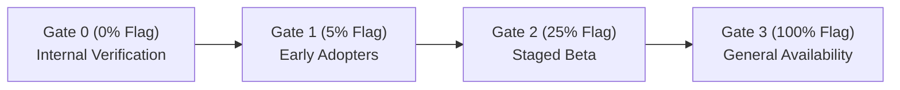

# X-01.2 Away Alerts and Background Results: Build and Rollout Runbook

Companion to `Docs/product/prd/X-01.2-away-alerts.md` (PRD) and `Docs/product/erd/X-01.2-away-alerts.md` (ERD). Builds on `docs/X-01-ROLLOUT.md`.

---

## 1. Overview and Architecture Summary

X-01.2 adds server-driven idle checking and background results notifications:
1. **Server-driven "Still studying?" check:** When a stopwatch goes quiet (> 90 s), pushes notification with "Still studying" and "Pause" buttons. If unanswered after 120 s, auto-settles to paused state (`min(now, last_active_at)`) with a "Resume" follow-up notification.
2. **Platform button capability rule:** Desktop Chromium (Chrome and Edge on Android, Windows, macOS, Linux) receive action buttons. Firefox, Safari, and iOS receive click-only deep links.
3. **Single-page tab navigation:** Clicks on notifications send `SW_MESSAGE_NAVIGATE` postMessage to any open client tab so the SPA navigates without full page reloads.
4. **Background task completion notifications:** Category `results` ("Finished in the background", priority 2):
   - `notes_ocr_done` (links to `/app/notes/pdf/{doc_id}`)
   - `notes_export_ready` (links to `/app/notes/pdf/{doc_id}`)
   - `notes_summary_ready` (links to `/app/notes`)
   - `recall_suggestions_ready` (links to `/app/recall/suggestions`)
   All results events support failure notifications (`failed=True`) with safe generic copy and zero user text leakage.
5. **Flag gating & kill switches:** Strict PostHog feature flag `away_alerts` (fails closed), `NOTIFICATIONS_ENABLED`, and `NOTIFICATIONS_DISABLED_EVENTS`.

---

## 2. Waves and Changes

| Wave | Scope | Status | Key Artifacts |
| --- | --- | --- | --- |
| **A0** | Pre-flight validation | Complete | Verification of notifications pipeline, VAPID keys, QStash, PostHog flags |
| **A1** | Enums, reference data, copy & migration | Complete | `0006_away_alerts.py`, `catalogue.py`, `copy.py`, `deeplinks.py`, `ActionToken.subject_kind` |
| **A2** | Settle & judgement services, handlers | Complete | `tracking/domain/judgement.py`, `tracking/services.py`, `notifications/handlers.py`, `planning.py`, `jobs.py` (Reschedule verdict) |
| **A3** | Action tokens & desktop Chromium rule | Complete | `buttons.supports_buttons`, `actions.py` (stopwatch subject routing, 120s TTL) |
| **A4** | Web navigation & settings row | Complete | `SW_MESSAGE_NAVIGATE`, `useNotificationNavigation`, `TrackerSettingsContainer` ("Alert me when the stopwatch goes quiet") |
| **A5** | Results category & background events | Complete | `notify()` wiring in `notes.ocr`, `notes.export_pdf`, `notes.summarize`, `recall.suggest`, privacy & on_commit tests |
| **A6** | Staged rollout & runbook | Current | `docs/X-01.2-ROLLOUT.md`, SLO gates, operational runbook |

---

## 3. Database Migration

Migration `notifications.0006_away_alerts`:
- Widens check constraint `notif_scheduledjob_kind` to include `stopwatch_idle` and `stopwatch_idle_end`.
- Adds column `subject_kind` (`varchar(10)`, default `'focus'`, check constraint `notif_actiontoken_subject_kind in ('focus', 'stopwatch')`) to `notifications_actiontoken`.
- Widens check constraint `notif_actiontoken_action` to include `still_studying`.

Run migrations:
```bash
cd apps/api
source .venv/bin/activate
python manage.py migrate notifications
```

Rollback strategy:
The migration is additive and backward compatible with running pods/workers. Old code ignores `subject_kind`. In an emergency, turning off the `away_alerts` flag ceases all writes without reverting the migration.

---

## 4. Staged Rollout Gates

The rollout proceeds through 4 gates via the PostHog strict feature flag `away_alerts`:



### Gate G0 (0% - Internal Dogfooding & Verification)
- **Target:** Staging & developer accounts.
- **Verification checks:**
  1. Unit and integration tests pass:
     - `pytest apps/api/modules/notifications/ apps/api/modules/tracking/`
     - `pnpm --filter @artha/web typecheck`
     - `pnpm --filter @artha/web test src/sw/ src/modules/notifications/ src/modules/tracker/`
  2. Manual test: Start stopwatch on desktop Chrome with `idle_minutes = 10`.
  3. Leave tab hidden for > 90 s. Push arrives with "Still studying" and "Pause" buttons.
  4. Tap "Still studying": stopwatch continues, no page reload.
  5. Repeat and let 120 s expire without tap: auto-pauses at last active moment, sends follow-up with "Resume".
  6. Verify background tasks (OCR, PDF export, summary, recall suggestions) send notifications on completion and on failure.

### Gate G1 (5% - Canary Release)
- **Target:** 5% of active users.
- **Duration:** 24 hours.
- **SLO Criteria:**
  - Push delivery acceptance ratio $\ge 0.98$.
  - Push delivery latency p95 $\le 5$ seconds.
  - Zero unhandled exceptions in `job_rescheduled` or `job_fired`.

SQL verification query:
```sql
SELECT
    event,
    status,
    COUNT(*) AS total,
    ROUND(COUNT(*) FILTER (WHERE status = 'sent')::numeric / NULLIF(COUNT(*), 0), 4) AS sent_ratio,
    PERCENTILE_CONT(0.95) WITHIN GROUP (ORDER BY lateness_ms) AS p95_lateness_ms
FROM notifications_delivery d
JOIN notifications_notification n ON d.notification_id = n.id
WHERE d.attempted_at >= NOW() - INTERVAL '24 hours'
  AND n.event IN ('stopwatch_idle', 'stopwatch_paused', 'notes_ocr_done', 'notes_summary_ready', 'notes_export_ready', 'recall_suggestions_ready')
GROUP BY event, status;
```

### Gate G2 (25% - Beta Release)
- **Target:** 25% of active users.
- **Duration:** 48 hours.
- **SLO Criteria:**
  - QStash message volume within plan limits.
  - Settle vs user response metrics normal (no spike in stale token errors).
  - Push delivery acceptance ratio $\ge 0.98$.

### Gate G3 (100% - General Availability)
- **Target:** 100% of active users.
- Set PostHog flag `away_alerts` to `true` (100%).
- Monitor PostHog events:
  - `idle_check_pushed`
  - `idle_check_answered` (`source`: `page`, `push_button`, `push_open`)
  - `idle_check_auto_paused`
  - `idle_alert_setting_changed`

---

## 5. Operational Runbook & Kill Switches

### Emergency Kill Switch
If unexpected behavior occurs, use one of the following instant controls:

1. **Feature-Wide Kill Switch (Instant):**
   In PostHog:
   - Set flag `away_alerts` to `0%` / disabled.
   - **Impact:** All pending `stopwatch_idle` and `stopwatch_idle_end` jobs evaluate as `flag_off` and skip execution cleanly without error. No pushes are dispatched. Page behavior continues normally.

2. **Per-Event Kill Switch (No code deploy needed):**
   Set environment variable in Vercel:
   ```bash
   NOTIFICATIONS_DISABLED_EVENTS=stopwatch_idle,stopwatch_paused,notes_ocr_done
   ```
   - **Impact:** Suppresses pushes for the listed event keys with reason `FLAG_OFF`.

3. **Global Push Kill Switch:**
   Set `NOTIFICATIONS_ENABLED=false`.

---

## 6. Device Compatibility Matrix

| Platform | Browser | Action Buttons Supported | Deep Link Navigation |
| --- | --- | --- | --- |
| macOS | Chrome / Edge | Yes ("Still studying", "Pause", "Resume") | SPA navigate via SW message |
| Windows | Chrome / Edge | Yes | SPA navigate via SW message |
| Linux | Chrome / Edge | Yes | SPA navigate via SW message |
| Android | Chrome / Edge | Yes | SPA navigate via SW message |
| macOS / Windows | Firefox | No (Click-only) | SPA navigate via SW message |
| macOS / iOS | Safari | No (Click-only) | SPA navigate via SW message |
| iOS | Installed PWA | No (Click-only) | SPA navigate via SW message |

---

## 7. Telemetry and Analytics Checklist

1. **PostHog web events allow-list:**
   - `idle_check_pushed`
   - `idle_check_answered` (`source`: `page`, `push_button`, `push_open`)
   - `idle_check_auto_paused`
   - `idle_alert_setting_changed`
   - Existing events: `push_clicked`, `notification_pref_changed` (with `category: results` or `tracker`).

2. **Privacy Audit:**
   - No user content, syllabus titles, card text, note text, or document filenames in push payloads.
   - Notification payloads only carry generic text, categories, event keys, and IDs.
