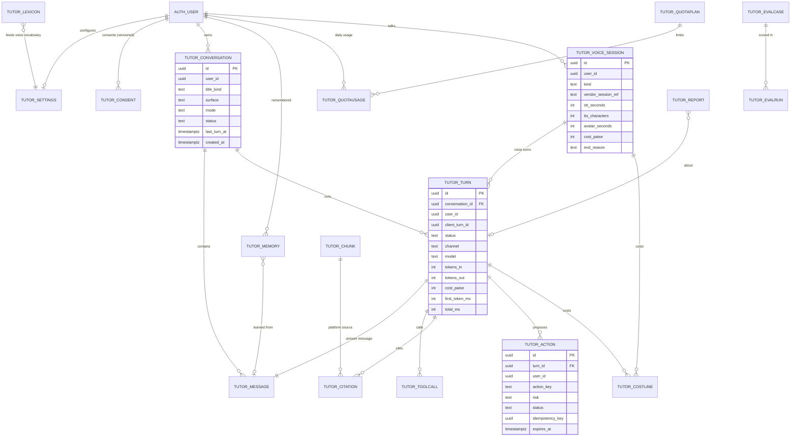

# ERD: F-17 AI Tutor and Context Agent

| Field | Value |
| --- | --- |
| Linked PRD | `docs/product/prd/F-17-ai-tutor-and-context-agent.md` |
| Django app | `apps/api/modules/tutor` (agent core, actions, voice sessions, memory, cost ledger, evaluation). Platform content chunks live in the same app and are fed by providers registered through `register_knowledge_source` |
| Web module | `apps/web/src/modules/tutor` |
| Depends on | `profiles`, `coverage`, `syllabus`, `tracking`, `focus`, `notes`, `recall` (read through their selectors and ports only), `core/plans.py`, `core/registry.py`, `integrations/gemini.py` |
| Last updated | 11 Oct 2026 |

## 0. Design decisions

1. **The vendors hold no student data we depend on.** Anam, Deepgram and Cartesia are stateless pipes for audio and video. Transcripts, memory, citations and costs are ours. We store vendor session ids only to reconcile bills and to ask Anam to delete its session report.
2. **No audio is ever stored.** Not in the database, not in Storage. A voice turn is stored as the text transcript, exactly like a typed turn, and follows the same retention.
3. **A turn is the unit of cost and audit.** `tutor_turn` carries model, tokens, latency stages and rupees. Tool calls, citations and actions hang off a turn, so one query answers "what did the agent do and what did it cost".
4. **Writes by the agent are proposals first.** `tutor_action` is a state machine (`proposed`, `confirmed`, `executed`, `failed`, `cancelled`, `expired`, `undone`). The executing service is the owning module's own service, never a table write from `tutor`. `idempotency_key` makes a double tap harmless.
5. **Knowledge is read, not copied, except platform content.** Student content (notes, cards, coverage, time, focus) is fetched live through registered providers per turn. Only platform-authored content (syllabus text, glossaries, curated explanations) is chunked into `tutor_chunk` with full text search and pgvector, because it is shared and rights-cleared.
6. **Quota is a ledger, not a counter we trust.** `tutor_quotausage` is a derived daily rollup and can be rebuilt from `tutor_turn` and `tutor_voice_session`. Enforcement reads the rollup with a row lock; reconciliation reads the ledger.
7. **Fail closed.** No consent row at the current version, no turn. No quota plan, no turn. Flag off, 403 `feature_disabled`.
8. **Django is the only gateway.** RLS is enabled with no policies (deny all) on every table. Nothing is reachable through the Supabase Data API.
9. **Text in logs is forbidden.** Message text, memory text, transcripts and tool arguments live only in these tables. Sentry scrub, `MaskRecallIds` and the PostHog allow-list are extended in slice 1 so none of them leaves the database.

## 1. Diagram

## 2. Tables

All ids are `uuid` generated by the database. `user_id` references `auth.users.id` by value and is part of every query. All tables are in the `tutor` Django app and named `tutor_<model>`. Timestamps are `timestamptz`. "Hard text" means free text a student or the model wrote; it never appears in logs, events or Sentry.

### 2.1 `tutor_conversation`

One thread. A conversation belongs to a surface (the full page, the side panel on a route, the voice screen) and has a mode.

| Column | Type | Null | Default | Notes |
| --- | --- | --- | --- | --- |
| id | uuid | no | gen | PK |
| user_id | uuid | no | | scoped on every query |
| surface | text | no | `ask` | `ask`, `panel`, `voice`, `avatar` |
| mode | text | no | `tutor` | `tutor`, `quick`, `exam_coach`, `socratic` (PRD section 6, group E) |
| title | text | yes | | hard text, generated from the first question, 80 chars max, editable by the student |
| status | text | no | `active` | `active`, `archived` |
| pinned | boolean | no | false | |
| context_route | text | yes | | route key from the page manifest where it started, never a URL with ids |
| turn_count | int | no | 0 | derived, for list display |
| last_turn_at | timestamptz | yes | | |
| created_at | timestamptz | no | now() | |
| deleted_at | timestamptz | yes | | soft delete for undo for 30 seconds, then the purge job removes rows |

Constraints and indexes: `(user_id, last_turn_at desc) where deleted_at is null and status = 'active'` for the history list; check `char_length(title) <= 80`; check `surface in (...)` and `mode in (...)`.

### 2.2 `tutor_message`

Hard text. One row per user message and one per assistant message.

| Column | Type | Null | Default | Notes |
| --- | --- | --- | --- | --- |
| id | uuid | no | gen | PK |
| conversation_id | uuid | no | | FK `tutor_conversation`, cascade |
| user_id | uuid | no | | denormalised for the purge job and scoping |
| turn_id | uuid | yes | | FK `tutor_turn`. Null only for a user message written before its turn row |
| role | text | no | | `user`, `assistant`, `system_note` (for "action cancelled" lines) |
| channel | text | no | `text` | `text`, `voice`, `avatar` |
| body | text | no | | hard text. Max 8,000 characters for `user`, 12,000 for `assistant` |
| body_redacted | boolean | no | false | true after a student removes one message; body replaced by empty string |
| structured | jsonb | yes | | answer blocks: `{blocks:[{type, text, cite_ids[], action_ids[]}]}`. No extra personal data |
| safety | text | no | `ok` | `ok`, `refused`, `redirected`, `filtered` |
| created_at | timestamptz | no | now() | |

Constraints and indexes: `(conversation_id, created_at)` for thread load; `(user_id, created_at)` for the retention job; check on `char_length(body)`. A trigram or full text index is **not** created on `body` (no student-side search over messages in R1; revisit in R3 with the PRD question Q-F17-6).

### 2.3 `tutor_turn`

One agent run. The audit and cost anchor.

| Column | Type | Null | Default | Notes |
| --- | --- | --- | --- | --- |
| id | uuid | no | gen | PK |
| conversation_id | uuid | no | | FK, cascade |
| user_id | uuid | no | | |
| client_turn_id | uuid | no | | made on the device; unique per user, so a retried request returns the stored result |
| voice_session_id | uuid | yes | | FK `tutor_voice_session`, set for voice and avatar turns |
| channel | text | no | `text` | `text`, `voice`, `avatar` |
| mode | text | no | | copied from the conversation at run time |
| status | text | no | `running` | `running`, `done`, `failed`, `cancelled`, `refused`, `over_quota` |
| failure_code | text | yes | | machine code only (`model_error`, `timeout`, `tool_error`, `budget`), no text |
| model | text | no | | e.g. `gemini-flash`; set at run time from settings, so changes are visible in history |
| prompt_version | text | no | | version of the system prompt bundle, for evaluation and rollbacks |
| tokens_in | int | no | 0 | |
| tokens_out | int | no | 0 | |
| tool_call_count | smallint | no | 0 | hard cap enforced in code (PRD FR-F17-05) |
| retrieved_count | smallint | no | 0 | chunks and records retrieved, not their content |
| cost_paise | int | no | 0 | sum of `tutor_costline` for this turn, kept here for fast reads |
| first_token_ms | int | yes | | |
| total_ms | int | yes | | |
| stage_ms | jsonb | yes | | `{retrieve, plan, tools, generate, tts}` milliseconds only |
| grounded | boolean | yes | | true when at least one citation backs the answer |
| started_at | timestamptz | no | now() | |
| finished_at | timestamptz | yes | | |

Constraints and indexes: unique `(user_id, client_turn_id)`; `(user_id, started_at desc)` for usage and Activity; `(status) where status = 'running'` for the tick that closes orphans after 2 minutes; partial index `(prompt_version, started_at)` for evaluation sampling.

### 2.4 `tutor_toolcall`

What the agent looked up or asked to do inside one turn. Arguments can contain hard text, so they are stored but never logged.

| Column | Type | Null | Default | Notes |
| --- | --- | --- | --- | --- |
| id | uuid | no | gen | PK |
| turn_id | uuid | no | | FK, cascade |
| user_id | uuid | no | | |
| seq | smallint | no | | order inside the turn |
| tool | text | no | | `search_knowledge`, `get_my_progress`, `navigate`, `propose_action` and others registered |
| source_key | text | yes | | provider key for `search_knowledge` (for example `notes`, `recall`, `syllabus`, `platform`) |
| args | jsonb | no | `{}` | validated against the tool schema, hard text |
| result_summary | jsonb | yes | | counts and ids only: `{n, ids[]}`, never the content |
| status | text | no | `ok` | `ok`, `error`, `denied`, `timeout` |
| error_code | text | yes | | |
| latency_ms | int | yes | | |
| created_at | timestamptz | no | now() | |

Constraints and indexes: unique `(turn_id, seq)`; `(user_id, created_at)` for retention; `(tool, status, created_at)` for the operations dashboard.

### 2.5 `tutor_citation`

What an answer rests on. Powers the "Sources" chips and the grounded rate.

| Column | Type | Null | Default | Notes |
| --- | --- | --- | --- | --- |
| id | uuid | no | gen | PK |
| turn_id | uuid | no | | FK, cascade |
| user_id | uuid | no | | |
| ordinal | smallint | no | | the `[1]`, `[2]` shown in the answer |
| source_kind | text | no | | `platform_chunk`, `note`, `pdf_page`, `recall_card`, `syllabus_topic`, `progress_record` |
| chunk_id | uuid | yes | | FK `tutor_chunk` when platform |
| source_ref | text | yes | | opaque reference to the student's own record (module key plus id by value); resolved by the owning module's selector when the chip is opened. Null for platform chunks |
| label | text | no | | what the chip shows, e.g. "Notes: Ind AS 2, p. 4". Built from titles the student owns or platform titles. Hard text |
| deep_link | text | yes | | in-app route built from the page manifest; validated, never an external URL |
| support | text | no | `used` | `used`, `shown_only` |
| created_at | timestamptz | no | now() | |

Constraints and indexes: unique `(turn_id, ordinal)`; `(chunk_id)` to find answers affected by a changed chunk; check that `deep_link` starts with `/app/` or `/courses/` or `/features/`.

### 2.6 `tutor_action`

The audit of everything the agent proposed to do. Every proposal, confirmation, cancel, expiry, result and undo is a state change on one row plus an entry in `events`.

| Column | Type | Null | Default | Notes |
| --- | --- | --- | --- | --- |
| id | uuid | no | gen | PK |
| turn_id | uuid | no | | FK, cascade |
| user_id | uuid | no | | |
| action_key | text | no | | key registered through `register_agent_action`, e.g. `focus.start`, `recall.add_card`, `tracker.log_session`, `navigate.go` |
| risk | text | no | | `read`, `low`, `write`, `destructive`. Destructive actions are not offered in R2 |
| status | text | no | `proposed` | `proposed`, `confirmed`, `executed`, `failed`, `cancelled`, `expired`, `undone` |
| params | jsonb | no | `{}` | validated against the action's schema, hard text possible |
| preview | jsonb | no | `{}` | the human-readable summary shown on the Confirm card, e.g. `{title, lines[]}`. Hard text |
| idempotency_key | uuid | no | gen | sent to the owning service so a repeat execute is a no-op |
| result_ref | jsonb | yes | | `{module, id}` of the thing created; used by Undo and by the Activity link |
| failure_code | text | yes | | |
| undo_until | timestamptz | yes | | set on execute for undoable actions |
| expires_at | timestamptz | no | | proposal time plus 10 minutes |
| decided_at | timestamptz | yes | | confirm or cancel time |
| executed_at | timestamptz | yes | | |
| events | jsonb | no | `[]` | append-only list of `{at, from, to, by}`; `by` is `student`, `system`, `tick` |
| created_at | timestamptz | no | now() | |

Constraints and indexes: unique `(user_id, idempotency_key)`; `(user_id, created_at desc)` for Activity; `(status, expires_at) where status = 'proposed'` for the tick that expires proposals; check that `risk = 'destructive'` is rejected while the flag `tutor_actions_destructive` is absent (enforced in the service, noted here for review). A confirmed action is executed only if the student's user id equals the row's `user_id` and the row is still `proposed`, in one transaction with `select for update`.

### 2.7 `tutor_voice_session`

One microphone or avatar session. Carries the vendor references and the metered quantities that the bills are built from.

| Column | Type | Null | Default | Notes |
| --- | --- | --- | --- | --- |
| id | uuid | no | gen | PK |
| user_id | uuid | no | | |
| conversation_id | uuid | no | | FK. A voice session always has a thread so the text is kept and shown |
| kind | text | no | | `voice` (STT plus TTS only) or `avatar` (adds Anam) |
| stt_vendor | text | no | | `deepgram` (default) or `cartesia` (fallback) |
| tts_vendor | text | no | | `cartesia` (default) or `deepgram` (fallback) |
| avatar_vendor | text | yes | | `anam`, null for voice |
| language | text | yes | | `en`, `hi`, `multi`, as chosen at start |
| stt_token_jti | text | yes | | id of the short-lived browser token we minted, for revocation and reconciliation |
| tts_token_jti | text | yes | | |
| vendor_session_ref | text | yes | | Anam session id. Used only to reconcile and to request report deletion |
| started_at | timestamptz | no | now() | |
| last_heartbeat_at | timestamptz | yes | | every 30 seconds from the client |
| ended_at | timestamptz | yes | | |
| end_reason | text | yes | | `student`, `max_length`, `quota`, `idle`, `vendor_error`, `orphan` |
| max_seconds | int | no | | cap given to the vendor and to our own timer |
| stt_seconds | int | no | 0 | audio seconds sent to speech to text |
| tts_characters | int | no | 0 | characters sent to text to speech |
| avatar_seconds | int | no | 0 | seconds Anam was live (billed unit) |
| turn_count | smallint | no | 0 | |
| cost_paise | int | no | 0 | sum of costlines |
| vendor_report_deleted_at | timestamptz | yes | | when Anam's session report was deleted on request |
| consent_version | int | no | | consent in force at start, for audit |

Constraints and indexes: `(user_id, started_at desc)`; `(ended_at) where ended_at is null` for the orphan tick (no heartbeat for 90 seconds closes the session and writes the final costline from the last heartbeat); `(vendor_session_ref)` partial where not null; check `ended_at >= started_at`.

### 2.8 `tutor_costline`

Cost ledger. One row per billed event, in paise, immutable. This is what finance and the budget gate read. Never updated, only appended.

| Column | Type | Null | Default | Notes |
| --- | --- | --- | --- | --- |
| id | uuid | no | gen | PK |
| user_id | uuid | no | | |
| turn_id | uuid | yes | | FK |
| voice_session_id | uuid | yes | | FK |
| component | text | no | | `llm`, `embedding`, `stt`, `tts`, `avatar`, `rerank` |
| vendor | text | no | | `gemini`, `deepgram`, `cartesia`, `anam` |
| unit | text | no | | `token_in`, `token_out`, `second`, `character`, `minute` |
| quantity | numeric(14,3) | no | | amount in `unit` |
| unit_price_micro_inr | bigint | no | | rupees times 1,000,000 per unit, copied from settings at write time so a later price change never rewrites history |
| cost_paise | int | no | | rounded up |
| fx_rate_milli | int | yes | | the USD to INR rate used (assumed 88,000 means 88.000), kept to explain the figure |
| created_at | timestamptz | no | now() | |

Constraints and indexes: check that one of `turn_id` or `voice_session_id` is set; `(user_id, created_at)`; `(created_at, component)` for the daily budget gate and weekly cost review; `(vendor, created_at)` for reconciliation against vendor invoices. Daily rupee budget: the gate sums `cost_paise` for today across all users and compares to `TUTOR_DAILY_BUDGET_PAISE`, the same pattern as the Notes AI gate.

### 2.9 `tutor_memory`

What the tutor remembers about how this student likes to learn. Hard text, short, listed and editable by the student (PRD group E).

| Column | Type | Null | Default | Notes |
| --- | --- | --- | --- | --- |
| id | uuid | no | gen | PK |
| user_id | uuid | no | | |
| kind | text | no | | `preference` (explain with examples), `goal`, `weak_area`, `fact` (exam attempt month), `style` |
| text | text | no | | one sentence, 200 characters max. Hard text |
| subject_id | uuid | yes | | FK `syllabus.subject` when it concerns one paper |
| source | text | no | `inferred` | `student` (typed it), `inferred` (the agent proposed it and the student accepted), `profile` (derived from F-16 and not editable here) |
| status | text | no | `active` | `active`, `suggested`, `paused`, `deleted` |
| learned_from_message_id | uuid | yes | | FK `tutor_message`, set null when that message is removed |
| last_used_at | timestamptz | yes | | |
| use_count | int | no | 0 | |
| created_at | timestamptz | no | now() | |
| updated_at | timestamptz | no | now() | |

Constraints and indexes: `(user_id, status, kind)`; at most 50 active items per student, enforced in the service; unique `(user_id, md5(lower(text)))` to avoid duplicates; check `char_length(text) <= 200`. Memory is never inferred when `tutor_settings.memory_enabled` is false, and is never read into a prompt for a student under the minor rules until parental consent is recorded.

### 2.10 `tutor_settings`

One row per student.

| Column | Type | Null | Default | Notes |
| --- | --- | --- | --- | --- |
| user_id | uuid | no | | PK |
| memory_enabled | boolean | no | true | off stops reading and writing memory |
| default_mode | text | no | `tutor` | |
| answer_language | text | no | `auto` | `auto`, `en`, `hi`, `hinglish` |
| answer_length | text | no | `short` | `short`, `normal`, `detailed` |
| voice_enabled | boolean | no | false | opt in |
| voice_language | text | no | `multi` | `multi`, `en`, `hi` |
| tts_voice_key | text | yes | | one of the configured voice keys (platform controlled list) |
| speaking_rate | numeric(3,2) | no | 1.00 | 0.70 to 1.30 |
| avatar_enabled | boolean | no | false | opt in; also needs plan or add-on |
| avatar_persona_key | text | yes | | one of the configured personas |
| confirm_all_actions | boolean | no | true | always true in R2; the switch exists for later low-risk relaxation and is read-only in the API for now |
| use_in_app_data | boolean | no | true | lets the agent read the student's own notes, cards, progress. Off means platform knowledge only |
| show_sources | boolean | no | true | |
| history_retention_days | smallint | no | 90 | 30, 90 or 365 |
| updated_at | timestamptz | no | now() | |

Constraints and indexes: PK on `user_id`; checks on every enumerated column and on `speaking_rate` range. The row is created lazily on first read with these defaults.

### 2.11 `tutor_consent`

Versioned consent events, appended, never edited.

| Column | Type | Null | Default | Notes |
| --- | --- | --- | --- | --- |
| id | uuid | no | gen | PK |
| user_id | uuid | no | | |
| scope | text | no | | `text_ai`, `voice`, `avatar`, `memory`, `parent` |
| version | int | no | | consent text version, from `TUTOR_CONSENT_VERSION` settings |
| granted | boolean | no | | grant or withdrawal |
| age_band | text | yes | | `adult`, `minor`: set from F-16 profile at that time; no date of birth is copied |
| guardian_ref | text | yes | | for `parent`: opaque reference to the verified guardian record from the age-gate flow, never a name or phone |
| vendor_disclosure_version | int | no | | version of the "who processes this" screen the student saw (Anam, Deepgram, Cartesia, Google) |
| recorded_at | timestamptz | no | now() | |
| source | text | no | `web` | `web`, `settings`, `onboarding` |

Constraints and indexes: `(user_id, scope, recorded_at desc)`; the current state is the latest row per scope. A turn is refused with 403 `consent_required` unless the latest `text_ai` row is granted at the current version. Voice needs `voice`, avatar needs `avatar`, and a `minor` age band needs a granted `parent` row for every scope. Rows are exported with the account and removed by the account eraser, except where law requires keeping the minimal proof of consent (PRD Q-F17-5; the retained subset is `scope, version, granted, recorded_at` with `user_id` replaced by a one-way hash).

### 2.12 `tutor_quotaplan`

Per plan limits, edited in Django admin by staff with `tutor.reports`. Same shape as the existing per-module quota plan tables, resolved with `core/plans.py` `plan_code_for`.

| Column | Type | Null | Default | Notes |
| --- | --- | --- | --- | --- |
| plan_code | text | no | | PK. `free`, `pro`, `pro_avatar` (add-on), `staff` |
| text_turns_per_day | int | no | | Free 10, Pro 60 at the planning stage (PRD section 11) |
| voice_seconds_per_day | int | no | | Free 600 (10 minutes), Pro 7,200 (120 minutes) |
| avatar_seconds_per_month | int | no | 0 | Pro 600 (10 minutes) unless the add-on is active |
| max_voice_session_seconds | int | no | 600 | passed to the vendors as the session cap |
| max_turn_tokens_out | int | no | 1200 | |
| memory_items | smallint | no | 50 | |
| actions_per_day | int | no | 30 | |
| active | boolean | no | true | |
| updated_at | timestamptz | no | now() | |

If a student's plan has no row the turn is refused with `quota_plan_missing` (fail closed).

### 2.13 `tutor_quotausage`

Derived daily and monthly rollup, rebuilt from the ledger when in doubt.

| Column | Type | Null | Default | Notes |
| --- | --- | --- | --- | --- |
| user_id | uuid | no | | part of PK |
| period | date | no | | day in IST for daily counters; first day of the month for the avatar counter |
| text_turns | int | no | 0 | |
| voice_seconds | int | no | 0 | |
| avatar_seconds | int | no | 0 | |
| actions_executed | int | no | 0 | |
| cost_paise | int | no | 0 | |
| updated_at | timestamptz | no | now() | |

Constraints and indexes: PK `(user_id, period)`. Increment happens in the same transaction as the turn insert, with `select for update` on the row, so two parallel taps cannot pass the limit. A weekly job recomputes the last 7 days from `tutor_turn` and `tutor_voice_session` and logs only the count of rows corrected.

### 2.14 `tutor_chunk`

Platform content for retrieval. Shared by all students, so no `user_id`. Fed by staff and by the syllabus and glossary providers, not by student uploads.

| Column | Type | Null | Default | Notes |
| --- | --- | --- | --- | --- |
| id | uuid | no | gen | PK |
| source_key | text | no | | `syllabus`, `glossary`, `explainer`, `faq`, `howto` (how to use the app) |
| source_ref | text | no | | stable key of the origin record, e.g. `syllabus.topic:<uuid>` |
| course_code | text | yes | | `ca`, `cma`, `cs` |
| level_code | text | yes | | |
| subject_id | uuid | yes | | FK `syllabus.subject` |
| chapter_id | uuid | yes | | FK `syllabus.chapter` |
| title | text | no | | |
| body | text | no | | chunk text, 200 to 800 tokens |
| language | text | no | `en` | |
| rights_status | text | no | `own` | `own` (we wrote it), `licensed`, `official_public` (ICAI, ICSI, ICMAI public pages with the source link kept), `blocked`. Retrieval returns only `own`, `licensed` and `official_public` |
| source_url | text | yes | | for `official_public` |
| version | int | no | 1 | bumped when the body changes; old versions kept 90 days |
| search | tsvector | no | generated | `to_tsvector('simple', title || ' ' || body)` stored generated column |
| embedding | vector(768) | yes | | pgvector; dimension follows the embedding model chosen in spike S2 and is set in the migration |
| embedding_model | text | yes | | |
| published | boolean | no | false | staff publish step |
| updated_at | timestamptz | no | now() | |

Constraints and indexes: unique `(source_key, source_ref, version)`; GIN on `search`; HNSW on `embedding` with `vector_cosine_ops` (created in a separate migration so the extension step can be deployed alone); `(course_code, level_code, subject_id) where published`. If pgvector is not available on the Supabase plan in use, the column is omitted and retrieval is full text only (spike S2 decides; the PRD does not depend on it).

### 2.15 `tutor_lexicon`

Pronunciation and spelling hints for voice, so "Ind AS", "GST", "AS-2", "TDS" and Hindi terms are heard and spoken correctly. Staff-edited, global.

| Column | Type | Null | Default | Notes |
| --- | --- | --- | --- | --- |
| id | uuid | no | gen | PK |
| term | text | no | | the written form |
| say_as | text | yes | | how TTS should speak it (spelled out letters, expansion) |
| keyterm | boolean | no | false | sent to STT as a keyterm hint |
| language | text | no | `en` | |
| course_code | text | yes | | |
| active | boolean | no | true | |
| updated_at | timestamptz | no | now() | |

Constraints and indexes: unique `(lower(term), language)`; `(keyterm, active)` so the voice session route loads the keyterm list with one query and caches it for 10 minutes.

### 2.16 `tutor_evalcase`

Golden questions with the expected behaviour. Used before every prompt, model or retrieval change. Staff with `tutor.eval`.

| Column | Type | Null | Default | Notes |
| --- | --- | --- | --- | --- |
| id | uuid | no | gen | PK |
| suite | text | no | | `grounding`, `navigation`, `actions`, `safety`, `injection`, `hinglish`, `voice_vocab` |
| prompt | text | no | | question or utterance. No student data |
| fixture | jsonb | no | `{}` | synthetic student state (notes titles, progress numbers) so cases run without real accounts |
| expect | jsonb | no | | rubric: `{must_cite[], must_not[], expected_tool, expected_action, expected_route, refusal}` |
| severity | text | no | `normal` | `normal`, `blocker` |
| active | boolean | no | true | |
| created_at | timestamptz | no | now() | |

### 2.17 `tutor_evalrun`

One case scored once. The ship gate reads the latest run per case.

| Column | Type | Null | Default | Notes |
| --- | --- | --- | --- | --- |
| id | uuid | no | gen | PK |
| case_id | uuid | no | | FK `tutor_evalcase` |
| batch_id | uuid | no | | one run of the whole suite |
| prompt_version | text | no | | |
| model | text | no | | |
| passed | boolean | no | | |
| scores | jsonb | no | `{}` | `{grounded, tool_ok, action_ok, route_ok, safety_ok, judge}` |
| cost_paise | int | no | 0 | |
| latency_ms | int | yes | | |
| created_at | timestamptz | no | now() | |

Constraints and indexes: `(batch_id)`; `(case_id, created_at desc)`. Evaluation never uses real student turns. Turns flagged by a student ("report this answer") are copied by staff into new `tutor_evalcase` rows only after the text is rewritten without personal data.

### 2.18 `tutor_report`

A student's "this answer was wrong or unsafe" report.

| Column | Type | Null | Default | Notes |
| --- | --- | --- | --- | --- |
| id | uuid | no | gen | PK |
| user_id | uuid | no | | |
| turn_id | uuid | yes | | FK, set null if the turn is deleted |
| reason | text | no | | `wrong`, `unsafe`, `off_topic`, `bad_action`, `voice_issue`, `other` |
| note | text | yes | | hard text, 500 characters max |
| attach_turn | boolean | no | false | the student ticks "let the team read this exchange"; without it staff see only the reason |
| status | text | no | `open` | `open`, `triaged`, `fixed`, `dismissed` |
| handled_by | uuid | yes | | staff user id |
| created_at | timestamptz | no | now() | |
| closed_at | timestamptz | yes | | |

Constraints and indexes: `(status, created_at)`; staff access requires scope `tutor.reports`, and reading the attached exchange is itself written to an access log (`core` audit table) with who and when.

## 3. Relationships to existing modules

| Need | Source | Access rule |
| --- | --- | --- |
| Student identity, age band, course and level | `profiles` | read through `profiles.selectors`. Only the band (`adult` or `minor`) is copied into consent rows |
| Subject and chapter ids, topic titles | `syllabus` | FK by value on `tutor_memory.subject_id` and `tutor_chunk`; reads through selectors |
| Coverage and study targets | `coverage` | read through the registered provider `get_my_progress` |
| Study time and goals | `tracking` | read through its selectors; write only by `tracker.log_session` action via `tracking.services` |
| Focus timer | `focus` | write only by `focus.start` and `focus.stop` actions via `focus.services`, which keeps the single live timer rule |
| Notes and PDF pages | `notes` | read through the provider registered with `register_knowledge_source`, which honours the existing AI consent and the Unlock setting for locked notes. Locked notes are never sent to the model |
| Flashcards and revision | `recall` | read through the provider; write through `core/recall_port.py` (null provider when the flag is off); `recall.add_card` goes through `recall.services` |
| Plans and quota | `core/plans.py` | `plan_code_for(user)` selects `tutor_quotaplan` |
| Registries | `core/registry.py` | the module registers its own eraser and exporter; other modules register knowledge sources, agent actions and page manifests through the three new registries in PRD section 9. `tutor` never imports another module's models |
| Gemini | `integrations/gemini.py` | `generate_structured` and streaming wrapper; price constants feed `tutor_costline` |

Deleting the account runs the registered eraser, which deletes in this order: actions, citations, tool calls, costlines for turns (rupee totals are kept as anonymous daily aggregates), turns, messages, conversations, memory, voice sessions (after asking Anam to delete the report for each stored `vendor_session_ref`), settings, consent (minimal proof retained as in 2.11), reports (note and attachment removed). The exporter writes conversations, memory, settings, consent and usage as JSON and CSV.

## 4. Enumerations and reference data

| Enumeration | Values | Maintained by |
| --- | --- | --- |
| mode | `tutor`, `quick`, `exam_coach`, `socratic` | code |
| surface | `ask`, `panel`, `voice`, `avatar` | code |
| turn status | `running`, `done`, `failed`, `cancelled`, `refused`, `over_quota` | code |
| action status | `proposed`, `confirmed`, `executed`, `failed`, `cancelled`, `expired`, `undone` | code |
| action risk | `read`, `low`, `write`, `destructive` | each action's registration |
| cost component | `llm`, `embedding`, `stt`, `tts`, `avatar`, `rerank` | code |
| consent scope | `text_ai`, `voice`, `avatar`, `memory`, `parent` | code, version in settings |
| rights status | `own`, `licensed`, `official_public`, `blocked` | staff with `tutor.knowledge` |
| plan code | `free`, `pro`, `pro_avatar`, `staff` | staff with `tutor.reports`, seeded by migration with the planning values |
| Seed data | quota plans (4 rows), lexicon (about 200 commerce terms, loaded by `manage.py load_tutor_seed`), evaluation cases (about 120 across 7 suites), starter platform chunks from the syllabus and glossary | repo files under `modules/tutor/seed/`, loaded as drafts and published after review, same flow as syllabus and recall seeds |

Prices (`GEMINI_PRICE_*`, `DEEPGRAM_PRICE_*`, `CARTESIA_PRICE_*`, `ANAM_PRICE_*`) are environment settings, not rows, so a change is a deploy with a PR, and each ledger line copies the unit price it used.

## 5. Query patterns

| # | Pattern | Frequency | Served by |
| --- | --- | --- | --- |
| Q1 | Check consent, flag, plan and remaining quota before a turn | every turn | latest `tutor_consent` per scope (index 2.11), `tutor_quotaplan` by PK (cached 5 min), `tutor_quotausage` by PK `(user, today)` |
| Q2 | Load the last 12 messages of a conversation for context | every turn | `tutor_message (conversation_id, created_at)` |
| Q3 | Retrieve platform chunks: full text plus vector, filtered by course, level, subject | every turn | GIN on `search`, HNSW on `embedding`, filter index on `(course_code, level_code, subject_id)` |
| Q4 | Idempotent turn insert by `client_turn_id` | every turn | unique `(user_id, client_turn_id)` |
| Q5 | Increment usage inside the turn transaction | every turn | PK lock on `tutor_quotausage` |
| Q6 | Conversation list for the history drawer | per open | `tutor_conversation (user_id, last_turn_at desc)` partial |
| Q7 | Activity list: actions with status and link | per open | `tutor_action (user_id, created_at desc)` |
| Q8 | Confirm an action: lock, verify status and expiry, execute, record | per action | PK plus `select for update`; unique `(user_id, idempotency_key)` |
| Q9 | Expire stale proposals and close orphan turns and voice sessions | every 5 minutes (tick) | partial indexes on `tutor_action`, `tutor_turn`, `tutor_voice_session` |
| Q10 | Daily budget gate: sum of today's `cost_paise` | every turn, cached 60 s | `tutor_costline (created_at, component)`; the sum is cached so the table is not scanned per turn |
| Q11 | Voice session start: keyterms, settings, quota, token mint | per session | `tutor_lexicon (keyterm, active)` cached, `tutor_settings` by PK |
| Q12 | Weekly cost and quality report: cost per active student, grounded rate, refusal rate, by prompt version | weekly | `tutor_turn (prompt_version, started_at)`, `tutor_costline` |
| Q13 | Retention purge: delete messages older than each student's retention | daily (tick) | `tutor_message (user_id, created_at)` joined to `tutor_settings.history_retention_days` |

Streaming turns hold one database connection only while writing the start and end rows, not during the model stream, so the container host pool (PRD section 11) is not tied up by slow answers.

## 6. Storage

No files are stored for this feature. There is no audio bucket, no avatar video bucket and no transcript file bucket. Exports are generated on request and returned as a download, using the existing account export path.

The only external state is at vendors: Anam session reports (deleted on request through the vendor API after a session ends and the student's retention allows, and always on account deletion), and nothing at Deepgram or Cartesia beyond what their own terms say about processing (to be confirmed in the data processing agreements, PRD Q-F17-4; their no-retention options are to be requested before launch).

## 7. Security

- **RLS.** Enabled on all 18 tables with no policies. The Supabase Data API, Realtime and Storage cannot reach them. Django connects with the service role.
- **Scoping.** Every student-facing query filters by `user_id`. A test creates two users and asserts that each of the 14 endpoints in PRD section 9 returns 404 for the other user's ids.
- **PII columns.** Hard text columns: `tutor_conversation.title`, `tutor_message.body`, `tutor_message.structured`, `tutor_toolcall.args`, `tutor_citation.label`, `tutor_action.params` and `preview`, `tutor_memory.text`, `tutor_report.note`. These never appear in logs, Sentry, PostHog, URLs or error messages. The static scan added in slice 1 fails the build if a serializer or log call references them outside the allowed modules.
- **Prompt injection.** Retrieved text and tool results are data. They are passed to the model inside delimited blocks, the model cannot call a tool the route and plan do not permit, and an action proposed after reading untrusted content (a PDF page, a note) always shows the full Confirm card (PRD group H). The evaluation suite `injection` is a release blocker.
- **Minors.** A `minor` age band blocks voice, avatar and memory until a granted `parent` consent exists, and the system prompt is switched to the age-appropriate bundle. Text turns for minors keep history for 30 days at most regardless of the retention setting.
- **Vendor tokens.** Browser tokens for Deepgram and Cartesia are minted per session with a short time to live (30 seconds or the vendor minimum), scoped to the single capability needed; Anam session tokens are minted with `maxSessionLengthSeconds` equal to the plan cap. Vendor API keys exist only on the API (`DEEPGRAM_API_KEY`, `CARTESIA_API_KEY`, `ANAM_API_KEY`) and are never sent to the browser. The token ids are stored in 2.7.
- **Retention.** Messages, tool calls, citations and actions follow `history_retention_days` (default 90). Costlines keep 25 months (finance), voice sessions 13 months with no text. Memory stays until the student deletes it. Evaluation data holds no student data. A student can delete one message, one conversation or everything; a delete is immediate for the student and the purge job removes the rows within 24 hours (soft delete first for 30 seconds so Undo works).
- **Deletion and export.** Registered with `core/registry.py`. The eraser order is in section 3. The exporter excludes `tutor_chunk`, `tutor_lexicon`, `tutor_evalcase` and `tutor_evalrun` (platform data).
- **Staff access.** Scopes `tutor.eval`, `tutor.reports`, `tutor.knowledge`. No staff scope reads conversation text by default; only a report with `attach_turn = true` exposes one exchange, and that read is logged.
- **Cross-border.** Audio and text are processed by vendors outside India. The consent screen names each vendor and purpose. The data processing and transfer position (DPDP Act 2023) is open item Q-F17-4 and gates the public launch, not the build.

## 8. Migration and rollout

Migrations run in this order, each deployable alone and safe with the flag off.

1. `0001_core`: `tutor_settings`, `tutor_consent`, `tutor_quotaplan` (with seed rows), `tutor_quotausage`, `tutor_costline`. Enables RLS on each (deny all). No traffic uses them until the flag opens.
2. `0002_conversations`: `tutor_conversation`, `tutor_message`, `tutor_turn`, `tutor_toolcall`, `tutor_citation`. Foreign keys inside the module only.
3. `0003_actions`: `tutor_action` with partial indexes. Registers the first read-only actions (`navigate.go`) in R1 and the write actions in R2 through code, not schema.
4. `0004_memory`: `tutor_memory`.
5. `0005_voice`: `tutor_voice_session`, `tutor_lexicon`.
6. `0006_knowledge_fts`: `tutor_chunk` with the generated `tsvector` and GIN index, no vector column yet.
7. `0007_knowledge_vector`: `create extension if not exists vector`, add `embedding` and `embedding_model`, build the HNSW index `concurrently` (non-atomic migration). Skipped on a plan without pgvector.
8. `0008_quality`: `tutor_evalcase`, `tutor_evalrun`, `tutor_report`.

Backfills: none. There is no existing data. `manage.py load_tutor_seed` loads lexicon, evaluation cases and starter chunks as drafts.

Rollout follows the PRD releases. R1 (text agent with navigation and knowledge) needs migrations 1, 2, 3 (read only), 6 and 8. R2 (actions and memory) adds 4. R3 (voice) adds 5. R4 (avatar) adds no new table: it uses `tutor_voice_session` with `kind = 'avatar'` and the `avatar_seconds` counter. The vector index (7) lands whenever spike S2 passes, without changing any API.

Ticks and jobs, all under the existing 5-minute `POST /api/v1/tutor/internal/tick/` (shared secret, same pattern as the Notes tick):

| Job | Cadence | What it does |
| --- | --- | --- |
| Expire proposals | every tick | `proposed` past `expires_at` becomes `expired` |
| Close orphans | every tick | `running` turns older than 2 minutes become `failed` with `timeout`; voice sessions with no heartbeat for 90 seconds are ended, and the last known quantities become costlines |
| Retention purge | daily | removes messages, tool calls, citations and actions past each student's retention; removes soft-deleted rows |
| Anam report delete | every tick, small batch | calls the vendor delete for sessions flagged by erase or retention, retries with back-off, records `vendor_report_deleted_at` |
| Usage rebuild | weekly | recomputes the last 7 days of `tutor_quotausage` from the ledger |
| Cost reconciliation | monthly, by hand | compares `tutor_costline` sums per vendor with the invoices and records the gap in the rollout doc |

Zero-downtime notes: all new tables are additive; the HNSW build is concurrent; no existing table is altered. Rolling the feature back is the flag (fail closed) plus an optional `manage.py purge_tutor --all` that deletes every row in this module, which the owner runs by hand.
