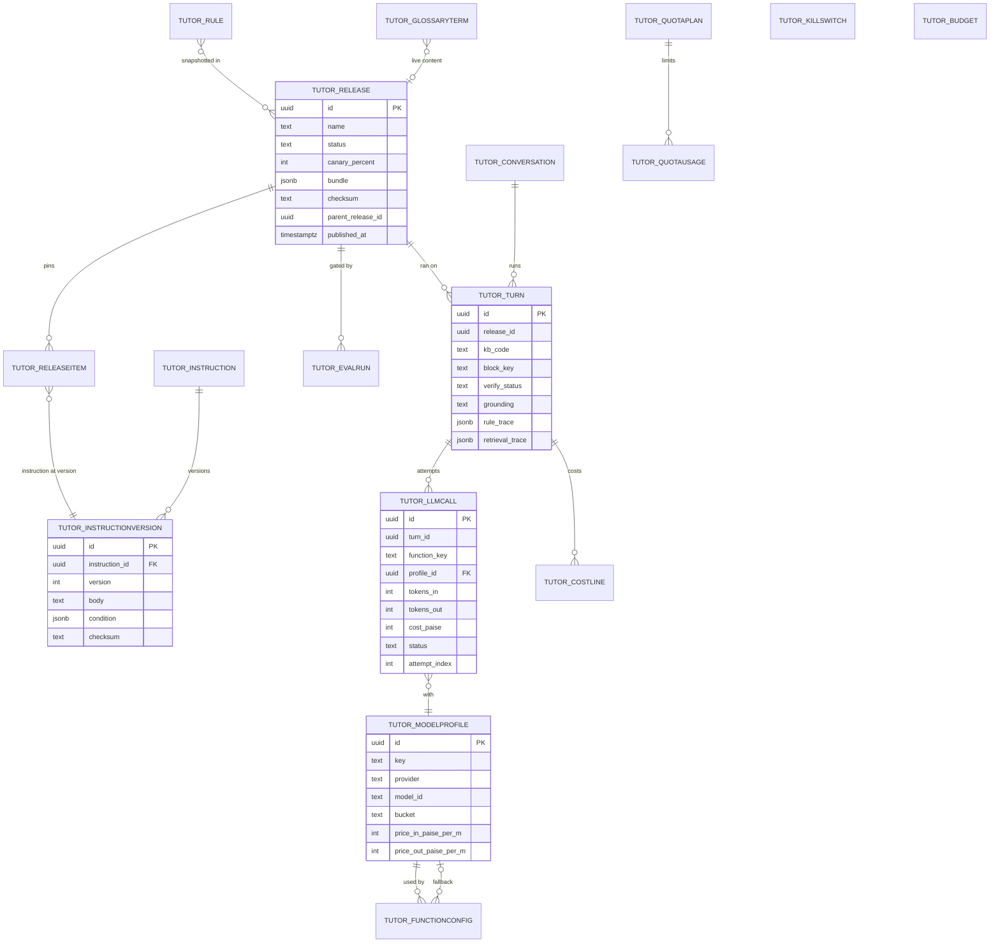

# ERD: F-17.1 Agent Platform

| Field | Value |
| --- | --- |
| Linked PRD | `docs/product/prd/F-17.1-agent-platform.md` |
| Parent ERD | `docs/product/erd/F-17-ai-tutor-and-context-agent.md` (tables kept there are listed in section 3; this file changes some of them) |
| Django apps | `apps/api/modules/tutor` (tables `tutor_*`), `apps/api/integrations/llm` (no tables) |
| Web module | `apps/web/src/modules/tutor` (host), `packages/tutor-widget` (F-17.5) |
| Depends on | `core/plans.py`, `core/feature_flags.py`, `core/registry.py`, `core/jobs.py`, `core/agent_registry.py` (new), `tutorkb` (retrieval, by service call), `tutorblocks` (block handlers, by registry) |
| Last updated | 2026-10-15 |

## 0. Design decisions

1. **Configuration is released, not live.** Editable draft rows exist for instructions, function configs, rules and block settings. Publishing compiles them into one immutable JSON bundle in `tutor_release`. The runtime reads only the bundle. Every turn stores the release id.
2. **Versions are rows, not strings.** An instruction edit inserts a `tutor_instructionversion`. Nothing is updated in place, so any release can be rebuilt and any change diffed.
3. **One ledger row per model attempt.** `tutor_llmcall` is append-only and holds numbers only. `tutor_costline` stays the financial rollup per turn and per component; it points back to the attempts.
4. **Rules are data with a closed language.** Conditions are JSON trees over a fixed variable catalogue, actions come from a fixed catalogue. No expression strings, no code.
5. **Text is hard text.** Message text, summaries and prompts exist only in `tutor_message`, `tutor_conversation.summary` and instruction versions (staff text). None reaches logs, Sentry or PostHog.
6. **The knowledge base is another app.** This ERD references it by `kb_code` and `embedding_set_id` values only (no foreign key), so `tutorkb` stays independently deployable.
7. **Fail closed.** A plan with no `tutor_quotaplan` row, a user with no consent at the current version, an unreadable kill switch table: no turn.
8. **Django is the only gateway.** RLS enabled, no policies, on every table.

## 1. Diagram (new and changed tables)



## 2. New tables

All ids are `uuid` generated by the database unless stated. Timestamps are `timestamptz`. Staff-edited tables carry `created_by`, `updated_by` (user ids by value) and are audited by `tutoradmin` (F-17.4).

### 2.1 `tutor_instruction`

One editable instruction slot (for example "tone, brief" or "law block, quote the section"). The text lives in versions.

| Column | Type | Null | Default | Notes |
| --- | --- | --- | --- | --- |
| id | uuid | no | gen | PK |
| key | text | no | | stable slug, unique, for example `platform.grounding`, `tone.warm_brief`, `block.law.core`, `locale.hinglish.style` |
| layer | text | no | | `platform`, `persona`, `tone`, `policy`, `course`, `block`, `locale`, `mode` |
| title | text | no | | admin label |
| scope | jsonb | no | `{}` | `{kb:[...], block:[...], locale:[...], plan_band:[...], age_band:[...]}`. Empty means everywhere |
| priority | smallint | no | 100 | lower first inside a layer |
| required | boolean | no | false | true for the platform layer rows that cannot be removed |
| enabled | boolean | no | true | |
| draft_version_id | uuid | yes | | the version being edited (not yet in a release) |
| created_by, updated_by | uuid | yes | | |
| created_at, updated_at | timestamptz | no | now() | |

Constraints and indexes: unique `key`; check `layer in (...)`; `(layer, enabled, priority)` for the compile step. A required row cannot be disabled or deleted (service rule, tested).

### 2.2 `tutor_instructionversion`

Immutable text of an instruction. Never updated after insert.

| Column | Type | Null | Default | Notes |
| --- | --- | --- | --- | --- |
| id | uuid | no | gen | PK |
| instruction_id | uuid | no | | FK, cascade |
| version | int | no | | 1, 2, 3 per instruction |
| body | text | no | | staff text with `{var}` placeholders from the whitelist; at most 6,000 characters |
| condition | jsonb | yes | | optional inclusion condition, same language as rules |
| variables | text[] | no | `{}` | placeholders found at insert time, checked against the whitelist |
| checksum | text | no | | sha256 of body and condition |
| note | text | yes | | change note, 200 characters |
| created_by | uuid | yes | | |
| created_at | timestamptz | no | now() | |

Constraints and indexes: unique `(instruction_id, version)`; check `char_length(body) <= 6000`; trigger rejects updates and deletes except by cascade from the instruction (immutability, same pattern as `recall_reviewlog` on PostgreSQL; ordinary table on SQLite for unit tests).

### 2.3 `tutor_release`

The unit of rollout.

| Column | Type | Null | Default | Notes |
| --- | --- | --- | --- | --- |
| id | uuid | no | gen | PK |
| name | text | no | | for example `2026-10-20 tone and exam-week rule` |
| status | text | no | `candidate` | `candidate`, `canary`, `live`, `retired`, `discarded` |
| canary_percent | smallint | no | 0 | 0 to 100; only meaningful in `canary` |
| canary_scope | jsonb | no | `{}` | optional `{kb:[...], plan_band:[...]}` |
| bundle | jsonb | no | | the compiled, validated, immutable document (section 2.4) |
| bundle_schema | smallint | no | 1 | version of the bundle format |
| checksum | text | no | | sha256 of the canonical bundle |
| parent_release_id | uuid | yes | | the release this was cloned from |
| gate_run_id | uuid | yes | | FK `tutor_evalrun` that passed the gate, null when overridden |
| gate_override_reason | text | yes | | set when promoted over a failing gate; audited |
| notes | text | yes | | |
| created_by | uuid | yes | | |
| created_at | timestamptz | no | now() | |
| published_at | timestamptz | yes | | when it first became `canary` or `live` |
| retired_at | timestamptz | yes | | |

Constraints and indexes: exactly one `live` release (partial unique index on `(status) where status = 'live'`); at most one `canary` (partial unique on `status = 'canary'`); trigger rejects updates of `bundle` and `checksum` after insert; `(status, published_at desc)` for admin lists. A global counter row `tutor_configversion` (single-row table, one `int` bumped inside the promote and rollback transaction) is what the runtime polls every 10 s.

### 2.4 The release bundle (JSON document, not a table)

```json
{
  "schema": 1,
  "style": {"persona_name": "Tutor", "voice": "warm_teacher", "verbosity": "standard",
            "caps": {"quick": 80, "explain": 150, "detailed": 600, "exam": 400},
            "address_form": "you", "emoji": false, "encouragement": 1, "exam_stress_mode": true},
  "instructions": [{"instruction_id": "...", "key": "platform.grounding", "version_id": "...", "layer": "platform",
                    "scope": {}, "priority": 10, "body": "...", "condition": null}],
  "functions": {"route.intent": {"profile_key": "gemini_lite", "temperature": 0, "max_tokens": 300,
                                 "schema_id": "router_v1", "cache": "none", "fallbacks": ["openai_lite"]}},
  "profiles": {"gemini_lite": {"provider": "gemini", "model_id": "...", "bucket": "lite",
                               "price_in_paise_per_m": 0, "price_out_paise_per_m": 0, "timeout_s": 8, "retries": 1}},
  "rules": [{"rule_id": "...", "name": "empty_retrieval", "priority": 500, "scope": {}, "stop": true,
             "condition": {"all": [{"var": "retrieval.count", "op": "eq", "value": 0}]},
             "actions": [{"type": "abstain", "message_key": "tutor.abstain.no_source"}]}],
  "blocks": {"law": {"enabled": true, "kb": ["ca", "cs", "cma"], "limits": {}, "settings": {}}},
  "thresholds": {"router_confidence": 0.6, "judge_sample_rate": 1.0, "retrieval_min_score": 0.0},
  "glossary_ref": "live",
  "static_messages_ref": "live"
}
```

Profiles are copied into the bundle with their prices at publish time, so ledger lines of a turn use the prices of its release.

### 2.5 `tutor_modelprofile`

A callable model with its price and limits. Editable draft table; the bundle holds a copy.

| Column | Type | Null | Default | Notes |
| --- | --- | --- | --- | --- |
| id | uuid | no | gen | PK |
| key | text | no | | unique slug, for example `gemini_fast`, `gemini_lite`, `gemini_reasoning`, `gemini_embed`, `openai_compat_vllm` |
| provider | text | no | | `gemini`, `openai_compatible`, `anthropic` |
| model_id | text | no | | vendor model name |
| bucket | text | no | | `reasoning`, `fast`, `lite`, `vision`, `embed`, `rerank` |
| endpoint_ref | text | yes | | env var name for a base URL (never the URL or key) for `openai_compatible` |
| params | jsonb | no | `{}` | temperature, top_p, thinking budget; only keys the adapter accepts |
| price_in_paise_per_m | int | no | | paise per million input tokens |
| price_out_paise_per_m | int | no | 0 | |
| timeout_s | smallint | no | 30 | |
| max_retries | smallint | no | 1 | |
| supports_streaming | boolean | no | true | |
| supports_structured | boolean | no | true | |
| max_input_tokens | int | yes | | |
| enabled | boolean | no | true | |
| updated_by | uuid | yes | | |
| updated_at | timestamptz | no | now() | |

Constraints and indexes: unique `key`; check on `bucket` and `provider`; a profile with a price of 0 for a paid provider fails validation at release time (a `free` flag is not allowed). Keys and URLs are environment variables on the API roles, never rows.

### 2.6 `tutor_functionconfig`

Draft mapping of a function key to a profile. The release bundle snapshots it.

| Column | Type | Null | Default | Notes |
| --- | --- | --- | --- | --- |
| id | uuid | no | gen | PK |
| function_key | text | no | | unique, from the list in PRD FR-AP-63 |
| profile_id | uuid | no | | FK `tutor_modelprofile`, protect |
| fallback_profile_ids | uuid[] | no | `{}` | ordered |
| temperature | numeric(3,2) | no | 0.2 | |
| max_output_tokens | int | no | 1200 | |
| schema_id | text | yes | | key of a registered structured-output schema in code |
| cache_policy | text | no | `none` | `none`, `exact` |
| thinking_budget | int | yes | | tokens, for adapters that support it |
| plan_overrides | jsonb | no | `{}` | `{ "pro_max": {"profile_key": "gemini_reasoning"} }` per plan code |
| updated_by | uuid | yes | | |
| updated_at | timestamptz | no | now() | |

Constraints and indexes: unique `function_key`; a validator checks that the function's required capabilities (streaming for `answer.*`, structured output for `route.intent`, `numerical.*`, `verify.ground`) match the profile.

### 2.7 `tutor_rule`

A behaviour rule (a state and its actions). Draft table; the bundle snapshots enabled rules.

| Column | Type | Null | Default | Notes |
| --- | --- | --- | --- | --- |
| id | uuid | no | gen | PK |
| name | text | no | | unique slug, for example `empty_retrieval` |
| title | text | no | | admin label |
| priority | smallint | no | 100 | higher runs first |
| scope | jsonb | no | `{}` | `{kb:[...], block:[...], plan_band:[...]}` |
| condition | jsonb | no | | the condition tree (PRD FR-AP-51) |
| actions | jsonb | no | | ordered list of `{type, ...params}` from the catalogue; at most 8 |
| stop | boolean | no | false | end evaluation after this rule matches |
| enabled | boolean | no | true | |
| protected | boolean | no | false | true for `unsafe` and `empty_retrieval`: editable, not disable-able |
| version | int | no | 1 | incremented on each edit (history is in the audit log and in release bundles) |
| updated_by | uuid | yes | | |
| updated_at | timestamptz | no | now() | |

Constraints and indexes: unique `name`; `(enabled, priority desc)`; check `jsonb_array_length(actions) between 1 and 8`; check `priority between 0 and 1000`; a service validates the condition tree against the variable catalogue and each action against the action catalogue.

### 2.8 `tutor_killswitch`

Instant switches. Small table, read through a 15 second cache, fail closed.

| Column | Type | Null | Default | Notes |
| --- | --- | --- | --- | --- |
| key | text | no | | PK. `text`, `block.ask`, `block.formula`, `block.law`, `block.numerical`, `embeddings`, `ingestion`, `rerank`, `image_input` |
| enabled | boolean | no | true | false means off |
| reason | text | yes | | shown to staff only |
| updated_by | uuid | yes | | |
| updated_at | timestamptz | no | now() | |

If the table cannot be read, the cache answers `off` for everything except `ingestion` (so a database problem cannot burn money).

### 2.9 `tutor_budget`

Rupee ceilings.

| Column | Type | Null | Default | Notes |
| --- | --- | --- | --- | --- |
| id | uuid | no | gen | PK |
| scope | text | no | | `global_day`, `global_month`, `student_day` (per plan code), `ingestion_day`, `eval_run` |
| plan_code | text | yes | | for `student_day` |
| function_group | text | yes | | `answer`, `helpers`, `numerical`, `embedding`, `ingest`, `eval`; null means all |
| limit_paise | int | no | | zero means off (fail closed) |
| warn_at_percent | smallint | no | 80 | |
| updated_by | uuid | yes | | |
| updated_at | timestamptz | no | now() | |

Constraints and indexes: unique `(scope, coalesce(plan_code,''), coalesce(function_group,''))`.

### 2.10 `tutor_llmcall`

One row per model, embedding or rerank attempt. Append-only. Numbers and codes only.

| Column | Type | Null | Default | Notes |
| --- | --- | --- | --- | --- |
| id | uuid | no | gen | PK |
| turn_id | uuid | yes | | null for ingestion, evaluation and helper calls outside a turn |
| user_id | uuid | yes | | null for ingestion and evaluation |
| context | text | no | | `turn`, `ingest`, `eval`, `admin_preview` |
| function_key | text | no | | |
| profile_id | uuid | no | | FK `tutor_modelprofile` |
| model_id | text | no | | copied, so history survives profile edits |
| release_id | uuid | yes | | |
| attempt_index | smallint | no | 0 | |
| attempt_reason | text | yes | | `primary`, `timeout`, `rate_limit`, `server_error`, `parse_error` |
| tokens_in | int | no | 0 | |
| tokens_out | int | no | 0 | includes thinking tokens |
| cached_tokens_in | int | no | 0 | provider cache hits, when reported |
| cost_paise | int | no | 0 | computed from the profile's prices at the time |
| latency_ms | int | yes | | |
| first_token_ms | int | yes | | streaming only |
| status | text | no | | `ok`, `error`, `timeout`, `blocked`, `cancelled`, `budget` |
| parser_status | text | yes | | `ok`, `repaired`, `failed` for structured outputs |
| error_code | text | yes | | machine code only |
| created_at | timestamptz | no | now() | |

Constraints and indexes: `(turn_id)`; `(created_at, function_key)` for dashboards; `(user_id, created_at)` for retention; hash or range partitioning by month on PostgreSQL is optional from 1 million rows (note, not built in the first migration). Retention 25 months.

### 2.11 `tutor_glossaryterm`

Live content (outside releases). English term and its accepted Hindi and Hinglish renderings, plus do-not-translate terms.

| Column | Type | Null | Default | Notes |
| --- | --- | --- | --- | --- |
| id | uuid | no | gen | PK |
| term_en | text | no | | the English form, for example `depreciation` |
| hi | text | yes | | Devanagari rendering |
| hinglish | text | yes | | Latin-script rendering |
| do_not_translate | boolean | no | false | keep as written in every language |
| kb_codes | text[] | no | `{}` | empty means every knowledge base |
| definition_hint | text | yes | | one line for the model, not shown to students |
| status | text | no | `draft` | `draft`, `approved` |
| updated_by | uuid | yes | | |
| updated_at | timestamptz | no | now() | |

Constraints and indexes: unique `(lower(term_en))`; GIN `to_tsvector('simple', term_en)` for per-turn term matching; only `approved` rows reach the prompt.

### 2.12 `tutor_staticmessage`

Localised static copy used by rules and the runtime (abstain, welcome, redirect, quota notice). Live content, versioned by audit.

| Column | Type | Null | Default | Notes |
| --- | --- | --- | --- | --- |
| key | text | no | | PK. `tutor.abstain.no_source`, `tutor.welcome.first_turn`, `tutor.redirect.other_course`, `tutor.quota.low` |
| en | text | no | | |
| hi | text | yes | | |
| hinglish | text | yes | | |
| placeholders | text[] | no | `{}` | allowed `{var}` names |
| updated_by | uuid | yes | | |
| updated_at | timestamptz | no | now() | |

A missing `hi` or `hinglish` falls back to `en` and increments a counter shown in admin.

### 2.13 `tutor_configversion`

Single-row table with `id smallint primary key check (id = 1)` and `version bigint not null`. Bumped inside the promote, rollback, kill-switch and budget transactions. Runtimes compare it every 10 seconds and reload the live bundle when it changes.

## 3. Tables kept from the parent ERD, and what changes

The parent ERD (`F-17-ai-tutor-and-context-agent.md`) keeps these as written: `tutor_toolcall` (2.4), `tutor_action` (2.6), `tutor_voice_session` (2.7), `tutor_memory` (2.9), `tutor_consent` (2.11), `tutor_lexicon` (2.15), `tutor_report` (2.18). These change:

| Parent table | Change | Reason |
| --- | --- | --- |
| `tutor_conversation` (2.1) | Add `kb_code text not null`, `enrollment_id uuid null` (by value), `state jsonb not null default '{}'`, `summary text null` (hard text), `summary_through_turn int null`, `language_locked text null`, `last_block text null`. `mode` values gain `hint` and `exam` | One knowledge base per conversation; the state and rolling summary of PRD 5.4 and FR-AP-22 |
| `tutor_message` (2.2) | `structured` now holds `cards` (block cards, F-17.3) and `verify` (`status`, corrections as ids), besides `blocks` | Cards and verification |
| `tutor_turn` (2.3) | Add `release_id uuid not null`, `canary boolean not null default false`, `kb_code text not null`, `embedding_set_id smallint null`, `block_key text not null`, `block_source text not null` (`forced`, `pre_router`, `router`, `rule`), `locale text not null`, `router jsonb null` (`{confidence, language, needs_clarification}`, codes only), `rule_trace jsonb null`, `retrieval_trace jsonb null` (counts, scores, ranks, mode `hybrid` or `fts_only`; no text), `verify_status text null` (`pending`, `verified`, `corrected`, `unverified`), `judge_verdict text null`, `grounding text not null default 'none'` (`full`, `partial`, `none`), `regenerates_turn_id uuid null`, `experiment_tag text null`, `weight smallint not null default 1`. `prompt_version` is replaced by `release_id`. `model` becomes the primary answer profile key | Audit and reproducibility |
| `tutor_citation` (2.5) | `source_kind` gains `kb_chunk`, `formula`, `law_section`, `solver_step`. `chunk_id` is replaced by `ref_kind text` and `ref_id uuid` (by value, no foreign key: a `tutorkb_chunk`, `tutorblocks_formula` or `tutorblocks_lawsection` id) plus `source_title text` and `locator jsonb` (page, heading path, timestamp, section) copied at answer time so chips survive re-indexing | Citations point across apps without foreign keys; chips survive changes |
| `tutor_quotaplan` (2.12) | Add `tutor_access boolean not null default false`, `block_limits jsonb not null` (`{ask:{per_day:40,weight:1}, formula:{...}, law:{...}, numerical:{per_day:15,weight:3}}`), `daily_budget_paise int not null`, `history_days smallint not null`, `kb_scope text not null default 'own_course'` (`own_course`, `all_enrolled`), `image_input boolean not null default false`, `priority_models boolean not null default false`. `plan_code` gains `pro_max` | Section 9 of the architecture; PRD 11.1 |
| `tutor_quotausage` (2.13) | Add `units_used int not null default 0`, `per_block jsonb not null default '{}'`. `text_turns` is kept as total turns | Block weights and per-block counters |
| `tutor_costline` (2.8) | Add `llmcall_ids uuid[] not null default '{}'` and `function_group text not null`; `component` gains `rerank` and `ingest` | Link to attempts; budget by group |
| `tutor_settings` (2.10) | Add `language text not null default 'match'` (`match`, `en`, `hi`, `hinglish`), `digits text not null default 'latin'`, `help_improve boolean not null default false`. Retention remains | Language engine; opt-in |
| `tutor_evalcase` (2.16) and `tutor_evalrun` (2.17) | Replaced by section 4 below | Release gating, per-language scoring |
| `tutor_chunk` (2.14) | **Removed from this app.** Platform content moves to `tutorkb_chunk` (F-17.2 ERD). Existing planning only; no data to migrate | One knowledge plane |

## 4. Evaluation tables (replace parent 2.16 and 2.17)

### 4.1 `tutor_evalcase`

| Column | Type | Null | Default | Notes |
| --- | --- | --- | --- | --- |
| id | uuid | no | gen | PK |
| suite | text | no | | `ask`, `formula`, `law`, `numerical`, `abstain`, `injection`, `safety`, `routing`, `language`, `rules` |
| kb_code | text | yes | | null for cross-course |
| block_key | text | yes | | expected block |
| lang | text | no | `en` | `en`, `hi`, `hinglish` |
| risk | text | no | `normal` | `normal`, `high` |
| input | jsonb | no | | `{message, student:{level, days_left, plan}, history:[...], page:{route_id}}`; staff-written, no student data |
| assertions | jsonb | no | | list of `{type, ...}` from PRD FR-AP-101 |
| reference | text | yes | | reference answer for the judge |
| status | text | no | `draft` | `draft`, `active`, `retired` |
| source | text | no | `staff` | `staff`, `report`, `thumbs_down` (identifiers removed on conversion) |
| tags | text[] | no | `{}` | |
| created_by | uuid | yes | | |
| created_at | timestamptz | no | now() | |

Constraints and indexes: `(suite, status)`, `(kb_code, block_key, lang)` for sampling; GIN on `tags`.

### 4.2 `tutor_evalrun`

| Column | Type | Null | Default | Notes |
| --- | --- | --- | --- | --- |
| id | uuid | no | gen | PK |
| release_id | uuid | yes | | FK `tutor_release`, the release under test |
| mode | text | no | | `fake`, `real`, `retrieval_only` |
| suites | text[] | no | | |
| status | text | no | `queued` | `queued`, `running`, `done`, `failed`, `stopped_budget` |
| budget_paise | int | no | 0 | cap; the run stops when reached |
| cost_paise | int | no | 0 | |
| metrics | jsonb | no | `{}` | `{groundedness, citation_validity, abstention, fabricated_sections, router_accuracy, injection, safety, judge_mean, by_lang:{en,hi,hinglish}, by_block:{...}}` |
| passed | boolean | yes | | against the thresholds of PRD FR-AP-102 |
| results_ref | text | yes | | Storage path of the per-case JSON (no student data) |
| started_at, finished_at | timestamptz | | | |
| created_by | uuid | yes | | |

Constraints and indexes: `(release_id, finished_at desc)`; a release's `gate_run_id` must reference a run with `passed = true`.

## 5. Enumerations and reference data

| Enumeration | Values | Maintained by |
| --- | --- | --- |
| instruction layer | `platform`, `persona`, `tone`, `policy`, `course`, `block`, `locale`, `mode` | code |
| release status | `candidate`, `canary`, `live`, `retired`, `discarded` | code |
| model bucket | `reasoning`, `fast`, `lite`, `vision`, `embed`, `rerank` | code |
| provider | `gemini`, `openai_compatible`, `anthropic` | code (adapters) |
| function key | list in PRD FR-AP-63 | code (adds a default profile in seed) |
| rule action | `abstain`, `send_static`, `ask_clarify`, `force_block`, `skip_retrieval`, `set_mode`, `set_style`, `limit_tools`, `escalate_model`, `attach_nudge`, `flag_turn`, `end_turn` | code |
| condition operator | `eq`, `ne`, `gt`, `gte`, `lt`, `lte`, `in`, `not_in`, `contains`, `exists` | code |
| block key | `ask`, `formula`, `law`, `numerical` (more by registration) | code (`BlockSpec`) |
| verify status | `pending`, `verified`, `corrected`, `unverified` | code |
| grounding | `full`, `partial`, `none` | code |
| plan code | `free`, `pro`, `pro_max`, `staff` | staff with `tutor.models`, seeded by migration |
| Seed data | model profiles (6), function configs (20), instructions (about 30: platform 6, persona 1, tone 3, policy 4, block 4 to 8, locale 3, mode 4), default rules (10), static messages (about 40), quota plans (4), budgets, kill switches (9, all on except `image_input`), the first release `r0001`, evaluation cases (about 150 across 10 suites) | repo files under `modules/tutor/seed/`, loaded by `manage.py load_tutor_seed` as drafts, then released |

Prices live in `tutor_modelprofile` and are copied into each release and each ledger row. `GEMINI_PRICE_*` settings remain only as the default when seeding.

## 6. Query patterns

| # | Pattern | Frequency | Served by |
| --- | --- | --- | --- |
| Q1 | Admission: plan row by code (cached 5 min), consent latest by scope, usage row by `(user, today)` with `select for update` | every turn | PKs and the consent index of the parent ERD |
| Q2 | Live release bundle | every turn | in-process cache keyed by `tutor_configversion.version`; one `select version` every 10 s per instance |
| Q3 | Canary decision | every turn | hash of `(user_id, release_id, day)`; no query |
| Q4 | Kill switches and budgets | every turn | cached 15 s, one query per instance per refresh |
| Q5 | Load window: last 6 exchanges and summary | every turn | `tutor_message (conversation_id, created_at)` |
| Q6 | Insert turn (idempotent), later update with usage | every turn | unique `(user_id, client_turn_id)` |
| Q7 | Insert ledger rows | per model attempt | append only, no index contention beyond the PK |
| Q8 | Global budget gate | every turn | sum of `tutor_llmcall.cost_paise` for today, cached 60 s per instance; a nightly job rebuilds a `tutor_costdaily` rollup if the table grows |
| Q9 | Glossary terms for the turn | per turn when language is not English | trigram or `to_tsvector` match on the normalised query, top 12 |
| Q10 | Instruction compile | on release | `(layer, enabled, priority)` |
| Q11 | Evaluation sampling | per run | `(suite, status)`, `(kb_code, block_key, lang)` |
| Q12 | Admin dashboards: cost, groundedness, abstention, fallback rate by release and day | per view | `tutor_turn (release_id, started_at)`, `tutor_llmcall (created_at, function_key)` |
| Q13 | Retention purge | daily | `tutor_message (user_id, created_at)` joined to settings |

## 7. Storage

No files. Evaluation per-case results go to a private Storage path (`tutor-kb/evals/`) with generated names; they hold staff-written inputs and outputs only. No audio, no student uploads in this app (images arrive in F-17.3 W10 and use the existing media pipeline).

## 8. Security

- RLS enabled, no policies, on every table in this file. The Supabase Data API cannot reach them.
- Student tables filter by `user_id` in every query; a test creates two users and asserts 404 across every endpoint in PRD 9.
- Hard text columns: `tutor_message.body`, `tutor_message.structured`, `tutor_conversation.summary`, `tutor_conversation.title`. They never appear in logs, Sentry, PostHog, URLs or error messages; the static scan fails the build on a reference outside the allowed modules.
- Staff text (instruction versions, rule titles, glossary) is not student data but is audited.
- The release bundle contains instruction text and prices, never secrets. Provider keys and endpoints are environment variables on the API roles.
- Immutability triggers on `tutor_instructionversion` and on `tutor_release.bundle`, tested on PostgreSQL.
- Staff scopes: `tutor.instructions`, `tutor.releases`, `tutor.models`, `tutor.eval`, `tutor.reports` (F-17.4). Reading a turn's text needs a report or the student's opt-in, and the read is logged.

## 9. Migration and rollout

| # | Migration | Contents | Needed by |
| --- | --- | --- | --- |
| 0001 | `core_tables` | `tutor_settings`, `tutor_consent`, `tutor_quotaplan` (with the new columns), `tutor_quotausage`, `tutor_killswitch`, `tutor_budget`, `tutor_configversion`, RLS | W1 |
| 0002 | `ledger` | `tutor_modelprofile`, `tutor_functionconfig`, `tutor_llmcall`, `tutor_costline` | W1 |
| 0003 | `conversations` | `tutor_conversation`, `tutor_message`, `tutor_turn`, `tutor_toolcall`, `tutor_citation` with the changes in section 3 | W3 |
| 0004 | `config` | `tutor_instruction`, `tutor_instructionversion` (immutability trigger), `tutor_release` (partial unique indexes, immutability trigger), `tutor_rule`, `tutor_glossaryterm`, `tutor_staticmessage` | W3 |
| 0005 | `quality` | `tutor_evalcase`, `tutor_evalrun`, `tutor_report` | W3 |
| later | parent migrations | `tutor_action`, `tutor_memory`, `tutor_voice_session`, `tutor_lexicon` | umbrella releases |

Seed loading is `manage.py load_tutor_seed` (drafts), then `manage.py tutor_release_create --name r0001 --promote` for the first release (no gate on an empty database; the command warns). SQLite (unit tests) gets ordinary tables where PostgreSQL uses triggers or partial unique indexes, as in recall decision D5; trigger, partial index and concurrency tests are PostgreSQL only and skip on SQLite.

Ticks (inside the 5-minute `POST /api/v1/tutor/internal/tick/`): close orphan turns (running more than 2 minutes become `failed`), retention purge (daily), usage rebuild (weekly), budget rollup (daily), alert evaluation. Rollback of the whole feature: flag `ai_tutor` off, plus `manage.py purge_tutor --all` by hand.
