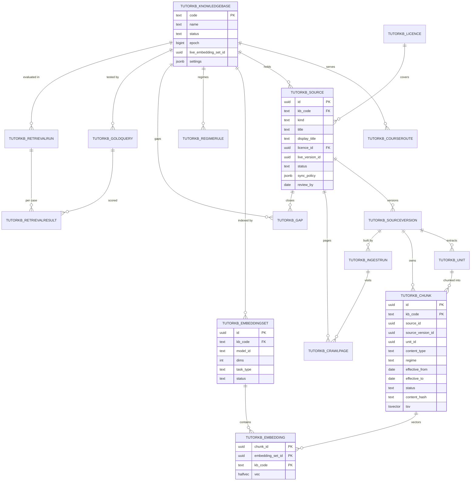

# ERD: F-17.2 Knowledge Bases and Ingestion

| Field | Value |
| --- | --- |
| Linked PRD | `docs/product/prd/F-17.2-knowledge-bases-and-ingestion.md` |
| Parent ERD | `docs/product/erd/F-17-ai-tutor-and-context-agent.md` (its `tutor_chunk` table is **removed**; chunks live here as `tutorkb_chunk`) |
| Sibling ERDs | `F-17.1-agent-platform.md` (refers to this app by `kb_code` and `embedding_set_id` values only), `F-17.3-study-blocks.md` (statute mirror, `lawmap`) |
| Django app | `apps/api/modules/tutorkb` (tables `tutorkb_*`) |
| Depends on | `core/jobs.py` (`core_job`), `core/registry.py`, `integrations/llm` (embedding, vision, speech adapters), `integrations/storage`, `modules/syllabus` (by value, through its selector, no foreign key), `media.scan` job |
| Last updated | 2026-10-15 |

## 0. Design decisions

1. **Four partitions, one schema.** `tutorkb_chunk` and `tutorkb_embedding` are `LIST` partitioned on `kb_code`. A fifth knowledge base is one row plus two `CREATE TABLE ... PARTITION OF` statements. Every retrieval query names one `kb_code`, so the planner reads one partition.
2. **Text and vectors are separate tables.** A chunk is text and metadata. An embedding is a vector belonging to an **embedding set** (model, dimension, task type, normalisation). Re-embedding with a new model builds a second set beside the live one and flips a pointer; chunks do not change.
3. **Sources are versioned, chunks belong to a version.** Publishing flips the live version in one transaction, so a query never sees a mix of old and new chunks of one source.
4. **Live set only in the index.** The HNSW index on each partition is a partial index on `embedding_set_id = <live set>`. Old sets are not indexed; a candidate set gets its own partial index before the flip.
5. **By value, not by foreign key, across apps.** Taxonomy columns (`course_code`, `level_code`, `paper_id`, `chapter_id`, `topic_id`) hold F-02 values with no foreign key. A deleted chapter never breaks retrieval or a migration.
6. **No student text in this app.** The gap queue stores labels. Retrieval traces live on `tutor_turn`. Queries are never persisted here.
7. **Soft delete, then purge.** Status flips first; a scheduled job removes text and files 90 days later.
8. **Rights are data.** Licence rows drive quoting, expiry unpublishing and the training export. The retriever filters by rights; the verifier (F-17.1) enforces quote limits.
9. **Django is the only gateway.** RLS is enabled with no policies on every table.
10. **Test database stays SQLite.** Partitions, `halfvec`, HNSW, `tsvector` and trigram are PostgreSQL features. Migrations use `RunSQL` guarded by `connection.vendor == "postgresql"`, and a `TestVectorBackend` (JSON array plus brute force cosine, `LIKE` for text) keeps the unit suite on SQLite. A marked `pg` test suite runs against a real PostgreSQL with pgvector in CI.

## 1. Diagram



## 2. Tables

Common columns on every table unless stated: `id uuid` primary key (`gen_random_uuid()`), `created_at timestamptz`, `updated_at timestamptz`. `jsonb` is `JSONField`. Enumerations are `TextChoices` with a check constraint.

### 2.1 `tutorkb_knowledgebase`

Four rows at launch. Primary key is the code, because it is the partition key everywhere.

| Column | Type | Notes |
| --- | --- | --- |
| `code` | text PK | `school`, `cs`, `cma`, `ca`. Lowercase, `^[a-z][a-z0-9_]{1,15}$` |
| `name` | text | Display name for staff ("Class 11 and 12") |
| `status` | text | `building` (staff only), `open` (students admitted), `paused` (retrieval returns `kb_not_open`) |
| `epoch` | bigint | Incremented on publish, withdraw, restore, regime change, flip. The retriever reads it (15 s cache) to invalidate caches |
| `live_embedding_set_id` | uuid null | Pointer to `tutorkb_embeddingset`. Null while `building` |
| `settings` | jsonb | Chunking defaults, retrieval thresholds, rerank per block, allowed kinds, `review_mode` (`manual`, `auto_for_trusted`), `kb_scope_note`. Validated by a serializer schema (FR-KB-08) |
| `readiness` | jsonb | Last readiness check result (FR-KB-94): gold size, recall, isolation, licences, overdue law, suspicious chunks |

Constraints: `UNIQUE(name)`. `status = 'open'` requires `live_embedding_set_id IS NOT NULL` (check). Opening is done by a service that runs the readiness check, not by a raw update.

### 2.2 `tutorkb_courseroute`

| Column | Type | Notes |
| --- | --- | --- |
| `course_code` | text | F-02 course code, by value |
| `kb_code` | text FK | |
| `level_code` | text null | Optional: route only some levels (for example `school` for `class-11`, `class-12`) |
| `active` | bool | |

`UNIQUE(course_code, COALESCE(level_code, ''))` (expression index). Lookup is most-specific first: a row with a level beats a row without. A course with no active row has no tutor access (FR-KB-02).

### 2.3 `tutorkb_licence`

| Column | Type | Notes |
| --- | --- | --- |
| `holder` | text | Rights holder or "Self" |
| `licence_type` | text | `own`, `licensed`, `statute_public`, `institute_public`, `link_only` |
| `terms` | text | Plain-language summary (staff text) |
| `allows_retrieval` | bool | |
| `quote_limit_words` | int null | 0 = no quoting, null = unlimited |
| `allows_training` | bool | Default false |
| `expires_on` | date null | |
| `evidence_path` | text null | Storage path in `tutor-kb` (licence letter or screenshot) |
| `contact` | text | |
| `status` | text | `active`, `expired`, `revoked` |

Check: `licence_type = 'link_only'` implies `allows_retrieval = false`. Index on `(status, expires_on)` for the tick that unpublishes expired licences (FR-KB-13).

### 2.4 `tutorkb_source`

| Column | Type | Notes |
| --- | --- | --- |
| `kb_code` | text FK | |
| `kind` | text | `text`, `faq`, `dataset`, `pdf`, `docx`, `pptx`, `xlsx`, `webpage`, `website`, `image`, `video`, `audio`, `youtube`, `statute`, `amendment`, `link` |
| `title` | text | Staff title |
| `display_title` | text | What students see in citations |
| `licence_id` | uuid FK | Required to publish (FR-KB-11) |
| `status` | text | `draft`, `estimating`, `confirmed`, `processing`, `needs_review`, `ready`, `live`, `needs_attention`, `withdrawn`, `deleted`, `failed`, `stopped_budget` |
| `live_version_id` | uuid null | The version students read |
| `latest_version_id` | uuid null | Newest built version |
| `origin` | jsonb | Kind-specific: `{url, seed, sitemap}`, `{storage_path, mime, bytes, pages}`, `{youtube_id}`, `{statute_act_id}` |
| `taxonomy` | jsonb | Defaults for its chunks: `course_code`, `level_code`, `paper_id`, `chapter_id`, `topic_id` |
| `language` | text | `en`, `hi`, `hinglish`, `mixed` |
| `trusted` | bool | Eligible for `auto_for_trusted` publish |
| `tags` | text[] | |
| `sync_policy` | jsonb | `{cadence, add_new_pages, reprocess_changed, path_prefixes, paused}` |
| `next_sync_at` | timestamptz null | Drives `tkb.sync_due` |
| `crawl_rules` | jsonb | Allowed hosts, include and exclude patterns, depth, page cap, `respect_robots` |
| `review_by` | date null | FR-KB-83 |
| `owner_id` | uuid | Staff profile id, by value |
| `cost_cap_paise` | int | Per-run cap (FR-KB-41) |
| `deleted_at` | timestamptz null | Purge after 90 days |

Indexes: `(kb_code, status)`, `(next_sync_at) WHERE status = 'live' AND next_sync_at IS NOT NULL`, `(review_by) WHERE status = 'live'`, `(licence_id)`. Check: `kind = 'link'` sources never own chunks (enforced in service, asserted by a test).

### 2.5 `tutorkb_sourceversion`

Immutable once `status = 'built'`.

| Column | Type | Notes |
| --- | --- | --- |
| `source_id` | uuid FK | |
| `version` | int | Per source, starts at 1 |
| `status` | text | `building`, `built`, `live`, `superseded`, `failed` |
| `settings_snapshot` | jsonb | Chunking and cleaning settings used |
| `content_hash` | text | Hash over the extracted units |
| `file_path` | text null | Original in `tutor-kb` |
| `page_count`, `unit_count`, `chunk_count`, `token_count` | int | |
| `quality` | jsonb | Per-page scores and flags (FR-KB-42) |
| `diff_summary` | jsonb | Added, changed, removed units against the previous version |
| `built_at`, `published_at` | timestamptz null | |
| `published_by` | uuid null | |

`UNIQUE(source_id, version)`. A partial unique index `ON (source_id) WHERE status = 'live'` guarantees one live version per source.

### 2.6 `tutorkb_unit`

The extracted structural piece (a page, a section, a Q and A pair, a table, a time window) before chunking.

| Column | Type | Notes |
| --- | --- | --- |
| `source_version_id` | uuid FK | |
| `kb_code` | text | Copied for partition-aligned joins |
| `ordinal` | int | Position inside the version |
| `unit_kind` | text | `page`, `section`, `qa`, `table`, `figure`, `window`, `row_group`, `statute_section` |
| `locator` | jsonb | `{page: 14}`, `{start_s: 312, end_s: 361}`, `{url, anchor}`, `{sheet, rows}` |
| `heading_path` | text[] | Ancestors, outermost first |
| `text` | text | Cleaned text. For `image`, the description plus OCR text |
| `text_hash` | text | |
| `extraction` | jsonb | `{method: "pdfium"|"tesseract"|"vision"|"speech"|"html", confidence, lang}` |
| `asset_path` | text null | Extracted image or crop in `tutor-kb` |

`UNIQUE(source_version_id, ordinal)`. Index `(source_version_id, text_hash)` for change detection between versions.

### 2.7 `tutorkb_chunk` (partitioned)

Partitioned `BY LIST (kb_code)`. Primary key `(id, kb_code)` because a partitioned table's key must include the partition column. Foreign keys **to** this table from other tables are not declared (a partitioned parent cannot be referenced by a single-column foreign key); `tutorkb_embedding` and citations store `(chunk_id, kb_code)` and integrity is checked by a nightly consistency job.

| Column | Type | Notes |
| --- | --- | --- |
| `id` | uuid | |
| `kb_code` | text | Partition key |
| `source_id` | uuid | Denormalised from the version for filtering and rights |
| `source_version_id` | uuid | |
| `unit_id` | uuid | |
| `ordinal` | int | Order inside the unit, used to expand neighbours (FR-KB-67) |
| `text` | text | Display text |
| `text_override` | text null | Staff edit (FR-KB-101); display and embedding use the override when set |
| `embed_text` | text | Contextual string that is embedded: `course > level > paper > chapter > heading path` plus the text (FR-KB-45) |
| `heading_path` | text[] | |
| `locator` | jsonb | |
| `token_count` | int | |
| `content_hash` | text | Hash of `embed_text`; used for embedding reuse (FR-KB-46) and duplicate detection |
| `content_type` | text | `explanation`, `statute`, `standard`, `case`, `example`, `question`, `solution`, `formula`, `glossary`, `summary`, `amendment` |
| `difficulty` | smallint null | 1 to 3 |
| `language` | text | `en`, `hi`, `hinglish` |
| `course_code`, `level_code` | text null | By value |
| `paper_id`, `chapter_id`, `topic_id` | text null | By value (F-02 ids as text) |
| `regime` | text null | For example `it_1961`, `it_2025` |
| `effective_from`, `effective_to` | date null | `effective_to` set when superseded by an amendment |
| `exam_terms` | text[] | For example `{2027-05}` |
| `amendment_year` | smallint null | |
| `is_official` | bool | |
| `rights_class` | text | Copied from the licence: `own`, `licensed`, `statute_public`, `institute_public` |
| `quote_limit_words` | int null | Copied from the licence |
| `ref_kind` | text null | `law_section` for the statute mirror (FR-KB-30) |
| `ref_id` | uuid null | Id in F-17.3 `lawsection` for mirrored chunks |
| `status` | text | `draft`, `live`, `superseded`, `inactive`, `suspicious` |
| `flags` | text[] | `injection`, `pii`, `near_duplicate`, `low_quality`, `edited` |
| `tsv` | tsvector | Generated: `to_tsvector('english', coalesce(text_override, text) || ' ' || array_to_string(heading_path, ' '))`, weight A for headings, B for text |
| `tsv_simple` | tsvector null | Generated with the `simple` configuration, filled only when `language <> 'en'` or the chunk has aliases (FR-KB-61) |
| `aliases` | text[] | FAQ aliases in Hindi and Hinglish; included in `tsv_simple` |
| `heading_path_text` | text | Generated: `array_to_string(heading_path, ' > ')`; feeds the trigram index |

Partitions: `tutorkb_chunk_school`, `tutorkb_chunk_cs`, `tutorkb_chunk_cma`, `tutorkb_chunk_ca`, each `FOR VALUES IN ('<code>')`.

Indexes (created on the parent, so each partition gets one):

| Index | Definition | Serves |
| --- | --- | --- |
| `chunk_live_filter` | `(paper_id, chapter_id, content_type) WHERE status = 'live'` | Hard filters |
| `chunk_regime_dates` | `(regime, effective_from, effective_to) WHERE status = 'live'` | Regime and `on_date` filters |
| `chunk_tsv_gin` | `GIN (tsv) WHERE status = 'live'` | Full-text leg |
| `chunk_tsv_simple_gin` | `GIN (tsv_simple) WHERE status = 'live' AND tsv_simple IS NOT NULL` | Non-English leg |
| `chunk_title_trgm` | `GIN (heading_path_text gin_trgm_ops)` on a generated `text` column of the joined heading path | Admin search and fuzzy entity match |
| `chunk_source_version` | `(source_version_id, ordinal)` | Publish flip, neighbours |
| `chunk_hash` | `(content_hash)` | Embedding reuse, duplicates |
| `chunk_unit` | `(unit_id, ordinal)` | Neighbour expansion |
| `chunk_ref` | `(ref_kind, ref_id) WHERE ref_kind IS NOT NULL` | Statute mirror upserts |

Checks: `status = 'live'` requires `flags` not containing `injection`. `effective_to IS NULL OR effective_to >= effective_from`. `rights_class <> 'link_only'` (link-only sources own no chunks).

### 2.8 `tutorkb_embeddingset`

| Column | Type | Notes |
| --- | --- | --- |
| `kb_code` | text FK | |
| `name` | text | For example `gemini-embedding-001-768-v1` |
| `provider` | text | `gemini` |
| `model_id` | text | `gemini-embedding-001` |
| `dims` | int | 768 at launch (Matryoshka truncation of the 3072 default; see 4.2) |
| `task_type_doc` | text | `RETRIEVAL_DOCUMENT` |
| `task_type_query` | text | `RETRIEVAL_QUERY` |
| `normalized` | bool | True: vectors are L2-normalised after truncation, a requirement for truncated dimensions |
| `status` | text | `building`, `ready`, `live`, `retired` |
| `coverage` | jsonb | `{chunks_total, chunks_embedded}` |
| `index_name` | text null | Name of the partial HNSW index on this set |
| `index_params` | jsonb | `{m, ef_construction}` |
| `gold_summary` | jsonb null | Latest comparison with the live set (FR-KB-93) |
| `flipped_at` | timestamptz null | |

A partial unique index `ON (kb_code) WHERE status = 'live'` allows one live set per knowledge base. Flip is a service transaction: set old to `retired`, new to `live`, update `tutorkb_knowledgebase.live_embedding_set_id`, bump the epoch.

### 2.9 `tutorkb_embedding` (partitioned)

Partitioned `BY LIST (kb_code)`; primary key `(chunk_id, embedding_set_id, kb_code)`.

| Column | Type | Notes |
| --- | --- | --- |
| `chunk_id` | uuid | No declared foreign key (see 2.7) |
| `embedding_set_id` | uuid | |
| `kb_code` | text | Partition key |
| `vec` | `halfvec(768)` | Half precision halves storage and fits HNSW (limit 4,000 dimensions for `halfvec`) |
| `content_hash` | text | Hash of the embedded text; the reuse lookup is `(embedding_set_id, content_hash)` |

Indexes per partition:

- Partial HNSW on the live set only: `CREATE INDEX CONCURRENTLY emb_<kb>_<set>_hnsw ON tutorkb_embedding_<kb> USING hnsw (vec halfvec_cosine_ops) WITH (m = 16, ef_construction = 64) WHERE embedding_set_id = '<live set uuid>'`. Created by the `build-index` admin action (a job), never in a request. Named in `embeddingset.index_name`.
- `(embedding_set_id, content_hash)` for reuse.
- `(chunk_id)` for deletes and joins.

Dimension is part of the column type, so a model with different dimensions needs a new column type. The route for that is a new table partition family `tutorkb_embedding_<dims>`; the set row names the table. Launch uses one family.

### 2.10 `tutorkb_ingestrun`

One row per attempt at building a version.

| Column | Type | Notes |
| --- | --- | --- |
| `source_id`, `source_version_id` | uuid FK | |
| `trigger` | text | `manual`, `sync`, `reprocess`, `edit`, `licence` |
| `status` | text | `queued`, `running`, `succeeded`, `failed`, `stopped_budget`, `cancelled` |
| `stage` | text | `fetch`, `extract`, `clean`, `chunk`, `embed`, `review` |
| `estimate` | jsonb | Pages, tokens, OCR and vision share, cost in paise (FR-KB-41) |
| `progress` | jsonb | Batches done and total, last heartbeat |
| `cost_paise` | int | Actual |
| `llm_cost_lines` | jsonb | Per component (ocr, vision, clean, embed, speech) in paise and tokens |
| `error` | jsonb null | Code and short message, no content |
| `started_at`, `finished_at` | timestamptz null | |
| `started_by` | uuid null | |

Index `(source_id, created_at DESC)`, `(status) WHERE status IN ('queued','running')`. A partial unique index on `(source_id) WHERE status IN ('queued','running')` prevents two runs on one source (`source_busy`).

### 2.11 `tutorkb_crawlpage`

| Column | Type | Notes |
| --- | --- | --- |
| `source_id` | uuid FK | |
| `ingest_run_id` | uuid FK null | Last run that touched it |
| `url` | text | Normalised (no fragment, sorted query, lowercase host) |
| `url_hash` | text | |
| `depth` | smallint | |
| `status` | text | `queued`, `fetched`, `unchanged`, `skipped_robots`, `skipped_rule`, `skipped_cap`, `failed`, `gone`, `ssrf_blocked`, `excluded` |
| `http_status` | smallint null | |
| `etag`, `last_modified` | text null | |
| `content_hash` | text null | |
| `fail_count` | smallint | Skipped after 5 (FR-KB-82) |
| `unit_id` | uuid null | Unit produced from it |
| `pdf_candidates` | text[] | PDF links proposed as separate sources (FR-KB-25) |
| `last_fetched_at` | timestamptz null | |

`UNIQUE(source_id, url_hash)`. Index `(source_id, status)`.

### 2.12 `tutorkb_regimerule`

Maps a course, paper and exam term to a legal regime (FR-KB-85).

| Column | Type | Notes |
| --- | --- | --- |
| `kb_code` | text FK | |
| `course_code` | text | By value |
| `paper_id` | text null | Null means every paper of the course |
| `exam_term_from` | text | `YYYY-MM`, for example `2027-05` |
| `exam_term_to` | text null | Open ended when null |
| `regime` | text | `it_2025`, `it_1961` |
| `source_note` | text | Where the rule comes from (circular, date) |
| `verified` | bool | False renders `[VERIFY]` in admin and blocks `open` for the knowledge base if a law paper depends on it |
| `verified_by`, `verified_on` | uuid null, date null | |

Index `(kb_code, course_code, paper_id)`. Overlap of term ranges for one `(course, paper)` is rejected by an exclusion constraint on a `daterange` generated from the terms (PostgreSQL), and by a service check on SQLite.

### 2.13 `tutorkb_gap`

Topic gaps from abstentions (FR-KB-104). Holds no student text.

| Column | Type | Notes |
| --- | --- | --- |
| `kb_code` | text FK | |
| `block_key` | text | `ask`, `formula`, `law`, `numerical` |
| `label` | text | At most 8 words, written by the lite model, checked for personal data (no digits beyond 4, no emails, no names list match) |
| `label_hash` | text | Normalised label; merge key |
| `count_7d` | int | Rolling, recomputed by the tick |
| `count_total` | int | |
| `first_seen`, `last_seen` | timestamptz | |
| `status` | text | `open`, `in_progress`, `closed` |
| `source_id` | uuid null | Source being added or that closed it |
| `closed_reason` | text null | Required when closed without a source |

`UNIQUE(kb_code, block_key, label_hash)`. Index `(status, count_7d DESC)`.

### 2.14 `tutorkb_goldquery`

| Column | Type | Notes |
| --- | --- | --- |
| `kb_code` | text FK | |
| `query` | text | Staff-written; not student text |
| `language` | text | `en`, `hi`, `hinglish` |
| `filters` | jsonb | Paper, chapter, regime, `on_date` |
| `expected` | jsonb | List of `{source_id, locator}` or `{chunk_ref}`; matched by source and locator so re-chunking does not break cases |
| `block_key` | text | |
| `tags` | text[] | `exact_string`, `hinglish`, `amendment`, `isolation` |
| `active` | bool | |

Index `(kb_code, active)`. Readiness needs at least 150 active cases per knowledge base (FR-KB-90).

### 2.15 `tutorkb_retrievalrun` and `tutorkb_retrievalresult`

**`tutorkb_retrievalrun`**

| Column | Type | Notes |
| --- | --- | --- |
| `kb_code` | text FK | |
| `embedding_set_id` | uuid | Set under test |
| `trigger` | text | `manual`, `publish`, `nightly`, `pre_flip` |
| `config` | jsonb | Legs, rerank, weights, thresholds, `ef_search` |
| `status` | text | `queued`, `running`, `done`, `failed` |
| `metrics` | jsonb | recall@5, recall@10, MRR, nDCG@10; per language; per leg; recall against exact search for filtered queries |
| `previous_run_id` | uuid null | For comparison |
| `delta_recall5` | numeric(5,4) null | Alert threshold −0.03 (FR-KB-92) |
| `changed_sources` | uuid[] | Listed in the alert |
| `cost_paise` | int | Embedding of queries |
| `started_by` | uuid null | |

**`tutorkb_retrievalresult`**

| Column | Type | Notes |
| --- | --- | --- |
| `run_id` | uuid FK | |
| `gold_query_id` | uuid FK | |
| `hit_rank_fused` | smallint null | Rank of first expected hit; null if missed |
| `hit_rank_vector`, `hit_rank_text` | smallint null | Per-leg ablation |
| `exact_overlap_at_10` | numeric(3,2) null | Approximate against exact search |
| `top_ids` | uuid[] | Chunk ids, no text |

`UNIQUE(run_id, gold_query_id)`.

## 3. Retrieval query shape

One statement per leg, run concurrently from the service (two connections from the pool; each leg uses its own short transaction with `SET LOCAL`).

```sql
-- vector leg
BEGIN;
SET LOCAL hnsw.ef_search = 80;
SET LOCAL hnsw.iterative_scan = relaxed_order;
SET LOCAL hnsw.max_scan_tuples = 40000;
SELECT e.chunk_id, e.vec <=> %(qvec)s::halfvec AS dist
FROM tutorkb_embedding e
JOIN tutorkb_chunk c ON c.id = e.chunk_id AND c.kb_code = e.kb_code
WHERE e.kb_code = %(kb)s
  AND e.embedding_set_id = %(live_set)s          -- matches the partial index
  AND c.status = 'live'
  AND (%(paper)s IS NULL OR c.paper_id = %(paper)s OR c.paper_id IS NULL)
  AND (c.regime IS NULL OR c.regime = %(regime)s)
  AND (c.effective_from IS NULL OR c.effective_from <= %(on_date)s)
  AND (c.effective_to   IS NULL OR c.effective_to   >= %(on_date)s)
ORDER BY e.vec <=> %(qvec)s::halfvec
LIMIT 40;
COMMIT;

-- full-text leg
SELECT c.id, ts_rank_cd(c.tsv, q) AS rank
FROM tutorkb_chunk c, websearch_to_tsquery('english', %(text)s) q
WHERE c.kb_code = %(kb)s AND c.status = 'live' AND c.tsv @@ q
  AND <same filters>
ORDER BY rank DESC LIMIT 40;
```

Fusion, boosts, near-duplicate suppression and context assembly run in Python (`selectors`/`services`), per FR-KB-62, 65 and 67. The `WHERE embedding_set_id = <live set>` literal must appear so the planner can use the partial index; the service passes it as a literal-safe parameter (a bound uuid is accepted for partial index matching when generic plans are disabled, so retrieval sets `plan_cache_mode = force_custom_plan` for these statements).

Verification: `EXPLAIN (ANALYZE, BUFFERS)` in the `pg` test suite asserts one partition scanned and the partial index used.

## 4. Operational notes

### 4.1 Publish flip (one transaction)

1. Lock the source row (`SELECT ... FOR UPDATE`).
2. Set the old live version `superseded` and its chunks `superseded`; set the new version `live` and its chunks `live`; apply `effective_to` to superseded chunks when an amendment applies.
3. Set `source.live_version_id`, `source.status = 'live'`.
4. Increment `tutorkb_knowledgebase.epoch` (`UPDATE ... SET epoch = epoch + 1`).
5. Enqueue the sampled retrieval run (`tkb.eval_sample`).

A reader never sees a mix because retrieval filters `status = 'live'` and both status changes commit together.

### 4.2 Embedding dimension

`gemini-embedding-001` defaults to 3,072 dimensions and supports Matryoshka truncation. Launch uses 768 (stored as `halfvec(768)`): at 400,000 chunks that is about 0.6 GB of vectors in half precision, against about 2.5 GB at 3,072 dimensions. Truncated vectors **must be L2-normalised** before storage; `embeddingset.normalized` records it and the embed handler asserts unit norm in a test. W2's gold run compares 768 with 1,536; if 1,536 wins by at least 2 points of recall at 5, a second embedding set is built and flipped using the normal path (this is what the set table is for).

### 4.3 Migrations

| File | Contents |
| --- | --- |
| `0001_schema` | Extensions (`vector`, `pg_trgm`, guarded `RunSQL`), knowledge bases, routes, licences, sources, versions, units, embedding sets, runs, crawl pages, regimes, gaps, gold, retrieval tables |
| `0002_partitioned_chunks` | `SeparateDatabaseAndState`: raw SQL creates `tutorkb_chunk` and `tutorkb_embedding` as partitioned tables with four partitions, generated `tsv` columns and the indexes in 2.7; Django state declares unmanaged models |
| `0003_seed` | Four knowledge base rows with `status = 'building'`, the four launch course routes (`school` route active only when F-02 has the course), licence types, default settings |
| `0004_rls` | `ENABLE ROW LEVEL SECURITY` on every table, no policies |
| `0005_hnsw_live` | Not a migration for data: documents the `build-index` job, which creates the partial HNSW index at runtime with `CONCURRENTLY` (cannot run inside a migration transaction) |

Direct-connection migrations only (Supabase pooler cannot run `CREATE INDEX CONCURRENTLY` reliably); the build-waves document lists the command.

Adding a fifth knowledge base: insert the row, then `python manage.py tutorkb_add_partition <code>` creates both partitions. A test fails if a knowledge base row exists without partitions.

### 4.4 Capacity and storage

| Item | Estimate at launch scale (400,000 chunks) |
| --- | --- |
| Chunk text and metadata | about 1.2 GB with `tsv` and GIN indexes |
| Vectors (`halfvec(768)`) | about 0.6 GB |
| Partial HNSW indexes (four) | about 1.0 GB |
| Total | about 3 GB, inside the Supabase Pro 8 GB database allowance with headroom; the build-waves compute check covers HNSW build memory (`maintenance_work_mem` raised for the build session only) |

### 4.5 Jobs (`core_job` types)

`tkb.fetch`, `tkb.extract`, `tkb.clean`, `tkb.chunk`, `tkb.embed`, `tkb.scan`, `tkb.publish`, `tkb.build_index`, `tkb.sync_due`, `tkb.eval_sample`, `tkb.eval_nightly`, `tkb.licence_tick`, `tkb.purge`, `tkb.gap_group`, `tkb.consistency`. Each carries ids only. Dedupe key per stage is `<run_id>:<stage>:<batch>`.

## 5. Security

- RLS on, no policies; Django (service role on the server) is the only reader and writer.
- No table holds student text or identifiers (FR-KB-112). `tutorkb_gap.label` is model-written and screened.
- Licensed text lives only in `text` columns and the private bucket; student APIs return excerpts limited by `quote_limit_words` (FR-KB-115).
- Playground and chunk views write to `tutoradmin_auditlog` (F-17.4) with the staff id.
- Provider keys are read from environment on the worker and API roles only.
- A fixture check (CI) greps migrations and models for columns named like `query`, `message`, `question` outside `goldquery`.

## 6. Test plan (data layer)

| Test | Asserts |
| --- | --- |
| Isolation suite | 100 adversarial queries per knowledge base return zero rows from other partitions |
| Plan check (`pg`) | One chunk partition and one embedding partition scanned; partial HNSW used |
| Publish flip | Concurrent reader sees only old or only new chunks of a source |
| Embedding reuse | Re-ingest of an unchanged source makes zero embedding calls |
| Regime filter | CA Inter, May 2027: `it_1961` chunks absent, `it_2025` present |
| Amendment dates | `on_date` before and after `effective_from` returns the right chunk |
| Licence expiry | Expired licence removes chunks from retrieval within one tick |
| Partition guard | Knowledge base row without partitions fails the consistency test |
| SQLite fallback | Unit suite runs with `TestVectorBackend` and no PostgreSQL features |

## 7. Open points

- Q-KB-1 to Q-KB-10 in the PRD (licence evidence, embedding dimension choice, regime rows marked `[VERIFY]`).
- Whether Supabase compute for the live database should be upgraded before the first HNSW build; the W2 checklist measures build time and memory on the real instance.
