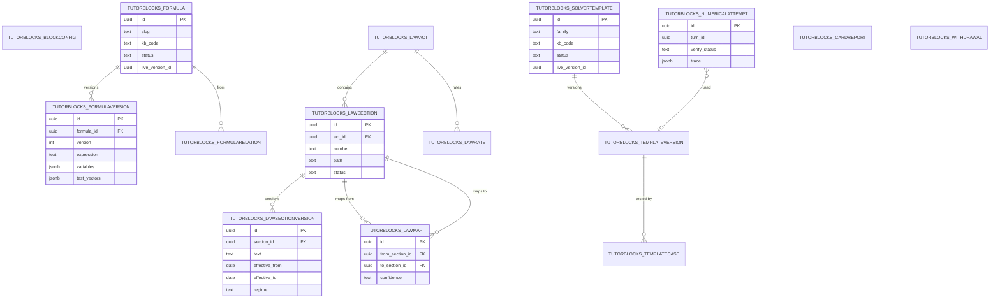

# ERD: F-17.3 Study Blocks

| Field | Value |
| --- | --- |
| Linked PRD | `docs/product/prd/F-17.3-study-blocks.md` |
| Parent ERD | `docs/product/erd/F-17-ai-tutor-and-context-agent.md` |
| Sibling ERDs | `F-17.1-agent-platform.md` (releases pin block config and store version ids), `F-17.2-knowledge-bases-and-ingestion.md` (statute mirror chunks, regime rules) |
| Django app | `apps/api/modules/tutorblocks` (tables `tutorblocks_*`) |
| Depends on | `core/registry.py`, `core/feature_flags.py`, `tutorkb` (retrieval by service call), `tutor` (release bundle, ledger port), `modules/syllabus` (by value) |
| Last updated | 2026-10-15 |

## 0. Design decisions

1. **Identity and content are separate.** A formula, a section, a solver template is an identity row; its content is an immutable version row. A release pins **version ids**, so any past answer can be replayed from what the student saw.
2. **Stores are the source of truth for cards.** Formula expressions, statute text and rate rows are never generated. Cards read store versions.
3. **Dated law.** A section has versions with `effective_from` and `effective_to`; retrieval of a section is always "as on a date, in a regime".
4. **Closed calculator language.** Solver templates and formulas hold expressions in one grammar (the whitelisted AST of FR-SB-60). Import validates every expression by parsing, dependency check and test vectors.
5. **No student text in this app's tables.** `tutorblocks_numericalattempt` stores numbers, step ids and hashes; the problem text stays in `tutor_message`.
6. **Withdraw is immediate, publish is released.** A small kill list is read at most 15 s stale, so a wrong row can be pulled without a release.
7. **Cross-app references are by value.** Course, paper and chapter columns hold F-02 ids as text; `kb_code` is a string; no foreign keys into `syllabus`, `tutor` or `tutorkb`.
8. **Django is the only gateway.** RLS enabled, no policies.

## 1. Diagram



## 2. Tables

Common columns unless stated: `id uuid` primary key (`gen_random_uuid()`), `created_at`, `updated_at`. Enumerations are `TextChoices` with check constraints. All `*_version` tables are insert-only (a database trigger rejects `UPDATE` and `DELETE`, tested).

### 2.1 `tutorblocks_blockconfig`

Draft, editable per block and knowledge base. Compiled into the release bundle (F-17.1).

| Column | Type | Notes |
| --- | --- | --- |
| `block_key` | text | `ask`, `formula`, `law`, `numerical` (validated against the registry) |
| `kb_code` | text | By value; `*` for all knowledge bases |
| `enabled` | bool | Master enablement besides the PostHog flag |
| `label_keys` | jsonb | i18n key overrides for name, description, starters |
| `weight` | smallint | Daily allowance units per turn (F-17.1 FR-AP-17) |
| `plan_limits` | jsonb | `{pro: {daily: 40}, pro_max: {daily: 120}}` (limits live here for blocks; quota plans in F-17.1 hold the shared totals) |
| `retrieval` | jsonb | Overrides: kinds, `k`, token budget, rerank |
| `verifier_mode` | text | `always`, `sampled`, `off` (law and numerical may not be `off`; check) |
| `verifier_sample_rate` | numeric(3,2) | |
| `tool_allowlist` | text[] | |
| `tool_call_cap` | smallint | Default 6 |
| `hint_ladder` | jsonb | Numerical: levels, defaults, graded-page behaviour |
| `practice` | jsonb | Practice mode toggles and ranges |
| `limits` | jsonb | Numerical: givens 60, steps 25, input chars 4,000 |
| `status` | text | `draft`, `ready` (a release reads `ready`) |

`UNIQUE(block_key, kb_code)`. Check: `block_key IN ('law','numerical') AND verifier_mode = 'off'` is rejected.

### 2.2 Formulas

**`tutorblocks_formula`** (identity)

| Column | Type | Notes |
| --- | --- | --- |
| `slug` | text | Stable key, for example `depreciation-wdv` |
| `kb_code` | text | |
| `paper_id`, `chapter_id` | text null | By value |
| `status` | text | `draft`, `live`, `withdrawn` |
| `live_version_id` | uuid null | |
| `review_by` | date null | |
| `owner_id` | uuid | Staff profile id, by value |

`UNIQUE(kb_code, slug)`. Index `(kb_code, paper_id, chapter_id) WHERE status = 'live'`.

**`tutorblocks_formulaversion`** (insert-only)

| Column | Type | Notes |
| --- | --- | --- |
| `formula_id` | uuid FK | |
| `version` | int | |
| `title_en`, `title_hi` | text | |
| `aliases` | text[] | Hinglish and Hindi included |
| `expression` | text | LaTeX for display |
| `calc_expression` | text | Same formula in the calculator grammar; parsed and validated at import |
| `variables` | jsonb | `[{symbol, name_en, name_hi, unit, description, kind: "input"|"output", default}]` |
| `solve_for` | jsonb | Rearrangements: `{ "FV": "...", "PV": "..." }` for each invertible variable |
| `conditions` | text | When to use it |
| `notes` | text | |
| `example` | jsonb | `{problem, steps, answer}` (staff-authored) |
| `valid_from_term`, `valid_to_term` | text null | `YYYY-MM` |
| `source_ref` | jsonb | `{source_id?, locator?, citation_text}` |
| `rights_class` | text | From F-17.2 licence vocabulary |
| `test_vectors` | jsonb | `[{inputs, expected, tolerance}]`, at least 1 required for `status = live` |
| `embed_text` | text | Description used for the vector leg of the finder |
| `checksum` | text | |
| `created_by` | uuid | |

`UNIQUE(formula_id, version)`. The formula finder searches an index table built from live versions (`tutorblocks_formulaindex` view over `formula.live_version_id`); full-text `tsv` column and a `halfvec(768)` column live on the version row, populated by the `tblocks.embed_formula` job through the F-17.2 embedding port (no direct provider call here).

**`tutorblocks_formularelation`**

| Column | Type | Notes |
| --- | --- | --- |
| `from_formula_id`, `to_formula_id` | uuid FK | |
| `relation` | text | `inverse`, `derived`, `special_case`, `see_also` |

`UNIQUE(from_formula_id, to_formula_id, relation)`.

### 2.3 Statutes

**`tutorblocks_lawact`**

| Column | Type | Notes |
| --- | --- | --- |
| `code` | text | `it_1961`, `it_2025`, `cgst_2017`, `igst_2017`, `companies_2013`, `contract_1872`, `fema_1999`, `ibc_2016`, `llp_2008`, `sebi_1992`, `sebi_lodr_2015`... |
| `short_name` | text | "Income-tax Act, 1961" |
| `aliases` | text[] | "IT Act", "Cos Act", "GST" |
| `kb_codes` | text[] | Knowledge bases that use it |
| `regime` | text null | Regime tag it belongs to (matches `tutorkb_regimerule.regime`) |
| `in_force_from`, `in_force_to` | date null | Act-level dates |
| `official_url` | text | |
| `status` | text | `draft`, `live`, `withdrawn` |
| `review_by` | date null | |
| `coverage` | jsonb | Sections loaded vs the official table of contents |
| `source_id` | uuid null | F-17.2 source that mirrors it as chunks, by value |

`UNIQUE(code)`.

**`tutorblocks_lawsection`** (identity)

| Column | Type | Notes |
| --- | --- | --- |
| `act_id` | uuid FK | |
| `number` | text | Top-level number as printed: `194C`, `2`, `80C`, `7A` |
| `path` | text | Full path: `194C`, `2(31)`, `37(1)`; normalised, no spaces |
| `parent_id` | uuid null | For sub-sections, self reference |
| `kind` | text | `section`, `subsection`, `clause`, `rule`, `regulation`, `schedule` |
| `ordinal` | int | Display order inside the Act |
| `status` | text | `in_force`, `omitted`, `repealed`, `not_yet_in_force` |
| `live_version_id` | uuid null | Latest version by date, for convenience |
| `chunk_ref` | uuid null | Mirror chunk id in `tutorkb_chunk`, by value |

`UNIQUE(act_id, path)`. Index `(act_id, number)`, trigram on `number` for typo tolerance in the parser.

**`tutorblocks_lawsectionversion`** (insert-only)

| Column | Type | Notes |
| --- | --- | --- |
| `section_id` | uuid FK | |
| `version` | int | |
| `heading` | text | Marginal note |
| `text` | text | Exact statute text |
| `provisos` | jsonb | `[{ordinal, text}]` |
| `explanations` | jsonb | `[{ordinal, text}]` |
| `effective_from` | date | |
| `effective_to` | date null | Null while current |
| `amended_by` | text null | Finance Act or amending Act reference |
| `regime` | text | Copied from the Act at import |
| `text_checksum` | text | Used by the verifier |
| `import_run` | text | Importer run id |
| `created_by` | uuid | |

Exclusion constraint: for a `section_id`, `daterange(effective_from, effective_to)` must not overlap (PostgreSQL `EXCLUDE USING gist`; service check on SQLite). Index `(section_id, effective_from DESC)`. Lookup "as on date" is `effective_from <= d AND (effective_to IS NULL OR effective_to >= d)`.

**`tutorblocks_lawrate`** (rate tables kept separate from section text)

| Column | Type | Notes |
| --- | --- | --- |
| `act_id`, `section_id` | uuid FK | |
| `label` | text | "TDS on payment to contractor, individual or HUF" |
| `rate` | numeric(9,4) | Percentage |
| `threshold` | numeric(18,2) null | |
| `conditions` | jsonb | Payee type, payment kind, PAN present |
| `effective_from`, `effective_to` | date | |
| `source_note` | text | Notification or Finance Act |

Index `(section_id, effective_from)`.

**`tutorblocks_lawmap`**

| Column | Type | Notes |
| --- | --- | --- |
| `from_section_id`, `to_section_id` | uuid FK | Different Acts or renumbered sections |
| `confidence` | text | `exact`, `partial`, `see_note` |
| `note` | text | What changed |
| `verified` | bool | Unverified mappings display "mapping unverified" |
| `verified_by`, `verified_on` | uuid null, date null | |

`UNIQUE(from_section_id, to_section_id)`. Many to many is allowed (one old section to several new ones).

### 2.4 Solver templates

**`tutorblocks_solvertemplate`** (identity)

| Column | Type | Notes |
| --- | --- | --- |
| `family` | text | `depreciation_wdv`, `emi_loan`, `marginal_costing_bep`... |
| `kb_code` | text | `*` allowed |
| `title_en` | text | |
| `description` | text | Used by the classifier |
| `paper_ids` | text[] | Hints |
| `status` | text | `draft`, `live`, `withdrawn` |
| `live_version_id` | uuid null | |
| `owner_id` | uuid | |

`UNIQUE(kb_code, family)`.

**`tutorblocks_templateversion`** (insert-only)

| Column | Type | Notes |
| --- | --- | --- |
| `template_id` | uuid FK | |
| `version` | int | |
| `parameters` | jsonb | Parameter schema: name, type, unit, required, aliases the extractor should map to |
| `steps` | jsonb | `[{id, label_en, label_hi, expression, depends_on, explain_key, show: true|false}]` in the calculator grammar |
| `outputs` | jsonb | Which step ids are final answers, with unit and label |
| `layout` | text | `plain`, `journal`, `t_account`, `cost_sheet`, `statement`, `schedule` |
| `rounding_policy` | jsonb | `{mode, decimals, round_intermediate, currency, grouping}` |
| `sanity_checks` | jsonb | `[{kind: "non_negative"|"ties_to"|"balanced"|"range", ...}]` |
| `practice_ranges` | jsonb | Per parameter min, max, step, constraints for variant generation |
| `checksum` | text | |
| `created_by` | uuid | |

**`tutorblocks_templatecase`**

| Column | Type | Notes |
| --- | --- | --- |
| `template_version_id` | uuid FK | |
| `name` | text | |
| `inputs` | jsonb | |
| `expected` | jsonb | Final outputs and optionally steps |
| `tolerance` | numeric | |

CI and the `{id}/test/` endpoint run every case for a version; publishing a template requires all cases to pass and at least 3 cases (check in service).

### 2.5 `tutorblocks_numericalattempt`

One row per solve. Numbers only.

| Column | Type | Notes |
| --- | --- | --- |
| `turn_id` | uuid | By value (`tutor_turn`) |
| `conversation_id` | uuid | By value |
| `template_version_id` | uuid null | Null for open problems |
| `family` | text null | |
| `path` | text | `template`, `open` |
| `parts` | smallint | |
| `givens_count` | smallint | |
| `step_count` | smallint | |
| `trace` | jsonb | `[{step_id, expression, inputs: {label: value}, output}]` (values as strings in Decimal form) |
| `final` | jsonb | `[{part, label, value, unit}]` |
| `verify_status` | text | `verified`, `corrected`, `unverified` |
| `verify_detail` | jsonb | Second derivation result, checks run, tolerance, mismatch size |
| `hint_level` | smallint | 0 to 3 |
| `mode` | text | `solve`, `hint`, `check`, `practice` |
| `repair_count` | smallint | |
| `tool_calls` | smallint | |
| `problem_hash` | text | SHA-256 of the normalised problem for repeat detection; not reversible to text |

Index `(turn_id)`, `(family, verify_status, created_at)`. Retention: 180 days then deleted (aligned with F-17.1 turn retention; job `tblocks.purge`).

### 2.6 `tutorblocks_cardreport`

| Column | Type | Notes |
| --- | --- | --- |
| `turn_id`, `card_id` | uuid | |
| `block_key` | text | |
| `card_type` | text | |
| `subject_kind` | text | `formula`, `law_section`, `template` |
| `subject_version_id` | uuid null | Version shown |
| `reason_code` | text | `wrong`, `outdated`, `unclear`, `missing` |
| `reporter_id` | uuid | Student profile id |
| `status` | text | `open`, `confirmed`, `rejected`, `fixed` |
| `resolution_note` | text null | Staff text |
| `resolved_by` | uuid null | |

The student's optional free-text note is not stored (reason code only). Index `(status, created_at)`, `(subject_kind, subject_version_id)`.

### 2.7 `tutorblocks_withdrawal`

The kill list. Read by the blocks with a 15 s cache.

| Column | Type | Notes |
| --- | --- | --- |
| `subject_kind` | text | `formula`, `law_section`, `law_act`, `template`, `law_map` |
| `subject_id` | uuid | Identity id |
| `reason` | text | |
| `withdrawn_by` | uuid | |
| `active` | bool | Restoring sets false |

`UNIQUE(subject_kind, subject_id) WHERE active`. The service writes the identity row's `status = 'withdrawn'` in the same transaction.

## 3. Release pinning

The F-17.1 release bundle holds, for the blocks:

```json
{
  "blocks": {
    "law": {
      "config": { "enabled": true, "weight": 1, "verifier_mode": "always" },
      "store": {
        "formula_versions": [],
        "law_section_versions": "all-live-at-publish",
        "template_versions": []
      },
      "store_epoch": "2026-10-15T09:12:00Z"
    }
  }
}
```

The bundle does not list thousands of ids. It records a `store_epoch` per store (the maximum `created_at` among live versions at publish). The blocks read versions **as of that epoch** (`created_at <= epoch AND` the latest such version for each identity), so a store edit after publish is invisible until the next release; withdrawal bypasses this by design. The `as_of` read is a selector (`selectors.formula_versions_as_of(epoch)`), covered by tests that edit a row after publish and assert the released version is still served.

## 4. Query patterns

| Need | Query |
| --- | --- |
| Section by reference, regime, date | `lawsection` join `lawsectionversion` on `act_id`, `path`, date range; Act chosen by alias and knowledge base |
| Old to new | `lawmap` from section, then the same lookup |
| Formula finder | Alias exact (`aliases @> ARRAY[:q]`), then `tsv` rank, then vector over `formulaversion` live set; filter by `kb_code`, chapter, term validity |
| Template match | Classifier over `solvertemplate.description` (cached in memory per release); parameters from `templateversion.parameters` |
| Review queues | `cardreport` by status; unverified numerical attempts grouped by family |

## 5. Migrations

| File | Contents |
| --- | --- |
| `0001_blocks_config` | `blockconfig`, `withdrawal` |
| `0002_formulas` | `formula`, `formulaversion` (with `tsv`, `halfvec(768)` behind a PostgreSQL guard), `formularelation`, insert-only triggers |
| `0003_statutes` | `lawact`, `lawsection`, `lawsectionversion` (exclusion constraint), `lawrate`, `lawmap` |
| `0004_solvers` | `solvertemplate`, `templateversion`, `templatecase`, `numericalattempt` |
| `0005_reports_rls` | `cardreport`, RLS enabled on all tables |
| `0006_seed` | Block configs for the four blocks (disabled), Act rows for the launch list in FR-SB-41 (status `draft`), starter solver template skeletons without versions |

The importers are management commands (`import_acts`, `import_formulas`, `import_templates`) that call the same services as the admin API.

## 6. Security

- RLS on every table, no policies; only Django reads and writes.
- Insert-only versions enforced by triggers; verified by a migration test that attempts an update.
- No student text anywhere here; `problem_hash` is a one-way hash; card report free text is not collected.
- Calculator grammar executes nothing outside the AST whitelist (FR-SB-60); the import path uses the same parser, so a malicious template cannot smuggle code.
- Statute text and rate rows are public law; formula notes and examples carry the rights class from F-17.2 and are shown within their quote limit.

## 7. Test plan (data layer)

| Test | Asserts |
| --- | --- |
| As-of lookups | Date before and after an amendment returns the right version; overlapping ranges are rejected |
| Release pin | Edit after publish does not change served content; withdraw does |
| Insert-only | Update or delete on a version table fails |
| Map | 194C resolves to the mapped section; unmapped returns `none` and the parser says so |
| Vectors | Every live formula's test vectors pass; wrong vector blocks import |
| Template cases | Every case passes; publish blocked with fewer than 3 cases |
| Trace replay | Re-running a stored trace through the calculator gives identical `final` |
| SQLite fallback | Unit suite runs without `halfvec`, `tsvector` or exclusion constraints |
