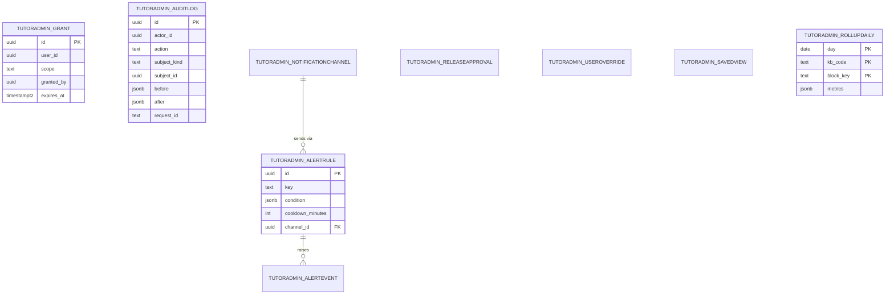

# ERD: F-17.4 Admin Console

| Field | Value |
| --- | --- |
| Linked PRD | `docs/product/prd/F-17.4-admin-console.md` |
| Parent ERD | `docs/product/erd/F-17-ai-tutor-and-context-agent.md` |
| Sibling ERDs | `F-17.1` (releases, switches, budgets, plans live there), `F-17.2`, `F-17.3`, `F-17.5` (nudges live there) |
| Django app | `apps/api/modules/tutoradmin` (tables `tutoradmin_*`) |
| Depends on | `modules/profiles` (roles), `core/permissions.py`, `tutor`, `tutorkb`, `tutorblocks`, `tutornudges` services |
| Last updated | 2026-10-15 |

## 0. Design decisions

1. **This app owns only what is about staff.** Audit, grants, alerts, approvals, overrides, saved views. Configuration data stays in the app whose behaviour it controls; `tutoradmin` calls their services.
2. **Audit is append-only and cannot be silenced.** A database trigger rejects `UPDATE` and `DELETE`; a decorator on every mutating view writes the row in the same transaction as the change.
3. **Scopes are data.** A role gives a default; grants give specific scopes with optional expiry.
4. **No student text.** Audit `before` and `after` snapshots are produced by per-model serializers that exclude message text, secrets and personal fields (allow-list, not deny-list).
5. **By value across apps.** Subject ids are stored with a `subject_kind` string; no foreign keys.
6. **Django is the only gateway.** RLS enabled, no policies.

## 1. Diagram

## 2. Tables

Common columns unless stated: `id uuid` primary key, `created_at`, `updated_at`.

### 2.1 `tutoradmin_grant`

| Column | Type | Notes |
| --- | --- | --- |
| `user_id` | uuid | Profile id, by value |
| `scope` | text | One of the scopes in FR-AD-02 (validated against a constant list) |
| `granted_by` | uuid | |
| `expires_at` | timestamptz null | |
| `revoked_at` | timestamptz null | Soft revoke so history stays |
| `reason` | text | |

`UNIQUE(user_id, scope) WHERE revoked_at IS NULL`. Index `(user_id) WHERE revoked_at IS NULL`. Effective scopes for a user = role defaults (`admin`: all) union active, unexpired grants. The permission class `HasTutorScope("tutor.kb.write")` reads this with a 30 s per-process cache and the cache is invalidated by a version counter row (`tutoradmin_grant` change bumps `core_cachestamp`, if that table exists; otherwise TTL only).

### 2.2 `tutoradmin_auditlog`

| Column | Type | Notes |
| --- | --- | --- |
| `actor_id` | uuid | |
| `actor_role` | text | At the time |
| `action` | text | `create`, `update`, `delete`, `publish`, `rollback`, `withdraw`, `restore`, `override_gate`, `grant`, `revoke`, `switch`, `view_text`, `playground`, `export` |
| `subject_kind` | text | `source`, `chunk`, `instruction`, `rule`, `release`, `formula`, ... |
| `subject_id` | uuid null | |
| `summary` | text | Short human line, generated |
| `before`, `after` | jsonb null | Allow-listed fields only; capped at 64 kB, larger diffs store a hash and the changed keys |
| `reason` | text null | Required for overrides, switch changes, text views |
| `request_id` | text | |
| `ip_hash` | text | Salted hash, not the address |
| `ua_family` | text | |
| `occurred_at` | timestamptz | Default now |

Partitioned by month (`RANGE (occurred_at)`), partitions created by a job; indexes `(actor_id, occurred_at DESC)`, `(subject_kind, subject_id, occurred_at DESC)`, `(action, occurred_at DESC)`. Trigger rejects update and delete. Retention: 3 years, then exported to private Storage and dropped by partition. `view_text` rows exist for any reported-turn text open (FR-AD-81).

### 2.3 `tutoradmin_notificationchannel`

| Column | Type | Notes |
| --- | --- | --- |
| `kind` | text | `email`, `slack_webhook` |
| `name` | text | |
| `target_ref` | text | Environment variable name that holds the webhook URL, or an email address; the URL itself is never stored |
| `enabled` | bool | |
| `last_ok_at`, `last_error` | timestamptz null, text null | |

### 2.4 `tutoradmin_alertrule` and `tutoradmin_alertevent`

**`alertrule`**

| Column | Type | Notes |
| --- | --- | --- |
| `key` | text | `budget_80`, `budget_100`, `error_rate`, `p95_latency`, `recall_drop`, `licence_expiring`, `ingest_failing`, `gap_threshold`, `card_reports`, `law_overdue`, `canary_unhealthy` |
| `condition` | jsonb | Threshold and window, validated per key |
| `cooldown_minutes` | int | |
| `channel_id` | uuid FK | |
| `enabled` | bool | |

**`alertevent`**

| Column | Type | Notes |
| --- | --- | --- |
| `rule_id` | uuid FK | |
| `state` | text | `firing`, `resolved`, `suppressed` |
| `value` | jsonb | Numbers measured |
| `fired_at`, `resolved_at` | timestamptz | |
| `delivered` | bool | |

Index `(rule_id, fired_at DESC)`. The tick `tadm.alerts_eval` runs every 5 minutes and evaluates rules from the rollup and live counters.

### 2.5 `tutoradmin_releaseapproval`

Used only when the second-approver rule is on (FR-AD-07).

| Column | Type | Notes |
| --- | --- | --- |
| `release_id` | uuid | By value (`tutor_release`) |
| `requested_by` | uuid | |
| `approved_by` | uuid null | Must differ from `requested_by` (check) |
| `status` | text | `pending`, `approved`, `rejected` |
| `note` | text | |

### 2.6 `tutoradmin_useroverride`

Per-user support overrides (FR-AD-55).

| Column | Type | Notes |
| --- | --- | --- |
| `user_id` | uuid | Student profile id |
| `kind` | text | `extra_allowance`, `blocked` |
| `value` | jsonb | `{extra_units: 20}` or `{}` |
| `reason` | text | |
| `expires_at` | timestamptz null | |
| `created_by` | uuid | |
| `revoked_at` | timestamptz null | |

Index `(user_id) WHERE revoked_at IS NULL`. Admission reads this with the quota row (F-17.1 FR-AP-16) via a service call; an unreadable table fails closed for `blocked` only and open for `extra_allowance`.

### 2.7 `tutoradmin_savedview`

| Column | Type | Notes |
| --- | --- | --- |
| `user_id` | uuid | |
| `screen` | text | |
| `name` | text | |
| `params` | jsonb | Filters |

### 2.8 `tutoradmin_rollupdaily`

Pre-aggregated numbers for the overview and reports, so the console never scans the ledger.

| Column | Type | Notes |
| --- | --- | --- |
| `day` | date | IST day |
| `kb_code` | text | |
| `block_key` | text | `*` for totals |
| `plan_code` | text | `*` for all |
| `release_id` | uuid null | |
| `metrics` | jsonb | `{turns, students, tokens_in, tokens_out, cost_paise, errors, abstained, unverified, p50_ms, p95_ms, first_token_p95_ms, thumbs_up, thumbs_down}` |

Primary key `(day, kb_code, block_key, plan_code, COALESCE(release_id, nil_uuid))` expressed as a unique index. Built by `tadm.rollup` hourly for the current day and finalised at 00:10 IST for the previous day. Groundedness and judge scores come from `tutor_evalrun` and the judge sample table in F-17.1, joined at read time.

## 3. Read models (no new tables)

| Screen | Source |
| --- | --- |
| Overview | `rollupdaily`, `tutor_killswitch`, `tutor_budget`, live release row |
| Sources, chunks, gaps | `tutorkb` services |
| Formulas, law, templates | `tutorblocks` services |
| Releases, rules, instructions | `tutor` services |
| Turn inspector | `tutor_turn`, `tutor_llmcall`, `tutor_costline`, retrieval trace JSON; text column is never selected |
| Nudges | `tutornudges` services |

## 4. Permissions matrix (summary)

| Scope | Screens |
| --- | --- |
| `tutor.kb.read` | KB lists, chunk browser, playground (audited) |
| `tutor.kb.write` | Add and edit sources, chunks, tags |
| `tutor.kb.publish` | Publish, withdraw, restore, embedding flip |
| `tutor.kb.licences` | Licences, regime rules |
| `tutor.law`, `tutor.formulas`, `tutor.solvers` | Block stores |
| `tutor.blocks.write`, `tutor.blocks.publish` | Block configs |
| `tutor.instructions`, `tutor.rules` | Behaviour editors |
| `tutor.models`, `tutor.budgets` | Models, functions, budgets, plans, switches |
| `tutor.releases` | Candidates, gates, canary, rollback, overrides |
| `tutor.eval` | Evaluation workspace |
| `tutor.reports` | Reports, student support view |
| `tutor.audit` | Audit log |
| `tutor.grants` | Grants |

Kill switches may be turned **off** (more restrictive) by any holder of `tutor.models` or `tutor.releases` without a fresh session; turning one back **on** needs a fresh session.

## 5. Migrations

| File | Contents |
| --- | --- |
| `0001_access_audit` | `grant`, `auditlog` (partitioned, trigger), first month partitions, RLS |
| `0002_alerts` | `notificationchannel`, `alertrule`, `alertevent`, seed rules (disabled until a channel is set) |
| `0003_overrides_rollup` | `useroverride`, `rollupdaily`, `savedview`, `releaseapproval` |
| `0004_seed` | No grants are seeded in a migration (no personal data in migrations). The admin role comes from the existing command `grant_staff_role --email <address> --role admin`; the new command `tutoradmin_check_access --email <address>` only prints the effective scopes for that profile |

## 6. Security

- RLS on, no policies; the Django service role is the only accessor.
- The audit serializer allow-list is unit tested: a test adds a column named like message text and fails until it is classified.
- `ip_hash` uses a salt from the environment; no raw IPs stored.
- Channel secrets live in environment variables, referenced by name.
- Sensitive-action freshness is enforced in a DRF permission using the session `iat` claim; test covers a 31-minute-old token.

## 7. Test plan (data layer)

| Test | Asserts |
| --- | --- |
| Audit coverage | Every mutating admin route writes exactly one row |
| Append-only | Update and delete fail |
| Scope checks | Each route is refused without its scope and allowed with it |
| Expiry | Expired grant stops working within the cache TTL |
| Approval rule | Author cannot approve own release |
| Rollup | Rollup totals equal the ledger for a seeded day |
| No text | Inspector and audit responses contain no field from the message-text allow-list |
