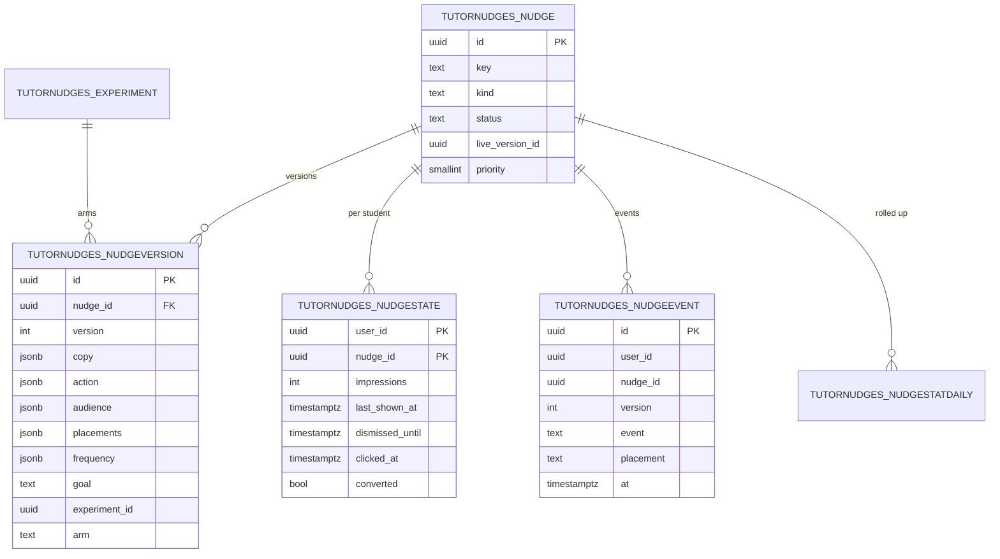

# ERD: F-17.5 Widget, Nudges and Localisation

| Field | Value |
| --- | --- |
| Linked PRD | `docs/product/prd/F-17.5-widget-nudges-localisation.md` |
| Parent ERD | `docs/product/erd/F-17-ai-tutor-and-context-agent.md` |
| Sibling ERDs | `F-17.1-agent-platform.md` (settings, glossary, static messages live there), `F-17.4-admin-console.md` (audit, scopes) |
| Django app | `apps/api/modules/tutornudges` (tables `tutornudges_*`) |
| Web | `packages/tutor-widget` holds no database; it reads only API responses |
| Depends on | `core/feature_flags.py`, `core/plans.py`, `tutor` (conversation state and settings by service call), `tutorblocks` (block availability by registry) |
| Last updated | 2026-10-15 |

## 0. Design decisions

1. **Nudges are live content, not behaviour.** They take effect on save (F-17.1 FR-AP-96), but every edit is a new version row and an audit entry, so what a student saw is always known.
2. **Copy per language lives in the version row.** One JSON object per language; English required, Hindi and Hinglish optional with fallback.
3. **Counts only.** State and events hold ids, enumerations and times. No student text, no page content, no selected text.
4. **Per-student state is small.** One row per student per nudge, updated by upsert; events are append-only with a short retention and rolled into daily stats.
5. **Selection is a pure function.** `select(context, state, catalogue) -> nudges` has no side effects, is unit tested with golden cases, and is what the admin simulator calls.
6. **Localisation data is shared.** Glossary and static messages stay in `tutor_*` (F-17.1) so answers, cards and widget strings use one source; this ERD adds no duplicate tables for them.
7. **Django is the only gateway.** RLS enabled, no policies.

## 1. Diagram



## 2. Tables

Common columns unless stated: `id uuid` primary key, `created_at`, `updated_at`.

### 2.1 `tutornudges_nudge` (identity)

| Column | Type | Notes |
| --- | --- | --- |
| `key` | text | Stable key, for example `block_intro_formula`; `UNIQUE` |
| `kind` | text | `block_intro`, `feature_tip`, `exam_countdown`, `habit`, `contextual`, `followup`, `upgrade`, `announcement` |
| `status` | text | `draft`, `active`, `paused`, `archived` |
| `priority` | smallint | 0 to 100 |
| `live_version_id` | uuid null | Version served when no experiment applies |
| `starts_at`, `ends_at` | timestamptz null | Schedule |
| `owner_id` | uuid | Staff profile id, by value |

Index `(status, kind)`, `(starts_at, ends_at) WHERE status = 'active'`.

### 2.2 `tutornudges_nudgeversion` (insert-only)

| Column | Type | Notes |
| --- | --- | --- |
| `nudge_id` | uuid FK | |
| `version` | int | |
| `copy` | jsonb | `{en: {title, body, cta}, hi: {...}, hinglish: {...}}`; `en` required; length limits validated (title 40, body 90, CTA 18 characters) |
| `action` | jsonb | `{type: "open_block"|"send_prompt"|"navigate"|"open_url"|"dismiss"|"snooze", block?, prompt_key?, route_id?, url?}`; `prompt_key` points to a static message key so the starter prompt is localised; `url` host must be on an allow-list in settings |
| `audience` | jsonb | Condition tree over the nudge variable catalogue (FR-NU-05); validated against the closed language of F-17.1 FR-AP-51 |
| `placements` | jsonb | `["rail","strip","inline","empty_state","launcher_badge"]` |
| `frequency` | jsonb | `{max_impressions, max_per_day, cooldown_hours, dismissed_for_days, suppress_after_click_days}` |
| `goal` | text | `block_used:<key>`, `route_visited:<id>`, `upgrade_clicked`, `none` |
| `icon` | text | Design-system icon name from an allow-list |
| `experiment_id` | uuid null | |
| `arm` | text null | Arm label inside the experiment |
| `checksum` | text | |
| `created_by` | uuid | |

`UNIQUE(nudge_id, version)`. Trigger rejects update and delete. Validation at save: every `block` exists in the registry, every `route_id` exists in the route manifest (shipped as a JSON file the API reads), every `prompt_key` exists in `tutor_staticmessage`.

### 2.3 `tutornudges_experiment`

| Column | Type | Notes |
| --- | --- | --- |
| `tag` | text | `experiment_tag` (also stamped on turns when relevant) |
| `description` | text | |
| `arms` | jsonb | `[{label, weight}]`, weights sum to 100 |
| `status` | text | `draft`, `running`, `stopped` |
| `started_at`, `stopped_at` | timestamptz null | |

Assignment is a pure function: `arm = arms[hash(user_id || tag) mod 100]`; no assignment table is needed, which keeps assignment stable and cheap.

### 2.4 `tutornudges_nudgestate`

| Column | Type | Notes |
| --- | --- | --- |
| `user_id` | uuid | Student profile id, by value |
| `nudge_id` | uuid | |
| `impressions` | int | Lifetime |
| `impressions_today` | smallint | Reset by date comparison at read time using `day_ist` |
| `day_ist` | date | Day for `impressions_today` |
| `last_shown_at` | timestamptz null | |
| `dismissed_until` | timestamptz null | |
| `clicked_at` | timestamptz null | |
| `converted` | bool | |
| `version_last_seen` | int | |

Primary key `(user_id, nudge_id)`. Index `(user_id, dismissed_until)`. Per-student daily and per-session caps use a small row `tutornudges_studentcap` below.

### 2.5 `tutornudges_studentcap`

| Column | Type | Notes |
| --- | --- | --- |
| `user_id` | uuid PK | |
| `day_ist` | date | |
| `impressions_today` | smallint | Global per-student cap (default 6) |
| `show_tips` | bool | Mirror of the student's setting for fast filtering (source of truth is `tutor_settings`) |

### 2.6 `tutornudges_nudgeevent` (partitioned, append-only)

| Column | Type | Notes |
| --- | --- | --- |
| `user_id` | uuid | |
| `nudge_id` | uuid | |
| `version` | int | |
| `event` | text | `impression`, `click`, `dismiss`, `snooze`, `conversion` |
| `placement` | text | |
| `arm` | text null | |
| `plan_code` | text | At the time |
| `locale` | text | Language shown |
| `kb_code` | text | |
| `at` | timestamptz | |
| `dedupe_key` | text | `(user_id, nudge_id, event, minute bucket)` hash; unique index makes batch posts idempotent |

Partitioned by month on `at`. Retention 90 days, then partitions are dropped after the daily rollup is final. Indexes: `UNIQUE(dedupe_key)` per partition (includes `at` in the key via the partition column rule: unique `(dedupe_key, at)`), `(nudge_id, at)`.

### 2.7 `tutornudges_nudgestatdaily`

| Column | Type | Notes |
| --- | --- | --- |
| `day` | date | IST |
| `nudge_id` | uuid | |
| `placement` | text | |
| `locale` | text | |
| `plan_code` | text | |
| `arm` | text | Empty string when none |
| `impressions`, `clicks`, `dismissals`, `snoozes`, `conversions` | int | |

Unique `(day, nudge_id, placement, locale, plan_code, arm)`. Built by the job `tnud.rollup` at 00:15 IST and hourly for the current day.

## 3. Selection query shape

```text
inputs: user_id, placement, context{route_id, context_kind, block, turn_index, verify_status}, locale
1. candidates = active nudges where now within schedule and placement in version.placements
2. student snapshot (one query each, cached for 60 s per user):
   plan_code (core.plans), kb_code and level and days_left (student_context port),
   language setting, show_tips, blocks_used_7d and streak (tutor_turn counts), usage share (tutor_quotausage)
3. eligibility: flags for the target block, plan allows block, consent, age band, audience tree evaluated in memory
4. caps: nudgestate (impressions, dismissed_until, clicked_at), studentcap (day total), session cap passed by the widget
5. rank and diversify; assign arm by hash; pick copy by locale with English fallback
6. return top N for the placement, plus an exclusion trace when called by the simulator
```

All reads use indexed single-row lookups per candidate; the candidate set is small (tens), cached per process for 30 s keyed by the nudge version counter, so a select is two or three queries.

## 4. Localisation data (where things live)

| Data | Location | Edited in |
| --- | --- | --- |
| Widget UI strings, bundled | `packages/tutor-widget/src/i18n/{en,hi,hinglish}.json` | Code review (source of truth for keys) |
| Admin overrides of UI strings and rule messages | `tutor_staticmessage` (F-17.1) | `/admin/tutor/behaviour/messages` |
| Glossary and do-not-translate list | `tutor_glossaryterm` (F-17.1) | `/admin/tutor/behaviour/glossary` |
| Nudge copy | `tutornudges_nudgeversion.copy` | `/admin/tutor/behaviour/nudges` |
| Student language and tips settings | `tutor_settings` (F-17.1) | Widget settings |
| Missing-key counters | PostHog events `tutor_i18n_missing` with `key` and `locale`; rolled up in `tutoradmin_rollupdaily.metrics` (F-17.4) | Admin dashboard |

Catalogue integrity checks in CI: every key in `en.json` exists in `hi.json` and `hinglish.json` or is listed in an allowed-gaps file with an owner; placeholders match; ICU syntax parses; no string longer than 2.5 times its English length without a note (layout risk).

## 5. Migrations

| File | Contents |
| --- | --- |
| `0001_nudges` | `nudge`, `nudgeversion` (insert-only trigger), `experiment`, RLS |
| `0002_state_events` | `nudgestate`, `studentcap`, `nudgeevent` (monthly partitions), `nudgestatdaily`, RLS |
| `0003_seed` | Starter nudges (draft status) for each kind in FR-NU-10, with `en`, `hi`, `hinglish` copy drafts marked for review; activated by staff |

## 6. Security and privacy

- RLS on every table, no policies; Django is the only accessor.
- Event ingestion validates that `nudge_id` and `version` exist and that the caller is the `user_id`; the server ignores any client-supplied `user_id` and uses the token.
- Events carry no text; `locale`, `placement` and `plan_code` are enumerations.
- Rate limit `tutor_read` on select, `tutor_write` on events and dismiss; payload size cap 50 events per batch.
- `open_url` actions must match the allow-list; `navigate` must match the route manifest; no user-supplied URLs.
- Deleting a student's tutor data (F-17.1 delete all) also deletes `nudgestate`, `studentcap` rows and her `nudgeevent` rows; `nudgestatdaily` is aggregate and kept.

## 7. Test plan (data layer)

| Test | Asserts |
| --- | --- |
| Selection golden cases | 30 contexts give the expected top 3 and exclusion reasons |
| Caps | Dismissal, per-day, per-session and global caps hold under repeated selects |
| Idempotent events | Re-posting the same batch adds no rows |
| Experiment stability | Same user, same arm across calls and processes |
| Insert-only | Version update and delete fail |
| Copy validation | Over-long copy and unknown block, route or prompt key are rejected |
| Delete all | A student's state and events are removed, aggregates remain |
| Fallback | Missing `hi` copy falls back to English; missing English copy rejects save |
