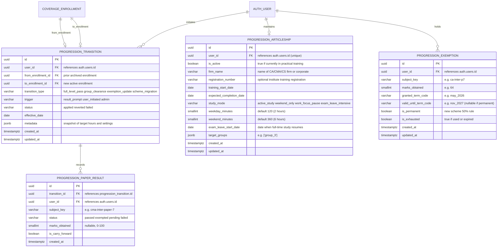

# ERD: F-18 Level Transition and Student Progression Engine

| Field | Value |
| --- | --- |
| Linked PRD | `docs/product/prd/F-18-level-transition-and-student-progression.md` |
| Django app | `apps/api/modules/progression` (owner: transitions, paper outcomes, exemptions, articleship) |
| Interacting apps | `apps/api/modules/coverage` (enrollment archiving & provisioning), `apps/api/modules/profiles` (user identity & preferences), `apps/api/modules/tracker` (weekday/weekend daily goals) |
| Last updated | 2026-10-19 |

---

## 0. Design decisions

1. **Keep Enrollment History Immutable (Fact Ledger Pattern):**
   When a student transitions from Intermediate to Final (or clears a Group), we never overwrite their existing `coverage_enrollment` record in place. Instead, the prior enrollment status is set to `'archived'` (moving its associated progress, notes, and activity logs into the read-only **"Past Level Vault"**), and a new active `coverage_enrollment` is created for the target level. This ensures total auditability, historic accuracy of analytics, and zero data loss.
2. **First-Class Articleship Entity:**
   Articleship is not just a boolean flag on the user profile; it dictates daily lifestyle, available cognitive energy, and study bandwidth over a 2 to 3 year duration. `progression_articleship_profile` explicitly tracks weekday vs. weekend target minutes, firm details, training phase (regular vs. exam leave), and study strategy mode (`active_study`, `weekend_only`, `work_focus_pause`, `exam_leave_intensive`).
3. **Formal Exemption Tracking with Term Expiry Rules:**
   Under ICAI/ICMAI/ICSI regulations, scoring $\ge 60$ marks in a paper exempts the student from writing that paper in subsequent terms. 
   - Under legacy schemes (e.g. CMA 2016, CA Old), an exemption expires after 3 consecutive terms.
   - Under modern schemes (e.g. CA New Scheme 2024), students may opt to make an exemption permanent, provided they score $\ge 50\%$ in each remaining paper instead of the standard $40\%$ individual / $50\%$ aggregate rule.
   `progression_exemption_ledger` models these business rules explicitly with `granted_term_id`, `valid_until_term_id`, and `is_permanent`.
4. **Strict Isolation at Service Layer:**
   When queries fetch active questions, MCQs, or PYQs, the selectors resolve the active `coverage_enrollment` (via `coverage_selectors.course_summary`). Archived enrollments are strictly walled off from the daily study feed and only queryable by the Vault selectors.
5. **Atomic Transition Pipeline:**
   A level transition touches multiple subsystems (archiving prior enrollment, creating new enrollment, saving paper results, setting up articleship, updating tracker targets). All operations execute inside an atomic database transaction (`transaction.atomic`) with idempotency keys.

---

## 1. Diagram



---

## 2. Tables

### 2.1 `progression_level_transition`
Stores each discrete graduation or syllabus transition event.

| Column | Type | Null | Default | Notes |
| --- | --- | --- | --- | --- |
| `id` | `uuid` | no | `gen_random_uuid()` | Primary Key |
| `user_id` | `uuid` | no | | References `auth.users.id` by value |
| `from_enrollment_id` | `uuid` | yes | | Prior `coverage_enrollment.id` (set to `archived`) |
| `to_enrollment_id` | `uuid` | yes | | Newly created active `coverage_enrollment.id` |
| `transition_type` | `varchar(32)` | no | | `'full_level_pass'`, `'group_clearance'`, `'exemption_update'`, `'scheme_migration'` |
| `trigger` | `varchar(32)` | no | `'user_initiated'` | `'result_prompt'`, `'user_initiated'`, `'admin'` |
| `status` | `varchar(16)` | no | `'applied'` | `'applied'`, `'reverted'`, `'failed'` |
| `effective_date` | `date` | no | `current_date` | Date transition takes effect |
| `metadata` | `jsonb` | no | `'{}'` | Snapshot of previous settings, chosen daily hours, etc. |
| `created_at` | `timestamptz` | no | `now()` | |
| `updated_at` | `timestamptz` | no | `now()` | |

**Constraints & Indexes:**
- Index on `(user_id, created_at DESC)` for student history lookup.
- Check constraint: `transition_type IN ('full_level_pass', 'group_clearance', 'exemption_update', 'scheme_migration')`.
- Check constraint: `status IN ('applied', 'reverted', 'failed')`.

---

### 2.2 `progression_paper_result`
Paper-by-paper outcomes reported during a term result transition.

| Column | Type | Null | Default | Notes |
| --- | --- | --- | --- | --- |
| `id` | `uuid` | no | `gen_random_uuid()` | Primary Key |
| `transition_id` | `uuid` | no | | FK to `progression_level_transition.id` ON DELETE CASCADE |
| `user_id` | `uuid` | no | | References `auth.users.id` |
| `subject_key` | `varchar(64)` | no | | Natural key matching syllabus subject |
| `status` | `varchar(16)` | no | | `'passed'`, `'exempted'`, `'pending'`, `'failed'` |
| `marks_obtained` | `smallint` | yes | | Integer $0 \le \text{marks} \le 100$ |
| `is_carry_forward` | `boolean` | no | `false` | True if carried forward from an earlier term |
| `created_at` | `timestamptz` | no | `now()` | |

**Constraints & Indexes:**
- Index on `(user_id, subject_key)`.
- Unique constraint on `(transition_id, subject_key)`.
- Check constraint: `status IN ('passed', 'exempted', 'pending', 'failed')`.
- Check constraint: `marks_obtained IS NULL OR (marks_obtained >= 0 AND marks_obtained <= 100)`.

---

### 2.3 `progression_articleship_profile`
Stores practical training details and lifestyle study constraints.

| Column | Type | Null | Default | Notes |
| --- | --- | --- | --- | --- |
| `id` | `uuid` | no | `gen_random_uuid()` | Primary Key |
| `user_id` | `uuid` | no | | Unique 1-to-1 reference to `auth.users.id` |
| `is_active` | `boolean` | no | `false` | Whether student is actively in articleship |
| `firm_name` | `varchar(255)` | yes | | Employer / Firm name (e.g. "Deloitte", "BDO", "Sole Proprietor") |
| `registration_number`| `varchar(64)` | yes | | Institute practical training registration number |
| `training_start_date`| `date` | yes | | Start date of articleship |
| `expected_completion_date` | `date` | yes | | Calculated or planned completion date |
| `study_mode` | `varchar(32)` | no | `'active_study'` | `'active_study'`, `'weekend_only'`, `'work_focus_pause'`, `'exam_leave_intensive'` |
| `weekday_minutes` | `smallint` | no | `120` | Planned weekday study minutes ($2$ hours default) |
| `weekend_minutes` | `smallint` | no | `360` | Planned weekend study minutes ($6$ hours default) |
| `exam_leave_start_date` | `date` | yes | | When student goes on exam leave before attempt |
| `target_groups` | `jsonb` | no | `'[]'` | Groups student is aiming for in next attempt |
| `created_at` | `timestamptz` | no | `now()` | |
| `updated_at` | `timestamptz` | no | `now()` | |

**Constraints & Indexes:**
- Unique constraint on `(user_id)`.
- Check constraint: `study_mode IN ('active_study', 'weekend_only', 'work_focus_pause', 'exam_leave_intensive')`.
- Check constraint: `weekday_minutes >= 0 AND weekday_minutes <= 1440`.
- Check constraint: `weekend_minutes >= 0 AND weekend_minutes <= 1440`.

---

### 2.4 `progression_exemption_ledger`
Tracks official exemptions granted under the 60+ marks rule.

| Column | Type | Null | Default | Notes |
| --- | --- | --- | --- | --- |
| `id` | `uuid` | no | `gen_random_uuid()` | Primary Key |
| `user_id` | `uuid` | no | | References `auth.users.id` |
| `subject_key` | `varchar(64)` | no | | Natural key matching syllabus subject |
| `marks_obtained` | `smallint` | no | | Marks scored ($\ge 60$) |
| `granted_term_code` | `varchar(32)` | no | | Term when exemption was earned (e.g. `'june_2026'`) |
| `valid_until_term_code` | `varchar(32)`| yes | | Expiry term (null if permanent) |
| `is_permanent` | `boolean` | no | `false` | Permanent exemption under 2024 scheme rules |
| `is_exhausted` | `boolean` | no | `false` | Marked true once level/group is cleared or exemption expires |
| `created_at` | `timestamptz` | no | `now()` | |
| `updated_at` | `timestamptz` | no | `now()` | |

**Constraints & Indexes:**
- Index on `(user_id, is_exhausted)`.
- Check constraint: `marks_obtained >= 60`.

---

## 3. Relationships to existing modules

- **`coverage.CoverageEnrollment` (F-02):**
  When a transition executes, the active enrollment has its `status` changed to `'archived'`. A new active enrollment is created with the target level, course, scheme, and term.
- **`coverage.CoverageSettings` (F-02 & F-16):**
  Target hours and study daily minutes are calibrated based on `progression_articleship_profile.weekday_minutes` and `weekend_minutes`.
- **`notes.Document` & `notes.Annotation` (F-03):**
  Documents linked to the archived enrollment remain in place with read-only access. In the Past Level Vault screen, documents are filtered by `enrollment_id`.
- **`recall.Deck` & `recall.Card` (F-15):**
  Recall decks associated with archived subjects are retained in the student's history without generating daily due reviews, while new decks for the transitioned level are initialized.

---

## 4. Query patterns

1. **Load Active Progression & Articleship Status:**
   ```sql
   SELECT a.*, e.id AS enrollment_id, e.course_id, e.level_id
   FROM progression_articleship a
   LEFT JOIN coverage_enrollment e ON e.user_id = a.user_id AND e.status = 'active'
   WHERE a.user_id = :user_id;
   ```
   *Fast via unique index on `(user_id)`.*

2. **Check Valid Exemptions for Active Level:**
   ```sql
   SELECT subject_key, marks_obtained, granted_term_code, valid_until_term_code, is_permanent
   FROM progression_exemption
   WHERE user_id = :user_id AND is_exhausted = false;
   ```
   *Fast via index on `(user_id, is_exhausted)`.*

3. **Fetch Transition Audit History:**
   ```sql
   SELECT t.*, json_agg(r.*) AS paper_results
   FROM progression_level_transition t
   LEFT JOIN progression_paper_result r ON r.transition_id = t.id
   WHERE t.user_id = :user_id
   GROUP BY t.id
   ORDER BY t.created_at DESC;
   ```
   *Fast via index on `(user_id, created_at DESC)`.*

---

## 5. Security and Privacy (DPDP Act 2023)

- **Row-Level Security (RLS):** All tables have RLS enabled with zero public access. Access is restricted exclusively to authenticated requests via Django REST Framework with scoped `request.user.id`.
- **PII & Data Retention:** Exam marks and firm employer names constitute personal educational/professional data.
- **Audit Registry Integration:**
  `apps/api/modules/progression` registers handlers in:
  - `profiles.register_exporter`: Exports transitions, paper marks, exemptions, and articleship records into standard JSON archive.
  - `profiles.register_eraser`: Cascades deletion of all progression records when an account is deleted.

---

## 6. Migration and rollout

1. **Migration 0001_initial in `modules/progression`:**
   Creates `progression_level_transition`, `progression_paper_result`, `progression_articleship_profile`, and `progression_exemption_ledger`.
2. **Backfill Existing Enrollments:**
   For all existing active students in `coverage_enrollment`, synthesize default `progression_articleship_profile` records with `is_active = false`.
3. **Zero Downtime:**
   Fully additive tables; no existing tables are modified or locked during migration.
