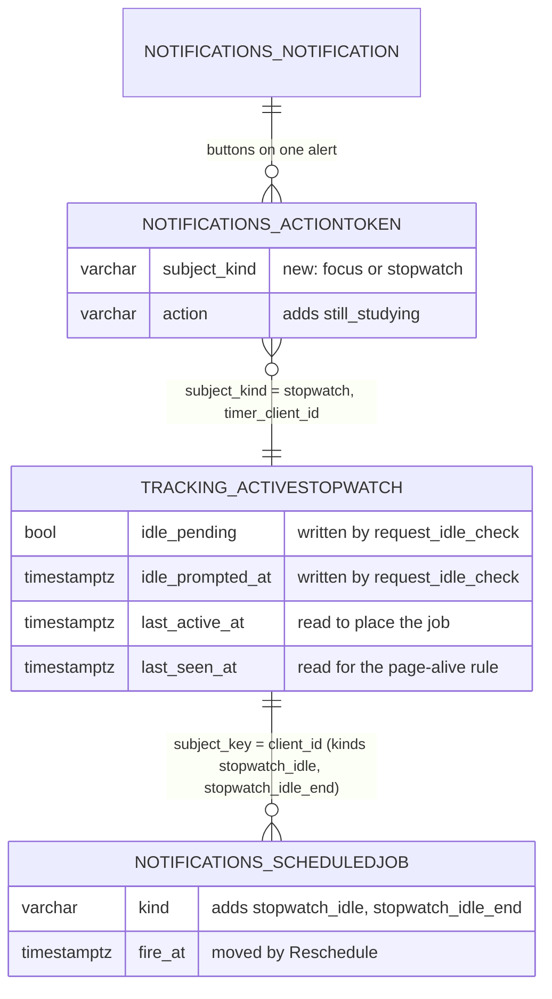

# ERD: X-01.2 Away Alerts

| Field | Value |
| --- | --- |
| Status | Draft for review |
| Last updated | 2026-10-14 |
| PRD | `docs/product/prd/X-01.2-away-alerts.md` |
| Builds on | `docs/product/erd/X-01.1-push-notifications.md` (tables 2.1 to 2.9) |

## 1. Diagram

No new table. The diagram shows only what changes. Dashed names are existing columns that are now written by a new code path.

## 2. Tables

### 2.1 `notifications_scheduledjob` (existing, ERD X-01.1 2.6)

| Change | Detail |
| --- | --- |
| `kind` values | Add `stopwatch_idle` (14 characters) and `stopwatch_idle_end` (18). The column is `varchar(20)`, so no size change. Widen the check constraint (`kind in (...)`) in the migration |
| Reschedule | A `Reschedule(at)` verdict updates `fire_at` on the same row, sets `status = 'pending'`, clears `external_id`, queues one new delayed message and (best effort) cancels the old one. No new column. The unique constraint (`user_id`, `kind`, `subject_key`, `expected_version`) already guarantees one job per stopwatch state |
| `subject_key` | Stopwatch `client_id` (uuid as text), as for `stopwatch_long` |
| `expected_version` | `ActiveStopwatch.version` when planned. `stopwatch_idle_end` uses the version after `request_idle_check` |
| `context` | `{"idle_minutes": 10, "subject_name": "Taxation"}` for copy. Subject name is the student's own syllabus label, as in `timer_end`. No free text |

The partial index `notif_job_due_idx (fire_at) WHERE status = 'pending'` already serves the sweep that backs these jobs up.

### 2.2 `notifications_actiontoken` (existing, ERD X-01.1 2.8)

| Column | Change | Notes |
| --- | --- | --- |
| `subject_kind` | **New**, `varchar(10)`, not null, default `focus` | `focus` or `stopwatch`. Check constraint `notif_actiontoken_subject_kind`. The default makes the addition metadata-only on PostgreSQL 11 and later |
| `timer_client_id`, `timer_version` | No change | Hold the stopwatch `client_id` and version when `subject_kind = stopwatch`. The names stay to avoid a rename migration on a live table; the model docstring says so |
| `action` | Widen check `notif_actiontoken_action` | Add `still_studying`. `pause` and `resume` already exist and are reused for stopwatch tokens |
| `expires_at` | Rule only | 120 s for `still_studying` and `pause` on `stopwatch_idle`; 10 minutes otherwise, as today |

Use is unchanged: one atomic `UPDATE ... WHERE token_hash = %s AND used_at IS NULL AND expires_at > now()`, then the action goes to the owner of the state. For `subject_kind = stopwatch` the owner is `tracking.services.act_from_notification` (new, mirrors `focus.services.act_from_notification`): `still_studying` calls `answer_idle`, `pause` calls the existing pause, `resume` the existing resume, each with the stored `client_id` and version, so a stale token changes nothing.

### 2.3 `notifications_notification` (existing, ERD X-01.1 2.4)

Only reference data changes (section 3 below): two event keys and one category key become valid values. The `event` and `category` columns are plain `varchar` validated in code and by check constraints where X-01.1 defined them; widen those checks in the same migration.

### 2.4 `tracking_activestopwatch` (existing, F-01.2)

No column change. Existing columns used: `idle_pending`, `idle_prompted_at`, `last_active_at`, `last_seen_at`, `paused_at`, `pause_count`, `version`, `client_id`. Two new service functions write them under the existing row lock:

| Service | Writes | Rule |
| --- | --- | --- |
| `request_idle_check(user_id, client_id, version)` | `idle_pending = true`, `idle_prompted_at = now`, `last_seen_at` untouched | Only when the row still matches `client_id` and `version`, is not paused and `idle_pending` is false. Not a versioned change, like `answer_idle("prompted")` |
| `settle_idle(user_id, client_id)` | The existing `_resolve_idle` result: `paused_at = min(now, last_active_at)`, `pause_count + 1`, `idle_pending = false`, `version + 1` | Only when the answer window (120 s) has expired. Returns the outcome (`paused`, `answered`, `gone`) and the paused clock time for the copy |

`settle_idle` bumps `version`, so the `stopwatch_changed` event fires once and the subscriber cancels stale jobs and plans the next one on resume, exactly as for any other pause (FR-N19).

## 3. Enumerations and reference data

| Enumeration | Addition |
| --- | --- |
| `JobKind` | `stopwatch_idle`, `stopwatch_idle_end` |
| Event keys (`domain/catalogue.py`) | `stopwatch_idle` (tracker, priority 0, expires 120 s), `stopwatch_paused` (tracker, priority 1, expires 2 h), `notes_ocr_done`, `notes_summary_ready`, `notes_export_ready`, `recall_suggestions_ready` (results, priority 2, expires 24 h). A failed-job variant reuses these keys with a `failed` context flag |
| `Category` | `results`, label "Finished in the background", defaults: push on, inbox on, email off |
| `ButtonAction` | `still_studying`; `pause` and `resume` reused |
| Dedupe keys | `stopwatch_idle:{client_id}:{spell}` (spell = `last_active_at` in whole epoch seconds), `stopwatch_paused:{client_id}:{version}`, `notes_ocr:{job_id}`, `notes_summary:{job_id}`, `notes_export:{job_id}`, `recall_suggest:{batch_id}` |
| Verdicts | New `Reschedule(at)` beside `Skip`, `NotYet`, `Notify`, `Redeliver` |
| Skip reasons | One new value, `page_alive` (a visible page is already asking, FR-A4). Everything else reuses `changed`, `paused`, `gone`, `flag_off`, `disabled`, `stale` |

## 4. Relationships to existing modules

| Module | Direction | How |
| --- | --- | --- |
| `tracking` | `notifications` reads and calls | Selector `stopwatch_idle_judgement` (read only, no lock), services `request_idle_check`, `settle_idle`, `act_from_notification`. `tracking` announces through its existing `announces_stopwatch` decorator and never imports `notifications` |
| `focus` | no change | Button rule for desktop is a policy change in `notifications/domain/actions.py` |
| `notes`, `recall` | They call `notifications.services.notify` | Through the notifications barrel, at job completion, with ids only in `dedupe_ref`. Neither stores anything new |
| `core.jobs` | Completion hook | The job handlers for notes OCR (`notes.ocr`), the notes AI summary, the PDF export (`notes.export_pdf`) and `recall.suggest` call `notify` after their last write succeeds, inside `transaction.on_commit` so a rolled back job never notifies |

## 5. Query patterns

| Pattern | Statement shape | Index |
| --- | --- | --- |
| Plan the idle job on a stopwatch change | upsert by (`user_id`, `kind`, `subject_key`, `expected_version`) | existing unique |
| Judge at fire time | one `SELECT` of the stopwatch row by `user_id` (primary key), no lock | PK |
| Claim a job | `UPDATE ... SET status = 'fired' WHERE id = %s AND status = 'pending'` | PK |
| Sweep overdue | `WHERE status = 'pending' AND fire_at <= now()` | `notif_job_due_idx` |
| Token use | one atomic `UPDATE` by `token_hash` | unique `token_hash` |
| Page-alive check | `last_seen_at` read in the same single select | PK |

Each fire is at most four short statements. No query scans by `kind`.

## 6. Storage

None. Payloads stay under 3 KB and are never stored beyond the notification row, as in X-01.1.

## 7. Security

- Row Level Security: no new table. The widened constraints and the new column sit on tables that already have RLS enabled by the `post_migrate` hook; the RLS test in `core/tests/test_row_level_security.py` needs no new case, but the token test adds a `subject_kind = stopwatch` row.
- A `still_studying` token can only answer one idle spell on one stopwatch version. It cannot pause, resume or stop anything else, and it expires in 120 s.
- The job fire endpoint keeps the QStash signature or cron secret. The judge reads, the service writes, and only after a "send" verdict (FR-A3).
- Logs: `job_fired`, `job_skipped`, `job_rescheduled` (new, `kind`, `delay_ms`), `push_sent`. No note, card or file text anywhere in payloads, logs or events (FR-A18).

## 8. Migration and rollout

| Order | Step |
| --- | --- |
| 1 | `notifications.0006_away_alerts`: widen the job kind, event, category and action checks; add `subject_kind` with its default and check. Additive, safe on a live table, old code ignores the column |
| 2 | Deploy API with the flag `away_alerts` at 0%. The code plans nothing while the flag is off |
| 3 | Deploy web (landing, settings row, service worker message) |
| 4 | Raise `away_alerts` 5, 25, 100 percent, checking the delivery SLO and the idle-answer metrics between steps |
| Roll back | Flag to 0%: pending idle jobs are skipped as `flag_off` when they fire; nothing is deleted. The migration is not reverted |

Existing stopwatches that were running before the deploy get their idle job planned on their next version change or on the sweep's catch-up pass (A2 plans jobs for running stopwatches lacking one, bounded to 1,000 per sweep).

## 9. Data-layer test checklist

1. Planning is idempotent: replaying `stopwatch_changed` leaves one job per version.
2. `Reschedule` moves one row and queues one message (fake queue records the calls).
3. Judge never writes: row checksum equal before and after a skipped fire.
4. `request_idle_check` is a no-op when paused, answered, replaced or versions differ.
5. `settle_idle` and `answer_idle` race on PostgreSQL: exactly one wins, no double pause, `pause_count` correct.
6. Token: used once, expired at 120 s, stale version returns `stale`, wrong `subject_kind` rejected.
7. Stale delivery (more than 120 s late) is recorded `suppressed: stale` and no push is sent.
8. Constraint tests for the widened checks and the new column default.
9. Erase and export: one row of every new kind removed with the account.
10. `notes` and `recall` notify once per completed job, none for a rolled back job, none with `NOTIFICATIONS_DISABLED_EVENTS` listing the event.
