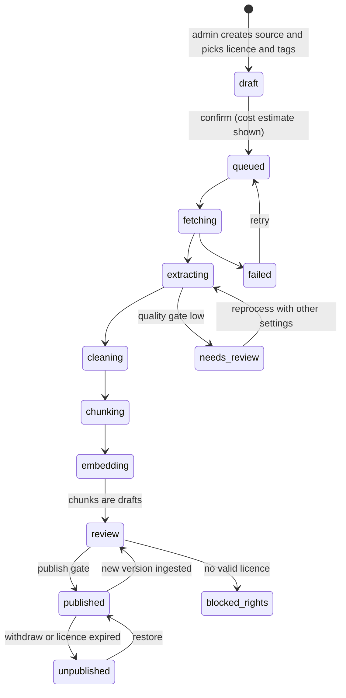
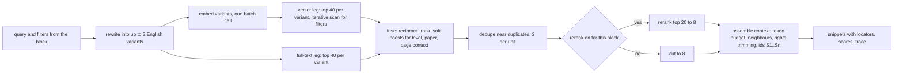
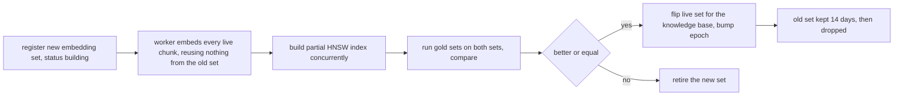

# PRD: F-17.2 Knowledge Bases and Ingestion (four global knowledge bases, sources, pipeline, retrieval)

| Field | Value |
| --- | --- |
| Status | Draft for review (written 2026-10-15) |
| Owner | Founder |
| Last updated | 2026-10-15 |
| Source | Founder's brief of 2026-10-15 (four centralised knowledge bases for Class 11 and 12, CS, CMA and CA; data sets such as web pages, documents, images, videos; RAG limited to the course the student chose; admin adds, edits and updates knowledge), `docs/F-17-ARCHITECTURE.md`, the `django-backend` review in section 14 |
| Parent | `docs/product/prd/F-17-ai-tutor-and-context-agent.md` |
| Siblings | F-17.1 Agent platform, F-17.3 Study blocks, F-17.4 Admin console, F-17.5 Widget, nudges and localisation |
| Related | F-02 syllabus (tags), X-04 Ingestion and scraping service (this document builds the tutor's own ingestion; X-04 stays the later shared service, section 12), F-03 media scan |
| Linked ERD | `docs/product/erd/F-17.2-knowledge-bases-and-ingestion.md` |
| Django app | `apps/api/modules/tutorkb` (table prefix `tutorkb_`) |
| Flags | None of its own; the tutor flag `ai_tutor` gates student access. Ingestion is staff-only and controlled by the `ingestion` kill switch |

Tags: `[NOTE]` the founder's words, `[ADD]` our proposal, `[NEW]` added by this document, `[?]` interpreted, `[VERIFY]` a number to confirm.

## 1. Problem and goal

The tutor is only as good as what it can read. Today the repo holds the syllabus structure (F-02) and the students' own notes, but no corpus of explanations, statutes, standards, past papers or videos that an answer can stand on. We need four **global** knowledge bases, one per course group, that you fill and keep current from many kinds of material, that are indexed for fast and exact retrieval, that carry the rights and dates of every source, and that a student can reach **only for the course she chose**.

Goal: an admin can add a source (a URL, a PDF, a Word file, an image, a video, a spreadsheet of questions, or typed text), watch it become searchable, test how it is retrieved, publish it, and later amend or withdraw it, while the tutor retrieves from it with high recall, shows where each answer came from and never mixes courses.

`[NOTE]` "4 centralised knowledge bases for Students (11th and 12th), CS, CMA, CA storage system, and based on the student course chosen value, we will only provide the access to the chat agent to use the RAG for that particular course knowledge base." Sections 6A and 6F.

## 2. Users and scenarios

**You, the admin, adding the CA Inter Taxation material.** You create a source "CA Inter Paper 3A study material", upload the PDF, choose licence "ICAI public, retrieval and short quotes only", tag course CA, level Intermediate, paper 3A, regime "Income-tax Act 2025 from May 2027". The estimator says about 560 pages, about 380 text pages and 20 that need vision for tables, estimated cost about ₹90. You confirm. Twenty minutes later it is in review: 1,140 chunks, 4 flagged for low text quality. You open the retrieval playground, ask three questions, see the fused ranking, fix a bad chunk, and publish.

**A content editor adding a website.** She adds `https://example.org/gst-updates` with depth 2, an allowed path prefix, weekly sync. Chunks arrive as drafts. A page that tries to give instructions to the AI is flagged and held back.

**A student, Arjun, CMA Final.** He asks about transfer pricing. The tutor retrieves only from the `cma` knowledge base, prefers Final-level material, ignores a superseded edition, and cites "CMA Final Paper 14, Chapter 3, p. 112" with a link. If nothing is found it says so; the miss appears (as a topic label, never his words) in your gap list.

**A reviewer handling an amendment.** An amendment booklet arrives. She uploads it as an `amendment` source that supersedes four chapters; the old chunks stop being retrieved for attempts after the effective date but stay for earlier attempts and for citations already shown.

**Edge: a student with two courses.** Her CA conversation reads only `ca`; her CS conversation reads only `cs`. Switching course starts a new conversation.

## 3. Success metrics

Targets apply to the first corpus per knowledge base and are measured on staff-written gold sets (section 6I), not on student text.

| Metric | Target | Source |
| --- | --- | --- |
| Retrieval recall at 5 on the gold set (fused, with filters) | 0.85 or higher | retrieval run (FR-KB-90) |
| Retrieval recall at 10 | 0.93 or higher | same |
| Mean reciprocal rank | 0.70 or higher | same |
| Fused beats best single leg by | at least 5 points of recall at 5 | ablation in the run |
| Filter leakage: chunks returned from another knowledge base | 0, always | cross-course test (FR-KB-05) |
| Ingestion success: sources reaching `ready` without manual repair | 97% | ingest runs |
| Time from upload to review for a 300-page text PDF | under 30 min | ingest runs |
| Cited chunks whose source is still live or superseded with a pointer | 100% | citation resolution |
| Sources past their review date | 0 for law and standards | admin dashboard |
| Gap queue: median age of open topic gaps | under 14 days | admin dashboard |
| Embedding and ingestion spend per 1,000 chunks | tracked; budget cap per source | ledger (`context = ingest`) |

## 4. Scope

| Release | Content |
| --- | --- |
| K1 Core | Four knowledge bases, course routing, licences and rights classes, source kinds `text`, `faq`, `dataset`, `pdf`, `webpage` and `website`, pipeline with quality and publish gates, chunking, embeddings with index sets, hybrid retrieval, citations, retrieval playground and gold sets (API), tick jobs |
| K2 Documents and images | `docx`, `pptx`, `xlsx`, `csv`, images (vision and OCR), tables to markdown, formulas to LaTeX, scanned-PDF OCR, near-duplicate detection, injection and PII scanners, bulk dataset import |
| K3 Video and audio | Uploaded video and audio, YouTube sources you own or are licensed to use, speech to text, timestamped chunks |
| K4 Freshness and scale | Scheduled sync, change detection, amendments and supersession, regime rules, stale reports, rerank, re-embedding with a new model (shadow index and flip), gap queue, load and capacity checks |

**Out of scope**

| Item | Where it goes |
| --- | --- |
| Statute, formula and numerical stores (structured records) | F-17.3 (`tutorblocks_*`); their text is mirrored here as chunks so Ask AI can retrieve it too |
| The students' own notes and flashcards | Umbrella F-17 `private_sources` port, searched live with the Notes search, never copied here |
| Admin screens | F-17.4 |
| A general web crawler for all of X-04 (competitor, news, lead data) | X-04 |
| Training a model on the corpus | `docs/AI-TUTOR-MODEL.md`; every licence records `allows_training` so that path stays open |
| Student uploads into the global KB | Never (students cannot write here) |

## 5. Flows

### 5.1 Source lifecycle

Each arrow from `queued` to `review` is one idempotent job stage on the existing queue (`core_job`), keyed by `(source_version, stage, batch)`. A crash repeats a stage; it never duplicates chunks.

### 5.2 Retrieval

The retriever always receives `kb_code` from the server, never from the client, and queries one partition.

### 5.3 Re-embedding with a new model (index sets)

### 5.4 Edge cases

| Case | Behaviour |
| --- | --- |
| Password-protected PDF | Source goes `needs_review` with reason `locked`; admin supplies the password once (kept only for that job, never stored) or uploads an unlocked copy |
| Scanned PDF with no text layer | Tesseract (English and Hindi) first, vision fallback per page when confidence is low, within the source's cost cap |
| Corrupt or empty file | `failed` with a machine code; no chunks |
| Very large PDF (over 3,000 pages or 200 MB) | Refused at upload with the limits; admin splits it |
| Same file uploaded twice | Detected by file hash; the admin is told and may add a new version instead |
| Same text under a different URL | Canonical URL and content hash detect it; kept once, the other URL recorded as an alias |
| Crawl trap (infinite calendars, session ids) | Depth, page cap, URL normalisation, query-string rules, per-host time cap |
| Cookie wall, captcha, login redirect | Page recorded as `blocked_by_site`, counted, not retried more than twice |
| `robots.txt` disallows | Respected by default; an override needs a written reason and is audited |
| Site is down | Retried with back-off; source `needs_attention` after 5 failed syncs |
| Mixed Hindi and English text | Language detected per chunk; Hindi chunks also get the simple-config text index |
| Tables and formulas mangled by text extraction | Pages flagged table-heavy or formula-heavy go to vision; result stored as markdown and LaTeX; originals kept for comparison |
| Repeating headers, footers, page numbers | Removed by repetition detection; page numbers kept as locators |
| Licence missing or expired | Source cannot be published; an expiry makes the tick unpublish it and tell staff |
| Source withdrawn after answers cited it | Old chips show "source updated"; the deep link goes to the successor or the source page |
| Amendment applies from a date | Chunks carry effective dates; retrieval filters by the student's attempt date (section 6G) |
| Two regimes of one law (for example Income-tax Act 1961 and 2025) | `regime` tag per source; rule table maps attempt to regime; both can coexist (section 6G) |
| Embedding service fails mid-run | Stage retries; already embedded chunks are kept; the source stays `embedding` until done or failed |
| Embedding rate limit | Batches back off; per-type concurrency cap on the worker |
| Chunk too long or too short | Split or merged by rules; chunks under 40 tokens attach to a neighbour |
| Wrong tagging noticed later | Bulk retag by filter in admin; re-tag does not re-embed |
| Malicious or instruction-bearing text | Injection scanner flags chunks `suspicious`; they are excluded from retrieval until a reviewer clears them |
| Personal data in an uploaded file | PII scanner flags (phone, email, PAN, Aadhaar patterns); source held for review |
| Student changes course | New conversation, other knowledge base; nothing carries over |
| KB mapping changed by admin | Takes effect for new conversations; open ones keep their binding |
| pgvector or index unavailable | Retrieval falls back to full text only and says so in the trace |

## 6. Functional requirements

Priority: P0 must ship in its release, P1 should, P2 can follow. Releases K1 to K4 as in section 4.

### A. Knowledge bases and course routing

| ID | Requirement | Priority | Acceptance criteria |
| --- | --- | --- | --- |
| FR-KB-01 | Exactly four knowledge bases at launch, rows with codes `school` (Class 11 and 12), `cs`, `cma`, `ca`; adding a fifth is a row plus a partition, not code | P0 K1 | Given a fresh database, then four rows exist and four partitions of the chunk and embedding tables |
| FR-KB-02 | A **course route** table maps a course code to a knowledge base (default one to one); editable by staff; a course with no route has no tutor access | P0 K1 | Given course `ca`, then `kb_route('ca')` returns `ca`; given an unmapped course, then 403 `kb_unavailable` |
| FR-KB-03 | The knowledge base is derived on the server from the student's active enrolment; the client may send `enrollment_id` which must belong to her | P0 K1 | Given another student's enrolment id, then 404 |
| FR-KB-04 | Chunks and vectors are partitioned by `kb_code`; every retrieval query names one `kb_code` and the planner prunes to one partition | P0 K1 | Given `EXPLAIN` on a retrieval query, then exactly one chunk partition and one embedding partition are scanned |
| FR-KB-05 | Cross-course isolation test: for each knowledge base, a query built to match another course's content returns none of it | P0 K1 | Given the isolation suite, then zero rows from other partitions across 100 adversarial queries per course |
| FR-KB-06 | Class 11 and 12 knowledge base needs a `school` course in F-02 (levels `class-11`, `class-12`) and an onboarding choice in F-16; until then staff can route a manual test group | P0 K1 | Given the dependency not done, then the wave plan shows it as a blocker for the `school` KB only |
| FR-KB-07 | A student with more than one active enrolment reads one knowledge base per conversation; widening to another of her courses needs a plan with `kb_scope = all_enrolled` | P1 K1 | Given a Pro student with two courses, then each conversation is bound to one |
| FR-KB-08 | Each knowledge base has settings: default chunking, retrieval thresholds, rerank on or off per block, allowed source kinds, review requirement (`manual`, `auto_for_trusted`), live embedding set | P0 K1 | Given a settings edit, then it is audited and takes effect on next retrieval |

### B. Sources, licences and rights

| ID | Requirement | Priority | Acceptance criteria |
| --- | --- | --- | --- |
| FR-KB-10 | A **source** has a kind, title, display title (what students see), knowledge base, licence, tags, language, effective dates, review-by date, sync policy, and a status from the lifecycle in 5.1 | P0 K1 | Given the create API, then required fields are validated by serializer |
| FR-KB-11 | A **licence** record: holder, plain terms, `allows_retrieval`, `quote_limit_words` (0 to unlimited), `allows_training`, `expires_on`, evidence file (private Storage), contact. Types: `own`, `licensed`, `statute_public`, `institute_public`, `link_only` | P0 K1 | Given a source without a licence, then publish is blocked with `licence_required` |
| FR-KB-12 | Rights class drives behaviour: `own`, `licensed`, `statute_public` can be quoted fully; `institute_public` is used for grounding and quoted at most 40 words (enforced by the verifier, F-17.1 FR-AP-78); `link_only` is never ingested as text, only as a titled pointer with a URL | P0 K1 | Given a `link_only` source, then no chunk exists and the tutor can only link |
| FR-KB-13 | Licence expiry: the tick unpublishes sources whose licence has expired and notifies staff; restoring needs a new licence | P0 K1 | Given an expired licence, then its chunks stop being retrieved within one tick |
| FR-KB-14 | Training flag: `allows_training` is stored and exported with each source so a later model-training dataset can be built only from permitted sources | P1 K1 | Given an export, then only `allows_training = true` sources appear |
| FR-KB-15 | Provenance: every chunk can be traced to source, version, file or URL, page or timestamp and extraction method | P0 K1 | Given a chunk id, then the admin shows the path |
| FR-KB-16 | Delete is soft (status `deleted`, chunks inactive); hard purge of text and files after 90 days unless held for a legal reason | P0 K1 | Given delete, then retrieval stops at once and the purge job removes text after 90 days |

### C. Source kinds and extractors

| ID | Requirement | Priority | Acceptance criteria |
| --- | --- | --- | --- |
| FR-KB-20 | `text`: staff-written markdown with title and tags; versioned in the editor; chunked by headings | P0 K1 | Given an edit, then a new source version and re-chunk of only changed sections |
| FR-KB-21 | `faq`: question and answer pairs, one chunk per pair, with optional aliases (Hindi, Hinglish) | P0 K1 | Given an alias in Hinglish, then the pair is retrieved by it |
| FR-KB-22 | `dataset`: CSV or JSONL of Q and A, glossary terms, tables, with a column-mapping step, dry run, validation report and a row cap per import (50,000) | P0 K2 | Given a dry run, then errors are listed per row and nothing is written |
| FR-KB-23 | `pdf`: text per page through `pypdfium2`; header and footer removal; page locators; quality score per page; scanned pages through Tesseract (English, Hindi) then vision if confidence is low; table and formula pages through vision to markdown and LaTeX; images extracted with captions; processed in batches of 20 pages as separate jobs with heartbeats | P0 K1 (text) K2 (OCR, tables, formulas) | Given a 300-page PDF, then it finishes in under 30 minutes and a crash resumes from the last finished batch |
| FR-KB-24 | `docx`, `pptx`: text, headings, tables, slide notes; `xlsx` and `csv`: each sheet as table chunks with header rows repeated | P1 K2 | Given a workbook, then each table chunk holds its header |
| FR-KB-25 | `webpage` (one URL) and `website` (crawl from a seed or sitemap): own fetcher with an adapter interface (`CrawlerEngine`) so a paid crawler can plug in; boilerplate removal; optional LLM clean-up per source (`ingest.clean`); PDF links found are proposed as separate sources, not auto-ingested | P0 K1 | Given a website source, then a page list with per-page status appears and PDF candidates are queued for approval |
| FR-KB-26 | Crawl controls per source: allowed hosts, include and exclude path rules, depth (default 2, max 4), page cap (default 200, max 2,000), politeness (1 request per second per host), `robots.txt` respected by default, a stated user agent | P0 K1 | Given a disallowed path, then it is skipped and counted |
| FR-KB-27 | Fetch safety: block private, loopback, link-local and metadata addresses (also after redirects), HTTPS preferred, 10 MB body cap, 20 s timeout, content type allow-list, no cookies or credentials forwarded | P0 K1 | Given a URL resolving to a private address, then it is refused and logged as `ssrf_blocked` |
| FR-KB-28 | `image`: stored privately; vision model describes and reads text; chunk text is description plus OCR text; image shown in citations through a signed URL | P1 K2 | Given a diagram, then a student can find it by a question about it |
| FR-KB-29 | `video` and `audio` (uploaded file) and `youtube` (only channels you own or are licensed to use, by URL with the licence noted): audio extraction, speech to text (language hint English, Hindi or auto), sentence-aligned windows of about 45 to 90 seconds with start and end times; citations carry a timestamp deep link | P1 K3 | Given a 20-minute video, then chunks have timestamps and a citation opens the video at that second |
| FR-KB-30 | `statute` sources are created by the F-17.3 importer and mirrored here as chunks (one per section or sub-section) so Ask AI can retrieve them; the mirror is read-only here | P0 K1 | Given a statute section, then a chunk with `ref_kind = law_section` exists |
| FR-KB-31 | Extractor interface: `extract(source_version, batch) -> units and chunks`, so a new kind adds a class and a table row, not pipeline changes | P0 K1 | Given a fake kind in tests, then the pipeline runs it |

### D. Pipeline and gates

| ID | Requirement | Priority | Acceptance criteria |
| --- | --- | --- | --- |
| FR-KB-40 | Stages: fetch, extract, clean, chunk, embed, then review; each is a job type (`tkb.fetch`, `tkb.extract`, `tkb.clean`, `tkb.chunk`, `tkb.embed`) that enqueues the next with a dedupe key; handlers are idempotent | P0 K1 | Given a killed worker, then the visibility timeout returns the job and the stage completes once |
| FR-KB-41 | Cost estimate before confirming: pages, expected token counts, OCR and vision share, embedding cost, total in rupees; a per-source cap that stops the run when reached | P0 K1 | Given a cap of ₹100, then a run that would exceed it stops with status `stopped_budget` and partial work kept |
| FR-KB-42 | Quality gate per page and per source: characters per page, garble ratio, language confidence, table and formula flags; sources under threshold go to `needs_review` with the bad pages listed | P0 K1 | Given a scanned PDF with poor OCR, then it is `needs_review` with page numbers |
| FR-KB-43 | Scans before chunks become retrievable: virus scan for uploads (the existing `media.scan` job), injection scan, PII scan, duplicate detection (exact by content hash, near by similarity above 0.95) | P0 K2 (virus K1) | Given a chunk with "ignore previous instructions", then it is `suspicious` and excluded from retrieval until cleared |
| FR-KB-44 | Chunking by kind: prose by headings then sentences, target 350 to 450 tokens with 15% overlap, never splitting a table, a formula or a list item; Q and A pairs, sections and table rows as units; video by time windows; every chunk keeps `heading_path` and a locator | P0 K1 | Given a table, then it is one chunk or split on row boundaries with the header repeated |
| FR-KB-45 | Contextual embedding text: the embedded string is `course > level > paper > chapter > heading path` plus the chunk text; the display text is unchanged | P0 K1 | Given two identical paragraphs in different chapters, then their vectors differ and retrieval follows the filter |
| FR-KB-46 | Embedding reuse: a chunk whose content hash (text plus context path) equals one already embedded in the same set reuses that vector | P0 K1 | Given re-ingesting an unchanged PDF, then zero new embedding calls |
| FR-KB-47 | Versioning: each ingest creates an immutable source version; chunks belong to a version; publishing flips the live version in one transaction (new chunks live, old chunks `superseded`) and bumps the knowledge base epoch | P0 K1 | Given a publish, then no query ever sees a mix of old and new chunks of one source |
| FR-KB-48 | Publish gate: `manual` (a reviewer clicks publish after the playground check) or `auto_for_trusted` (only for source kinds and licences staff mark trusted, and only when the quality gate passed and no flags) | P0 K1 | Given a flagged chunk, then auto-publish does not apply |
| FR-KB-49 | Ingestion never blocks students: heavy stages run only on the worker; the retrieval path reads only live chunks | P0 K1 | Given a large ingest running, then student turn latency is unchanged in the load test |

### E. Metadata and taxonomy

| ID | Requirement | Priority | Acceptance criteria |
| --- | --- | --- | --- |
| FR-KB-50 | Each source and chunk carries taxonomy by value from F-02: `course_code`, `level_code`, `paper_id` (subject), `chapter_id`, optional `topic_id`; no foreign keys into `syllabus` | P0 K1 | Given a chunk, then ids resolve through the syllabus selector and a deleted chapter does not break retrieval |
| FR-KB-51 | Other metadata: `content_type` (`explanation`, `statute`, `standard`, `case`, `example`, `question`, `solution`, `formula`, `glossary`, `summary`, `amendment`), `difficulty` (1 to 3), `language`, `regime`, `effective_from`, `effective_to`, `exam_terms` (for example `2027-05`), `amendment_year`, `is_official` | P0 K1 | Given a filter by `content_type = statute`, then only those return |
| FR-KB-52 | Bulk tagging: retag many sources or chunks by filter, with preview and audit; retagging never re-embeds | P1 K1 | Given a retag, then chunk rows change and embedding rows do not |
| FR-KB-53 | Auto-suggestion of tags at ingest (paper, chapter) by matching headings against the F-02 chapter names, shown as suggestions to confirm, never applied silently | P1 K2 | Given a PDF with a chapter heading, then the suggestion lists the matching chapter |

### F. Retrieval

| ID | Requirement | Priority | Acceptance criteria |
| --- | --- | --- | --- |
| FR-KB-60 | One service call: `retrieve(RetrievalRequest) -> RetrievalResult` in the `tutorkb` barrel with `kb_code`, query variants, filters, `on_date`, `kinds`, `k`, `token_budget`, `block`, `purpose` | P0 K1 | Given the barrel, then `tutor` and `tutorblocks` import nothing else from `tutorkb` |
| FR-KB-61 | Hybrid: vector leg (halfvec cosine, per partition, partial HNSW on the live set) and full-text leg (`english` config on text, `simple` config for non-English chunks and aliases), top 40 per variant per leg, run concurrently | P0 K1 | Given an exact string like "194C" or "AS 2", then the full-text leg finds it even when the vector leg does not |
| FR-KB-62 | Fusion: reciprocal rank fusion with k = 60, leg weights (vector 1.0, text 0.8) from the release, soft boosts (same level 1.15, same paper from page context 1.25), hard filters for knowledge base, status live, not suspicious, rights allowed, effective on `on_date` | P0 K1 | Given identical content in two papers and a page context for one, then that paper ranks first |
| FR-KB-63 | Filtered recall: `hnsw.iterative_scan = relaxed_order` and `hnsw.ef_search` set per transaction; the gold run reports recall at 10 against exact search with the same filters and fails below 0.95 | P0 K1 | Given a selective filter (one paper), then recall against exact search stays at or above 0.95 |
| FR-KB-64 | Query rewrite (`query.rewrite`, lite model) produces up to 3 English variants and extracts entities (section numbers, standards, terms); timeout 400 ms falls back to the raw query | P0 K1 | Given a Hinglish question, then English variants are searched and the Hindi aliases are matched too |
| FR-KB-65 | Near-duplicate suppression: at most 2 chunks per unit and no two chunks with the same content hash in the result | P0 K1 | Given duplicates across sources, then one is returned and the other appears in the trace as suppressed |
| FR-KB-66 | Optional rerank (`retrieve.rerank`): top 20 to top 8 by a rerank adapter (lite model listwise at first, a dedicated reranker later), enabled per block and knowledge base only when the gold run shows a gain of at least 3 points of recall at 5 | P1 K4 | Given rerank off, then no extra call |
| FR-KB-67 | Context assembly: snippets get ids `S1..Sn`, include display title, heading path, locator, effective dates and rights note; the best chunk is expanded with its neighbours if budget allows; the budget per block comes from the release | P0 K1 | Given 20 hits, then 8 or fewer reach the model and the total stays inside the budget |
| FR-KB-68 | Confidence signals returned with every result: `count`, `top_vector_similarity`, `top_text_rank_present`, `coverage` (share of rewrite entities found), `mode` (`hybrid` or `fts_only`); thresholds come from the release (`retrieval_min_score`), calibrated on the gold set | P0 K1 | Given a nonsense question, then `count = 0` after the threshold and the abstain rule fires |
| FR-KB-69 | Retrieval trace (counts, per-leg ranks, fused scores, filters used, timings, suppressed ids; no text) stored on the turn | P0 K1 | Given the admin turn inspector, then it shows the ranking with no text |
| FR-KB-70 | Citation resolution: `GET /api/v1/tutor/citations/{id}/` returns display title, locator, an excerpt (limited by rights), effective dates and an open link, only for a citation of the student's own turn | P0 K1 | Given another student's citation id, then 404 |

### G. Freshness, amendments and regimes

| ID | Requirement | Priority | Acceptance criteria |
| --- | --- | --- | --- |
| FR-KB-80 | Per-source sync policy: `cadence` (`off`, `daily`, `weekly`, `monthly`), `add_new_pages`, `reprocess_changed`, `path_prefixes`; default `off`; a 5-minute tick enqueues due sources (`tkb.sync_due`) with a 30-minute grace so slow runs do not drift the schedule | P0 K4 | Given a weekly source, then it runs once a week at the same hour |
| FR-KB-81 | Change detection: ETag or Last-Modified, then content hash; only changed pages re-extract; only changed chunks re-embed | P0 K4 | Given an unchanged site, then zero embedding calls |
| FR-KB-82 | Failure handling: a page that fails 5 times is skipped and listed; a source with 5 failed syncs becomes `needs_attention` and raises an alert; a page that disappears has its chunks deactivated and is listed as gone | P0 K4 | Given a 404, then its chunks stop being retrieved and the admin sees "gone" |
| FR-KB-83 | `review_by` date per source (default 12 months for law and standards, 24 for others); a report lists overdue sources; overdue law sources show a banner in admin and a count in the dashboard | P1 K4 | Given an overdue source, then it is listed with its owner |
| FR-KB-84 | Amendments: a source of kind `amendment` names the sources and chapters it amends, an effective date and the attempts it applies to; superseded chunks get `effective_to`; they remain retrievable for earlier attempts and for citations | P0 K4 | Given an attempt after the effective date, then the old chunks are filtered out and the amendment chunks are returned |
| FR-KB-85 | Regime rules: a table mapping `(course, paper or subject, exam term)` to a `regime` tag (for example CA Intermediate Paper 3A and Final Paper 4 from the May 2027 attempt use `it_2025`; earlier attempts use `it_1961`). ICAI's announcement states the 2025 Act applies from the May 2027 exam; it does not state the earlier law, so earlier mappings are staff-entered and marked `[VERIFY]`. The retriever filters by the student's regime when the paper has one | P0 K4 | Given a CA Inter student with a May 2027 attempt, then law chunks tagged `it_1961` are excluded and `it_2025` returned |
| FR-KB-86 | Section number mapping between regimes (old to new) is data owned by F-17.3 (`tutorblocks_lawmap`); retrieval can add the mapped section to the query when the student mentions an old number | P1 K4 | Given "section 194C", then the entity set includes the new Act's equivalent when mapped |
| FR-KB-87 | Withdrawal and restore of a source with reason; withdrawing bumps the epoch | P0 K1 | Given withdrawal, then retrieval excludes it within one epoch check (15 s) |

### H. Admin operations (APIs here, screens in F-17.4)

| ID | Requirement | Priority | Acceptance criteria |
| --- | --- | --- | --- |
| FR-KB-100 | Retrieval playground API: run a query against a knowledge base with chosen filters, `on_date`, draft chunks included or not, legs on or off, rerank on or off; returns each leg's ranks, fused scores and text of chunks (staff only) | P0 K1 | Given a playground call, then no student data is read and the call is audited |
| FR-KB-101 | Chunk editor: view, edit text (override kept beside the original), deactivate, retag; edits re-embed that chunk only | P0 K1 | Given an edit, then one embedding call and the override flag shows |
| FR-KB-102 | Source operations: reprocess (with different settings), re-chunk, re-embed, retry failed pages, pause sync, clone to a new version, withdraw, delete | P0 K1 | Given reprocess, then a new source version and a diff summary appear |
| FR-KB-103 | Exclusion rules per website source (URL patterns) and per knowledge base (domains never to ingest) | P1 K1 | Given an excluded pattern, then matching pages are skipped on every sync |
| FR-KB-104 | Gap queue: abstained or empty-retrieval turns are grouped into **topic gaps** by a lite model that writes a label of at most 8 words with no personal information; stored as label, knowledge base, block, count in 7 days, last seen, status; never the student's words | P0 K4 | Given 20 abstentions about one topic, then one gap row with count 20 and a label |
| FR-KB-105 | Gap workflow: open, in progress (linked to a source being added), closed; closing without a source needs a reason | P1 K4 | Given a gap closed by a published source, then a retrieval check re-runs the sample query set |
| FR-KB-106 | Dashboards: corpus size per knowledge base (sources, chunks, tokens), ingestion runs, failures, cost, index size, staleness, suspicious chunks waiting, gap queue | P0 K1 | Given the overview API, then every number reconciles with the tables |

### I. Evaluation

| ID | Requirement | Priority | Acceptance criteria |
| --- | --- | --- | --- |
| FR-KB-90 | **Gold sets**: staff-written queries per knowledge base with filters and the expected sources or locators, in English, Hindi and Hinglish; at least 150 per knowledge base before its first publish to students | P0 K1 | Given a knowledge base with fewer than 150 cases, then the readiness check shows amber |
| FR-KB-91 | Retrieval runs compute recall at 5 and 10, MRR and nDCG at 10, per language and per leg (ablation: text only, vector only, fused, fused plus rerank), and recall against exact search for filtered queries | P0 K1 | Given a run, then all metrics are stored and comparable with the previous run |
| FR-KB-92 | Run on every ingest publish (a sampled subset), nightly (full), and before flipping an embedding set; a drop of more than 3 points of recall at 5 raises an alert and blocks auto-publish | P1 K4 | Given a bad publish, then the alert fires with the sources that changed |
| FR-KB-93 | Shadow comparison: for a new embedding set, run the gold sets on both sets and show the difference before the flip | P1 K4 | Given a candidate set, then the flip button shows the comparison |
| FR-KB-94 | Readiness check per knowledge base before students are admitted: gold size, recall, isolation test, sources with valid licences, no overdue law sources, no suspicious chunks waiting | P0 K1 | Given all green, then the knowledge base can be marked `open` for students |

### J. Security and privacy

| ID | Requirement | Priority | Acceptance criteria |
| --- | --- | --- | --- |
| FR-KB-110 | Staff only: no student endpoint writes or lists sources; students reach knowledge only through retrieval inside a turn and the citation resolver | P0 K1 | Given a student token on any admin path, then 403 |
| FR-KB-111 | Uploads validated by content, not name: type, size, page count; generated storage names; private bucket `tutor-kb`; signed URLs short lived; virus scan before extraction | P0 K1 | Given a renamed executable, then it is rejected |
| FR-KB-112 | No student data in this app: queries are not stored; the gap queue stores labels only; traces store ids and numbers | P0 K1 | Given the table list, then no column holds student text |
| FR-KB-113 | Provider keys only on the API roles; the worker holds the embedding key; no key in the browser or in rows | P0 K1 | Given the web bundle, then no key appears |
| FR-KB-114 | Admin actions audited with before and after (F-17.4); the retrieval playground and chunk views are logged because they show licensed text | P0 K1 | Given an audit query, then each playground call is listed with the staff id |
| FR-KB-115 | Raw licensed files are never served to students; only excerpts within the quote limit and links to public sources | P0 K1 | Given a licensed PDF, then no endpoint returns the file to a student |

## 7. Screens and URLs

Admin screens are in F-17.4 (`/admin/tutor/kb/...`). Student-facing: a citation chip and the source card (F-17.5). Public: none (the knowledge bases are not public pages).

## 8. Data and permissions

Entities (ERD): knowledge base, course route, licence, source, source version, unit, chunk, embedding set, embedding, ingest run, crawl page, regime rule, gap, gold query, retrieval run. Scopes: `tutor.kb.read`, `tutor.kb.write` (sources, chunks), `tutor.kb.publish`, `tutor.kb.licences`, `tutor.eval` (gold sets and runs). Students have no direct access.

## 9. API surface

### 9.1 In-process service (the barrel)

`tutorkb.retrieve(request) -> result`, `tutorkb.kb_for_course(course_code) -> kb_code`, `tutorkb.resolve_citation(ref) -> SourceCard`, `tutorkb.epoch(kb_code) -> int`. Nothing else is public.

### 9.2 Student endpoint

| Method and path | Purpose |
| --- | --- |
| `GET /api/v1/tutor/citations/{id}/` | Source card for a citation chip (FR-KB-70) |

### 9.3 Admin endpoints (served by `tutoradmin`, listed here because this app owns the behaviour)

All under `/api/v1/tutor-admin/kb/`: `knowledge-bases/` (list, settings), `routes/`, `licences/`, `sources/` (CRUD, `{id}/confirm/`, `{id}/estimate/`, `{id}/versions/`, `{id}/reprocess/`, `{id}/publish/`, `{id}/withdraw/`, `{id}/restore/`, `{id}/sync/`), `uploads/` (signed upload), `crawl/preview/` (list candidate URLs without fetching content), `chunks/` (list, `{id}`, `bulk-retag/`), `playground/search/`, `gaps/`, `gold/` (cases CRUD, import), `runs/` (create, list, compare), `embedding-sets/` (create, `{id}/build-index/`, `{id}/flip/`), `regimes/`, `overview/`.

Errors: `licence_required`, `licence_expired`, `quality_gate_failed`, `budget_exceeded`, `upload_rejected`, `ssrf_blocked`, `source_busy`, `kb_not_open`.

## 10. Notifications and analytics events

Staff notifications (email or Slack webhook, configured in F-17.4): ingest failed, source needs attention, licence expiring in 30 days, retrieval recall dropped, suspicious chunks waiting, overdue law source. Product events (PostHog) carry no text: `tutorkb_retrieval_done` is not sent to PostHog (it is in `tutor_turn.retrieval_trace`); staff dashboards read the database.

## 11. Non-functional requirements

| Area | Requirement |
| --- | --- |
| Retrieval latency | Hybrid retrieval p95 under 300 ms at 150,000 chunks in the partition; p99 under 600 ms |
| Ingestion throughput | 300-page text PDF to review in under 30 minutes; 1,000-page website crawl in under 60 minutes at politeness 1 request per second |
| Capacity | Up to 400,000 chunks across four partitions at launch scale (architecture section 11); design check at 1 million per partition |
| Availability | Retrieval depends on Postgres only (and the embedding call for the query vector; if that fails, full text only) |
| Cost | Embedding the whole corpus once is about 160 million tokens, about $24 at the verified `gemini-embedding-001` price of $0.15 per million tokens; OCR and vision are the large cost and are capped per source |
| Quality | Gold-set targets in section 3 |
| Accessibility | Not applicable (staff screens follow F-17.4) |

### 11.1 Index and query settings (starting values, tuned in W2)

HNSW `m = 16`, `ef_construction = 64`, per partition and per live embedding set, `halfvec_cosine_ops`, `hnsw.ef_search = 80`, `hnsw.iterative_scan = relaxed_order`, `hnsw.max_scan_tuples = 40000` (set per transaction with `SET LOCAL`). These follow the verified pgvector guidance (appendix of the architecture document) and are replaced by the values the W2 gold run supports.

## 12. Risks and open questions

| # | Risk | Mitigation |
| --- | --- | --- |
| R-KB-1 | Copyright: institute material ingested without rights | Licence required to publish, rights classes, quote limits enforced by the verifier, training flag, counsel review before general launch |
| R-KB-2 | Poor extraction of tables, formulas and scans quietly lowers answer quality | Quality gate, vision fallback, review step, playground, gold sets |
| R-KB-3 | Stale law and standards | `review_by`, effective dates, regime rules, amendment sources, overdue report |
| R-KB-4 | Prompt injection through crawled pages | Scanner, quarantine, delimited data in prompts (F-17.1), staff-only ingestion |
| R-KB-5 | Filtered vector recall collapse | Partition per knowledge base, iterative scan, recall against exact search in every run |
| R-KB-6 | Ingestion cost surprises (vision on a 1,000-page scan) | Estimator, per-source cap, ingestion budget, kill switch |
| R-KB-7 | Re-embedding is slow or breaks live retrieval | Index sets, shadow index, flip, keep the old set 14 days |
| R-KB-8 | Crawler blocked or legally risky | Respect `robots.txt`, rate limit, own or licensed sources first, `link_only` for the rest |
| R-KB-9 | Wrong tagging sends content to the wrong paper | Suggestions not silent, bulk retag with preview, gold sets by paper |
| R-KB-10 | `school` knowledge base blocked by missing course in F-02 and F-16 | FR-KB-06 and the dependency in the wave plan |

| # | Question | Default until you answer |
| --- | --- | --- |
| Q-KB-1 | Does F-02 get a `school` course (Class 11 and 12 by board) and does onboarding offer it? | Yes; a wave-0 task in the plan; the other three knowledge bases do not wait |
| Q-KB-2 | Crawler: built-in fetcher first, or buy a hosted crawler such as Firecrawl now? | Built-in fetcher (static pages) with the adapter interface; add a hosted crawler only for JavaScript-heavy sources you need |
| Q-KB-3 | Which corpora first, in what order? | CA Intermediate Taxation and Accounting, then CMA, CS, school; you supply the files |
| Q-KB-4 | Auto-publish policy: which sources count as trusted? | None at first; everything manual |
| Q-KB-5 | YouTube: only your own channel? | Yes; third-party videos only as `link_only` |
| Q-KB-6 | Embedding dimension: 768 (default here) or 1536 | 768; the gold run in W2 can justify 1536 |
| Q-KB-7 | Who writes the gold sets (150 per knowledge base) | You and one subject expert per course, 30 a week |
| Q-KB-8 | Use X-04 when it exists, or keep the tutor's own ingestion | Keep the tutor's own (K1 to K4); X-04 can call it later through the extractor interface |
| Q-KB-9 | Retention of superseded chunks | 90 days, then purge text, keep ids and numbers |
| Q-KB-10 | Dual-regime mapping for Income-tax before May 2027 | Staff enters it after checking ICAI's material; marked `[VERIFY]` |
| Q-KB-11 | F-14 Amendments (publisher plug-in over X-04) already models institute amendments per term and paper. Should the tutor's `amendment` source kind consume F-14's published change cards instead of staff re-entering them | Yes when F-14 is built: a read-only provider turns each published change card into an `amendment` chunk with its effective date and attempts; until then staff enter amendments here (FR-KB-84) |

## 13. Rollout

Waves and the owner checklist are in `docs/F-17-BUILD-WAVES.md`: W2 (K1 core and the first corpus), W8 (K2), W9 (K3 and K4 pieces), W11 (scale and re-embedding). A knowledge base is opened to students only after FR-KB-94 turns green.

Slicing into PR-sized issues:

1. `tutorkb` schema: knowledge bases, routes, licences, sources, versions, units, chunks (partitioned), embedding sets and embeddings (partitioned), ingest runs; RLS; partition and trigger tests on PostgreSQL.
2. `integrations/llm` embedding and rerank interfaces (shared with F-17.1) and the fake embedder.
3. Pipeline skeleton: job types, stage chaining, idempotency keys, status machine, tick job.
4. Extractors: `text`, `faq`, `dataset` (K1), then `pdf` text (K1).
5. Chunker (all kinds) with golden tests; contextual embedding text; reuse by content hash.
6. Retrieval service: hybrid SQL, fusion, filters, trace, confidence, isolation test.
7. Rights and licences: gates, expiry job, quote limits hook for the verifier.
8. Web fetcher with SSRF guard, crawl rules, `website` source; PDF candidates.
9. Admin API for sources, chunks, playground, estimates, gold sets, runs.
10. K2 extractors: OCR, vision tables and formulas, `docx`, `pptx`, `xlsx`, image; scanners.
11. K3: audio and video, YouTube, speech to text.
12. K4: sync, change detection, amendments, regimes, stale reports, gap queue, rerank, embedding set flip.

## 14. Review of `django-backend` used for this design

Read on 2026-10-15 (`tenant/models/data`, `tenant/services/data_pipeline`, `tenant/temporal/data_pipeline`, `tenant/ai_models/vector_store.py`, `text_splitters.py`, `embedding_models.py`). We keep: source then unit then chunk then embedding with status enums and `failed_reason`; deterministic workflow ids and per-stage retries (here, dedupe keys on `core_job`); versioned embeddings soft-deleted on replace; per-source chunk and sync settings in JSON; daily fan-out of only-due sources; multi-query reciprocal rank fusion; partial HNSW indexes; the empty-retrieval guard. We change or add: full-text leg and fusion (theirs is dense only), partitions per knowledge base instead of tenant schemas, content-hash reuse (theirs has none), a publish gate and quality gate, rights classes and licences, effective dates and regime rules, a source-kind extractor interface, retrieval gold sets and ablations (theirs has none), and a hosted-crawler-optional design (theirs is Firecrawl only). Their company-domain relevance checker, page intent levels and case-study tagging are sales concepts and are not carried over.
