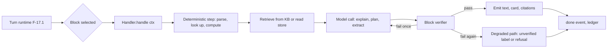
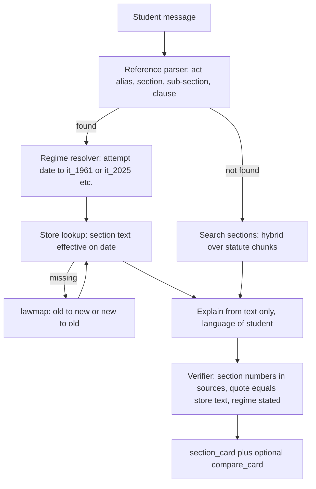
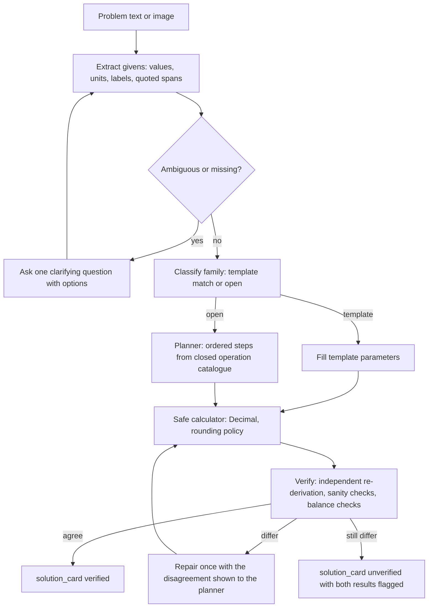

# PRD: F-17.3 Study Blocks (Ask AI, Formula, Law Sections, Numerical)

| Field | Value |
| --- | --- |
| Feature id | F-17.3 (child of the F-17 umbrella) |
| Owner | Pawan (product), engineering TBD |
| Status | Draft for review |
| Siblings | F-17.1 Agent platform, F-17.2 Knowledge bases, F-17.4 Admin console, F-17.5 Widget, nudges and localisation |
| Architecture | `docs/F-17-ARCHITECTURE.md` (section 8 "Blocks as plug-ins" is the contract this document fills in) |
| Django app | `apps/api/modules/tutorblocks` (table prefix `tutorblocks_`) |
| Flags | PostHog: `ai_tutor` (master, F-17.1), `ai_tutor_block_ask`, `ai_tutor_block_formula`, `ai_tutor_block_law`, `ai_tutor_block_numerical` (all strict, fail closed) |
| ERD | `docs/product/erd/F-17.3-study-blocks.md` |
| Last updated | 2026-10-15 |

## 1. Problem and goal

A single "ask me anything" box gives a student the same shaky answer whether she wants a concept explained, the exact wording of a section, a formula, or a worked numerical. Those four jobs fail in different ways. A concept answer fails by being vague. A section answer fails by quoting the wrong section or the wrong Act. A formula answer fails by a wrong symbol. A numerical fails by a wrong number that looks confident. One prompt cannot guard against all four.

So each job becomes a **block**: its own input handling, its own data store, its own tools, its own verifier and its own card. The runtime (F-17.1) chooses the block; the blocks do the work. The goal is that each block reaches a standard of correctness a student can trust in an exam week:

- **Ask AI**: grounded concept answers, always with a source or an honest "not in my material".
- **Formula**: the formula comes from a staff-curated store, never from the model's memory, with a calculator that plugs in values.
- **Law Sections**: the section text comes from a statute store with effective dates and regimes; the model explains, it never recites from memory.
- **Numerical**: the model plans, a calculator computes in exact decimal arithmetic, a second pass verifies, and the student sees steps she can follow.

Anything a block cannot ground or verify is shown as unverified or refused, never dressed up as certain.

## 2. Users and scenarios

**Riya, CA Intermediate (Pro).** Types "194C ka rate kya hai contractor ke liye" in Ask AI. The pre-router (F-17.1 FR-AP-31) sends it to Law Sections. She gets a section card for the right Act for her attempt, the rate table, a three-line Hinglish explanation, and a note that the section is numbered differently in the 2025 Act.

**Arjun, CMA Final (Pro Max).** Pastes a transfer-pricing numerical. The Numerical block lists the givens it found and asks him to confirm one ambiguous figure, then shows a solution card with steps, workings, and the answer. He taps "Hint only" on the next problem and gets a nudge at hint level 1.

**Meera, Class 12 commerce (Pro).** Asks "WDV aur SLM ka formula". The Formula block returns two formula cards with variables, a worked example and "Add to Recall". She enters her own values in the card's calculator and gets the answer without a model call.

**Karan, CS Executive (Pro).** Asks "difference between private and public company". Ask AI answers from the CS knowledge base with two citations and a small comparison table, in English because he asked in English.

**Pawan (admin).** Adds 40 new numerical solver templates, marks one formula as withdrawn because the circular changed, and watches the per-block accuracy on the dashboard.

## 3. Success metrics

| Metric | Target | Measured by |
| --- | --- | --- |
| Law: fabricated or wrong section number reaching a student | 0 in the evaluation set; < 0.1% of sampled live turns | Evaluation harness (F-17.1) and the judge sample |
| Law: quoted text equals store text | 100% | Verifier (FR-SB-48) |
| Formula: formula shown equals store entry | 100% (no model-generated formula in the card) | Card schema plus test |
| Numerical: final answer correct on the gold set | at least 95% for template-backed families, at least 85% for open problems | Numerical gold set (FR-SB-95) |
| Numerical: wrong answer shown as `verified` | 0 in the gold set | Gold set |
| Ask AI: groundedness | at least 0.90 | F-17.1 evaluation gate |
| Block routing accuracy | at least 95% | F-17.1 labelled set |
| Time to first token | p95 under 2.5 s; numerical first status event under 1.5 s | Ledger |
| Students who use two or more blocks in a week (Pro) | 40% by month 3 | PostHog funnel, counts only |
| Helpful rating by block | at least 80% positive | In-card thumbs |

## 4. Scope

In scope: the Block SDK; the four launch blocks; the card types they emit; the curated stores (formulas, law sections, solver templates); statute and formula importers; practice and hint modes; block-level evaluation packs; admin APIs (screens in F-17.4); block-level limits, weights and flags.

Out of scope here: the turn runtime, quotas and releases (F-17.1); the knowledge bases and general retrieval (F-17.2); the screens (F-17.4, F-17.5); a graded mock-test engine; image-first doubt solving as a separate product (P2 below only adds image input to Numerical); live case-law research; advice about a student's own tax filing (the tutor teaches, it does not advise).

### 4.1 Releases

| Release | Contents |
| --- | --- |
| B1 | Block SDK, registry, card registry, Ask AI block, block config and flags |
| B2 | Law Sections: statute store, importer, reference parser, regime handling, verifier, `section_card`, `compare_card` |
| B3 | Formula: store, importer, finder, calculator, `formula_card`, Recall bridge |
| B4 | Numerical core: extractor, solver templates, safe calculator, verifier, `solution_card`, hint ladder |
| B5 | Numerical practice and image input, Law case notes, block-to-block hand-offs, one future block behind a flag |

## 5. Flows

### 5.1 Block contract (all blocks)

The handler receives a `BlockContext` (release bundle, student context, conversation state, tool budget, language, locale glossary, retrieval port, ledger port) and yields events (`status`, `text_delta`, `card`, `citation`, `verify_status`, `suggestions`). It never touches HTTP, quotas, or the database tables of other apps.

### 5.2 Law Sections

### 5.3 Numerical

### 5.4 Edge cases

| Case | Behaviour |
| --- | --- |
| Student cites an old section number for her regime ("section 194C" for a 2027 attempt under the 2025 Act) | Parser finds it in `lawmap`; answer uses the new section, states "this was 194C under the 1961 Act", and offers the `compare_card` |
| Section exists in two Acts ("section 2" of CGST and Companies Act) | Act is taken from context (page, previous turn, course default) or the model asks "which Act?" with chips; never guessed |
| Section repealed or omitted | Store entry has status `omitted`; card says so with the omission date; no explanation text invented |
| Section amended during the student's study period | Store holds dated versions; the card uses the version effective on the exam-relevant date and shows "amended on <date>" |
| Student's attempt date is unknown | Block asks once ("Which attempt are you preparing for?") and stores the answer in conversation state; if she declines, the card states the regime it used |
| Law question that needs judgment ("Will this expense be allowed?") | Explains the rule from the section, states the conditions, and labels application to facts as exam-style reasoning; no filing or planning advice |
| Formula with different forms by exam term | `formula` rows have `valid_from_term` and `valid_to_term`; the finder returns the one for her attempt and notes the other |
| Formula the store does not have | Falls back to Ask AI retrieval with the label "not in the formula store"; the answer carries citations or abstains; no `formula_card` is produced from the model's memory |
| Numerical with missing data | Asks for exactly what is missing, with the quantity named; never assumes silently; an assumption the student approves is listed on the card |
| Numerical with inconsistent data (totals do not tie) | Reports the inconsistency with the figures; continues only after she confirms which to use |
| Rounding differs between ICAI and textbook style | Template carries a `rounding_policy`; the card states the policy; staff set it per family |
| Very large problem (many rows) | Cap of 60 givens and 25 steps per solution (configurable); beyond that the block offers to split by part |
| Two parts (a), (b), (c) | One extraction, one plan with named parts, one card with tabs per part |
| Calculator would divide by zero or overflow | Step fails with a named error; the card shows the failed step and asks for a data check |
| Student asks for the answer to a graded or proctored test | Rule `exam_integrity` (F-17.1) applies: hints and method only when the page context is a graded assessment |
| Student sends a photo of a question | P2: vision extraction to the same givens structure; she confirms the extracted values before solving |
| Language mix (Hinglish question, English statute) | Statute text stays in English (the legal text), explanation in her language, with a glossary of Hindi terms from F-17.5 |
| Block disabled by kill switch or flag | The router falls back to Ask AI with a notice; Ask AI disabled means the whole tutor degrades per F-17.1 section 12 |
| Block timeout | The block returns its degraded path: Law returns the section card without the explanation; Formula returns the card alone; Numerical returns the plan and the givens with "I could not finish; here is where I got to" |

## 6. Functional requirements

Priority: P0 must ship in its release, P1 should, P2 can follow. Releases B1 to B5 as in section 4.1.

### A. Block SDK and registry

| ID | Requirement | Priority | Acceptance criteria |
| --- | --- | --- | --- |
| FR-SB-01 | `BlockSpec` declares key, name and description (i18n keys), icon, starter prompts, input schema, card schemas, tools, default knowledge kinds, default weight, default plan limits, evaluation pack path | P0 B1 | Given a spec missing a card schema, then startup validation fails |
| FR-SB-02 | `BlockHandler.handle(ctx) -> iterator[Event]` is the only entry point; handlers are pure with respect to HTTP and quotas | P0 B1 | Given the import-linter rules, then `tutorblocks` imports no `views`, `serializers` or other apps' models |
| FR-SB-03 | Registry populated in `AppConfig.ready`; `tutor` finds blocks by key through `core/registry.py`; adding a block needs no change in `tutor` | P0 B1 | Given a fake block in tests, then the runtime routes to it |
| FR-SB-04 | Per-block config row (released): enabled, label overrides, plan limits, weight, retrieval overrides, verifier mode (`always`, `sampled`, `off`), tool allow-list, hint ladder, practice rules | P0 B1 | Given a config edit and a release, then the next turn uses it |
| FR-SB-05 | Block flags `ai_tutor_block_<key>` (strict); a block whose flag is off is absent from `bootstrap` and from the router's candidates | P0 B1 | Given the flag off, then the chip is not shown and routing never selects it |
| FR-SB-06 | Cards are JSON validated against the spec's schema before they are sent; an invalid card is dropped and the text-only answer is sent with a `card_dropped` flag on the turn | P0 B1 | Given a malformed card, then the student sees text and the turn has the flag |
| FR-SB-07 | Tools exposed to the model are typed functions with JSON schemas; each call is logged by name and duration (no arguments with student text); at most 6 tool calls per turn (per block config) | P0 B1 | Given a runaway tool loop, then the turn stops at the cap with a degraded answer |
| FR-SB-08 | Every block has a degraded path, a kill switch (F-17.1 FR-AP-19) and an evaluation pack whose pass is a release gate | P0 B1 | Given a block with no pack, then the release gate fails |
| FR-SB-09 | Block hand-off: a block can suggest another (`Open in Formula`, `Solve this in Numerical`) as a chip; it never silently re-routes | P1 B5 | Given a numerical typed in Ask AI, then a chip offers Numerical |
| FR-SB-10 | State namespace: a block stores small JSON under `conversation.state.<block>`; no student text; cleared with the conversation | P0 B1 | Given a numerical attempt id, then it is in `state.numerical` and nothing else |

### B. Ask AI

| ID | Requirement | Priority | Acceptance criteria |
| --- | --- | --- | --- |
| FR-SB-19 | Grounded explanation for concepts, definitions, differences, steps and examples, using hybrid retrieval over the student's knowledge base (F-17.2) with page and syllabus filters | P0 B1 | Given "what is deferred tax", then the answer carries at least one citation from the CA knowledge base |
| FR-SB-11 | Modes: `explain` (default), `quick` (3 lines), `eli5` (simple analogy then the real definition), `exam` (answer as written for marks, with key words highlighted), `compare` (table), `steps`; the mode is a chip and a rule can set it | P0 B1 | Given `quick`, then at most 60 words |
| FR-SB-12 | Follow-up handling: pronouns and elisions resolved from the conversation window; "explain simpler" and "give an example" are recognised as follow-ups on the same topic | P0 B1 | Given "explain simpler" after an answer, then the same topic is simplified |
| FR-SB-13 | Citations: every factual claim from a source carries `[S#]` mapped to a citation chip; claims without a source are labelled as general explanation; abstain action when retrieval is empty (F-17.1 FR-AP-70) | P0 B1 | Given no sources, then "not in my material" with the offer of a labelled general explanation |
| FR-SB-14 | Syllabus awareness: the answer notes when the topic is outside her course or level and points to the right chapter (from F-02) | P1 B1 | Given a Class 12 question on a CA topic, then it is answered briefly and flagged as beyond her syllabus |
| FR-SB-15 | Table and list cards for comparisons and step lists (`table_card`, `steps_card`) rendered by the widget; text fallback when cards are not supported | P1 B1 | Given a compare request, then a `table_card` and a text summary |
| FR-SB-16 | Study actions on an answer: "Make flashcards" (hand-off to Recall, FR-SB-29), "Quiz me" (P2, future block), "Save to notes" (host feature if present) | P2 B5 | Given the Recall bridge off, then the actions are not shown |
| FR-SB-17 | Ask AI never produces a section number, a formula for a card, or a final numeric answer on its own: when it detects one of these, it offers the matching block (FR-SB-09) and may answer from retrieved text with citations | P0 B1 | Given "what is section 194C", then the pre-router sends it to Law; given a forced Ask AI, then the section text comes only from sources with a citation |
| FR-SB-18 | Out-of-scope handling is a rule (F-17.1 6F): off-topic, harmful, personal advice, graded-test integrity; each has a localised static message | P0 B1 | Given an off-topic question, then a redirect and no retrieval |

### C. Formula block

| ID | Requirement | Priority | Acceptance criteria |
| --- | --- | --- | --- |
| FR-SB-20 | **Formula store**: curated entries with id, title (EN, HI), aliases (including Hinglish), subject, chapter, expression (LaTeX), variables (symbol, name, unit, description), conditions of use, notes, worked example, exam-term validity, source reference, status | P0 B3 | Given a formula row, then every variable used in the expression is declared |
| FR-SB-21 | Finder: exact alias match, then full-text over titles and aliases, then vector search over formula descriptions; scoped to the knowledge base and chapter hint; returns up to 3 candidates with scores | P0 B3 | Given "WDV", then the Written Down Value formula is first |
| FR-SB-22 | `formula_card`: title, expression rendered as math, variables table, conditions, a worked example, source link, validity note, "Add to Recall", "Use calculator"; every field comes from the store row, never from the model | P0 B3 | Given a card, then a test proves each field equals the store row |
| FR-SB-23 | The model only chooses among candidates and writes the short explanation and example framing; if none fits above threshold, the block says so and offers Ask AI | P0 B3 | Given a request for a formula that is not in the store, then no card and an offer |
| FR-SB-24 | **Calculator on the card**: the student enters variable values; evaluation happens in the browser **or** server through the same safe expression engine (FR-SB-60) with exact decimal; shows the substitution and the result; no model call | P0 B3 | Given inputs, then the result equals the reference value from the store's test vectors |
| FR-SB-25 | Each formula may carry **test vectors** (inputs and expected output); import fails if a vector disagrees with the expression | P0 B3 | Given a wrong vector, then import is rejected with the row |
| FR-SB-26 | Solve-for-variable: when one variable is blank and the others are filled, the card solves for it if the expression is invertible by the engine (algebraic rearrangement table per formula, not symbolic guessing); otherwise the field is disabled with a reason | P1 B3 | Given PV, rate and n blank FV, then FV is computed; given a non-invertible formula, then the field is disabled |
| FR-SB-27 | Units and Indian formatting: amounts in ₹ with lakh and crore grouping when the locale asks; percentages; days vs years flags prompt the student ("rate per annum, time in months?") | P1 B3 | Given 12% p.a. and 6 months, then the card asks or shows the conversion |
| FR-SB-28 | Related formulas on the card ("also see": derived, inverse, special cases) from store links | P1 B3 | Given a formula with relations, then chips appear |
| FR-SB-29 | **Recall bridge**: "Add to Recall" posts a flashcard (front: name and prompt, back: expression and variables) through the `recall` port; absent port hides the button | P1 B3 | Given the port stubbed, then the call carries ids and text for her own deck only |
| FR-SB-30 | Formula sheet export: the student collects cards in the chat; "Formula sheet" renders a printable page of the selected cards (client-side print stylesheet) | P2 B5 | Given 5 cards, then a print view opens |
| FR-SB-31 | Formula import: CSV or JSON with a dry run and validation (variables declared, vectors pass, LaTeX parses with KaTeX in CI) | P0 B3 | Given a bad LaTeX row, then it is listed with the error |
| FR-SB-32 | Versioned rows: changing a formula creates a new version; cards reference the version used so an old conversation still shows what it showed | P0 B3 | Given an edit, then old turns still render the earlier version |

### D. Law Sections block

| ID | Requirement | Priority | Acceptance criteria |
| --- | --- | --- | --- |
| FR-SB-40 | **Statute store**: Acts with short names, aliases and status; sections with number, sub-section path, heading, text, marginal note, dated versions (`effective_from`, `effective_to`), `regime`, `status` (`in_force`, `omitted`, `repealed`, `not_yet_in_force`), provisos and explanations as child rows, official source URL | P0 B2 | Given section 194C, then it has at least one version with dates and a source URL |
| FR-SB-41 | Launch Acts by knowledge base, staff-confirmed (Q-SB-1): `ca`: Income-tax Act 1961 and 2025, CGST Act and IGST Act, Companies Act 2013, Indian Contract Act 1872, FEMA, Insolvency and Bankruptcy Code, LLP Act, SEBI Act and SEBI LODR; `cs`: Companies Act 2013 and rules, SEBI Act, LODR, FEMA, Securities Contracts Act; `cma`: Companies Act 2013, Income-tax Act, GST Acts, Cost Auditing rules; `school`: block off by default | P0 B2 (subset) | Given the importer, then each Act loads with a coverage report of sections |
| FR-SB-42 | **Importer** from official sources: HTML or PDF of the Act (India Code, department sites, ICAI study material PDFs where licensed) into sections via the F-17.2 extractors, with a review screen that shows each section's parsed number, heading and text before publish; a diff view for amendments | P0 B2 | Given a new Act file, then a review list with counts and low-confidence flags appears |
| FR-SB-43 | **Reference parser**: handles "sec 194C", "s.194C(1)(a)", "section 80C", "Sec. 2(31)", "u/s 37(1)", "Reg 30", "Rule 11", "SA 700", "AS 2", "Ind AS 115"; Hindi and Hinglish forms ("dhara 194C"); Act aliases ("IT Act", "GST", "Cos Act"); returns a typed reference or ambiguity | P0 B2 | Given the parser test set of 300 strings, then at least 98% parse correctly |
| FR-SB-44 | **Regime resolver**: from the student's attempt date and paper, uses `tutorkb_regimerule` (F-17.2 FR-KB-85) to pick the regime; rules marked unverified are used but the card shows "regime assumed" and staff are alerted | P0 B2 | Given CA Inter May 2027, then `it_2025`; given an earlier attempt, then `it_1961` (staff-entered, `[VERIFY]`) |
| FR-SB-45 | **Section map** (`lawmap`) between regimes and between renumbered sections (old to new, many to many, with a mapping note and confidence `exact`, `partial`, `see_note`); staff-curated and import-assisted | P0 B2 | Given 194C, then the mapped section(s) in the 2025 Act are listed with a note |
| FR-SB-46 | `section_card`: Act, section and sub-section, heading, the **exact text** with proviso and explanation folded, version and effective dates, regime badge, official link, and the student-language explanation underneath; text part is rendered from the store, not from model output | P0 B2 | Given a card, then the text equals the store row character for character |
| FR-SB-47 | Explanation rules: written in her language from the store text only; states conditions and exceptions; marks "exam tip" separately; never adds thresholds, rates or dates that are not in the section text or a linked rate table; rate tables are separate store rows (`lawrate`), each dated | P0 B2 | Given a TDS question, then the rate comes from the rate row with its dates |
| FR-SB-48 | **Verifier**: (a) every section number in the answer is in the sources of the turn; (b) every quoted span equals store text after whitespace and quote normalisation; (c) the regime is stated when a regime-dependent Act is used; (d) numbers in the explanation appear in the section text or rate rows. A failure causes one repair; a second failure strips the explanation and shows the card only | P0 B2 | Given an injected wrong section, then it never reaches the student |
| FR-SB-49 | Search when no reference is given ("which section deals with TDS on rent"): hybrid retrieval over statute chunks (F-17.2 FR-KB-30), returns up to 3 candidate sections as a list card to pick from; the model never picks silently when confidence is low | P0 B2 | Given "TDS on rent", then candidates 194-I and the mapped new section are listed |
| FR-SB-50 | `compare_card`: two versions of one section (before and after an amendment) or two regimes (old and new Act) side by side, with changed words highlighted by a word diff computed on the server | P1 B2 | Given 194C old and new, then differences are highlighted |
| FR-SB-51 | Amendment awareness: each section shows "last amended", the Finance Act or amending Act, and the next scheduled change if known; a **law freshness** report lists Acts not reviewed within the review period | P1 B2 | Given an Act overdue, then it appears on the dashboard |
| FR-SB-52 | Case notes and standards (P2): short staff-written notes linking a section to leading cases or to AS, Ind AS, SA or CAS standards as separate store rows with citations; shown as chips on the card | P2 B5 | Given a section with notes, then chips appear |
| FR-SB-53 | Disclaimer rule: a small localised line "Based on <Act> as in force for <attempt>. For exam preparation, not professional advice." on every section card | P0 B2 | Given a card, then the line is present |
| FR-SB-54 | Dual-law handling default (Q-SB-2 to confirm): when the attempt straddles regimes (for example a paper tested under both), the card shows the primary regime and a one-tap switch to the other | P1 B2 | Given a straddling attempt, then a switch chip is shown |

### E. Numerical block

| ID | Requirement | Priority | Acceptance criteria |
| --- | --- | --- | --- |
| FR-SB-60 | **Safe calculator**: parses expressions into an AST with a whitelist of nodes and functions (add, subtract, multiply, divide, power with integer exponent, `abs`, `min`, `max`, `round_half_up(x, n)`, `ceil`, `floor`, `sum`, `avg`, `pv`, `fv`, `pmt`, `npv`, `irr`, `ln`, `exp` with Decimal contexts); no names other than declared variables; no attribute access, imports or calls outside the whitelist; evaluation in `decimal.Decimal` with a 34-digit context; step, depth and time limits | P0 B4 | Given `__import__('os')`, then rejected; given 0.1 + 0.2, then exactly 0.3 |
| FR-SB-61 | **Extractor** (`numerical.extract`): problem text to `{parts[], givens[{label, value, unit, span}], unknowns[], assumptions[], missing[], inconsistent[]}`; every given quotes the span of the problem it came from; spans are checked as substrings of the input | P0 B4 | Given an extracted value with no matching span, then it is dropped and listed as missing |
| FR-SB-62 | Clarification step: if `missing` or `inconsistent` is non-empty, the block asks one question listing exactly those items (chips for options); the answer is merged into the givens; maximum 2 rounds | P0 B4 | Given a missing rate, then one question and no solution until answered |
| FR-SB-63 | **Solver templates**: staff-curated problem families (`depreciation_slm`, `depreciation_wdv`, `ratio_analysis`, `marginal_costing_bep`, `variance_material`, `emi_loan`, `npv_irr`, `tds_computation`, `gst_computation`, `goodwill_valuation`, `partnership_admission`, `cash_flow_ind_as7`, and more), each with parameter schema, step list as calculator expressions, rounding policy, output layout, and test cases | P0 B4 (20 families) B5 (60) | Given a template, then all test cases pass in CI |
| FR-SB-64 | Template matching: classifier over family descriptions and the extracted givens returns a family with confidence; above threshold (per release) the template path runs; below, the open planner runs | P0 B4 | Given a depreciation problem, then the template path and no open planning |
| FR-SB-65 | **Open planner** (`numerical.plan`, strongest allowed profile): outputs steps as `{id, label, expression, depends_on[], explanation}` using only given labels and earlier step ids, validated by the AST checker before any calculation; at most 25 steps | P0 B4 | Given a plan referencing an undefined variable, then rejected and repaired once |
| FR-SB-66 | **Verification**: (a) second independent derivation by a different profile compared to the first result within a tolerance set by the rounding policy; (b) sanity checks per family (non-negative where required, totals tie, trial balance balances, percentages within 0 to 100); (c) unit check; a mismatch triggers one repair with both results visible to the planner; if still different the card is `unverified` | P0 B4 | Given a seeded wrong plan, then verification catches it |
| FR-SB-67 | `solution_card`: parts as tabs; for each part the givens used (with spans highlighted in the problem), steps with expression, substitution and value, any statement or table (T-account, journal, cost sheet, budget), the final answer with unit and rounding, assumptions list, `verify_status`; all numbers come from the calculator trace, not model text | P0 B4 | Given a card, then every number on it appears in the calculator trace |
| FR-SB-68 | Explanations: the model writes the "why" per step in her language from the trace; the verifier checks that numbers mentioned are in the trace; text that mentions an untraced number is rewritten once, then dropped | P0 B4 | Given an explanation with an extra figure, then the figure's sentence is removed |
| FR-SB-69 | Hint ladder (levels 0 to 3): 0 = show the approach name only; 1 = list the first step without numbers; 2 = show steps with the first two computed; 3 = full solution. The student picks "Hint" or "Solve fully"; the rule engine may set the level for graded pages | P0 B4 | Given "Hint only", then level 1 and the final answer is not present in the output |
| FR-SB-70 | **Check my answer**: the student enters her answer; the block compares to the verified result within rounding policy and says correct, close (shows the likely slip: sign, unit, rounding) or different, with the first step where her method diverges if she gives steps | P1 B4 | Given a rounding slip, then "close: rounding to the nearest rupee" |
| FR-SB-71 | **Practice mode** (P2): from a template, generate a variant with new random parameters in a valid range; the answer comes from the template calculator, not from a model; the student attempts, then checks | P1 B5 | Given a template, then 5 distinct variants have deterministic answers |
| FR-SB-72 | **Image input** (P2): a photo of a question goes through the vision profile into the same extraction structure; the student confirms or edits the extracted givens before solving | P2 B5 | Given a tilted photo, then extracted values are shown for confirmation |
| FR-SB-73 | Accounting layouts: journal entries, ledger T-accounts, trial balance, final accounts, cost sheet and cash flow statements are card layouts with debit and credit columns, double-underline totals and Indian digit grouping | P1 B4 (journal, T-account) B5 (rest) | Given a journal problem, then a balanced journal table |
| FR-SB-74 | Rounding and presentation policy per family: decimals shown, rounding mode, whether intermediate values are rounded, currency symbol, lakh and crore grouping; stated on the card | P0 B4 | Given a family with round-to-rupee, then intermediate and final values follow it |
| FR-SB-75 | Limits: input text 4,000 characters (10,000 for P2 image), 60 givens, 25 steps, calculator time 200 ms per step; over-limit gives a split suggestion | P0 B4 | Given 80 givens, then the block asks to split |
| FR-SB-76 | Cost control: the solve path caps model calls (extract 1, plan 1, verify 1, repair 1, explain 1); template path skips planning; weight per turn (F-17.1 FR-AP-17) set in block config | P0 B4 | Given a template solve, then 3 model calls or fewer |
| FR-SB-77 | Reproducibility: the calculator trace (steps, expressions, input values, outputs) is stored with the turn (numbers, no problem text beyond what is already in `tutor_message`) so any answer can be replayed deterministically | P0 B4 | Given a turn id, then the replay yields identical numbers |

### F. Cross-block behaviour

| ID | Requirement | Priority | Acceptance criteria |
| --- | --- | --- | --- |
| FR-SB-80 | Card registry and schemas versioned (`card.type`, `card.schema_version`); the widget ignores unknown types and shows the text fallback | P0 B1 | Given an unknown card type, then text shows and no error |
| FR-SB-81 | Localisation: card labels and static text are i18n keys (F-17.5); statute text and formula LaTeX stay as stored; explanations follow the language engine (F-17.1 6I) | P0 B1 | Given Hindi, then labels are Hindi and statute text English |
| FR-SB-82 | Feedback: each answer and card has thumbs up and down with optional reason codes (`wrong`, `unclear`, `too_long`, `not_in_syllabus`); stored as counts and codes on the turn, no free text by default | P0 B1 | Given a thumbs down, then a code is stored and a review queue count increases |
| FR-SB-83 | Report an error on a card (formula, section or numerical): creates a review item for staff with the card id and version; staff can correct the store row and re-run affected cached answers | P1 B2 | Given a report, then staff see the item with the store row link |
| FR-SB-84 | Block-level analytics (counts only): `tutor_block_selected`, `tutor_card_shown`, `tutor_card_action`, `tutor_hint_level`, `tutor_verify_status` with ids and enumerations, never text | P0 B1 | Given an event, then no free text property exists |
| FR-SB-85 | Accessibility of cards: math is read by assistive tech (MathML from KaTeX), tables have headers, tabs follow the WAI-ARIA pattern, colour is never the only cue for verify status | P0 B1 | Given axe on each card type, then no violations in four themes |

### G. Data operations (APIs here, screens in F-17.4)

| ID | Requirement | Priority | Acceptance criteria |
| --- | --- | --- | --- |
| FR-SB-90 | Admin CRUD with versions for formulas, statute Acts and sections, rate rows, section maps, solver templates and block configs; every change audited with before and after | P0 | Given an edit, then a new version and an audit row |
| FR-SB-91 | Imports (CSV, JSON, Act files) with dry run and validation reports; nothing is written on a dry run | P0 | Given a dry run, then a report and no rows |
| FR-SB-92 | Publish flow: draft rows are not served; a release (F-17.1) snapshots the **version ids** of store rows used, so a release can be replayed | P0 B2 | Given a store edit after a release, then live turns still use the released versions until the next release |
| FR-SB-93 | Withdraw: a formula, section or template can be withdrawn immediately (kill list read by the block at most 15 s stale) without waiting for a release; withdrawn items cannot be returned in cards | P0 B2 | Given a withdrawn formula, then the finder skips it within 15 s |
| FR-SB-94 | Coverage dashboards: formulas per chapter, sections per Act, templates per family, test case pass rate, store rows overdue for review | P1 | Given the overview API, then counts reconcile with tables |

### H. Evaluation and security

| ID | Requirement | Priority | Acceptance criteria |
| --- | --- | --- | --- |
| FR-SB-95 | Evaluation packs per block: Ask AI 150 cases, Law 120 cases (including regime, mapping, omitted sections and fabricated-reference traps), Formula 100 cases, Numerical 200 cases (template families, open problems, inconsistent data, hint ladder); expected assertions as in F-17.1 FR-AP-101 plus `section_text_equals`, `card_field_equals_store`, `answer_within`, `verify_status_is` | P0 each block's release | Given a pack, then CI runs it and the release gate reads it |
| FR-SB-96 | Calculator fuzz tests: 10,000 random expressions against a reference implementation (`fractions.Fraction`) and an adversarial suite of escape attempts | P0 B4 | Given the suite, then zero escapes and zero mismatches |
| FR-SB-97 | Prompt-injection tests inside statute text, formula notes and problem statements | P0 | Given an instruction hidden in a problem, then it is ignored |
| FR-SB-98 | No student text in store tables, logs or analytics from this app; traces hold ids and numbers | P0 | Given the schema, then no column holds student text |
| FR-SB-99 | Rights: statute text and rate tables are public law; formula notes and examples are staff-authored or licensed (rights class from F-17.2); cards show a source label for licensed content within the quote limit | P0 | Given a licensed example, then the card shows its source and respects the limit |

## 7. Screens and URLs

Student: no routes of its own; blocks render inside the widget (F-17.5): block chips, cards, hint chips, calculator panel. Admin screens (F-17.4): formulas, statutes, section map, solver templates, block configs, review queue under `/admin/tutor/blocks/...`.

## 8. Data and permissions

Entities (ERD): block config, formula, formula version, formula relation, law act, law section, section version, law rate, law map, solver template, template case, numerical attempt, card report, kill list. Scopes: `tutor.blocks.read`, `tutor.blocks.write`, `tutor.blocks.publish`, `tutor.law`, `tutor.formulas`, `tutor.solvers`. Students read nothing directly; they see cards inside turns.

## 9. API surface

### 9.1 In-process (the barrel `tutorblocks/__init__.py`)

`registry.get(key) -> BlockSpec`, `registry.handler(key) -> BlockHandler`, `registry.cards() -> dict`, `law.lookup(ref, on_date, regime)`, `formulas.find(query, kb, chapter)`, `calc.evaluate(expr, vars)`. `tutor` uses only these.

### 9.2 Student endpoints

| Method and path | Purpose |
| --- | --- |
| `POST /api/v1/tutor/calc/` | Stateless card calculator for a formula id and values (rate limited, scope `tutor_read`), identical engine to the block |
| `POST /api/v1/tutor/cards/{id}/report/` | Report an error on a card (FR-SB-83) |
| `POST /api/v1/tutor/turns/{id}/feedback/` | Thumbs and reason code (FR-SB-82; the route lives in F-17.1 and is listed here for completeness) |

### 9.3 Admin endpoints (served by `tutoradmin`)

Under `/api/v1/tutor-admin/blocks/`: `configs/`, `formulas/` (CRUD, `import/`, `{id}/versions/`, `{id}/withdraw/`), `acts/`, `sections/` (CRUD, `import/`, `{id}/versions/`, `diff/`), `rates/`, `maps/`, `templates/` (CRUD, `{id}/test/`), `reports/` (card reports), `evals/`, `overview/`.

Errors: `block_disabled`, `block_unavailable`, `reference_ambiguous`, `regime_unknown`, `givens_missing`, `calc_error`, `plan_invalid`, `limit_exceeded`.

## 10. Notifications and analytics events

Staff notifications: card report queue above threshold; law source overdue; unverified regime rule used; solver template test failing after an edit. Events in FR-SB-84.

## 11. Non-functional requirements

| Area | Requirement |
| --- | --- |
| Latency | Formula card p95 under 1.2 s to first card; Law lookup with reference under 1.5 s; Numerical template path to first status event under 1.5 s and full solution under 12 s p95 |
| Determinism | Store lookups, parsing, calculator and verifier are deterministic and unit tested; only extraction, planning and explanation use models |
| Cost per turn (starting estimate, F-17.1 section 12) | Ask AI ₹0.4, Formula ₹0.15, Law ₹0.5, Numerical ₹1.6 on the template path and ₹3 on the open path |
| Accuracy | Section 3 targets enforced by the evaluation gates |
| Accessibility | FR-SB-85; WCAG 2.2 AA in four themes |
| Security | FR-SB-60 (calculator isolation), FR-SB-97, FR-SB-98; secrets on API roles only |

## 12. Risks and open questions

| Risk | Impact | Mitigation |
| --- | --- | --- |
| Wrong section or Act shown | Student misled before an exam | Store-only text, verifier, regime resolver, evaluation traps, error report path |
| Regime mapping rows unverified (`[VERIFY]`) | Wrong law for an attempt | Staff verification before `open`, "regime assumed" label, alert |
| Open numericals have lower accuracy than templates | Wrong answers | Verification, `unverified` label, hint-first default, grow templates from the unverified queue |
| Statute import quality (PDF layout, provisos) | Broken sections | Review screen, coverage report, section count against the official table of contents |
| Formula store takes staff time | Gaps | Seed from the existing study material; the gap queue (F-17.2 FR-KB-104) ranks missing formulas |
| Student copies solution cards for graded work | Integrity | Hint ladder default on graded page context; rule `exam_integrity` |

Open questions: **Q-SB-1** which Acts, in which order, per knowledge base (list in FR-SB-41 is a proposal). **Q-SB-2** exam terms that straddle the 1961 and 2025 Acts (which papers, which attempts). **Q-SB-3** does the existing "Recall" feature expose an API for adding cards (the bridge needs `recall.add_card(user, front, back, source)`); if not, F-17.3 ships the button hidden. **Q-SB-4** formula seeding source: ICAI, ICSI, ICMAI material licences (F-17.2 licence rows). **Q-SB-5** rounding conventions per paper (ICAI vs textbook) to encode in templates. **Q-SB-6** should "Check my answer" be limited per day (it costs nothing in model calls when compared deterministically but costs extraction). **Q-SB-7** do we show verify status wording ("Verified by calculator") to students or only the badge.

## 13. Rollout

B1 behind `ai_tutor` and `ai_tutor_block_ask` for staff, then 5% of Pro. B2 to B4 each behind their flag, at 0% until the block's pack passes and Pawan has reviewed 50 live-like answers in the admin turn inspector. Rollback is a flag or kill switch; no data migration is needed to roll back. Wave mapping: B1 in W4, B2 in W6, B3 and B4 in W7, B5 in W10. Details and owner steps are in `docs/F-17-BUILD-WAVES.md`.

## 14. Review of `django-backend` used for this design

Taken: layered prompts and a closed tool registry, deterministic shortcuts before models, structured outputs with schema validation, an agent function per model job (`numerical.extract`, `numerical.plan`, `verify.ground`). Changed: the calculator is a whitelisted AST over `Decimal` instead of a general tool call, statute and formula answers come from stores rather than retrieval-only, every block has a verifier and an evaluation pack as a release gate, and the card contract is schema-validated.
