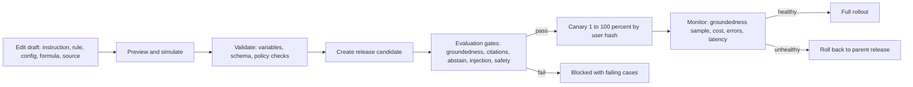

# PRD: F-17.4 Admin Console (control the tutor: knowledge, instructions, models, releases)

| Field | Value |
| --- | --- |
| Feature id | F-17.4 (child of the F-17 umbrella) |
| Owner | Pawan (product and the only admin at launch), engineering TBD |
| Status | Draft for review |
| Siblings | F-17.1 Agent platform, F-17.2 Knowledge bases, F-17.3 Study blocks, F-17.5 Widget, nudges and localisation |
| Architecture | `docs/F-17-ARCHITECTURE.md` (ADR-10: console inside the student web app under `/admin/tutor`, code split, role guarded; Django admin kept as a fallback) |
| Django app | `apps/api/modules/tutoradmin` (table prefix `tutoradmin_`); thin serializers and permissions over the services of the other apps |
| Web module | `apps/web/src/modules/tutor-admin` (routes `/admin/tutor/*`) |
| Flags | None for access (role and scope guarded). `ai_tutor_admin` (PostHog, optional) hides the console nav until ready |
| ERD | `docs/product/erd/F-17.4-admin-console.md` |
| Last updated | 2026-10-15 |

## 1. Problem and goal

The tutor is only as good as its knowledge, its instructions and its settings, and all three change weekly: a new circular lands, a prompt is too stiff, a model gets cheaper, a block misbehaves. If every change needs a developer and a deploy, the tutor goes stale or breaks quietly.

The goal is one console where the admin can add and fix knowledge, edit tone and behaviour, choose models, set budgets, test, release and roll back, and see what the tutor is doing, without touching code, without seeing students' private text, and without any change going live unchecked.

## 2. Users and scenarios

**Pawan (admin).** Uploads the new ICAI amendment PDF, checks the cost estimate (₹38), watches ingest progress, tries three questions in the retrieval playground, publishes the source, and sees the gap "TDS on crypto transfers" close.

**Pawan, Friday.** Edits the tone instruction from "formal" to "warm, brief", changes the exam-week rule from 7 to 10 days, previews the final prompt for a CA Inter student in Hinglish, runs the evaluation, publishes to 10%, watches groundedness and cost for a day, then publishes to 100%. Next week a change hurts law answers; he clicks Roll back and the old release serves within 15 seconds.

**Content editor (later, role `editor` with scopes).** Maintains formulas and law sections only; cannot open instructions, models or budgets.

**Support (later).** Opens a reported card, sees the store row and the version shown, fixes the row, closes the report. Never sees message text unless the student shared it.

## 3. Success metrics

| Metric | Target | Measured by |
| --- | --- | --- |
| Time from "new source" to live for a 100-page PDF (staff time) | under 15 minutes of attention | Admin events (counts) |
| Publish to rollback time | under 2 minutes of staff time, effective within 15 s | Audit log, release events |
| Releases that reach 100% without passing the evaluation gate | 0 | Release gate |
| Admin actions with an audit entry | 100% | Test that every mutating endpoint writes audit |
| Admin screens usable by keyboard and screen reader | 100% of screens pass axe in four themes | CI |
| Staff time spent in Django admin for tutor tasks | trends to 0 | Observation |

## 4. Scope

In scope: the screens and APIs listed in section 6; access scopes; audit log; alerts; dashboards; release management UI; playgrounds and simulators; evaluation views; nudge, glossary and static message editors (their data lives in F-17.1 and F-17.5, screens here).

Out of scope: general platform admin (users, billing, content outside the tutor) except links; student-facing screens; editing student messages; a public API.

### 4.1 Releases

| Release | Contents |
| --- | --- |
| A1 | Shell, access and scopes, audit log, overview, Django admin registration as fallback for every tutor table |
| A2 | Knowledge: knowledge bases, sources, upload and crawl wizards, estimates, chunk browser, playground, licences, gaps |
| A3 | Control: instructions and style, rules and simulator, models and functions, budgets and kill switches, plans and quotas, releases with diff, gates, canary and rollback |
| A4 | Blocks: formulas, statutes, section map, solver templates, card reports; evaluation views; turn inspector |
| A5 | Nudges, glossary and static messages editors; alerts and notification channels; usage and cost reports; second-approver option |

## 5. Flows

### 5.1 Change and release

### 5.2 Add knowledge

Pick knowledge base → choose kind (upload, URL, website, text, FAQ, dataset, video) → fill title, display title, licence, tags and taxonomy → estimate (pages, tokens, rupees) → confirm with a cost cap → watch the run (stages, per-batch progress, failures) → review (quality flags, suspicious chunks, duplicates) → playground check → publish. Every step is resumable; closing the browser does not stop the run (worker).

### 5.3 Edge cases

| Case | Behaviour |
| --- | --- |
| Two admins edit the same draft | Each save sends `If-Match` with the row's `etag`; the second gets `409 stale_edit` and a diff to merge |
| Publish clicked twice | Idempotent by release candidate id; second click returns the same release |
| Publish during an ingest | Allowed; releases do not include knowledge, only configuration; ingest publish is separate |
| Evaluation gate fails | Release cannot reach more than 0% (staff-only canary of the admin account stays allowed) unless a named override with a written reason, recorded in audit; the override is disabled by default for the three hard gates (abstain, injection, safety) |
| Canary shows a worse metric | Alert, one-click rollback, auto-rollback optional per release (off by default) when error rate or unsupported-share crosses a threshold |
| Rollback target was deleted | Releases are never deleted, only archived; rollback list shows all |
| Admin account compromised | Mutations need a fresh session (re-auth within 30 minutes) for publish, rollback, delete, budgets and grants; all actions in the audit log; kill switches usable at once |
| Staff opens a message text | There is no screen for it; the inspector shows no text; reported turns show text only when the student attached it to a report or opted in |
| Licence expires while a source is live | The tick unpublishes it (F-17.2); the console shows a banner and the alert fires |
| Console bundle too large | Code split per section; each route lazy loaded; bundle budget 250 kB gzip per section |
| Long-running screens (playground, evaluation) | Run as jobs; the page polls and can be left and reopened |

## 6. Functional requirements

Priority: P0 must ship in its release, P1 should, P2 can follow. Releases A1 to A5 as in section 4.1.

### A. Access, scopes and audit

| ID | Requirement | Priority | Acceptance criteria |
| --- | --- | --- | --- |
| FR-AD-01 | Console at `/admin/tutor/*`, reachable only when the profile role is `admin` or `editor` with at least one grant; others get 403 and no route is listed | P0 A1 | Given a student, then 403 on API and a not-found screen |
| FR-AD-02 | Scopes: `tutor.kb.read`, `tutor.kb.write`, `tutor.kb.publish`, `tutor.kb.licences`, `tutor.blocks.read`, `tutor.blocks.write`, `tutor.blocks.publish`, `tutor.law`, `tutor.formulas`, `tutor.solvers`, `tutor.instructions`, `tutor.rules`, `tutor.models`, `tutor.budgets`, `tutor.releases`, `tutor.nudges`, `tutor.eval`, `tutor.reports`, `tutor.audit`, `tutor.grants`; `admin` role holds all | P0 A1 | Given an editor with `tutor.formulas` only, then other endpoints return 403 |
| FR-AD-03 | Grants are rows (user, scope, granted by, expiry optional); only holders of `tutor.grants` edit them; a grant change is audited | P0 A1 | Given a grant, then the editor sees only the allowed nav entries |
| FR-AD-04 | Every mutating endpoint writes an audit row: actor, action, subject kind and id, before and after (JSON diff of non-secret fields), request id, IP hash, user agent family, time | P0 A1 | Given a test that calls every mutating route, then each leaves a row |
| FR-AD-05 | Audit log is append-only (database trigger rejects update and delete); viewing it needs `tutor.audit`; filters by actor, subject, action, date; CSV export | P0 A1 | Given an update attempt, then the database rejects it |
| FR-AD-06 | Sensitive actions (publish, rollback, delete source, budget change, grant change, kill switch off to on) need a session younger than 30 minutes; otherwise the API returns `reauth_required` and the console prompts | P0 A3 | Given an old session, then the action is refused until re-auth |
| FR-AD-07 | Optional second-approver rule for publish, per environment setting (off at launch with one admin); when on, a candidate needs approval by a different admin | P2 A5 | Given the rule on, then the author cannot approve their own candidate |
| FR-AD-08 | Optimistic concurrency on every editable draft: `etag` returned, `If-Match` required | P0 A1 | Given a stale etag, then 409 with the current version |
| FR-AD-09 | Secrets (provider keys) are never shown or accepted in the console; models reference key names held in the environment | P0 A3 | Given the model screen, then only key names appear |

### B. Overview and dashboards

| ID | Requirement | Priority | Acceptance criteria |
| --- | --- | --- | --- |
| FR-AD-10 | Overview: turns today and 7 days by block, active students, cost today against budget, first-token p95, error rate, groundedness sample, abstain rate, unverified share, open reports, gap queue size, overdue law sources, live release and canary state | P0 A1 | Given the overview API, then numbers reconcile with ledger tables |
| FR-AD-11 | Alert banner for red states (kill switch on, budget at 100%, recall dropped, licence expiring, ingest failing) with links to the owning screen | P0 A1 | Given a failing ingest, then the banner links to it |
| FR-AD-12 | Usage and cost reports: by day, block, plan, model profile, function, knowledge base; cost per active student; ingestion cost; export CSV | P1 A5 | Given a date range, then totals match `tutor_costline` and `tutorkb_ingestrun` |
| FR-AD-13 | Quality dashboard: groundedness, citation validity, abstain correctness, router accuracy, verify-status mix by block and release, with release markers on the time axis | P1 A4 | Given two releases, then metrics are split at the release time |
| FR-AD-14 | Student-level support view limited to counts (turns, blocks used, quota, plan, consent version, last active) by student id or email; no message text | P1 A5 | Given a lookup, then no text appears |

### C. Knowledge (screens over F-17.2)

| ID | Requirement | Priority | Acceptance criteria |
| --- | --- | --- | --- |
| FR-AD-20 | Knowledge bases list with readiness, corpus size, live embedding set, staleness; open, pause and settings per knowledge base | P0 A2 | Given a settings edit, then audit and effect on next retrieval |
| FR-AD-21 | Source list with filters (knowledge base, kind, status, licence, tag, owner, review by) and bulk actions (retag, withdraw, set review date) | P0 A2 | Given a filter, then results update without reload |
| FR-AD-22 | Add-source wizard per kind with signed upload, URL preview, crawl rules, licence picker, taxonomy picker (from F-02), estimate, cost cap, confirm | P0 A2 | Given a PDF, then estimate shows before any cost is incurred |
| FR-AD-23 | Run monitor: stages, per-batch progress, current cost, failures with reason code, retry, cancel | P0 A2 | Given a failing page, then retry from the screen |
| FR-AD-24 | Review screen: quality flags, low-confidence pages, suspicious chunks, duplicates, side by side page image and extracted text (for PDFs), accept, edit or deactivate | P0 A2 | Given a flagged chunk, then staff can clear or deactivate it |
| FR-AD-25 | Chunk browser and editor with source path, rights, taxonomy and a "used in answers" count (from retrieval traces, counts only) | P0 A2 | Given a chunk, then edit re-embeds it alone |
| FR-AD-26 | Retrieval playground: query box, filters, `on_date`, regime, toggles for legs and rerank, shows ranked results with per-leg ranks and fused score, draft chunks optional; a "make gold case from this" button | P0 A2 | Given a query, then ranks match the production retriever on the same inputs |
| FR-AD-27 | Gap queue with topic labels, counts, last seen, create-source-from-gap, close with reason | P1 A2 | Given a gap, then Add source pre-fills the title |
| FR-AD-28 | Licences screen with expiry calendar and evidence upload; regime rules screen (marks unverified rows) | P0 A2 | Given an unverified rule, then a `[VERIFY]` badge and a block on opening the knowledge base if a law paper depends on it |
| FR-AD-29 | Embedding sets screen: build index, coverage, compare on gold, flip with confirmation | P1 A2 | Given a candidate set, then comparison table before flip |
| FR-AD-30 | Gold sets and retrieval runs: case editor, import, run, compare runs, per-language and per-leg metrics | P0 A2 | Given two runs, then deltas show with red for drops over 3 points |

### D. Instructions, style, rules

| ID | Requirement | Priority | Acceptance criteria |
| --- | --- | --- | --- |
| FR-AD-40 | Instruction editor by layer (platform, persona, tone, policy, course, block, locale, mode) with scope, priority, condition builder, version history, diff and restore | P0 A3 | Given an edit, then a new version row and a diff view |
| FR-AD-41 | Style profile form with the structured levers (voice, verbosity, word caps, address form, emoji policy, encouragement, exam-stress mode) and live examples of each setting | P0 A3 | Given verbosity brief, then the example answer shows the cap |
| FR-AD-42 | Prompt preview: choose sample student (course, level, language, plan, days left), block and mode; shows layer by layer text, token counts and total; no model call | P0 A3 | Given a preview, then layer sizes sum to the total |
| FR-AD-43 | Placeholder checker: highlights unknown variables as the admin types; refuses to save a version with an unknown variable | P0 A3 | Given `{student.age}`, then error with the variable |
| FR-AD-44 | Rule editor: condition builder (all, any, not, variable, operator, value from the catalogue), action picker with parameters, priority drag order, scope; test cases per rule | P0 A3 | Given an invalid operator for a variable type, then the builder prevents it |
| FR-AD-45 | Rule simulator: choose or paste a context; shows matched rules in order and the resulting actions; no model call | P0 A3 | Given a context, then the trace equals production for the same inputs (golden tests) |
| FR-AD-46 | Static message and glossary editors by key and locale with missing-translation counters, do-not-translate list, preview in the widget shell | P0 A3 | Given a missing `hi` key, then it is listed with its English fallback |
| FR-AD-47 | Behaviour packs: named bundles of rules and instructions for situations (exam week, festival low-load, maintenance) that can be switched on for a date range inside a release | P2 A5 | Given a pack scheduled, then the next release contains it and the date window applies |

### E. Models, functions, budgets, plans

| ID | Requirement | Priority | Acceptance criteria |
| --- | --- | --- | --- |
| FR-AD-50 | Model profiles screen: provider, model id, bucket, prices per million tokens, rate limit, status; test button runs a fixed one-line probe (no student data) and records latency and cost | P0 A3 | Given a profile, then a probe result shows |
| FR-AD-51 | Function configs screen (`router`, `query.rewrite`, `answer.main`, `answer.lite`, `summary`, `verify.ground`, `numerical.extract`, `numerical.plan`, `law.explain`, `ingest.clean`, `ingest.vision`, `ingest.speech`, `embed`...): profile, fallback profile, temperature, max tokens, timeout, structured-output schema id | P0 A3 | Given a profile switch in a release, then new turns use it |
| FR-AD-52 | Budgets screen: per-student daily rupees by plan, global daily rupees per function group, ingestion budget, warning at 80%, behaviour at 100% (refuse or switch off group) | P0 A3 | Given 100%, then behaviour as configured |
| FR-AD-53 | Kill switches screen: `text`, each block, `embeddings`, `ingestion`, `rerank`; one click, effective within 15 s, shows who turned it off and when; confirmation needs a reason | P0 A1 | Given a switch, then the next turn answers `ai_unavailable` within 15 s |
| FR-AD-54 | Plans and quotas screen: allowances per plan (`free`, `pro`, `pro_max`, `staff`) per block and total, weights, retention days, `kb_scope`, upgrade copy keys; values proposed in F-17.1 appear as drafts to approve | P0 A3 | Given an edit, then the next admission uses it |
| FR-AD-55 | Per-user overrides (support): extra allowance for N days, block a user from the tutor with a reason; counted in audit | P1 A5 | Given an override, then admission reads it and it expires on schedule |

### F. Releases and evaluation

| ID | Requirement | Priority | Acceptance criteria |
| --- | --- | --- | --- |
| FR-AD-60 | Releases screen: list, status (`draft`, `evaluating`, `ready`, `canary`, `live`, `archived`), parent, author, checksum, canary percent, live metrics; create candidate from current drafts | P0 A3 | Given drafts, then Create release builds a candidate and its bundle |
| FR-AD-61 | Release diff: every instruction, rule, config, glossary key and store epoch that differs from the parent, with text diffs | P0 A3 | Given two releases, then every change is listed |
| FR-AD-62 | Evaluation gate view: runs the packs of F-17.1 and F-17.3 on the candidate, shows metrics against thresholds, failing cases with output and assertion, cost of the run; override rules per FR-AD-63 | P0 A3 | Given a failing case, then its input, output and failed assertion show |
| FR-AD-63 | Overrides: allowed only for non-hard gates, need a written reason and the `tutor.releases` scope, recorded in audit and shown on the release forever; hard gates (abstain, injection, safety, fabricated section) cannot be overridden | P0 A3 | Given a hard gate failure, then no override control exists |
| FR-AD-64 | Canary: percent by stable hash of user id (1, 5, 10, 25, 50, 100), plus allow-list of user ids and an A/B `experiment_tag`; pause and resume | P0 A3 | Given 10%, then about 10% of users get the candidate and the share is stable per user |
| FR-AD-65 | Rollback: one click to the parent or any earlier release; confirms; effective within 15 s; optional auto-rollback thresholds | P0 A3 | Given rollback, then new turns use the target within 15 s and in-flight turns finish on theirs |
| FR-AD-66 | Release notes field and change summary generated from the diff (staff edits it); shown in the audit and the release list | P1 A3 | Given a release, then notes are saved |
| FR-AD-67 | Evaluation workspace: cases by block and risk, add from thumbs-down or report with identifiers removed, edit assertions, run a subset, compare runs | P0 A4 | Given a reported card, then Make evaluation case creates one without turn identifiers |
| FR-AD-68 | Judge calibration view: sample of judged turns with expert grade entry, agreement rate between judge and expert; threshold to trust the judge | P1 A5 | Given 50 graded turns, then agreement percentage shows |

### G. Blocks (screens over F-17.3)

| ID | Requirement | Priority | Acceptance criteria |
| --- | --- | --- | --- |
| FR-AD-70 | Formula editor: LaTeX with live preview, variable table, calculator expression with live test, test vectors, aliases, relations; import with dry run | P0 A4 | Given a wrong test vector, then the editor blocks save |
| FR-AD-71 | Statute screens: Act list with coverage, section tree, version timeline with dates, import review (parsed number, heading, text, confidence), diff between versions, rate table editor | P0 A4 | Given an amendment, then the diff highlights words |
| FR-AD-72 | Section map editor: from and to sections, confidence, note, verified flag; coverage report of unmapped sections | P0 A4 | Given an unmapped 1961 section, then it is listed |
| FR-AD-73 | Solver template editor: parameters, steps (expression builder with validation), layout, rounding policy, test cases with run button, family coverage view | P0 A4 | Given failing cases, then publish disabled |
| FR-AD-74 | Block config editor: enablement, weights, limits, verifier mode, hint ladder; each field shows the default and the released value | P0 A4 | Given a draft edit, then it is marked unreleased |
| FR-AD-75 | Card reports queue: report, card as shown (the exact store version), the current store row, fix and close, notify the reporter with a canned message key | P1 A4 | Given a confirmed report, then a fix creates a new version and the report links to it |
| FR-AD-76 | Withdraw buttons on formulas, sections, Acts and templates with reason; shows kill-list state and time to effect | P0 A4 | Given withdraw, then the finder skips it within 15 s |

### H. Turn inspector, nudges, alerts

| ID | Requirement | Priority | Acceptance criteria |
| --- | --- | --- | --- |
| FR-AD-80 | Turn inspector: by turn id or by filters (block, release, verify status, abstained, error, cost above); shows stages, router result, rules matched, retrieval counts and scores, tools, model calls with tokens and cost, verify status; **no message text** unless reported or opted in | P0 A4 | Given a normal turn, then no text field is rendered or returned by the API |
| FR-AD-81 | Reported-turn view: when a student reports, the turn text she chose to share appears with her consent flag; access is audited with a reason | P1 A4 | Given a reported turn, then text is visible and an audit row exists |
| FR-AD-82 | Nudge editor and performance (F-17.5 data): message keys, placements, triggers, audience, frequency caps, A/B, impressions, clicks, dismissals, conversion to block use | P1 A5 | Given a nudge, then performance shows counts only |
| FR-AD-83 | Alert rules and channels: email and Slack webhook; rules for budget, error rate, p95, recall drop, licence expiry, ingest failures, gap threshold, card reports, overdue law; each with threshold, window and cooldown | P1 A5 | Given a budget at 80%, then a message is sent once per cooldown |
| FR-AD-84 | Saved views and a command palette (jump to a source, release, rule, formula by name) | P2 A5 | Given Ctrl K, then results by type |

### I. Quality of the console itself

| ID | Requirement | Priority | Acceptance criteria |
| --- | --- | --- | --- |
| FR-AD-90 | Built with `@artha/design-system` only; four themes; WCAG 2.2 AA; keyboard operable tables, builders and drag ordering (with button alternatives) | P0 | Given axe and keyboard tests on each screen, then they pass |
| FR-AD-91 | Every list has server pagination and filters; every long action is a job with a progress view; no screen blocks on a request longer than 5 s | P0 | Given 100,000 chunks, then the chunk browser stays responsive |
| FR-AD-92 | Destructive actions show impact ("this affects 412 chunks and 3 gold cases") before confirming | P0 | Given delete source, then counts appear in the dialog |
| FR-AD-93 | Django admin registrations for every tutor table as a read-mostly fallback (no secrets, no message text columns) | P0 A1 | Given the fallback, then message text is not listed in any admin form |
| FR-AD-94 | Help text per screen and field linking to the owning section of these PRDs | P1 | Given a field, then a help popover shows |

## 7. Screens and URLs

| URL | Screen |
| --- | --- |
| `/admin/tutor` | Overview |
| `/admin/tutor/kb` | Knowledge bases; `/kb/sources`, `/kb/sources/new`, `/kb/sources/:id`, `/kb/chunks`, `/kb/playground`, `/kb/gaps`, `/kb/licences`, `/kb/regimes`, `/kb/embedding-sets`, `/kb/gold`, `/kb/runs` |
| `/admin/tutor/blocks` | `/blocks/configs`, `/blocks/formulas`, `/blocks/law`, `/blocks/law/:act`, `/blocks/maps`, `/blocks/templates`, `/blocks/reports` |
| `/admin/tutor/behaviour` | `/behaviour/instructions`, `/behaviour/style`, `/behaviour/rules`, `/behaviour/simulator`, `/behaviour/messages`, `/behaviour/glossary`, `/behaviour/nudges` |
| `/admin/tutor/models` | `/models/profiles`, `/models/functions`, `/models/budgets`, `/models/plans`, `/models/switches` |
| `/admin/tutor/releases` | List, `/releases/:id` (diff, gates, canary, rollback) |
| `/admin/tutor/eval` | Cases, runs, judge calibration |
| `/admin/tutor/turns` | Inspector |
| `/admin/tutor/reports` | Usage, cost, quality |
| `/admin/tutor/access` | Grants, audit log |

Layout: left navigation grouped as above, breadcrumb, a persistent "unreleased changes" chip that opens the release candidate builder, red alert banner on top. SEO: all routes `noindex`.

## 8. Data and permissions

Entities (ERD): audit log, grant, alert rule, alert event, notification channel, release approval, user override, saved view. Other apps' tables are edited through their services. Mutating endpoints require scope plus, for sensitive actions, a fresh session. Staff never read student message text except in the reported-turn path.

## 9. API surface

Base path `/api/v1/tutor-admin/`. Sections and their owners:

| Prefix | Owner behaviour | Reference |
| --- | --- | --- |
| `kb/` | `tutorkb` | F-17.2 section 9.3 |
| `blocks/` | `tutorblocks` | F-17.3 section 9.3 |
| `behaviour/` | `tutor` | `instructions/`, `style/`, `rules/`, `simulate/`, `preview/`, `messages/`, `glossary/`, `behaviour-packs/` |
| `models/` | `tutor` | `profiles/`, `profiles/{id}/probe/`, `functions/`, `budgets/`, `plans/`, `switches/`, `overrides/` |
| `releases/` | `tutor` | list, create candidate, `{id}/`, `{id}/evaluate/`, `{id}/diff/`, `{id}/canary/`, `{id}/promote/`, `{id}/rollback/`, `{id}/approve/` |
| `eval/` | `tutor` | `cases/`, `runs/`, `judge/` |
| `turns/` | `tutor` | `{id}/` (inspector), filters |
| `reports/` | `tutoradmin` | `overview/`, `usage/`, `cost/`, `quality/`, `support/student/` |
| `access/` | `tutoradmin` | `grants/`, `audit/`, `audit/export/` |
| `alerts/` | `tutoradmin` | `rules/`, `channels/`, `events/` |
| `nudges/` | `tutornudges` | F-17.5 |

Common behaviour: `etag` and `If-Match` on drafts, cursor pagination, `X-Request-Id`, errors `{error: {code, message, details}}` with codes `reauth_required`, `stale_edit`, `scope_required`, `gate_failed`, `override_not_allowed`, `validation_failed`, `not_found`. Throttle scope `tutor_admin` 300 a minute per user; expensive endpoints (playground, evaluate, probe) 20 a minute.

## 10. Notifications and analytics events

Staff notifications from FR-AD-83. PostHog events for console use are counts only and are not required; the audit log is the record. No student text anywhere.

## 11. Non-functional requirements

| Area | Requirement |
| --- | --- |
| Performance | List endpoints p95 under 400 ms at 100,000 chunks and 1 million ledger rows (indexes and pre-aggregated daily tables); overview under 1.2 s from the daily rollup |
| Security | Scope checks on every route; fresh-session rule; audit append-only; no secrets; no student text; CSRF not applicable (bearer tokens) but `Origin` check for the console; rate limits |
| Reliability | Console failure never affects students; the runtime reads releases and switches, not console state |
| Accessibility | FR-AD-90 |
| Browser support | Last 2 versions of Chrome, Edge, Safari, Firefox on desktop; tablet usable; phone read-only for overview, kill switches and alerts |
| Bundle | 250 kB gzip per section, lazy loaded; admin code not in the student bundle |

## 12. Risks and open questions

| Risk | Impact | Mitigation |
| --- | --- | --- |
| Single admin is a single point of failure and of compromise | Bad release or lost access | Fresh-session rule, audit, grant a second admin account early, break-glass via Django admin and the environment kill switch |
| Console scope grows into a general CMS | Delay | Release plan A1 to A5, only tutor tables |
| Admin sees licensed text (playground, chunks) | Rights exposure | Playground and chunk views audited; staff only |
| Prompt edits harm quality silently | Student harm | Gates and canary; hard gates cannot be overridden |

Open questions: **Q-AD-1** add a second admin and an `editor` account now or later (affects grants seeding). **Q-AD-2** Slack workspace or email only for alerts (affects channel setup). **Q-AD-3** keep the 30-minute fresh-session window or shorten. **Q-AD-4** does the existing app already have an admin shell (layout, nav) to reuse; if so A1 reuses it.

## 13. Rollout

A1 ships with the first backend wave so every later wave can be driven from the console; the fallback is Django admin. Console routes have no student exposure and need no flag; `ai_tutor_admin` only hides nav while screens are incomplete. Wave mapping: A1 in W1, A2 in W2, A3 in W5, A4 in W6 (law) and W7 (formulas, templates, config), A5 in W8 (nudge editor) and W11 (alerts, reports, overrides, second approver). Owner steps are in `docs/F-17-BUILD-WAVES.md`.

## 14. Review of `django-backend` used for this design

Taken: staff-editable agent function configs, layered prompts, a rules engine over a typed variable catalogue, ledger-driven cost screens, tool registries. Changed: immutable releases with gates and canary instead of live edits, scoped grants and audit instead of broad staff access, no screen for message text, budgets that actually stop spend, and a Django admin fallback rather than a second console project.
