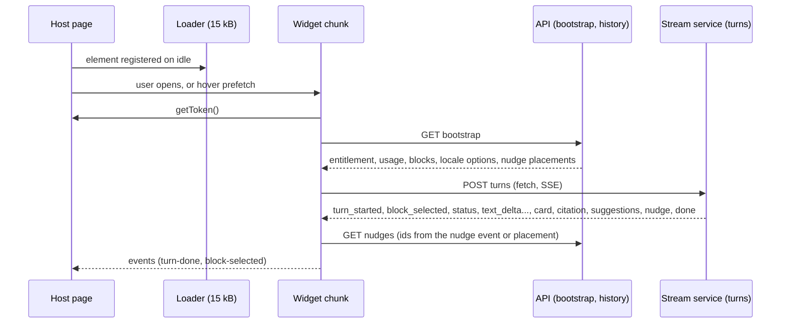
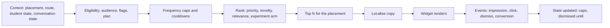

# PRD: F-17.5 Widget, Nudges and Localisation (the `<artha-tutor>` chat agent inside the student app)

| Field | Value |
| --- | --- |
| Feature id | F-17.5 (child of the F-17 umbrella) |
| Owner | Pawan (product), engineering TBD |
| Status | Draft for review |
| Siblings | F-17.1 Agent platform, F-17.2 Knowledge bases, F-17.3 Study blocks, F-17.4 Admin console |
| Architecture | `docs/F-17-ARCHITECTURE.md` (ADR-9: React-rendered custom element with a shadow root) |
| Packages | `packages/tutor-widget` (the element, no import from `apps/web`), `apps/web/src/modules/tutor` (host container and barrel), Django app `apps/api/modules/tutornudges` (table prefix `tutornudges_`) |
| Flags | `ai_tutor` (master). `ai_tutor_nudges` (PostHog, strict) for the nudge rail |
| ERD | `docs/product/erd/F-17.5-widget-nudges-localisation.md` |
| Last updated | 2026-10-15 |

## 1. Problem and goal

The tutor must feel like part of the study app, not a bolted-on chat box, and must also be an independent piece that can be built, versioned and moved without touching the rest of the web app. Students should find the right block without reading a manual, use the tutor in the language they think in (English, Hindi or Hinglish), and be gently led to features they have not tried, without being nagged.

The goal: one web component, `<artha-tutor>`, that renders the chat, the four blocks' cards, history and settings; a nudge system that shows several short, relevant suggestions beside the chat; and a localisation layer that makes all three languages first-class for interface text, answers, and numbers.

## 2. Users and scenarios

**Riya, CA Intermediate, laptop.** Opens the tutor from any page. The panel docks on the right; beside it a slim rail shows three nudges: "Try Law Sections: look up section 194C", "Exam in 38 days: practise numericals", "Add formulas to Recall". She taps the first, the composer fills with an example, she edits and sends.

**Meera, Class 12, phone.** The tutor opens as a bottom sheet. Nudges appear as a horizontally scrolling chip strip above the composer. She switches the language chip to Hinglish; the buttons, hints and answers change.

**Karan, CS Executive, reading a chapter.** Selects a paragraph, taps "Ask Tutor about this"; the widget opens with the selected text as context (up to 4,000 characters) and the Ask AI block selected.

**Free student.** Sees the launcher; opening it shows the plan card ("Tutor is part of Pro") with the benefits and an upgrade button; no chat, no nudge rail except the upgrade nudge.

**Pawan.** Changes a nudge's Hinglish text, sets its audience to "Pro students who never used Formula", and sees impressions and clicks the next day, as counts.

## 3. Success metrics

| Metric | Target | Measured by |
| --- | --- | --- |
| Widget loader weight (always loaded) | at most 15 kB gzip | Bundle budget in CI |
| Chat chunk weight (loaded on first open or idle) | at most 120 kB gzip, math renderer lazy at most 70 kB | Bundle budget in CI |
| Open to interactive after chunk is cached | under 300 ms | Web vitals, lab test |
| INP while streaming | p75 under 200 ms | RUM (PostHog web vitals, no text) |
| Accessibility | 0 axe violations in four themes; keyboard-only completion of ask, switch block, change language, delete conversation | CI and manual audit |
| Pro students who open the tutor in week 1 | 60% | PostHog counts |
| Nudge click-through | at least 6% of impressions | Nudge events |
| Nudge-driven first use of a new block | at least 15% of clicks lead to a turn in that block within 30 minutes | Nudge conversion events |
| Nudge dismissals per student per week | under 4 on average | Nudge events |
| Missing translation keys at runtime | 0 in released languages | Counter in admin |
| Non-English share of turns that get an answer in the requested language | at least 97% | Judge sample, language assertion |

## 4. Scope

In scope: the custom element and its public contract; chat, streaming, cards, citations drawer, history, settings, consent; launcher, dock, bottom sheet and full page layouts; host integration (`TutorLauncher`, `askAbout`, page context); nudge engine and admin APIs; localisation of interface, answers and numbers; accessibility; telemetry as counts.

Out of scope: the turn runtime (F-17.1); card content and logic (F-17.3); admin screens beyond the nudge editor (F-17.4); third-party site embedding (supported by the contract later, not built; ADR-9 revisit trigger); native mobile apps; voice answers (text to speech).

### 4.1 Releases

| Release | Contents |
| --- | --- |
| U1 | Element shell, loader, layouts, auth hand-off, bootstrap, consent, chat with streaming, markdown, history, settings, errors, plan gate, version check |
| U2 | Block chips, forced block and auto-block label, card registry and the card components for F-17.3, citations drawer, feedback, usage meter |
| U3 | Nudge engine (backend and rail), language switch and Hinglish interface strings, glossary-aware answers, Indian number formats |
| U4 | Voice input, image attach for Numerical, formula sheet print, `askAbout` on all content pages, performance and embed hardening |

## 5. Flows

### 5.1 Open, ask, stream



### 5.2 Layout

```
Desktop (>= 1024 px)                          Mobile (< 640 px)
+------------------------------+------+       +---------------------+
| Page                         | Chat | Nudge |       | Page (dimmed)       |
|                              | dock | rail  |       +---------------------+
|                              | 400  | 280   |       | Chat bottom sheet   |
+------------------------------+------+-------+       | [nudge chip strip]  |
                                                       | [composer]          |
                                                       +---------------------+
Full page /app/ask: chat centre (max 760), rail right, history left
```

The rail sits beside the chat (to its left on a right dock so it stays visible next to the page edge), shows up to 3 nudge cards, can be collapsed to a thin tab, and the choice is remembered in the browser (`sessionStorage` is not available in all preview contexts, so the setting is also sent to `tutor_settings`).

### 5.3 Nudge selection



### 5.4 Edge cases

| Case | Behaviour |
| --- | --- |
| Token expires mid-stream | The stream is not cut by expiry (validated at start); the widget refreshes through `getToken()` before the next call; a 401 retries once |
| Network drops during streaming | Widget keeps the partial text, shows "reconnecting", resumes with `GET turns/{id}/events?after=<seq>`; if the server has finished, it shows the final text; if not resumable, "Try again" |
| Two tabs open | Each has its own conversation view; sending in one does not stream into the other; usage meter refreshes on focus; conversation list syncs on focus |
| Student closes the panel while the answer streams | Streaming continues in the background; a small dot on the launcher marks the unread answer |
| Host navigates (single-page route change) | The widget persists; page context updates through `setPageContext`; the current conversation stays |
| Selected text too long | Trimmed at 4,000 characters with a visible "text trimmed" note |
| Old widget version cached | `bootstrap.min_widget_version` above the loaded version shows "Reload to update" and blocks sending |
| Very long answer | Windowed rendering for lists; the "stop" button is always available |
| Shadow DOM breaks focus or portals | Popovers and dialogs render into the shadow root through the design system's portal container context; verified by tests |
| Fonts | `@font-face` inside a shadow root is not reliably applied, so fonts (including Devanagari) are loaded by the host document; the widget uses the same `font-family` tokens and falls back to a system Devanagari font |
| Reduced motion | Streaming animation and nudge transitions are off; text appears in chunks without effects |
| Dark, high-contrast and the other three themes | Widget inherits the CSS variables of the host theme through the shadow boundary; tests run per theme |
| No consent yet | A consent screen with the versioned notice; nothing is sent until accepted |
| Under-age band | `age_restricted` shows a plain message; no chat, no nudges |
| Nudge refers to a disabled block | Eligibility checks block flags; never shown |
| Student dismisses the rail | Rail hidden for 7 days; chat-level nudges inside answers still appear |
| Quota at zero | Composer disabled with the reset time and, for Pro, an upgrade nudge to Pro Max if that plan exists; Free sees the Pro card |
| Language set to Hindi but a card has English statute text | Statute text stays English; labels Hindi; a small "text of the Act is in English" note |
| JS disabled or widget fails to load | Launcher shows a link to `/app/ask`; the full-page route is a normal page that mounts the same element |

## 6. Functional requirements

Priority: P0 must ship in its release, P1 should, P2 can follow. Releases U1 to U4 as in section 4.1.

### A. The element and its contract

| ID | Requirement | Priority | Acceptance criteria |
| --- | --- | --- | --- |
| FR-WG-01 | Custom element `<artha-tutor>` registered by a loader of at most 15 kB gzip that lazy loads the chat chunk on first open, on idle after 3 s, or on launcher hover or focus | P0 U1 | Given the loader size check and a Lighthouse run, then the budget holds and TTI of the host is unaffected |
| FR-WG-02 | Attributes: `api-base` (required), `placement` (`dock`, `page`, `sheet`, `auto`), `locale` (`en`, `hi`, `hinglish`, `match`), `open` (boolean), `launcher` (`show`, `hide`), `block` (preselected block key), `theme` (`inherit` only; theming is by CSS variables) | P0 U1 | Given each attribute, then a test asserts its effect |
| FR-WG-03 | Properties: `getToken: () => Promise<string>` (required; the widget never reads cookies or storage for the token), `pageContext` (object validated server-side against the route manifest), `onNavigate` (optional callback in addition to the event) | P0 U1 | Given no `getToken`, then the element shows a configuration error in development and a safe closed state in production |
| FR-WG-04 | Methods: `open()`, `close()`, `askAbout({ text, block?, context?, send? })`, `setPageContext(ctx)`, `startNew()`, `focusComposer()` | P0 U1 | Given `askAbout` with `send: false`, then the composer is filled and focused |
| FR-WG-05 | Events (`CustomEvent`, `bubbles`, `composed`, names prefixed `artha-tutor:`): `ready`, `open`, `close`, `turn-start`, `turn-done` (detail: block, verify status, tokens, no text), `block-selected`, `card-action`, `nudge-click`, `navigate` (detail: `href`, `reason`), `upgrade-requested`, `error` (detail: code), `locale-change` | P0 U1 | Given a host listener, then each event fires with the documented detail and no student text |
| FR-WG-06 | Shadow root (`mode: open`, so tests and assistive tools can reach it; no secrets are ever placed in the DOM) with styles from the design system tokens injected as constructed stylesheets; host CSS cannot leak in or out | P0 U1 | Given a hostile host stylesheet (`* { display:none }`), then the widget renders unchanged |
| FR-WG-07 | The widget imports only `@artha/design-system` and its own code; no import from `apps/web`; import-linter style rule enforced in CI | P0 U1 | Given a forbidden import, then CI fails |
| FR-WG-08 | Portal container: the design system's portal context points to an element inside the shadow root so popovers, tooltips, dialogs and menus render inside it | P0 U1 | Given a dropdown, then it renders inside the shadow tree with correct focus and Escape handling |
| FR-WG-09 | Version contract: the element exposes `widgetVersion`; `bootstrap` returns `min_widget_version`; breaking contract changes bump a major and the old major keeps working for 30 days | P0 U1 | Given a lower version than the minimum, then send is blocked with a reload prompt |
| FR-WG-10 | Server-side rendering safe: the host renders only the loader; the element mounts client-side; no hydration mismatch | P0 U1 | Given SSR output, then no tutor markup appears and hydration logs no warning |

### B. Chat experience

| ID | Requirement | Priority | Acceptance criteria |
| --- | --- | --- | --- |
| FR-WG-20 | Streaming by `fetch` and a `ReadableStream` SSE parser (not `EventSource`, which cannot send an `Authorization` header); handles all events in F-17.1 section 9.2 in order; backoff and resume with `after=<seq>` | P0 U1 | Given a dropped connection at seq 14, then the resumed stream continues from 15 with no duplicate text |
| FR-WG-21 | Composer: multiline, Enter sends, Shift+Enter newline, max length from bootstrap, character counter near the limit, disabled with reason when quota is zero, paste of long text warns | P0 U1 | Given 4,001 characters over the limit, then send is disabled with a message |
| FR-WG-22 | Message list: user and tutor messages, stop, regenerate (counts against usage), copy, thumbs with reason codes, timestamps, retract handling (`retract` event replaces text with a visible "corrected" mark) | P0 U1 | Given a `retract` event, then text from `from_seq` is replaced and marked |
| FR-WG-23 | Markdown subset renderer (paragraphs, lists, tables, code, emphasis, links); no raw HTML; links `rel="noopener noreferrer"` and external links marked; math via KaTeX loaded on first math content | P0 U1 | Given `<script>` in an answer, then it is shown as text |
| FR-WG-24 | Live region: streaming text announced politely in sentence chunks (not per token); completion announced once; errors assertive | P0 U1 | Given a screen reader test, then no token-by-token chatter |
| FR-WG-25 | Status line from `status` events ("Searching your material", "Calculating", "Verifying"), localised | P0 U1 | Given a `calculating` status, then the localised line shows |
| FR-WG-26 | Suggestions chips from `suggestions`, localised; tapping fills or sends per setting | P0 U2 | Given suggestions, then up to 3 chips show |
| FR-WG-27 | Usage meter from `done.usage` and `GET usage/`: units used today, reset time; warning at 80% | P0 U2 | Given usage 40 of 50, then the meter warns |
| FR-WG-28 | Plan gate: `plan_required` renders the upgrade card from the error payload; `feature_disabled` hides the launcher; `ai_unavailable` shows a calm message with retry time and keeps browse and history working | P0 U1 | Given each error code, then its screen state is tested |
| FR-WG-29 | Offline and slow states: skeletons, retry, "you are offline" banner, queued composer text is preserved | P1 U1 | Given offline, then the draft survives reconnect |

### C. Blocks and cards in the UI

| ID | Requirement | Priority | Acceptance criteria |
| --- | --- | --- | --- |
| FR-WG-40 | Block chips under the composer from `bootstrap.blocks` (Ask AI, Formula, Law Sections, Numerical): tapping forces the block for the next message; the chosen block is shown with a one-tap change ("Auto" returns to routing) | P0 U2 | Given a forced block, then `block` is sent and the label shows |
| FR-WG-41 | Auto-routing label: `block_selected` event shows a small "Using Law Sections" label with a change control | P0 U2 | Given an auto route, then the label appears before the first text |
| FR-WG-42 | Card registry: `card.type` to a lazy-loaded component; unknown types show the text fallback; each card has an `aria` structure and its own focus order | P0 U2 | Given an unknown card, then the text shows and no error is thrown |
| FR-WG-43 | Cards at launch: `section_card`, `compare_card`, `formula_card` (with calculator), `solution_card` (tabs, steps, hint chips, check my answer), `table_card`, `steps_card`, `list_card` (pick a section), `plan_card`, `source_card` | P0 U2 (law, formula, solution), P1 (others) | Given each card, then a visual and an axe test exist |
| FR-WG-44 | Formula calculator panel: variable inputs with units and Indian grouping; computation through the same safe engine (client-side build shared with the server; falls back to `POST calc/`); shows substitution | P0 U2 | Given a test vector, then the result equals the server's |
| FR-WG-45 | Solution card actions: Hint (levels), Solve fully, Check my answer, Try a similar one (practice, P1), Report a mistake | P1 U2 | Given Hint, then the next level request is sent with `mode=hint` |
| FR-WG-46 | Citations: chips `[S1]` open a side drawer with the source card (title, locator, excerpt within rights, effective dates, open link); chips are buttons with accessible names | P0 U2 | Given a chip, then the drawer shows the card resolved by `citations/{id}/` |
| FR-WG-47 | Verify status badge (`verified`, `corrected`, `unverified`) with text, icon and colour; `unverified` shows a plain-language caution | P0 U2 | Given `unverified`, then the caution is visible and announced |
| FR-WG-48 | Recall and formula sheet actions shown only when the corresponding host capability is available | P1 U2 | Given Recall absent, then no button |
| FR-WG-49 | Image attach for Numerical (camera or file), client-side downscale and strip metadata before upload; shown only when `bootstrap.features.image_input` | P2 U4 | Given a photo, then EXIF is removed before upload |
| FR-WG-50 | Voice input (Web Speech API where available, `hi-IN` and `en-IN`), push to talk; transcript goes into the composer for editing, never auto-sent | P2 U4 | Given an unsupported browser, then the mic is hidden |

### D. History, settings, consent

| ID | Requirement | Priority | Acceptance criteria |
| --- | --- | --- | --- |
| FR-WG-60 | History list: conversations by recency with title (first 6 words of the first message, generated on the server as a label), block icon, date; search by title; open, rename, delete | P0 U1 | Given delete, then the conversation and its messages are gone within the retention rules |
| FR-WG-61 | Settings: language (`match`, English, Hindi, Hinglish), answer length default, "help improve" opt-in (off), retention period (from plan options), clear summary, delete all, export my data (F-17.1 `tutor_export`) | P0 U1 | Given delete all, then history is empty and the server confirms |
| FR-WG-62 | Consent screen with version, what goes to Google, what is stored, how to delete, "answers can be wrong"; accept and decline; decline closes the widget and hides nudges | P0 U1 | Given decline, then no request other than bootstrap is made |
| FR-WG-63 | Full-page route `/app/ask` mounting the same element with `placement="page"`, history on the left, nudge rail on the right | P0 U1 | Given the route, then the same bundle and contract |
| FR-WG-64 | `/app/settings/tutor` page for language, retention, consent and delete all, mounting shared settings components | P1 U1 | Given a change, then it persists through `PATCH settings/` |

### E. Host integration

| ID | Requirement | Priority | Acceptance criteria |
| --- | --- | --- | --- |
| FR-WG-70 | The `tutor` barrel exports `TutorLauncher` (floating button, keyboard shortcut Alt+T configurable) and `askAbout(args)`; other modules use nothing else | P0 U1 | Given a lint rule, then deep imports into `modules/tutor` fail |
| FR-WG-71 | Route manifest: each page registers `route_id` and the allowed context kinds (`chapter`, `question`, `note`, `law_section`, `formula`); `setPageContext` validates locally and the server revalidates | P0 U1 | Given an unknown route id, then context is dropped and `invalid_context` is not shown to the student |
| FR-WG-72 | "Ask Tutor about this" affordance on selected text in content pages and on question and note headers (U4 for all pages; U2 for notes and questions) | P1 U2 | Given selected text, then the toolbar button opens the widget with the text |
| FR-WG-73 | Token hand-off: the host supplies `getToken` backed by the Supabase session; widget never stores tokens | P0 U1 | Given a storage inspection, then no token is stored by the widget |
| FR-WG-74 | Event bridge to PostHog in the host (counts and enumerations only): `tutor_opened`, `tutor_turn_sent`, `tutor_block_forced`, `tutor_card_action`, `tutor_language_changed`, `tutor_nudge_*` | P0 U1 | Given the events, then no free text property |
| FR-WG-75 | Error reporting to Sentry through the host with scrubbing; no message text or tokens | P0 U1 | Given a thrown error, then the Sentry event contains no text fields from the chat |

### F. Nudges

| ID | Requirement | Priority | Acceptance criteria |
| --- | --- | --- | --- |
| FR-NU-01 | **Nudge**: a short suggestion with copy (title, body, CTA) per language, a kind, an action, audience conditions, placements, priority, frequency rules, optional experiment arm and a schedule. Live content edited in admin; versioned and audited | P0 U3 | Given an edit, then a new version row and audit |
| FR-NU-02 | Kinds: `block_intro` (try a block), `feature_tip`, `exam_countdown`, `habit` (streak, daily practice), `contextual` (based on the page), `followup` (after a block use), `upgrade`, `announcement` | P0 U3 | Given each kind, then a seed nudge exists |
| FR-NU-03 | Actions: `open_block` (selects a block), `send_prompt` (prefill or send a starter prompt, localised), `navigate` (host route from the manifest), `open_url` (allow-listed domains), `dismiss`, `snooze` | P0 U3 | Given `open_block`, then the block chip is selected and the composer focused |
| FR-NU-04 | **Placements**: `rail` (beside the chat, up to 3 cards), `strip` (mobile chips above composer, up to 3), `inline` (below an answer, up to 1, from the `nudge` SSE event or `attach_nudge` rule), `empty_state` (first screen with block starters), `launcher_badge` (a dot, no text), `host_banner` (a slot the host can render, P2) | P0 U3 (rail, strip, inline, empty_state) | Given a placement, then the API returns at most its cap |
| FR-NU-05 | Audience uses the same closed condition language as rules (F-17.1 FR-AP-51) over a nudge variable catalogue: `student.plan`, `student.kb`, `student.level`, `student.days_left`, `student.language`, `student.first_seen_days`, `student.blocks_used_7d` (set), `student.block_never_used.<key>`, `student.streak_days`, `usage.share_used`, `page.route_id`, `page.context_kind`, `conv.block`, `conv.verify_status`, `conv.turn_index`, `time.hour_ist` | P0 U3 | Given an unknown variable, then save is rejected |
| FR-NU-06 | Eligibility also checks: block flag on, plan allows the block, consent given, age band allowed, nudge active and within schedule, not in a quiet period | P0 U3 | Given a block flag off, then its nudges are never returned |
| FR-NU-07 | Frequency control: per nudge per student (`max_impressions`, `max_per_day`, `cooldown_hours`), after dismiss `dismissed_for_days` (default 7), after click `suppress_after_click_days` (default 30 for `block_intro`), global cap per student per day (default 6 impressions) and per session (default 3) | P0 U3 | Given a dismissed nudge, then it does not return for 7 days |
| FR-NU-08 | Ranking: `priority` descending, then relevance boosts (page match, days left, never-used block), then least recently shown, then random with a stable seed; diversification so the rail never shows two nudges of the same kind | P0 U3 | Given 10 eligible nudges, then the top 3 have distinct kinds |
| FR-NU-09 | **Multi-nudge rail**: up to 3 cards beside the chat; each card has icon, title, one-line body, CTA, close; cards refresh when context changes (page, block, turn done) at most once per 20 s; the rail collapses to a tab and remembers the choice | P0 U3 | Given a context change, then the rail updates without layout jump |
| FR-NU-10 | Context-aware logic (examples seeded): never used Formula and viewing a chapter with formulas; just finished a numerical, suggest practice; asked a law question, suggest Law Sections; days left under 45, suggest numericals; quota above 80%, suggest planning; three days without use, a gentle return prompt (inside the app only) | P0 U3 | Given each seed, then a test context returns it |
| FR-NU-11 | Experiments: variants by `experiment_tag` and arm weights; assignment by stable hash of user id; results are counts per arm | P1 U3 | Given 50/50 arms, then assignment is stable per user |
| FR-NU-12 | Events (counts only): `impression` (rendered with at least 50% visible for 1 s), `click`, `dismiss`, `snooze`, `conversion` (the nudge's `goal` happened within 30 minutes: a turn in the target block, a route visit, an upgrade click); batched client side, sent with `sendBeacon` on page hide | P0 U3 | Given a click then a Formula turn in 10 minutes, then one conversion |
| FR-NU-13 | Safety rules: no nudges during an active stream; none while the composer has focus and text; none in exam-stress mode except the exam-countdown kind phrased supportively; none to students who opted out of nudges (setting) | P0 U3 | Given focus with text, then the rail holds updates until blur |
| FR-NU-14 | Copy guidelines enforced in admin: title at most 40 characters, body at most 90, CTA at most 18 per language; no urgency tricks or false scarcity; upgrade nudges state the actual plan benefit | P1 U3 | Given 100 characters in a body, then validation fails |
| FR-NU-15 | Performance reporting: impressions, clicks, dismissals, conversion rate, by nudge, language, placement, arm and plan; daily rollup table; no per-student export | P0 U3 | Given the admin report, then it equals the rollup |
| FR-NU-16 | Nudge preview in admin for a sample student and context; simulator shows which nudges would show and why others did not (caps, audience) | P1 U3 | Given a context, then the trace lists exclusion reasons |
| FR-NU-17 | Opt out: a setting "Show tips and suggestions" (default on); off hides rail, strip and inline nudges but not system messages (quota, errors) | P0 U3 | Given off, then no nudge endpoint results are shown |

### G. Localisation

| ID | Requirement | Priority | Acceptance criteria |
| --- | --- | --- | --- |
| FR-LC-01 | Three interface languages: English (`en`), Hindi in Devanagari (`hi`), Hinglish in Latin script (`hinglish`); `match` follows the language the student writes in (F-17.1 FR-AP-80) for answers, while the interface language follows the setting (default: the profile language, else English) | P0 U3 | Given `match` and a Hinglish message, then the answer is Hinglish and the interface stays as set |
| FR-LC-02 | String catalogue: key-based JSON bundles `en`, `hi`, `hinglish` shipped inside the widget (loaded per language on demand, at most 12 kB gzip each), plus server overrides from `tutor_staticmessage` returned by `bootstrap` for admin-edited keys | P0 U3 | Given an override, then it replaces the bundled string without a deploy |
| FR-LC-03 | Missing key falls back to English, shows no placeholder text, and sends a counter event `tutor_i18n_missing` (key and language only), visible in admin | P0 U3 | Given a missing `hi` key, then English shows and the counter increments |
| FR-LC-04 | ICU message format for plurals and gender-neutral phrasing; no string concatenation; placeholders validated by a CI check for each language | P0 U3 | Given a placeholder mismatch, then CI fails |
| FR-LC-05 | Hinglish style guide (in this repo's docs when written): Latin script, common English terms kept (formula, section, depreciation), natural Hindi grammar, no forced Sanskritised words; Devanagari style guide for Hindi: simple everyday words, standard finance terms from the glossary | P0 U3 | Given the guides, then translators and reviewers have a checklist |
| FR-LC-06 | Glossary integration (F-17.1 FR-AP-83): terms and the do-not-translate list apply to answers, cards and static strings; admin edits take effect on save | P0 U3 | Given "depreciation" in `hi`, then the glossary rendering is used everywhere |
| FR-LC-07 | Numbers and dates: Indian digit grouping for rupee amounts in every language; Latin digits default, Devanagari digits only if chosen; dates `15 Oct 2026` or the localised month name; IST times | P0 U3 | Given 1250000, then "₹12,50,000" |
| FR-LC-08 | Fonts: host document loads a Latin UI font and Noto Sans Devanagari (or the design-system font with Devanagari coverage) with `font-display: swap` and unicode-range subsets; widget tokens reference those families; fallback to system fonts; line-height tuned for Devanagari (at least 1.6) | P0 U3 | Given Hindi text, then no tofu boxes and no clipped matras on Android, iOS, Windows, macOS |
| FR-LC-09 | Text direction: left to right only; a CI check prevents physical `left` and `right` CSS in the widget (logical properties used) to leave room for later RTL languages | P1 U3 | Given a physical property, then lint warns |
| FR-LC-10 | Language switch control in the widget header: English, हिन्दी, Hinglish, Match me; persists to `tutor_settings`; announces the change to screen readers; changes strings instantly without reloading the conversation | P0 U3 | Given a switch, then labels change and the next answer follows the setting |
| FR-LC-11 | Expandable languages: adding a language means a catalogue file, a glossary set, an evaluation set per FR-AP-86 and a row in `bootstrap.locales`; no code change in the chat shell | P1 U3 | Given a fake language in tests, then it renders |
| FR-LC-12 | Translation workflow: source strings in English; an export and import of catalogues as JSON for translators; admin shows coverage per language and a "needs review" flag for machine-drafted strings (drafts are allowed only for Hinglish and Hindi after a human review step before release) | P1 U3 | Given 98% coverage, then the language is releasable; below, it is hidden from the switcher |
| FR-LC-13 | Hindi and Hinglish quality evaluation: the evaluation set includes 100 Hindi and 100 Hinglish cases (F-17.1 FR-AP-86); a native reviewer samples 30 answers per release | P0 U3 | Given a release, then three language columns and the reviewer sign-off field |

### H. Accessibility and quality

| ID | Requirement | Priority | Acceptance criteria |
| --- | --- | --- | --- |
| FR-WG-80 | WCAG 2.2 AA in all four themes: contrast, focus visible and not obscured, target size at least 24 by 24 CSS px, no keyboard traps, consistent help | P0 U1 | Given axe and a manual keyboard pass, then no failures |
| FR-WG-81 | Focus management: opening focuses the composer (or the first control in a modal state); closing returns focus to the launcher; Esc closes drawers first, then the panel | P0 U1 | Given the sequence, then focus lands as described |
| FR-WG-82 | Landmarks: the panel is a `complementary` region with a label; the message list is a `log` region; nudge rail is a labelled `complementary` region; cards use headings in order | P0 U1 | Given a screen reader tour, then regions are announced |
| FR-WG-83 | Motion and sensory: `prefers-reduced-motion` respected; no flashing; status never colour-only | P0 U1 | Given reduced motion, then no animations beyond opacity changes |
| FR-WG-84 | Performance budgets enforced in CI (size-limit) and a Playwright check of first open under 300 ms with the chunk cached; long lists virtualised above 200 messages | P0 U1 | Given a budget breach, then CI fails |
| FR-WG-85 | Cross-browser: last 2 versions of Chrome, Edge, Safari (including iOS), Firefox; Android Chrome; shadow root and constructed stylesheets feature-detected with a fallback to `<style>` | P0 U1 | Given the browser matrix, then the Playwright suite passes |
| FR-WG-86 | Security: no `innerHTML` of model output; a Content Security Policy compatible build (no `eval`, no inline script); all API calls to `api-base` only; no third-party calls from the widget | P0 U1 | Given the CSP test page, then the widget works with `script-src 'self'` |

## 7. Screens and URLs

| URL or surface | Content |
| --- | --- |
| Any `/app/*` page | Launcher and dock or sheet |
| `/app/ask` | Full-page chat with history and rail |
| `/app/settings/tutor` | Language, retention, consent, tips on or off, delete all |
| Plan gate state | Upgrade card inside the widget (billing links from F-12 or `BILLING-PLAN.md`) |

All routes `noindex`. Admin nudge editor: `/admin/tutor/behaviour/nudges` (F-17.4).

## 8. Data and permissions

Entities (ERD): nudge, nudge version, nudge state, nudge event, nudge daily stat, nudge seed catalogue. Student data: per-student state keyed by `user_id`, own rows only. Scopes for editing: `tutor.nudges` (F-17.4). The widget holds no data beyond what the API returns; the only browser storage use is light conveniences (rail collapsed, last language chip), wrapped in try and catch.

## 9. API surface

### 9.1 Student endpoints in `tutornudges`

| Method and path | Purpose |
| --- | --- |
| `POST /api/v1/tutor/nudges/select/` | Body: `placement`, `context` (route id, context kind, block, turn index, verify status), `locale`; returns up to N localised nudges with `id`, `kind`, `copy`, `action`, `experiment_arm`; scope `tutor_read` |
| `POST /api/v1/tutor/nudges/events/` | Batch of `{nudge_id, version, event, at}`; idempotent by `(nudge_id, user, event, minute bucket)` |
| `POST /api/v1/tutor/nudges/{id}/dismiss/` | Dismiss or snooze with days |
| `PATCH /api/v1/tutor/settings/` | `show_tips`, `language`, `rail_collapsed` (F-17.1 owns the route) |

### 9.2 Admin endpoints (under `/api/v1/tutor-admin/nudges/`)

`nudges/` (CRUD with versions), `nudges/{id}/preview/`, `simulate/`, `performance/`, `seed/` (load starter nudges), `experiments/`.

Errors: `nudge_invalid`, `copy_too_long`, `audience_invalid`, `placement_full`.

### 9.3 Widget contract (public)

Section 6A is the public contract; a file `packages/tutor-widget/CONTRACT.md` carries the same tables for integrators and a type definition file (`elements.d.ts`) with `HTMLElementTagNameMap` and `HTMLElementEventMap` entries.

## 10. Notifications and analytics events

PostHog (counts and enumerations only): `tutor_opened`, `tutor_turn_sent`, `tutor_block_forced`, `tutor_card_action`, `tutor_language_changed`, `tutor_nudge_impression`, `tutor_nudge_click`, `tutor_nudge_dismiss`, `tutor_nudge_conversion`, `tutor_i18n_missing`, `tutor_widget_error` (code only). No email or push notifications are sent by nudges; they exist only inside the app.

## 11. Non-functional requirements

| Area | Requirement |
| --- | --- |
| Weight | Loader at most 15 kB gzip; chat chunk at most 120 kB; each card chunk at most 25 kB; KaTeX chunk at most 70 kB; language bundle at most 12 kB |
| Speed | First open under 300 ms cached; nudge select p95 under 150 ms; time to first token as F-17.1 |
| Resilience | Widget failure never breaks the host page (error boundary around the element, host catches `error` events) |
| Accessibility | FR-WG-80 to 83 |
| Privacy | No student text in events, logs, Sentry or PostHog; nudge events carry ids and enumerations |
| Compatibility | FR-WG-85 |

## 12. Risks and open questions

| Risk | Impact | Mitigation |
| --- | --- | --- |
| Shadow DOM and Radix portals or focus break | Broken menus and focus traps | Portal container context, tests per component, fall back to host-rendered dialogs only if a bug blocks release |
| Fonts not applying in the shadow root | Hindi shows tofu or wrong weight | Fonts loaded by the host; tested on four platforms |
| Nudges feel naggy | Churn | Caps, cooldowns, opt out, dismissal metrics, copy rules |
| Hindi or Hinglish quality | Mistrust | Glossary, reviewer sample, per-language evaluation gate |
| Bundle creep | Slow host pages | Size limits in CI, lazy chunks, loader only |

Open questions: **Q-WG-1** keyboard shortcut Alt+T acceptable (conflicts with some layouts). **Q-WG-2** font strategy: does the app already ship a Devanagari font, or do we self-host Noto Sans Devanagari (adds weight) or use a system stack. **Q-WG-3** does a design for the dock and rail exist in Figma, or should one be created (the design-system can supply components; layout needs design review). **Q-WG-4** Hindi UI strings: who reviews (native reviewer) and who owns the Hinglish style guide. **Q-WG-5** should nudges ever appear outside the tutor (host banner slot, P2) or stay inside the chat only. **Q-WG-6** is the tutor shown to Free students as a locked launcher or hidden entirely (affects upgrade funnel; default here: locked launcher with plan card). **Q-WG-7** the attached image from the original brief may contain layout ideas for blocks and nudges; once re-attached, sections 5.2 and FR-NU-04 may change.

## 13. Rollout

U1 behind `ai_tutor` for staff, then 5% of Pro. U2 with the first block flags. U3 behind `ai_tutor_nudges` at 0%, then staff, then 10%, 50%, 100% by watching dismissals and clicks. Hindi and Hinglish are released per language when coverage reaches 98% and the reviewer signs off. Wave mapping: U1 in W4, U2 in W6 and W7 (cards arrive with their blocks), U3 language in W5 and nudges in W8, U4 in W10. Owner steps are in `docs/F-17-BUILD-WAVES.md`.

## 14. Review of `django-backend` used for this design

`django-backend` has no student-facing widget; its chat agent is API only. Taken from it: the event vocabulary for streaming steps and the idea of suggested follow-ups. Added here: the custom element contract, nudges as a first-class system, glossary-aware localisation and fetch-based streaming that works with bearer tokens.
