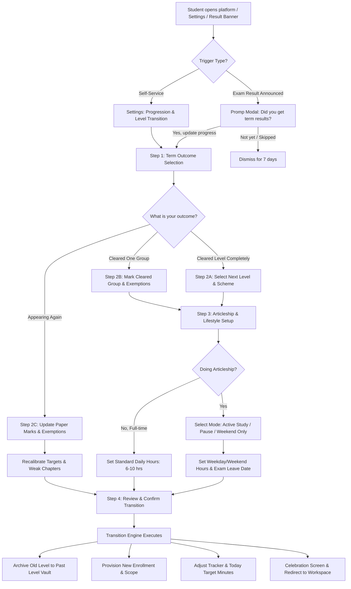

# PRD: F-18 Level Transition and Student Progression Engine

| Field | Value |
| --- | --- |
| Status | Draft (ready for review) |
| Owner | Product & Engineering |
| Last updated | 2026-10-19 |
| Source | User Request (Level Transition, Group Clearance, Paper Exemptions & Articleship Workflow); `docs/product/FEATURE_MAP.md` Section 4 & 6 |
| Linked ERD | `docs/product/erd/F-18-level-transition-and-student-progression.md` |
| Order | **Twenty-first** PRD/ERD, directly builds upon F-02 (Syllabus Coverage), F-16 (Personalization & Onboarding), F-01.2 (Tracker), and F-13 (Today Planner) |

---

## 1. Problem and goal

Commerce professional qualifications in India (ICAI Chartered Accountancy, ICMAI Cost and Management Accountancy, and ICSI Company Secretary) are demanding, multi-year journeys structured in sequential tiers:
- **CA:** Foundation $\rightarrow$ Intermediate (Group 1, Group 2) $\rightarrow$ Practical Training (Articleship) $\rightarrow$ Final (Group 1, Group 2)
- **CMA:** Foundation $\rightarrow$ Intermediate (Group 1, Group 2) $\rightarrow$ Practical Training $\rightarrow$ Final (Group 3, Group 4)
- **CS:** CSEET / Foundation $\rightarrow$ Executive (Module 1, Module 2) $\rightarrow$ Practical Training $\rightarrow$ Professional (Module 1, Module 2)

Each level is examined semi-annually (May/June and Nov/Dec). When term results are declared, a student's preparation landscape changes overnight based on their results:
1. **Full Level Pass:** A student clears both groups of Intermediate and graduates to Final.
2. **Partial Group Pass:** A student clears Group 1 (or Group 2), remaining in Intermediate but needing to focus 100% of their daily bandwidth on the pending group.
3. **Paper-Wise Exemptions (The 60+ Rule):** Under Institute regulations, scoring $\ge 60\%$ in a paper grants an exemption for subsequent terms. Even if the student failed the group overall, that paper does not need to be studied or tested again.
4. **Articleship / Practical Training Phase Shift:** Clearing Intermediate triggers mandatory 2 to 3-year practical training (Articleship) in audit/tax firms or corporate industry. Available daily study time drops from 8–10 hours/day (full-time student) to 2–3 hours/day (working articled assistant), demanding a completely recalibrated study strategy (e.g. single-group focus, weekend study blocks, or pausing study during peak audit seasons).
5. **Syllabus Scheme Migration:** When institutes update schemes (e.g. CMA 2016 to 2022 Scheme, CA Old 8-paper to New 6-paper Scheme), students carry forward equivalent credits and exemptions.

**The Failure of Generic Platforms:**
Generic ed-tech and LMS platforms force students to either create a brand-new account (destroying all their past notes, annotations, performance analytics, and bookmarks) or manually wade through clutter from cleared subjects. Furthermore, they continue to schedule 8 hours of daily tasks for students who just started articleship and can only spare 2 hours before office.

**Goal:**
Build an intelligent, empathetic **Level Transition and Student Progression Engine** that:
- Prompts students contextually upon term result declaration (or via manual self-service in Settings).
- Seamlessly guides them through an interactive, multi-step transition wizard: declaring full pass, group pass, or individual paper exemptions.
- Automatically archives completed level syllabus while seamlessly instantiating the new level's syllabus tree, study targets, and daily planner.
- Integrates an **Articleship Planner Mode** that recalibrates target hours, weekday/weekend splits, and exam leave periods.
- Preserves all previous notes, PDF annotations, and flashcards in a read-only **"Past Level Vault"**, allowing instant cross-referencing between Intermediate and Final provisions.
- Ensures all question banks (MCQs, PYQs, Mock Tests, Practice, Recall decks) strictly adhere to the student's active scoped level and remaining papers.

---

## 2. Users and scenarios

### Scenario 1: Aarav clears CMA Intermediate and transitions to Final while starting Articleship
Aarav has been using ArthaCommerce for 8 months for CMA Intermediate (2022 Scheme). In August, ICMAI announces term results and Aarav clears both Group 1 and Group 2. When he opens ArthaCommerce, a celebratory banner asks: *"Did you receive your June 2026 term results?"*. Aarav taps **"Update My Progress"**. 
He selects *"Cleared CMA Intermediate (Both Groups)"* and chooses his new destination: *"CMA Final, June 2027 attempt"*. The wizard asks: *"Are you doing practical training (Articleship)?"*. Aarav enters *"Yes, starting at BDO India"*, setting his available weekday study time to 2.5 hours/day (morning 6:30–9:00 AM) and weekends to 6 hours/day. 
Instantly, his workspace resets: his sidebar shows `CMA • Final (2022 Scheme)`, his syllabus displays Group 3 and Group 4 papers, his daily targets adapt to 150 minutes on weekdays, and his past Intermediate notes and bookmarked PYQs are safely stored in his **"Past Level Vault"** accessible via a single tap.

### Scenario 2: Priya clears CA Intermediate Group 1 and gets an exemption in Paper 7 (Direct Tax)
Priya sat for both groups of CA Intermediate. She cleared Group 1, but missed Group 2 aggregate. However, in Paper 7 (Direct Tax) she scored 68 marks, earning an official ICAI exemption. 
In the transition modal, Priya selects *"Partial Clearance / Exemption"*. She marks Group 1 as *"Cleared"*, marks Paper 7 Direct Tax as *"Exempted (60+ Marks, valid for 3 terms)"*, and leaves Papers 5 and 6 as *"Preparing for Nov 2026"*. 
Her ArthaCommerce workspace reconfigures: Group 1 is moved to completed history, Paper 7 Direct Tax displays an **"Exempted"** badge with 0 remaining study hours required, and her daily Today planner schedules practice and recall *only* for the 2 pending papers. Her coverage calculation dynamically reflects 100% on cleared/exempted papers while accurately projecting the target hours needed to pass the remaining papers.

### Scenario 3: Rohan is doing Articleship and chooses "Work-Focus Pause" before Final
Rohan cleared CA Intermediate 4 months ago and is working 11 hours a day at a Big 4 audit firm during statutory audit season. He knows he cannot realistically study right now and plans to write CA Final 1.5 years later. 
In the transition wizard, Rohan selects *"Articleship Active"*, and picks *"Study Strategy: Work-Focus Pause"*. He specifies his expected exam leave start date (4 months prior to his attempt). 
ArthaCommerce pauses his daily reminder nudges, freezes his streak penalty without shaming him, switches his home screen to a lightweight **"Keep Sharp"** mode (suggesting optional 10-minute micro-recall decks for transit), and schedules an automated check-in 30 days before his exam leave begins.

---

## 3. Success metrics

| Metric | Definition | Target | PostHog Event |
| --- | --- | --- | --- |
| **Transition Completion Rate** | % of prompted students who complete the transition wizard within 7 days of result declaration | $> 85\%$ | `progression_transition_completed` / `progression_prompt_shown` |
| **Time to Re-configured Workspace** | Median seconds taken to complete the level transition flow | $< 90\text{ s}$ | `progression_wizard_duration_ms` |
| **Articleship Mode Adoption** | % of students entering Intermediate/Final who configure Articleship study hours | $> 70\%$ of eligible | `progression_articleship_saved` |
| **Exemption Accuracy** | % of partial transitions recording at least one paper exemption with valid term limits | Track (est. 40%) | `progression_paper_result_saved` |
| **Vault Access Rate** | % of transitioned students who access their "Past Level Vault" notes within 30 days | $> 45\%$ | `vault_past_level_viewed` |
| **Plan Realism Retention** | Day-30 study tracker retention of students on Articleship mode vs generic 8-hr targets | $+40\%$ relative retention | PostHog cohort comparison |

---

## 4. Scope

### In scope (This release — Phase 1 & 2)
1. **Result & Term Transition Wizard (`/app/transition`):**
   - Result declaration prompt (post-exam term modal & dashboard banner).
   - Four distinct progression branches:
     - Full Level Clearance $\rightarrow$ Next Level Enrollment.
     - Group-wise Clearance $\rightarrow$ Single Group Focus.
     - Paper-wise Exemptions $\rightarrow$ 60+ Marks carry-forward tracking.
     - Repeat Attempt $\rightarrow$ Syllabus Reset & Diagnostic Review.
2. **Articleship / Practical Training Mode:**
   - Articleship status capture (active firm, start date, target attempt).
   - Dynamic schedule configuration: Weekday vs Weekend study split (e.g. 2 hrs weekday / 6 hrs weekend).
   - Study strategy modes: `active_study`, `weekend_only`, `work_focus_pause`, `exam_leave_intensive`.
   - Planned exam leave calendar integration (auto-switches daily target hours when leave begins).
3. **Cross-Module Syllabus Scoping & Isolation:**
   - Automatic archiving of prior level enrollment (`status = 'archived'`).
   - Creation of new active enrollment in `coverage_enrollment` with the new level's scheme.
   - Immediate cascading filter to all modules:
     - Question Bank (`/app/questions`)
     - MCQ Bank (`/app/mcqs`)
     - Previous Year Questions (`/app/pyqs`)
     - Flashcards / Recall Decks (`/app/recall`)
     - Daily Tracker & Today Planner (`/app/today`)
4. **"Past Level Vault" (`/app/vault`):**
   - Read-only preservation of all notes, PDF markup/drawings, and summaries from previous levels.
   - Cross-referencing search allowing students in Final to find their Intermediate notes on shared subjects (e.g. Income Tax, GST, Company Law).
5. **Progress History Ledger & Exemption Tracker:**
   - Persistent audit log of student attempts, marks obtained, exemptions granted, and exemption expiry terms.

### Out of scope (Later phases)
- Direct Institute portal credential scraping for marksheet auto-import (blocked by CAPTCHA, privacy, and security risk; manual self-reporting or PDF marksheet upload with OCR in Phase 3).
- Mentorship/Firm verification where articleship principals sign off on study hours (Phase 4).
- Formal multi-student study pods during articleship (Phase 4).

---

## 5. User flows

### 5.1 Main Progression & Transition Flowchart



### 5.2 Edge Cases and System States
- **Edge Case 1: Exemption Expiry (3-Term Rule):** When a student has carried forward an exemption for 3 terms without clearing the group, the system notifies the student on term 4 that the exemption has lapsed (under 2016 scheme) or requires 50% passing aggregate (under 2024 scheme).
- **Edge Case 2: Mid-Level Scheme Transition (e.g. CMA 2016 to 2022 Scheme):** If the student transitions across schemes, the engine executes a rule-based paper mapping (e.g., Paper 7 $\rightarrow$ Paper 7 credit) and marks only the non-equivalent papers as pending.
- **Edge Case 3: Offline Transition Submission:** If the student completes the transition wizard while offline, the payload is persisted in the indexedDB offline queue and synced upon reconnection with optimistic UI update.
- **Edge Case 4: Accidental Transition / Rollback:** The student can undo a transition within 48 hours from Settings (`/app/settings/progression/history`) with full restoration of prior active status.

---

## 6. Functional requirements

| ID | Requirement | Priority | Acceptance criteria |
| --- | --- | --- | --- |
| **FR-PRG-01** | **Result Declaration Prompt** | P0 | **Given** an active student whose enrolled exam term has passed and result date is reached, **When** they visit any `/app/*` screen, **Then** show an unobtrusive dismissible modal and top banner prompting them to update term results. |
| **FR-PRG-02** | **Full Level Graduation** | P0 | **Given** a student clearing all papers of a level (e.g. CMA Inter), **When** they select "Cleared Level", **Then** prompt for target level (CMA Final), archive the Inter enrollment, create the Final enrollment, and reset workspace scope. |
| **FR-PRG-03** | **Group-Wise Clearance** | P0 | **Given** a multi-group course level, **When** a student marks Group 1 as cleared, **Then** mark all Group 1 subjects as 100% completed, exclude them from daily tasks, and restrict active syllabus to Group 2. |
| **FR-PRG-04** | **Paper Exemption Tracking** | P0 | **Given** a student with $\ge 60$ marks in a specific paper, **When** they mark the paper as "Exempted", **Then** record exemption term, compute validity term, set paper status to `exempted`, and exclude it from remaining study targets. |
| **FR-PRG-05** | **Articleship Profile & Hours** | P0 | **Given** a student entering or doing articleship, **When** they configure articleship mode, **Then** allow setting distinct weekday hours (default 2 hrs) and weekend hours (default 6 hrs), updating tracker goals. |
| **FR-PRG-06** | **Articleship Pause Mode** | P0 | **Given** a student on intense office training, **When** they choose "Work-Focus Pause", **Then** pause daily overdue task alerts, freeze streak penalties, and offer micro-recall suggestions. |
| **FR-PRG-07** | **Exam Leave Mode** | P1 | **Given** a student with a configured exam leave start date, **When** that calendar date arrives, **Then** automatically ramp daily target hours to full-time mode (e.g. 8 hrs/day) and notify the student. |
| **FR-PRG-08** | **Past Level Vault** | P0 | **Given** an archived level enrollment, **When** the student navigates to `/app/vault`, **Then** provide full read-only access to all past notes, PDF annotations, and bookmarked questions. |
| **FR-PRG-09** | **Cross-Level Note Search** | P1 | **Given** a student studying a Final subject, **When** they search notes in the note editor, **Then** offer a toggle to "Search Past Level Vault" for cross-referencing Intermediate provisions. |
| **FR-PRG-10** | **Rollback Transition** | P1 | **Given** an accidental transition, **When** requested within 48 hours, **Then** revert target enrollment to draft and re-activate the archived prior enrollment. |

---

## 7. Screens and URLs

| Screen | URL | Components Used | Notes |
| --- | --- | --- | --- |
| **Progression Wizard** | `/app/transition` | `StepFlow`, `Card`, `Badge`, `RadioGroup`, `NumberStepper`, `SwitchRow` | 4-step wizard: Outcome $\rightarrow$ Target Level/Group $\rightarrow$ Articleship $\rightarrow$ Review |
| **Progression Settings** | `/app/settings/progression` | `PageHeader`, `Accordion`, `Table`, `Button`, `Dialog` | Overview of cleared papers, active exemptions, articleship status, and transition history |
| **Articleship Planner** | `/app/settings/articleship` | `Card`, `DurationField`, `DatePicker`, `Select` | Update firm details, weekly schedule, weekday/weekend hours, and exam leave dates |
| **Past Level Vault** | `/app/vault` | `PageHeader`, `Tabs`, `DocumentCard`, `NotesList`, `EmptyState` | Browse archived levels, read notes, search annotations, inspect old exam analytics |
| **Result Modal** | Floating Modal | `Dialog`, `Badge`, `Sparkles`, `Button` | Contextual prompt triggered upon result announcement date |

---

## 8. Data and permissions

- **Module Ownership:** Owned by `apps/api/modules/progression`. Interacts with `coverage` via `coverage_enrollment` service and `profiles` via `auth.users.id`.
- **Read/Write Access:** 
  - Authenticated students have full read/write access to their own progression, paper results, and articleship settings.
  - No access across student accounts.
- **Privacy & Retention (DPDP Act 2023):**
  - Marks and exemption details are private personal educational data.
  - Exportable via account data export (`register_exporter`).
  - Erasable on account deletion request (`register_eraser`).

---

## 9. API surface

### 9.1 `GET /api/v1/progression/status/`
Returns current level status, cleared groups, active exemptions, and articleship configuration.
```json
{
  "active_enrollment": {
    "id": "c1f7b8d0-...",
    "course_code": "cma",
    "level_code": "intermediate",
    "scheme_year": 2022,
    "term_name": "June 2026"
  },
  "articleship": {
    "is_active": true,
    "mode": "active_study",
    "firm_name": "BDO India",
    "weekday_minutes": 150,
    "weekend_minutes": 360,
    "exam_leave_date": "2027-02-01"
  },
  "exemptions": [
    {
      "subject_key": "cma-inter-paper-7",
      "subject_name": "Direct and Indirect Taxation",
      "marks": 68,
      "granted_term": "June 2026",
      "valid_until_term": "December 2027",
      "is_valid": true
    }
  ],
  "available_transitions": [
    { "type": "level_up", "target_level": "final", "label": "Promote to CMA Final" },
    { "type": "group_focus", "target_group": "group_2", "label": "Focus on CMA Intermediate Group 2" }
  ]
}
```

### 9.2 `POST /api/v1/progression/transition/`
Executes a level transition or group reconfiguration.
```json
// Request:
{
  "transition_type": "full_level_pass",
  "target_course_code": "cma",
  "target_level_code": "final",
  "target_term_code": "june_2027",
  "paper_results": [
    { "subject_key": "cma-inter-p5", "status": "passed", "marks": 58 },
    { "subject_key": "cma-inter-p6", "status": "passed", "marks": 62 },
    { "subject_key": "cma-inter-p7", "status": "passed", "marks": 71 },
    { "subject_key": "cma-inter-p8", "status": "passed", "marks": 54 }
  ],
  "articleship": {
    "is_active": true,
    "mode": "active_study",
    "firm_name": "KPMG",
    "weekday_minutes": 150,
    "weekend_minutes": 360,
    "exam_leave_date": "2027-03-01"
  }
}

// Response: HTTP 201 Created
{
  "transition_id": "9a8b7c6d-...",
  "status": "applied",
  "new_enrollment_id": "e2f1a0b3-...",
  "vault_archived_enrollment_id": "c1f7b8d0-...",
  "message": "Congratulations on clearing CMA Intermediate! Welcome to CMA Final."
}
```

### 9.3 `POST /api/v1/progression/transition/rollback/`
Rolls back a transition if triggered within 48 hours.

---

## 10. Notifications and analytics events

- `progression_prompt_shown`: Triggered when term result modal is displayed.
- `progression_wizard_started`: When student enters `/app/transition`.
- `progression_step_completed`: Emitted at each step (`outcome`, `exemption`, `articleship`).
- `progression_transition_completed`: Emitted upon successful execution with payload `{ from_level, to_level, transition_type, articleship_active }`.
- `progression_articleship_updated`: Emitted when weekday/weekend study hours are adjusted.
- `vault_past_level_viewed`: Emitted when student opens archived notes or questions in the Vault.

---

## 11. Non-functional requirements

- **Idempotency & Atomic Transactions:** Level archiving and new enrollment creation must occur in a single atomic database transaction (`transaction.atomic`). Failure at any step cleanly rolls back.
- **Sub-100ms API Response:** Transition submission must execute in $<100\text{ ms}$, ensuring snappy user experience before firing celebration animations.
- **Offline Capability:** The transition wizard caches answers locally; if connectivity is interrupted during submission, it automatically retries with exponential backoff.
- **Strict Data Isolation:** Scoping must guarantee that once transitioned, active endpoints (`/questions/`, `/mcqs/`, `/pyqs/`) reject or filter any requests targeting non-enrolled levels.

---

## 12. Risks and open questions

1. **Exemption Verification:** Students manually enter exemption marks. In Phase 1, we trust self-reported marks since they only affect personal study schedules. In Phase 3, we can introduce optional marksheet OCR verification for community badges.
2. **Multiple Group Combinations:** In CMA Final and CA Final, students can write Group 3 or Group 4 first, or both together. The wizard must support arbitrary group selections, not just sequential order.
3. **Articleship Overtime Spikes:** During statutory audit or tax filing deadlines (e.g. July & September in India), articled assistants often work 14 hours a day. We provide a **"Crunch Week Snooze"** feature so students don't feel discouraged by missed daily goals.

---

## 13. Rollout plan

- **Phase 1 (Backend Core):** Create `progression` Django module, migration models, serializers, services, and atomic transition pipeline.
- **Phase 2 (Frontend Wizard & Scoping):** Implement `/app/transition`, Articleship settings, Past Level Vault screen, and scoping enforcement.
- **Phase 3 (Result Day Triggers):** Automated result date notification engine based on official Institute calendars.
